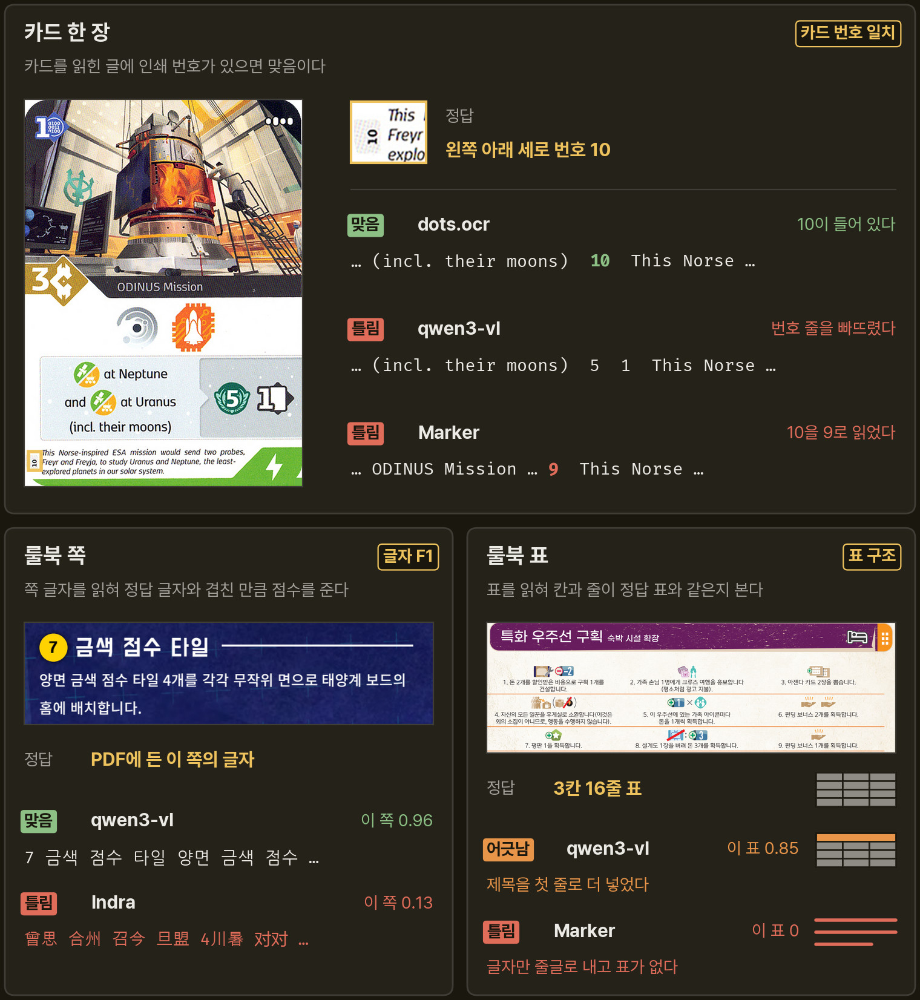
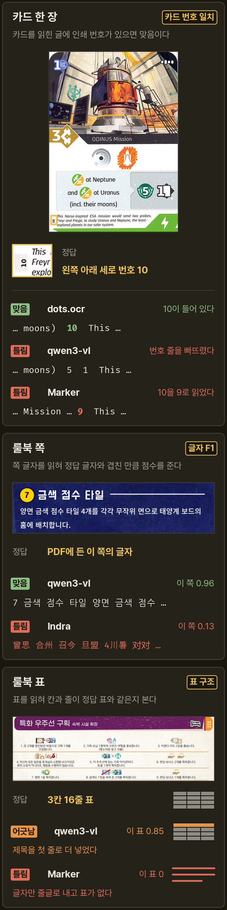

## 측정 방법

후보마다 같은 카드 사진과 룰북 쪽을 읽히고, 낸 글자를 정답과 견줘 맞음과 틀림을 가린다. 아래 그림의 사진과 출력은 실제 측정에서 나온 것이다.

- **SETI, WC**: 카드 한 장마다 인쇄 번호가 출력에 들어 있으면 맞음이고, SETI 100장과 WC 50장 중 맞은 카드의 비율이다.
- **한글, 영문**: 한국어 룰북 12쪽과 영어 룰북 15쪽에서 출력 글자가 PDF 글자와 얼마나 겹치는지 쪽마다 매긴 점수의 평균이다. 읽는 순서는 보지 않는다.
- **TEDS**: 실제 룰북 표 3쪽에서 출력 표의 칸과 줄 구조가 정답 표와 얼마나 같은지 매긴 점수다. 표를 내지 않으면 0이다.
- **쪽당 초**: 모델 적재 시간을 뺀 룰북 27쪽 처리 시간의 중앙값이다.
- **평균**: 정확도 다섯 열의 단순 평균이다. PaddleOCR은 표 칸에 같은 회사의 표 인식기 PP-StructureV3 값을 넣었다.
