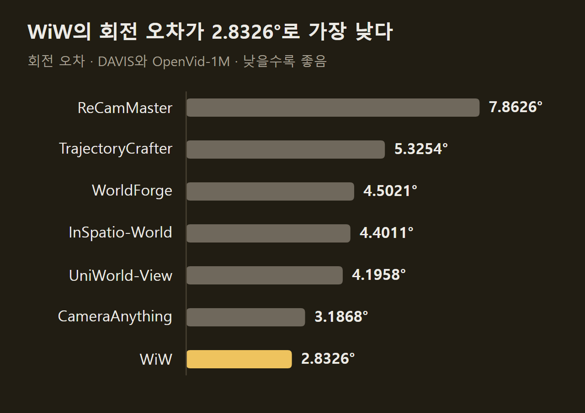
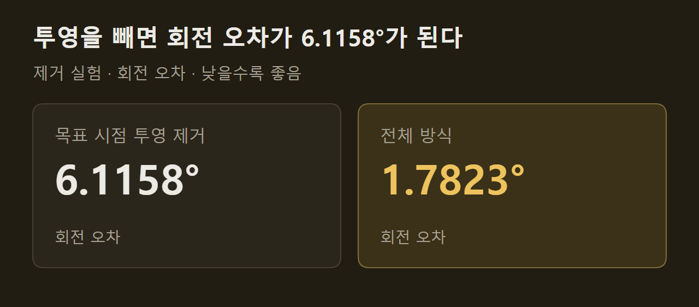

> 이 글은 아래 원문을 우리말로 간추려 정리한 글입니다. 정확한 내용은 원문을 확인하십시오.
>
> 원문: [arxiv.org/abs/2609.11548](https://arxiv.org/abs/2609.11548)  
> 원문을 소개한 뉴스레터: Turing Post

춤추는 두 사람을 정면에서 찍은 영상이 한 편 있다고 하자. 같은 순간을 옆이나 뒤에서 다시 보려면 그 시점에서 보이는 장면을 새로 만들어야 하는데, 지금까지는 카메라 제어, 원본 영상 다시 보기, 장기 기억 같은 기능마다 전용 모듈을 따로 학습시키는 방식이 많았다. Westlake AGI Lab은 모델을 전혀 학습시키지 않고 이 일을 하는 [World in World](https://arxiv.org/abs/2609.11548)(이하 WiW)를 내놓았다. 원본 영상과 원하는 카메라 경로를 넣으면, 사건의 모습과 시간 진행은 그대로 둔 채 그 경로에서 본 영상을 생성하는 인터페이스다.

```요약
요약: WiW는 파라미터를 고정한 비디오 월드 모델의 셀프 어텐션에 여러 시각 증거를 같은 형식으로 넣어 카메라 제어 재렌더링을 수행하며, DAVIS와 OpenVid-1M 평가에서 비교한 7개 방식 가운데 VBench 평균 점수가 가장 높고 카메라 궤적 오차가 가장 낮았다.
```

```용어
비디오 월드 모델: 처음 관찰한 장면과 요청받은 카메라·동작을 받아, 그 환경을 돌아다닐 때 보일 영상을 이어서 예측하는 모델이다. 이 기사에서는 공개된 LingBot-World 2.0이 바탕 모델로 쓰인다.
셀프 어텐션: 모델이 지금 만드는 부분에서 이미 가진 정보 가운데 어디를 참고할지 정하는 연산이다. WiW는 이 경로에 바깥 정보를 끼워 넣는다.
K/V: 어텐션에서 참고 대상이 되는 키와 값 특징이다. 미리 계산해 캐시에 넣어 두면 생성 중인 부분이 질의를 보내 읽어 간다.
시각 증거: 원본 영상, 투영한 장면, 렌더링한 형상, 과거 생성 결과처럼 생성을 이끄는 데 쓰는 시각 정보다. WiW는 이것들을 모두 카메라와 시간 정보가 붙은 깨끗한 시각 상태로 바꾼다.
재렌더링: 이미 찍힌 영상을 다른 카메라 경로에서 본 영상으로 다시 만드는 작업이다. 논문의 주된 평가 과제다.
```

## 1. 풀려는 문제

비디오 월드 모델은 정해진 길이의 영상 한 편을 만들고 끝나지 않고, 관찰했거나 스스로 생성한 장면을 바탕으로 다음 장면을 계속 예측한다. 사용자는 생성이 이어지는 동안 카메라 위치와 방향을 바꿀 수 있다. 연구진이 던진 질문은 이렇게 미리 학습된 큰 모델의 제어 능력을 재학습 없이 넓힐 수 있느냐였다.

제어를 넓히려면 성격이 다른 정보를 함께 써야 한다. 시점이 크게 바뀌면 원본에 찍히지 않은 면을 모델이 채워야 하고, 카메라가 한참 뒤에 같은 자리로 돌아오면 예전에 만든 모습과 배치를 되살려야 한다. 기존 방식은 카메라 조건, 원본 영상, 기하 정보, 장기 기억마다 전용 경로를 두었기 때문에 새 종류의 정보를 더하거나 조합하려면 설계를 고치거나 추가로 학습해야 했다.

연구진이 주목한 곳은 모델이 원래 갖고 있는 셀프 어텐션이다. 인과적 비디오 월드 모델은 자기회귀 생성 중에 첫 관찰과 방금 확정한 출력을 노이즈가 없는 깨끗한 시각 상태로 읽고, 카메라·시간 인코딩으로 그 상태의 시점과 시각을 구분한다. 그렇다면 바깥에서 주는 제어 정보도 같은 형식으로 바꿔 주면 모델을 고치지 않고 읽힐 수 있다. ==제어 확장을 모델 적응이 아니라 시각 증거를 만들고 배치하는 문제로 바꾼 셈이다.==

")

## 2. 네 가지 시각 증거와 공통 형식

WiW는 증거마다 가장 믿을 만하게 줄 수 있는 정보만 맡긴다. 논문이 구성한 증거는 네 가지다.

1. 원본 영상 관찰: 촬영된 사건의 모습과 내용을 참조하게 한다.
2. 목표 시점 장면 투영: DepthCrafter로 깊이를 추정해 원본 화소를 3차원으로 올린 뒤 목표 카메라에서 다시 투영해, 관찰된 내용이 새 화면의 어디에 놓여야 하는지 알려 준다.
3. 렌더링한 형상: 원본에 없던 피사체의 면이 드러날 때 그 시각의 형태와 모습을 제안한다.
4. 검색한 생성 이력: 캐시에서 밀려난 과거 생성 상태를 보관해 두었다가 카메라가 돌아오면 꺼내 준다.

투영은 원본에 보인 부분만 다룰 수 있고, 가려짐과 깊이 오차의 영향을 받는다. 그래서 가시성과 기하 신뢰도로 토큰마다 지원 가중치를 매겨 불확실한 영역의 영향을 줄인다. 피사체가 사람이면 가려짐이 적은 전신 장면에서 LHM++로 아바타를 복원하고 프레임별 SMPL-X 파라미터로 움직여, 보이지 않던 면까지 목표 시점에서 렌더링한다.

생성 이력이 필요한 까닭은 기본 캐시가 최근 상태만 남기기 때문이다. WiW는 밀려나는 상태의 층별 K/V를 카메라 자세, 시간 인덱스와 함께 보관하고, 목표 시점의 표면을 얼마나 덮는지와 보는 방향이 얼마나 맞는지로 순위를 매긴 뒤 서로 겹치지 않는 상위 몇 개만 골라 쓴다.

네 증거는 모두 같은 절차를 거친다. 증거를 카메라·시간 정보와 함께 고정된 모델에 한 번 통과시켜 각 어텐션 층의 K/V를 뽑아 캐시에 넣으면, 생성 중인 청크의 질의가 이를 읽는다. 모델의 기본 블록은 잠재 프레임 상태 18칸을 유지하는데, 원본 기준 6칸과 최근 이력 8칸, 현재 청크 4칸으로 이루어진다. 원본 영상 증거는 원본 기준 칸에 들어가고, 나머지 증거는 임시 보조 블록으로 붙었다가 청크가 확정되면 제거된다.

")

## 3. 읽을 위치와 반영 강도의 조절

증거를 읽을 수 있게 해 두어도 질의가 그 안에서 맞는 위치를 찾는다는 보장은 없다. 시점이 바뀌면 같은 표면도 다르게 보이고, 반복되는 무늬는 서로 다른 위치를 비슷해 보이게 만들어서 겉모습에 기댄 어텐션이 흔들린다. 연구진은 어디를 읽을지와 얼마나 강하게 쓸지를 나누어 다룬다.

어디를 읽을지는 대응 기반 어텐션 라우팅(CGAR)이 맡는다. 원본 영상에서 같은 점을 계속 추적하고 깊이와 카메라 정보를 더해, 현재 화면의 토큰과 원본 영상의 토큰을 기하학적으로 짝짓는다. 짝이 맞는 질의와 키에는 대응 가중치의 로그를 어텐션 점수에 더해, 질의가 해당 위치로 향하게 한다.

얼마나 강하게 쓸지는 증거별 어텐션 CFG(EWA)가 정한다. 같은 층의 같은 질의를 놓고 기본 블록만 본 응답과 증거를 함께 본 응답을 비교하는 방식이다. 증거가 들어간 응답을 통째로 키우면 모델이 원래 내던 방향까지 같이 커지므로, 기본 응답 방향의 성분을 빼고 남은 보완 성분만 두 응답의 코사인 유사도와 증거별 강도 값에 따라 키운다. 결과의 크기는 기본 응답의 크기를 기준으로 제한한다.

==EWA는 같은 디노이징 순전파의 어텐션 출력을 다시 쓰므로 신경망 평가 횟수가 늘지 않는다.== 증거마다 디노이징 신경망 전체를 따로 돌리지 않는다는 뜻이다.

## 4. 카메라 제어 재렌더링 평가

실험은 LingBot-World 2.0의 공개 causal-fast 체크포인트에 WiW를 붙이고 모든 파라미터를 고정한 상태로 진행했다. DAVIS와 OpenVid-1M에서 고른 영상으로 ReCamMaster, TrajectoryCrafter, WorldForge, InSpatio-World, UniWorld-View, CameraAnything 여섯 방식과 비교했으며, 모든 방식에 같은 원본 영상과 같은 목표 카메라 경로를 주었다. 비교 방식은 공식 구현과 권장 설정을 따랐으므로 프레임 수가 서로 다르고, 평가 전에 카메라 각도와 프레임 수를 맞추었다.

카메라 추종 정확도는 생성된 영상에서 Depth Anything 3와 ViPE로 각각 궤적을 추정해 목표 궤적과 비교하고, 두 추정기의 오차를 평균해 구했다. WiW의 회전 오차는 2.8326°로 가장 낮았고, 이동 오차도 0.068622로 UniWorld-View의 0.068705보다 조금 낮았다.



영상 품질은 VBench의 일곱 항목으로 쟀다. 일곱 항목의 평균은 WiW가 85.192로 가장 높고 UniWorld-View가 84.295로 뒤를 이었다. 항목별로 보면 미적 품질 56.556, 화질 68.004, 움직임 부드러움 97.749, 피사체 일관성 88.948, 배경 일관성 92.627이 가장 높았고, 움직임 정도 98.750은 TrajectoryCrafter와 같았다. 다만 시간적 깜빡임 항목은 93.711로 ReCamMaster의 95.178보다 낮다.

이미지 충실도에서도 WiW가 PSNR 23.1511, SSIM 0.787205로 가장 높았다. LPIPS는 0.121664로 UniWorld-View의 0.121668과 거의 같았다.

논문은 카메라 움직임이 다른 다섯 사례의 출력도 나란히 보여 준다. 맨 윗줄이 입력 영상과 목표 카메라 경로이고, 그 아래로 비교 방식 여섯 개가 놓이며 맨 아랫줄이 WiW다. 카메라 움직임은 왼쪽부터 반시계 방향 궤도, 오른쪽 회전, 아래 회전, 오른쪽 이동, 전진이다.

")

## 5. 구성 요소 제거 실험

연구진은 구성 요소를 하나씩 뺀 변형을 만들어 각각의 기여를 확인했다. 전체 방식은 카메라 오차가 가장 낮았고, 보고한 VBench 다섯 항목에서 모두 가장 높거나 공동 최고였다. 이 표의 전체 방식 수치는 앞 절 비교표의 수치와 다른데, 두 실험의 조건이 어떻게 다른지는 자료에 없다.

가장 크게 나빠진 변형은 목표 시점 투영을 뺀 경우다. 회전 오차가 1.7823°에서 6.1158°로, 이동 오차가 0.053291에서 0.581847로 올랐고, 피사체 일관성도 88.076에서 83.378로 내려갔다. ==관찰된 내용이 새 화면의 어디에 놓일지를 알려 주는 기준이 카메라 제어를 좌우한다.==



나머지 변형의 차이는 이보다 작다. 원본 카메라 정보를 플뤼커 좌표로 넣는 조건을 빼면 회전 오차가 1.8811°가 되고, CGAR와 EWA를 둘 다 빼면 2.0346°, EWA만 빼면 1.9944°가 된다. CGAR만 뺀 경우는 1.7828°로 전체 방식과 거의 같다. 논문은 CGAR와 EWA가 피사체의 모습과 배경 구조를 지키는 데 도움이 되고, 렌더링한 형상과 이력 검색은 새로 드러난 피사체의 면과 캐시 밖으로 밀려난 과거 장면이라는 두 빈틈을 메운다고 설명한다.

## 6. 재렌더링 밖의 작업

같은 인터페이스는 다른 제어에도 쓰인다. 증거가 무엇이든 같은 어텐션 경로로 들어가고, 카메라와 시간 정보가 그 증거와 요청한 출력의 관계를 정해 주기 때문이다. 논문이 그림으로 보인 사례는 다섯 가지다.

1. 불릿 타임: 특정 프레임에서 시간을 멈춘 채 카메라만 움직인다.
2. 영상 안정화: 흔들리는 원본 카메라 경로를 매끄러운 목표 경로로 바꾼다.
3. 영상 편집: 낙타에 안장을 더하거나 소를 얼룩말로 바꾼다.
4. K/V 공유: 한쪽이 캐시한 K/V를 다른 쪽에 시각 증거로 넘겨 생성을 이끈다.
5. 사람 동작 전이와 카메라 재설정: 다른 영상의 동작을 대상 영상의 인물에게 옮긴다.

K/V 공유 사례에서 모델 A와 모델 B는 서로 다른 모델이 아니라 같은 고정 모델의 두 인스턴스이고, 각각 다른 생성 사례에 해당한다. 논문은 이 사례들을 작업별 학습 없이 바탕 모델을 고정한 채 수행했다고 밝혔으며, 재렌더링과 달리 이 응용들의 정량 평가는 자료에 없다.

")

## 출처와 작성 방식

- 원문: [arxiv.org/abs/2609.11548](https://arxiv.org/abs/2609.11548)
- 원문을 소개한 뉴스레터: Turing Post
- 그림: 아래에 출처가 적힌 그림은 원문에 실린 그림을 인용한 것이며 저작권은 원저작자에게 있습니다. 출처가 없는 그래프는 원문에 적힌 값으로 직접 그린 것입니다.
- 작성 방식: 직접 만든 뉴스 정리 파이프라인(VISER)으로 생성하고 검수한 글입니다. 본문의 수치와 주장은 원문에서 가져온 것입니다.
- 정리 주차: 2026-W38
