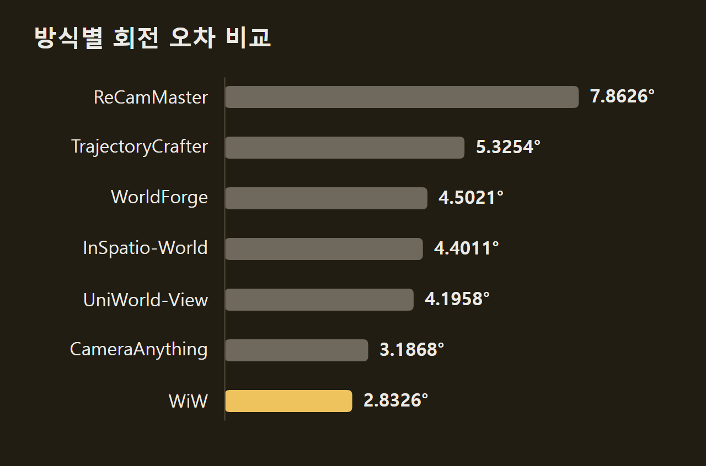

> 이 글은 아래 원문을 우리말로 간추려 정리한 글입니다. 정확한 내용은 원문을 확인하십시오.
>
> 원문: [arxiv.org/abs/2609.11548](https://arxiv.org/abs/2609.11548)  
> 원문을 소개한 뉴스레터: Turing Post

비디오 월드 모델은 처음 화면과 카메라 이동 지시를 받아 다음 화면을 계속 이어서 만든다. 이 때문에 사용자는 생성 도중에도 시점과 방향을 바꿀 수 있다. 다만 이런 모델이 카메라 경로나 원본 영상 같은 새 제어 정보를 받으려면 지금까지는 제어마다 전용 모듈을 붙이고 다시 학습해야 했다. Westlake AGI Lab 연구진이 내놓은 [World in World](https://arxiv.org/abs/2609.11548)(WiW)는 녹화된 영상 한 편과 원하는 카메라 경로를 넣으면, 이미 학습된 월드 모델의 매개변수를 하나도 바꾸지 않고 같은 사건을 새 시점에서 다시 찍은 영상을 만드는 방법이다.

```요약
요약: World in World는 학습을 마친 비디오 월드 모델을 고치지 않고 원본 영상, 기하 정보, 생성 기록을 시각 증거로 바꿔 읽히는 방법이며, DAVIS와 OpenVid-1M 영상으로 한 카메라 재렌더링 평가에서 기존 6개 방식보다 VBench 평균 점수가 높고 카메라 궤적 오차가 낮았다.
```

```용어
비디오 월드 모델: 처음 화면과 카메라·행동 지시를 받아 관찰자가 이동하며 볼 다음 화면을 이어서 예측하는 영상 생성 모델이다. 이 실험에서는 LingBot-World 2.0이 이 역할을 한다.
셀프 어텐션: 지금 만드는 화면 토큰이 다른 토큰 가운데 어디를 얼마나 참고할지 계산하는 모델 내부 연산이다. WiW는 외부 정보를 이 연산으로 들여보낸다.
깨끗한 시각 상태: 잡음 제거를 마쳐 확정된 화면 정보이다. 모델은 생성 중에 처음 화면과 최근에 확정한 출력을 이 형태로 읽는다.
K/V: 어텐션에서 참고 대상이 되는 토큰의 키(key)와 값(value) 특징이다. WiW는 증거마다 이것을 미리 계산해 저장해 둔다.
롤링 캐시: 최근에 확정한 상태를 정해진 개수만큼만 남겨 두는 저장 공간이다. 오래된 상태는 밀려나서 모델이 더는 읽지 못한다.
```

## 1. 녹화된 영상 속 세계를 다시 보는 과제

연구진이 다룬 과제는 녹화된 영상 속 사건을 원래와 다른 카메라 경로로 다시 보는 일이다. 이 작업을 카메라 제어 재렌더링(rerendering)이라 부르는데, 새 영상은 원본의 겉모습과 사건 진행을 지키면서도 요청한 시점에서 본 모습이어야 한다. 예를 들어 두 사람이 춤추는 영상을 받아 그 주위를 한 바퀴 도는 카메라로 다시 찍은 영상을 만든다.

이 과제를 풀려면 성격이 다른 정보를 함께 써야 한다. 시점이 크게 바뀌면 원본에 없던 면을 모델이 그럴듯하게 채워야 하고, 앞서 지나간 곳으로 카메라가 돌아오면 그때의 모습과 배치를 되살려야 한다. 그런데 기존 방법은 제어마다 전용 경로나 표현을 쓰므로, 새 증거나 증거의 조합을 받으려면 구조를 다시 짜거나 추가로 학습해야 했다.

다음 그림의 왼쪽은 원본 영상이고, 가운데는 장면 안에서 카메라를 옮겨 본 시점들이다. 오른쪽에는 안쪽을 향해 360도 도는 시점, 바깥쪽을 향해 360도 도는 시점, 자유 탐색으로 만든 영상이 놓여 있다. 아래 줄에는 연구진이 세운 네 목표가 적혀 있는데, 원하는 시점으로 탐색하기, 원본 사건과 맞게 생성하기, 원본 밖 영역을 그럴듯하게 채우기, 다시 찾은 장면을 앞서와 같게 유지하기다.

")

## 2. 제어 정보를 시각 상태로 바꾸는 구조

WiW는 인과적(causal) 비디오 월드 모델에 시각 정보를 읽는 경로가 이미 있다는 데서 출발한다. 인과적 모델은 앞서 만든 화면만 보고 다음 구간을 차례로 만든다. 이때 처음 화면과 최근 확정 출력을 셀프 어텐션으로 읽고, 카메라·시간 인코딩으로 각 상태의 시점과 시간 위치를 구분한다. 따라서 외부 제어 정보도 카메라 자세와 사건 시각, 유효한 공간 영역이 붙은 깨끗한 시각 상태로 바꾸면 모델을 고치지 않고 그대로 읽힐 수 있다.

이 관찰에 따라 연구진은 월드 모델의 제어를 넓히는 일을 모델을 고쳐 맞추는 문제가 아니라 시각 증거를 만들고 배치하는 문제로 다뤘다. 증거마다 화면 내용, 프레임별 카메라 내부 값과 자세, 사건 시각, 토큰별 공간 지지 가중치, 잡음 제거 단계별 활성 여부를 함께 적는다. 그다음 이 상태를 고정된 모델에 한 번 통과시켜 층마다 키와 값을 뽑아 K/V로 저장해 두고, 현재 구간을 만들 때 읽힌다.

증거가 들어가는 자리는 두 가지다. 기본 블록은 백본이 원래 쓰던 18개 잠재 프레임 상태 칸으로, 원본 기준 상태 6칸, 최근 기록 8칸, 현재 구간 4칸으로 나뉘며 원본 영상 증거가 원본 기준 상태 칸을 차지한다. 반면 나머지 증거는 임시 보조 어텐션 블록으로 붙었다가 현재 구간이 확정되면 빠진다. 어느 블록이든 고정된 백본의 Q/K/V 투영과 원래의 텍스트·카메라 조건 경로를 그대로 쓴다.

증거와 현재 생성 상태 사이의 시간 관계는 회전 위치 임베딩(RoPE)의 시간 좌표로 정한다. 공간 지지 가중치는 증거 토큰의 정규화 전 어텐션 가중치에 곱해져 믿기 어려운 영역의 영향을 줄인다. 이와 달리 채널 활성 여부는 각 증거가 어느 잡음 제거 단계에 참여할지를 정한다.

다음 그림은 전체 처리 과정을 담았다. ①에서 원본 영상을 3D·4D 비전 모델로 분석하고, ②에서 점구름, 신체 대리 모형, 추적점을 목표 시점으로 옮겨 시각 증거를 만든다. ③은 원본 토큰과 현재 토큰을 잇는 추적 경로이고, ④는 고정된 월드 모델이 KV를 읽는 부분, ⑥은 EWA다. ⑤에는 생성 기록, 편집한 내용, 다른 모델의 KV처럼 더 붙일 수 있는 조건이 놓여 있다.

")

## 3. 네 가지 시각 증거가 맡는 역할

WiW는 증거마다 가장 믿을 만하게 줄 수 있는 정보만 맡긴다. 원본 영상 관찰은 녹화된 사건의 겉모습과 내용을 참고 자료로 주지만, 그 내용이 목표 카메라 화면의 어디에 놓여야 하는지는 정해 주지 않는다. 나머지 세 증거가 이 빈자리와 원본만으로는 채울 수 없는 영역을 맡는다.

**목표 시점 투영은 원본 화면을 요청한 시점의 배치로 옮긴다.** 연구진은 DepthCrafter로 원본 프레임의 깊이를 추정해 픽셀을 3차원으로 되돌린 뒤, 시간이 맞는 목표 카메라에서 다시 투영해 목표 시점의 색 영상, 보임 여부 마스크, 깊이를 얻었다. 가림이나 국소적인 기하 오차가 투영을 틀어지게 할 수 있으므로, 보임 여부와 기하 신뢰도로 토큰별 지지 가중치를 정해 불확실한 영역의 영향을 줄인다.

**렌더링한 기하는 원본에 없던 면을 채울 단서를 준다.** 카메라가 크게 움직여 원본에서 보이지 않던 피사체의 면이 드러나면, 투영만으로는 그 면의 모양과 색을 참고할 자료가 없다. 피사체가 사람이면 LHM++로 원본에서 선명하고 가림이 적은 전신 부분을 잘라 아바타를 복원하고, 프레임별 SMPL-X 매개변수로 그 자세를 움직여 목표 카메라에서 렌더링한다. SMPL-X 신체 모델에서 얻은 깊이로 피사체끼리의 가림을 판단하고, 이 깊이를 투영된 장면 깊이와 견주어 피사체 경계 근처의 미덥지 않은 배경 투영을 지운다.

**지난 생성 기록은 카메라가 돌아왔을 때의 모습을 되살린다.** 기본 롤링 캐시(rolling cache)는 최근 상태만 남기므로, 앞서 지나간 곳으로 카메라가 돌아올 즈음에는 그 상태가 이미 밀려나 있다. 이를 막으려고 WiW는 캐시에서 밀려나는 확정 상태마다 층별 K/V를 카메라 자세, 시간 위치와 함께 생성 전체 기간의 기록 저장소에 보관한다. 구간마다 목표 시점 표면을 얼마나 덮는지와 보는 방향이 얼마나 맞는지로 순위를 매기고, 서로 겹치지 않도록 상위 k개를 골라 임시 보조 블록으로 읽힌다.

## 4. CGAR과 EWA: 읽을 위치와 반영 강도

증거를 읽을 수 있게 해 두어도 모델이 그 안에서 맞는 위치를 찾는다는 보장은 없다. 시점이 바뀌거나 피사체가 움직이면 같은 표면의 겉모습이 달라지고, 반복되는 무늬는 서로 다른 위치를 비슷하게 보이게 하므로 겉모습에만 기대는 어텐션은 엉뚱한 곳을 읽을 수 있다. 그래서 연구진은 어디를 읽을지와 얼마나 강하게 쓸지를 따로 다뤘다.

**CGAR은 기하적 대응으로 읽을 위치를 잡는다.** 대응 기반 어텐션 라우팅(correspondence-guided attention routing, CGAR)은 원본 영상에서 고유 번호를 유지하는 점들을 추적하고, 깊이와 카메라 정보를 더해 현재 시점 토큰과 원본 토큰을 짝짓는다. 유효한 짝이 있는 토큰은 어텐션 점수에 대응 가중치의 로그 값을 더하고, 이 응답을 다른 블록의 응답과 함께 정규화한다. 그 결과 현재 토큰은 기하적으로 맞는 원본 위치를 더 많이 읽는다.

**EWA는 증거마다 반영 강도를 따로 조절한다.** 증거별 어텐션 CFG(evidence-wise attention CFG, EWA)는 조건이 있을 때와 없을 때의 출력 차이를 키우는 분류기 없는 가이던스(classifier-free guidance, CFG)와 NAG에서 착안했다. EWA는 같은 층, 같은 쿼리에 대해 기본 블록만 읽은 응답과 기본 블록과 증거를 함께 읽은 응답을 구한다. 이어서 뒤의 응답에서 앞 응답 방향의 성분을 빼고, 증거가 새로 더한 정보만 키운다.

키우는 폭은 두 응답의 코사인 유사도(음수면 0으로 둔다)와 증거마다 따로 정한 가이던스 강도로 정한다. 보정값을 모든 활성 블록의 응답에 더한 뒤에는 기본 응답의 크기를 기준으로 출력 크기에 상한을 두므로, 지나친 가이던스가 생성을 흐트러뜨리지 않는다. 또한 이 계산은 같은 잡음 제거 순전파에서 이미 나온 어텐션 출력을 다시 쓰므로, 가이던스 때문에 네트워크 함수 평가(network function evaluations, NFE) 횟수가 늘지 않는다.

## 5. 기존 6개 방식과의 재렌더링 비교

연구진은 LingBot-World 2.0의 공개 체크포인트 causal-fast에 WiW를 적용하고, 사전 학습 매개변수를 모두 고정한 채 실험했다. 평가 영상은 DAVIS와 OpenVid-1M에서 골랐고, 비교 대상은 ReCamMaster, TrajectoryCrafter, WorldForge, InSpatio-World, UniWorld-View, CameraAnything 6개 방식이다. 모든 방식에 같은 원본 영상과 연속된 목표 카메라 경로를 주고 각 방식의 공식 구현과 권장 설정을 썼다. ReCamMaster는 81프레임, TrajectoryCrafter는 49프레임처럼 출력 길이가 방식마다 달라서, 평가 전에 카메라 각도와 프레임 수를 맞췄다.

평가 지표는 세 종류다. 화질은 PSNR, SSIM, LPIPS로 쟀고, 영상 품질과 시간 일관성, 움직임 정도는 VBench의 7개 항목과 그 평균(Overall)으로 쟀다. 카메라 추종은 Depth Anything 3와 ViPE로 생성 영상의 카메라 궤적을 각각 추정해 목표 궤적과 견주고, 두 추정기의 이동 오차와 회전 오차를 평균해 냈다.

**WiW는 VBench 평균과 두 카메라 오차에서 가장 좋았다.** VBench 평균은 2위인 UniWorld-View의 84.295점보다 높은 85.192점이었고, 회전 오차는 다음으로 낮은 CameraAnything의 3.1868°보다 작은 2.8326°였다. 다만 이동 오차는 WiW 0.068622, UniWorld-View 0.068705로 차이가 거의 없었다. 시간 깜박임 항목에서는 오히려 ReCamMaster가 95.178점으로 WiW의 93.711점보다 높았다.



**화질 지표 세 개에서도 WiW가 가장 좋은 값을 냈다.** PSNR은 23.1511, SSIM은 0.787205로, 두 지표 모두 2위인 UniWorld-View(22.4735, 0.770554)보다 높았다. 반면 LPIPS는 WiW 0.121664, UniWorld-View 0.121668로 사실상 같았다.

다음 그림은 같은 목표 카메라 경로에서 방식별 출력을 견준 것이다. 맨 위 줄은 입력 영상과 카메라 경로이고, 다섯 예시에는 각각 반시계 방향 궤도 이동, 오른쪽 회전, 아래쪽 회전, 오른쪽 이동, 앞쪽 이동을 적용했다. 맨 아래 줄이 WiW의 결과다.

")

## 6. 구성 요소 제거 실험과 추가 응용

**목표 시점 투영을 빼면 성능이 가장 크게 떨어진다.** 구성 요소를 하나씩 뺀 절제 실험에서 이 변형은 모든 지표가 나빠졌고, 회전 오차는 전체 방법의 1.7823°에서 6.1158°로, 이동 오차는 0.053291에서 0.581847로 커졌다. 연구진은 관찰한 내용이 놓일 자리를 분명히 알려 주는 기준이 있어야 카메라를 정확히 따를 수 있다고 해석했다. 이 표의 전체 방법 값은 앞 비교 표의 값(2.8326°)과 다르며, 두 측정의 조건 차이는 자료에 없다.

다른 구성 요소의 효과는 이보다 작다. 원본 카메라 정보를 담은 Plücker 조건을 빼면 회전 오차가 1.8811°로 커졌고, CGAR과 EWA를 함께 빼면 2.0346°가 됐다. 반면 VBench 항목들의 차이는 0.1점 안팎에 그쳤다. 정성 비교에서 CGAR과 EWA는 피사체의 겉모습과 배경 구조를 지키는 데 쓰였고, 렌더링한 기하는 새로 드러난 피사체의 면을, 기록 검색은 롤링 캐시 밖으로 밀려난 이전 장면 상태를 보완했다.

같은 인터페이스는 재렌더링 밖의 작업에도 쓰인다. 연구진이 보인 예는 한 순간에 시간을 멈추고 카메라만 움직이는 불릿 타임(bullet time), 흔들리는 카메라 경로를 매끄러운 경로로 바꾸는 영상 안정화, 낙타에 안장을 얹거나 소를 얼룩말로 바꾸는 영상 편집, 다른 사람의 동작을 옮겨 오는 동작 전이다. 어느 작업이든 증거의 종류만 바뀌고, 고정된 백본과 어텐션 경로는 같다.

K/V 공유 예에서는 같은 고정 모델의 두 인스턴스가 서로 다른 생성 작업을 맡고, 한쪽이 저장한 K/V를 다른 쪽에 시각 증거로 넘긴다. 다음 그림 (d)의 왼쪽은 모델 B가 만든 결과이고, 가운데는 이 결과를 받지 않은 모델 A의 출력, 오른쪽은 받은 모델 A의 출력이다.

")

WiW는 원본 관찰, 목표 시점 투영, 렌더링한 기하, 생성 기록을 카메라와 시간이 붙은 깨끗한 시각 상태로 바꿔 고정된 백본이 셀프 어텐션으로 읽게 한다. 그 결과 DAVIS와 OpenVid-1M 평가에서 비교한 방식 가운데 VBench 7개 항목 평균이 가장 높고 카메라 궤적 오차가 가장 낮았다. 연구진은 시각 증거를 만들고 고르고 조절하는 것만으로 학습된 월드 모델의 능력을 넓혀, 주어진 영상 속 동적 세계를 탐색할 수 있다고 결론지었다.

## 출처와 작성 방식

- 원문: [arxiv.org/abs/2609.11548](https://arxiv.org/abs/2609.11548)
- 원문을 소개한 뉴스레터: Turing Post
- 그림: 아래에 출처가 적힌 그림은 원문에 실린 그림을 인용한 것이며 저작권은 원저작자에게 있습니다. 출처가 없는 그래프는 원문에 적힌 값으로 직접 그린 것입니다.
- 작성 방식: 직접 만든 뉴스 정리 파이프라인(VISER)으로 생성하고 검수한 글입니다. 본문의 수치와 주장은 원문에서 가져온 것입니다.
- 정리 주차: 2026-W38
