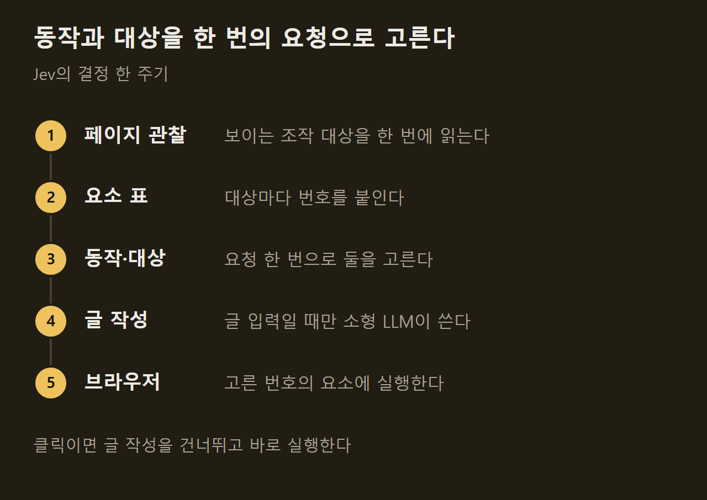
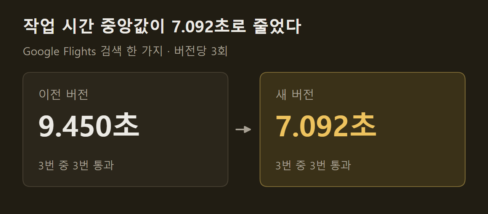

> 이 글은 아래 원문을 우리말로 간추려 정리한 글입니다. 정확한 내용은 원문을 확인하십시오.
>
> 원문: [github.com/browser-use/jev-ultrafast](https://github.com/browser-use/jev-ultrafast)  
> 원문을 소개한 뉴스레터: AlphaSignal

"취리히에서 런던으로 가는 편도 항공편을 찾아라"는 문장 하나를 주면, 프로그램이 Google Flights 화면에서 출발지와 도착지, 날짜를 직접 채우고 결과 목록이 뜰 때까지 진행한다. TypeSafe가 만들어 [Jev](https://github.com/browser-use/jev-ultrafast)라는 이름으로 browser-use 저장소에 공개한 브라우저 에이전트가 이 일을 7.1초에 끝냈다. Jev는 웹 주소와 자연어 목표 하나를 받으면, 화면의 버튼과 입력란에 번호를 붙여 읽고 무엇을 누르고 어디에 입력할지 번호로 골라 실행한다.

```요약
요약: Jev는 페이지를 번호 붙은 요소 표로 바꿔 동작과 대상을 한 번의 요청으로 고르는 브라우저 에이전트이고, Google Flights 검색 한 가지를 세 번씩 잰 비교에서 작업 시간 중앙값이 9.450초에서 7.092초로 줄었다.
```

```용어
브라우저 에이전트: 사람 대신 웹 페이지를 조작해 주어진 목표를 수행하는 프로그램이다. 이 기사에서는 Jev가 여기에 해당한다.
요소 표: 화면에 보이는 버튼, 입력란 같은 조작 대상에 번호를 붙여 나열한 목록이다. Jev는 페이지를 관찰할 때마다 이 표를 새로 만들고 번호로 대상을 고른다.
브라우저 프로토콜 호출: 프로그램이 Chrome에 명령을 보내거나 상태를 읽어 오는 요청 한 번이다. 기사는 이 횟수를 두 버전의 비교 지표로 썼다.
셀렉터: 페이지 안의 특정 요소를 가리키는 주소 문자열이다. Jev는 모델 출력을 셀렉터로 쓰지 않는다.
```

## 1. 요소 표와 여덟 가지 동작

Jev는 화면 캡처를 보지 않는다. 페이지를 관찰할 때마다 보이는 조작 대상의 종류, 이름, 현재 값을 읽어 `[2] combobox Where from? · San Francisco` 같은 줄로 이루어진 요소 표를 새로 만든다. 화면 밖에 있는 본문이나 바닥글은 표에 넣지 않으므로 모델에 들어가는 글이 짧아진다.

고를 수 있는 동작은 클릭, 글 입력, 목록 선택, 위·아래 스크롤, 대기, 완료, 막힘의 여덟 가지다. 이 가운데 지금 페이지에서 쓸 수 있는 동작과 대상만 선택지로 제시된다. 사이트별로 미리 짜 둔 조작 스크립트나 준비된 입력 문자열은 없다.

읽을 수 있는 범위에는 제한이 있다. 흔한 HTML과 ARIA 컨트롤만 다루고, 섀도 루트, 프레임, 캔버스, 파일 업로드, 팝업 탭, 중첩 스크롤, 임의의 키보드 위젯은 이번 최소 버전의 범위 밖이라고 원문은 밝혔다.

## 2. 요청 한 번으로 정하는 동작과 대상

보통은 "무엇을 할지"를 먼저 묻고 "어디에 할지"를 다시 물어야 하므로 네트워크를 두 번 오간다. Jev는 TypeSafe에 요청을 한 번만 보내면서 동작과 함께 클릭 대상, 입력 대상, 선택 대상을 미리 다 물어 둔다. 동작이 클릭으로 정해지면 클릭 대상의 답만 실행에 쓰고 나머지는 버린다. ==결정은 둘이지만 네트워크 왕복은 한 번이다.==

글을 직접 써야 하는 경우는 동작이 `TYPE_TEXT`일 때뿐이고, 이때만 소형 LLM이 입력할 글을 만든다. 현재 데모는 추론을 끈 `inception/mercury-2.5`를 쓴다.



## 3. 호출과 대기를 줄이는 방식

속도는 모델보다 브라우저를 다루는 방식에서 나온다. 원문이 든 설계 가운데 시간과 직접 관련된 것은 다음과 같다.

1. 스냅숏당 호출 한 번: 보이는 컨트롤의 이름, 값, 글을 브라우저 호출 한 번으로 읽는다.
2. 짧은 대기: 콤보박스에 입력한 뒤에는 추천 목록이 보일 때까지 최대 200ms를 기다리고, 그 밖의 조작은 애니메이션 프레임 두 번이나 50ms까지만 기다린다.
3. 숨은 탭 렌더링 유지: 포커스를 흉내 내, 보이는 탭을 바꾸지 않고도 뒤에 있는 탭의 애니메이션이 느려지지 않게 한다.
4. 글 요청 재사용: 페이지가 바뀌어 다시 시도할 때, 글 작성 모델의 입력이 전부 그대로면 이미 만든 글을 다시 쓴다.

## 4. 측정 결과

공개된 영상은 7,073ms 걸린 Google Flights 실행이다. 시간은 첫 페이지 관찰이 끝난 뒤부터 재었고 모델 호출, 글 생성, 브라우저 작업, 낡은 결정의 재시도, 로딩 대기를 모두 포함한다. 결과는 별도 검사가 편도 설정, 취리히, 런던, 2026년 9월 20일, 항공편 목록 표시 여부를 확인했다.

두 버전의 비교는 같은 모델과 설정으로 번갈아 여섯 번 실행한 것이고, 두 버전 모두 3번 중 3번 통과했다. 작업 시간 중앙값은 9.450초에서 7.092초로 25% 줄었다.



같은 실행에서 브라우저 프로토콜 호출의 중앙값은 1,092회에서 101회로 줄었다. 원문은 이 수치가 브라우저 프로필 하나에서 과제 하나를 세 번 반복한 값이고 일반적인 신뢰성 벤치마크가 아니라고 적었다.


같은 방식으로 위키백과에서 요청한 문서를 여는 데 2.798초, 로컬에 만든 호텔 검색·필터 과제에 1.896초가 걸렸다. 실패 사례와 측정 범위는 저장소의 `performance.md`에 있다.

## 5. 모델 출력을 실행으로 옮기는 규칙

모델이 내놓는 것은 번호와 동작 이름뿐이다. ==모델 출력은 셀렉터, 좌표, 셸 명령, 실행 코드가 되지 않는다.== 실행되는 대상은 모두 관찰한 DOM 노드에서 찾고, 실행 직전에 페이지가 그사이 바뀌지 않았는지와 대상이 다른 요소에 가려지지 않았는지를 다시 확인한다. 글 작성 모델의 출력도 작은 JSON 객체로 해석되어야만 입력된다.

Jev가 완료를 골랐다고 해서 과제가 끝난 것으로 치지는 않으며, 결과는 따로 검증해야 한다. 항공편 예제도 검색까지만 하고 항공편을 고르거나 예약하지 않는다. 설치와 실행 방법, 다른 글 작성 모델을 연결하는 설정은 원문 저장소에 정리되어 있다.

## 출처와 작성 방식

- 원문: [github.com/browser-use/jev-ultrafast](https://github.com/browser-use/jev-ultrafast)
- 원문을 소개한 뉴스레터: AlphaSignal
- 그래프: 원문에 적힌 값으로 직접 그린 그림입니다.
- 작성 방식: 직접 만든 뉴스 정리 파이프라인(VISER)으로 생성하고 검수한 글입니다. 본문의 수치와 주장은 원문에서 가져온 것입니다.
- 정리 주차: 2026-W38
