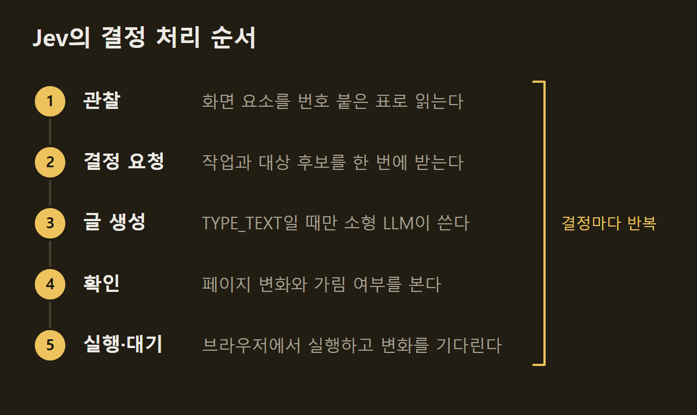

> 이 글은 아래 원문을 우리말로 간추려 정리한 글입니다. 정확한 내용은 원문을 확인하십시오.
>
> 원문: [github.com/browser-use/jev-ultrafast](https://github.com/browser-use/jev-ultrafast)  
> 원문을 소개한 뉴스레터: AlphaSignal

브라우저 에이전트는 사람 대신 웹 페이지를 클릭하고 글을 입력해서 항공편 검색 같은 일을 끝내는 프로그램이다. TypeSafe는 이런 에이전트인 Jev를 [browser-use/jev-ultrafast](https://github.com/browser-use/jev-ultrafast) 저장소에 공개했다. "취리히에서 런던까지 가는 편도 항공편을 찾아라" 같은 목표를 한 문장으로 주면, Jev는 페이지에서 조작할 수 있는 요소마다 번호를 붙인다. 그런 다음 어떤 작업을 몇 번 요소에 할지 골라 브라우저를 움직인다.

```요약
요약: Jev는 페이지를 번호 붙은 요소 표로 바꾼 뒤 작업과 대상을 고르는 브라우저 에이전트이고, 영상으로 남긴 한 번의 실행에서 Google Flights 항공편 검색을 7.073초에 마쳤다.
```

```용어
요소 표: Jev가 페이지를 관찰할 때마다 새로 만드는 목록이다. 버튼과 입력란 같은 요소에 번호를 붙이고 종류, 이름, 현재 값을 적는다.
작업(operation): Jev가 한 번에 고르는 행동의 종류이다. CLICK, TYPE_TEXT 등 여덟 가지 가운데 하나를 고른다.
대상 헤드(target head): 작업마다 따로 둔 대상 후보 목록이다. 그 작업을 할 수 있는 요소만 들어 있다.
브라우저 프로토콜 호출: 에이전트가 브라우저를 다루려고 보내는 개별 호출이다. 이 기사에서는 두 버전의 처리량을 견주는 지표로 쓰였다.
MVP: 핵심 기능만 갖춘 첫 버전이다. 기사에서는 현재 지원하는 범위를 밝힐 때 쓰였다.
```

## 1. 페이지를 요소 표로 읽는 방식

Jev는 페이지를 화면 사진이 아니라 번호 붙은 요소 표로 읽는다. 예를 들어 Google Flights의 표에서 2번 요소는 출발지를 묻는 콤보박스이고 현재 값은 San Francisco다. 기본 동작에서는 스크린숏을 쓰지 않으며, 화면 밖에 있는 본문이나 바닥글도 모델에 보내지 않는다.

모델이 고를 수 있는 작업은 CLICK, TYPE_TEXT, SELECT, SCROLL_UP, SCROLL_DOWN, WAIT, DONE, BLOCKED의 여덟 가지다. 이 가운데 그 페이지에서 지원되는 작업과 대상만 후보로 주어진다. 특정 사이트에 맞춘 동작 스크립트나 미리 준비한 입력 문자열이 없으므로, 같은 방식을 위키백과 문서 찾기 같은 다른 작업에도 그대로 쓸 수 있다.

다만 Jev가 읽을 수 있는 요소의 범위는 아직 좁다. 흔한 HTML·ARIA 컨트롤만 읽고, 섀도 루트(shadow root), 프레임, 캔버스, 파일 업로드, 팝업 탭, 중첩 스크롤, 임의의 키보드 위젯은 현재 MVP의 범위 밖이다. 설치와 실행 방법은 원문에 정리되어 있다.

## 2. 요청 한 번으로 작업과 대상을 고르는 구조

Jev는 작업과 대상을 TypeSafe 요청 한 번으로 함께 고른다. 응답에는 작업 하나와 함께 클릭할 대상, 글을 입력할 대상, 드롭다운이 있을 때 고를 대상의 후보가 한꺼번에 담긴다. 대상 후보는 작업이 정해지기 전에 미리 계산되므로, 작업이 CLICK으로 정해지면 클릭 대상만 실행된다. 이 때문에 두 가지 결정이 네트워크 왕복 한 번에 끝난다.

입력할 글은 별도의 소형 LLM이 쓰고, 작업이 TYPE_TEXT일 때만 호출된다. 예제 설정은 OpenRouter를 거쳐 추론 기능을 끈 inception/mercury-2.5를 쓴다. 페이지가 바뀌어 다시 시도해야 할 때는 소형 LLM에 들어가는 입력이 그대로일 때만 앞서 만든 글을 다시 쓴다.



## 3. 실행 직전의 확인과 대기 상한

Jev는 모델이 고른 대상을 바로 실행하지 않고 실행 직전에 한 번 더 확인한다. 실행할 대상은 모두 관찰 단계에서 읽은 요소에서 찾는다. 실행기는 그사이 페이지가 바뀌지 않았는지, 클릭할 요소가 다른 요소에 가려지지 않았는지를 다시 본다. 반면 모델의 출력은 셀렉터, 좌표, 셸 명령, 실행 가능한 JavaScript로 쓰이지 않으며, 소형 LLM이 쓴 글도 작은 JSON 객체로 해석될 때만 입력된다.

화면 변화를 기다리는 시간에는 상한이 있다. 콤보박스에 글을 입력한 뒤에는 추천 목록이 보일 때까지 최대 200ms를 기다리고, 그 밖의 동작 뒤에는 애니메이션 두 프레임이나 50ms까지만 기다린다. 또한 페이지 상태는 브라우저 호출 한 번으로 한꺼번에 읽는다.

## 4. Google Flights 측정 결과와 조건

영상으로 남긴 한 번의 실행에서 Jev는 취리히발 런던행 편도 항공편 검색을 7.073초에 마쳤다. 이 시간은 첫 페이지를 관찰한 뒤부터 쟀고, 모델 호출과 글 생성, 브라우저 작업, 로딩 대기를 모두 포함한다. AlphaSignal은 이 검색에 드는 비용이 0.5센트에 못 미친다고 소개했다.

성공 여부는 Jev의 판단과 별도로 확인했다. Jev가 DONE을 골라도, 별도의 확인 과정이 편도 설정, 출발지와 도착지, 2026년 9월 20일이라는 날짜, 항공편 목록이 화면에 보이는지를 다시 검사했다. 이 예제는 항공편을 고르거나 예약하지는 않는다.

이전 버전과 견주면 작업 시간이 줄었다. 같은 모델과 설정으로 두 버전을 번갈아 세 번씩 모두 여섯 번 실행했고, 두 버전 모두 3번 중 3번 성공했다. 그 결과 작업 시간 중앙값은 9.450초에서 7.092초로 25% 줄었다.


같은 측정에서 브라우저 프로토콜 호출 중앙값은 1,092회에서 101회로 줄었다. 다만 이 수치는 한 브라우저 프로필에서 한 작업을 세 번 되풀이한 결과이고, 개발진은 이 비교가 일반적인 신뢰성 벤치마크가 아니라고 밝혔다.


같은 방식은 다른 작업에서도 돌아갔다. Jev는 요청받은 위키백과 문서를 2.798초에 열었고, 로컬 호텔 검색·필터 작업을 1.896초에 통과했다. 실행 기록, 실패 사례, 측정 범위는 저장소의 `performance.md`에 있다.

Jev는 페이지를 번호 붙은 요소 표로 바꾸고, 모델에게는 정해진 작업과 표 안의 번호만 고르게 한다. 작업과 대상을 요청 한 번에 함께 받고 실행 직전에 다시 확인하는 이 구조로, 한 작업을 세 번 잰 비교에서 이전 버전보다 짧은 시간과 적은 브라우저 호출로 항공편 검색을 마쳤다.

## 출처와 작성 방식

- 원문: [github.com/browser-use/jev-ultrafast](https://github.com/browser-use/jev-ultrafast)
- 원문을 소개한 뉴스레터: AlphaSignal
- 그래프: 원문에 적힌 값으로 직접 그린 그림입니다.
- 작성 방식: 직접 만든 뉴스 정리 파이프라인(VISER)으로 생성하고 검수한 글입니다. 본문의 수치와 주장은 원문에서 가져온 것입니다.
- 정리 주차: 2026-W38
