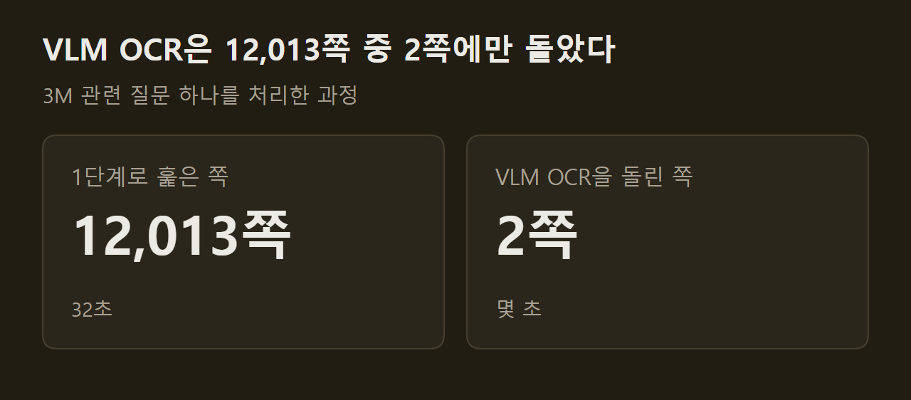
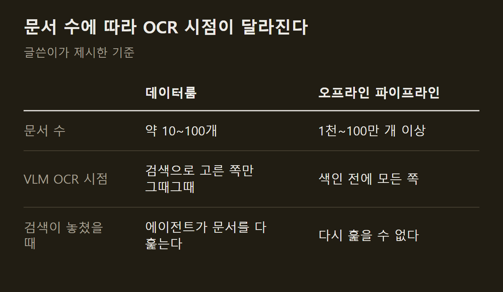
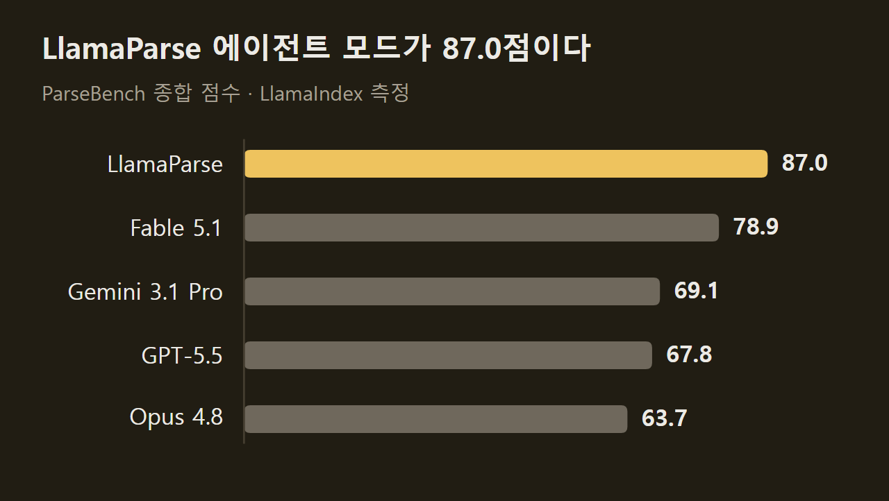

> 이 글은 아래 원문을 우리말로 간추려 정리한 글입니다. 정확한 내용은 원문을 확인하십시오.
>
> 원문: [llamaindex.ai/blog/just-in-time-agentic-ocr](https://www.llamaindex.ai/blog/just-in-time-agentic-ocr)  
> 원문을 소개한 뉴스레터: Deep Learning Weekly

사용자가 계약서나 공시 자료 수십 개를 한꺼번에 올리고 질문을 던지면, 에이전트는 그 문서를 전부 읽을 수 있는 텍스트로 바꿔야 한다. 모든 쪽을 VLM으로 읽으면 정확하지만 느리고 비싸며, 값싼 텍스트 추출만 쓰면 표와 스캔 문서가 깨진다. LlamaIndex 블로그는 Claude Cowork나 Codex 같은 에이전트 하네스가 이미 쓰고 있는 절충 방식을 [Just-in-Time 에이전트 OCR](https://www.llamaindex.ai/blog/just-in-time-agentic-ocr)이라고 이름 붙였다. 문서 전체는 값싼 추출로 빠르게 훑어 검색에 쓰고, 검색으로 찾아낸 몇 쪽만 그때 VLM으로 정밀하게 읽는 문서 처리 방식이다.

```요약
요약: 문서 10~100개 규모의 데이터룸에서 전체를 값싼 추출로 훑고 필요한 쪽만 VLM으로 읽는 방식이며, 공시 84건 사례에서는 12,013쪽 중 2쪽만 VLM OCR을 거쳤지만 문서가 1천 개를 넘는 오프라인 파이프라인에는 권하지 않는다.
```

```용어
데이터룸: 사용자가 한 가지 업무를 위해 올려 둔 문서 모음이다. 이 기사에서는 문서 10~100개쯤을 올리고 그때그때 질문하는 상황을 가리킨다.
VLM: 이미지와 글을 함께 읽는 언어 모델이다. 문서 쪽을 이미지로 받아 표와 그래프까지 읽어 내는 데 쓴다.
OCR: 문서 이미지에서 글자를 읽어 텍스트로 바꾸는 작업이다. VLM으로 하는 OCR은 정확하지만 쪽마다 비용이 든다.
에이전트 하네스: 모델에 파일 읽기와 검색 같은 도구를 붙여 일을 시키는 실행 환경이다. 기사는 Claude Cowork와 Codex를 예로 든다.
그라운딩: 읽어 낸 값이 문서의 어느 위치에서 나왔는지 좌표로 짚어 주는 기능이다. 사람이 결과를 검수할 때 근거로 쓴다.
```

## 1. 두 단계 처리의 구조

에이전트는 먼저 모델을 쓰지 않는 값싼 텍스트 추출을 올라온 모든 파일에 돌린다. 결과가 완벽하지는 않아도 `grep`으로 뒤지거나 가벼운 의미 검색 인덱스를 얹기에는 충분하다. 이 텍스트를 검색해 후보 파일과 쪽을 고른 뒤, 고른 쪽만 VLM 수준으로 다시 읽는다. 다시 읽을 때는 쪽을 화면 캡처해 하네스 자체의 VLM에 넘기거나 VLM 기반 문서 파서를 부른다. ==VLM은 문서 전체가 아니라 검색이 짚은 쪽에만 쓴다.==

2단계 비용을 낮추는 방법으로는 두 가지를 든다. 하나는 문서 전체가 아니라 일부 쪽만 처리하는 것으로, 약 250쪽짜리 연차 보고서에서 검색이 24~25쪽을 짚었다면 그 두 쪽만 읽는다. 다른 하나는 사용자에게는 두 단계 방식으로 빠르게 답하면서 뒤에서 전체 문서를 VLM OCR로 처리해 캐시해 두는 것이고, 이렇게 하면 같은 문서를 세션마다 다시 읽지 않아도 된다.

")

원문 도식은 4만 쪽짜리 데이터룸을 예로 들어, 1단계는 쪽당 밀리초 수준으로 로컬에서 거의 무료로 돌고 2단계의 비용은 작업이 닿는 몇 쪽에만 든다고 적는다.

## 2. 사례: SEC 공시 84건

글쓴이는 금융 질의응답 벤치마크 FinanceBench의 공개분으로 이 과정을 직접 돌렸다. 공시 문서 84건, 모두 12,013쪽이며 질문은 "인수합병 영향을 빼면 2022년 3M의 성장을 끌어내린 사업 부문은 어디인가"였다. 수치는 글쓴이의 노트북에서 잰 값이다.

1단계에서는 LiteParse가 84건 전체를 32초에 텍스트로 바꿨다. 그 결과에서 "Organic sales"를 검색하자 252쪽짜리 3M 2022년 연차 보고서의 25쪽, 사업 부문별 매출 변화 표가 나왔다. 이 쪽에는 재무 표가 세 개 실려 있는데, `pdftotext`의 기본 출력은 표를 열 단위로 쏟아 내서 어느 숫자가 어느 행에 속하는지 알기 어렵다. LiteParse는 글자의 좌표를 보존하므로 행과 열이 맞는 표로 복원했다. 24쪽은 더 어려워서, 머리글이 세 줄로 쌓인 14열짜리 표라 텍스트로는 어떻게 옮겨도 모호하다는 것이 글쓴이의 평가다.

")

두 쪽을 LlamaParse 에이전트 모드로 읽자 병합된 머리글까지 살린 HTML 표가 나왔다. 유기적 매출 변화는 Safety and Industrial 1.0%, Transportation and Electronics 1.2%, Health Care 3.2%, 전사 1.2%였고 Consumer만 -0.9%(원문 표기 (0.9)%)로 줄었으므로 답은 Consumer다. ==에이전트가 VLM OCR을 돌린 것은 12,013쪽 가운데 2쪽이었다.==



어느 쪽에 VLM이 필요한지도 싸게 가려낼 수 있다. LiteParse의 `lit is-complex` 명령은 쪽마다 OCR 필요 여부와 이유를 내놓는데, 84건에서는 12,013쪽 중 2,605쪽(21.7%)을 골랐다. 대부분은 표가 빽빽해 텍스트 비중이 낮은 쪽이었고, 이미지가 박힌 쪽이 253쪽, 텍스트 층이 아예 없는 쪽이 75쪽이었다. LlamaParse의 비슷한 도구는 3M 연차 보고서에서 약 3분의 2를 LiteParse로, 나머지 약 35%를 VLM 등급으로 배정했다.

## 3. 데이터룸과 오프라인 파이프라인의 구분

두 단계 방식은 검색이 틀려도 만회할 수 있을 때만 통한다. 1단계가 표를 망가뜨리거나 스캔된 쪽을 빠뜨리면 검색이 그 쪽을 놓칠 수 있다. 문서가 84건이면 에이전트가 검색에만 기대지 않고 모든 문서를 하나씩 열어 볼 수 있으므로, 지연 시간이 늘어날 뿐 답은 찾는다.

문서가 100만 건이면 이렇게 할 수 없다. 에이전트는 검색이 돌려준 것만 보게 되고, 검색의 정확도는 그 밑에 깔린 텍스트의 품질을 넘지 못한다. ==문서가 1천 개를 넘으면 색인 전에 모든 쪽을 VLM으로 읽는다.==



처음부터 전체를 VLM으로 읽어야 하는 경우는 둘이다. 에이전트가 반복해서 질의할 대규모 문서를 색인할 때는 파싱 비용이 이후의 모든 질의에 나뉘어 상각된다. 송장 처리, 보험 청구 접수, 고객 신원 확인처럼 값을 뽑아 원장 시스템에 넣는 작업은 셀 하나를 잘못 읽으면 그대로 틀린 숫자가 되므로, 어차피 모든 문서를 처리해야 하고 필드마다 위치 좌표와 신뢰도 점수가 있어야 사람이 검수할 수 있다. 두 경우 모두 쪽당 약 1센트를 한 번 낸다.

## 4. 기본 구성의 문제

하네스는 기본 도구로 이미 두 단계 처리를 한다. 1단계는 `pdftotext`, 2단계는 하네스 자체 모델이며 Cowork에서는 Opus 5다. 글쓴이는 이 구성의 문제를 세 가지로 꼽는다.

1. 범용 최상위 모델의 한계: 추론·수학·코딩에 맞춰 학습된 모델이라 OCR 정확도가 가장 높지 않고, 대량으로 쓰기에는 비싸며 그라운딩이 약하다.
2. 1단계 도구의 한계: `pypdf`와 `pdftotext`는 디지털 PDF의 텍스트 층만 꺼내므로 스캔 쪽은 비어 나오고, 다단 편집은 순서가 섞이며, 표는 열 단위로 쏟아진다. 실제 고객 파일의 절반쯤인 워드·파워포인트·엑셀·이메일은 다루지 못한다.
3. 일회용 코드: 쪽 렌더링, 그림 잘라 내기, 표 재구성을 에이전트가 세션마다 파이썬으로 다시 짜므로 토큰과 시간이 들고 재사용도 재현도 되지 않는다.

첫째 문제의 근거로는 LlamaIndex가 만든 벤치마크 ParseBench 점수를 든다. 사람이 검증한 기업 문서 2,078쪽으로 표, 그래프, 내용 충실도, 서식, 그라운딩을 채점한다.



쪽당 비용은 Fable 5.1이 16센트, GPT-5.5가 13센트, Gemini 3.1 Pro가 8.5센트, Opus 4.8이 7.3센트이고 LlamaParse 에이전트 모드는 1.25센트다. 그라운딩 점수는 차이가 더 커서 Opus 4.8이 18.7점, 사고 기능을 끈 Haiku 4.5와 GPT-5 Mini가 7점 미만이고 LlamaParse는 84점이다. 위치 좌표와 신뢰도 점수가 없으면 출력을 검수할 방법이 없어서, 표의 셀 하나를 잘못 읽은 오류가 이후 작업 전체로 번진다. 모두 LlamaIndex가 자사 제품과 함께 잰 값이다.

## 5. 단계별 도구

LlamaIndex는 두 단계에 각각 자사 도구를 제시한다. 1단계용 LiteParse는 Rust로 쓴 무료 오픈소스 파서로, 좌표를 살린 텍스트 추출과 표·제목 복원을 하고 오피스 형식을 포함해 50가지 넘는 문서를 다룬다. 다만 글쓴이는 LiteParse를 데이터룸의 1단계로 권할 뿐, 문서 1천 개가 넘는 오프라인 파이프라인의 첫 단계로는 쓰지 않겠다고 밝힌다.

2단계용 LlamaParse는 쪽마다 알맞은 VLM을 골라 보내고 셀 단위 표 구조, 위치 좌표, 신뢰도 점수를 돌려준다. 쪽 번호를 입력으로 받으므로 문서의 일부만 읽을 수 있고, 전체 문서를 뒤에서 처리해 다음 세션이 같은 쪽을 다시 읽지 않게 할 수 있다. 글쓴이는 데이터룸 용도에서는 이 방식이 기본이 되고, 대규모 오프라인 문서와 일괄 추출에서는 처음부터 전체를 VLM으로 읽는 편이 여전히 맞다고 본다.

## 출처와 작성 방식

- 원문: [llamaindex.ai/blog/just-in-time-agentic-ocr](https://www.llamaindex.ai/blog/just-in-time-agentic-ocr)
- 원문을 소개한 뉴스레터: Deep Learning Weekly
- 그림: 아래에 출처가 적힌 그림은 원문에 실린 그림을 인용한 것이며 저작권은 원저작자에게 있습니다. 출처가 없는 그래프는 원문에 적힌 값으로 직접 그린 것입니다.
- 작성 방식: 직접 만든 뉴스 정리 파이프라인(VISER)으로 생성하고 검수한 글입니다. 본문의 수치와 주장은 원문에서 가져온 것입니다.
- 정리 주차: 2026-W38
