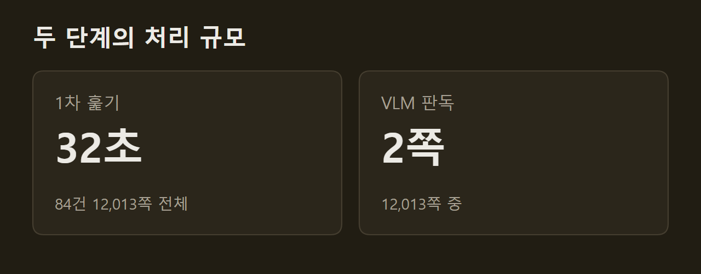
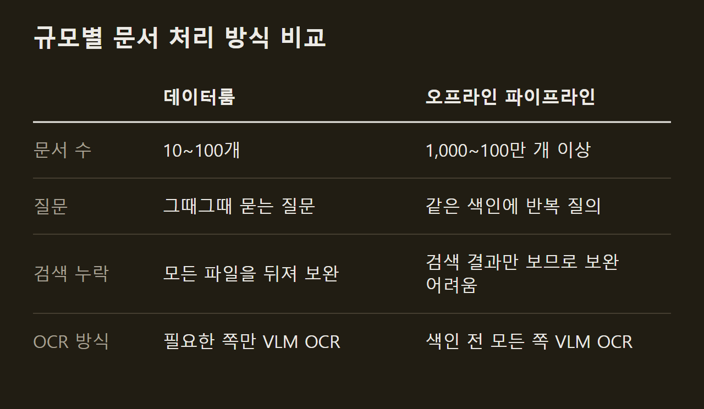
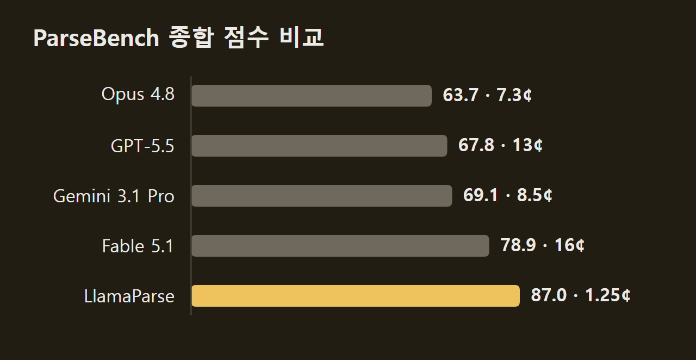

> 이 글은 아래 원문을 우리말로 간추려 정리한 글입니다. 정확한 내용은 원문을 확인하십시오.
>
> 원문: [llamaindex.ai/blog/just-in-time-agentic-ocr](https://www.llamaindex.ai/blog/just-in-time-agentic-ocr)  
> 원문을 소개한 뉴스레터: Deep Learning Weekly

Claude Cowork나 Codex 같은 에이전트 하네스(harness)는 사용자가 올린 문서 수십 개로 업무 질문에 답할 때 문서를 두 번 나눠 읽는다. 하네스는 먼저 모든 파일에서 글자만 값싸게 뽑아 검색하고, 답에 필요한 쪽을 찾으면 그 쪽만 시각 언어 모델(VLM, Vision Language Model)로 다시 정밀하게 읽는다. LlamaIndex는 이 방식에 [Just-in-Time Agentic OCR](https://www.llamaindex.ai/blog/just-in-time-agentic-ocr)이라는 이름을 붙였다. 사용자가 파일과 질문을 넣으면 에이전트가 필요한 몇 쪽의 표와 차트만 구조화된 텍스트로 바꿔 답을 찾는 문서 처리 방식이다.

```요약
요약: Just-in-Time Agentic OCR은 모든 쪽을 모델 없이 훑고 검색으로 찾은 쪽만 VLM으로 읽는 방식이며, 문서 10~100개 규모의 데이터룸에 맞는다.
```

```용어
하네스(harness): Claude Cowork, Codex처럼 모델이 파일 명령과 검색 도구를 써서 일하게 하는 에이전트 실행 환경이다. 이 기사에서는 문서를 두 단계로 나눠 읽는 처리를 기본으로 하는 주체다.
데이터룸: 사용자가 문서 10~100개 정도를 올려 두고 그때그때 질문하는 작업 환경이다. 실사 같은 업무에서 쓰인다.
VLM: 이미지를 입력받아 글로 답하는 시각 언어 모델이다. 여기서는 쪽 이미지에서 표와 차트를 읽어 내는 데 쓰인다.
유기적 매출: 인수·매각과 환율 효과를 뺀 매출 증감이다. 3M 사례에서 M&A 영향을 뺀 성장률을 찾는 기준이 된다.
그라운딩(grounding): 추출한 값을 페이지 위의 위치와 연결하는 능력이다. 사람이 결과를 검수할 때 근거로 쓰인다.
```

## 1. 1차 훑기와 2차 판독의 구조

Just-in-Time Agentic OCR은 값싼 1차 훑기와 정밀한 2차 판독 사이에 검색을 끼운 구조다. 1차에서 에이전트는 모델을 쓰지 않는 텍스트 추출기로 올라온 모든 파일을 처리한다. 이렇게 뽑은 결과는 완벽하지 않지만 `grep`으로 찾거나 가벼운 의미 검색 색인을 만들기에는 충분하다.

검색으로 후보 파일과 쪽을 찾으면 에이전트는 그 쪽만 VLM 수준으로 다시 읽는다. 이때 에이전트는 쪽을 캡처해 자기 VLM(Cowork는 Opus 5)에 넘기거나, 같은 일을 하는 문서 파서를 부른다. 다음 그림에서는 왼쪽부터 원본 파일, 1차 훑기, 검색, 2차 판독을 차례로 거쳐 답이 나온다.

")

2차 판독의 비용은 두 가지 방법으로 낮춘다. 첫째는 문서 전체가 아니라 일부 쪽에만 VLM OCR을 돌리는 것이다. 예를 들어 약 250쪽짜리 미국 기업 연차 보고서(10-K)에서 검색이 24~25쪽을 가리키면 그 두 쪽만 처리하므로 지연 시간과 비용이 함께 준다. 둘째는 사용자에게 두 단계 처리로 먼저 답하는 동안 올라온 파일 전체에 VLM OCR을 돌려 캐시해 두는 것이다. 이렇게 하면 하네스가 같은 문서를 거듭 OCR하지 않아도 된다.

## 2. 사례: 공시 문서 84건과 3M 질문

LlamaIndex는 FinanceBench로 이 과정을 시연했다. FinanceBench는 Patronus AI가 만든 재무 질의응답 벤치마크다. 공개분에는 공시 문서 84건(10-K, 10-Q, 8-K, 실적 발표)에 대한 질문 150개가 들어 있고, 문서 쪽수는 모두 12,013쪽이다. 그중 한 질문은 "M&A 영향을 빼면 2022년 3M의 전체 성장을 끌어내린 부문은 어디인가"였다.

1차 훑기와 검색은 1분이 걸리지 않았다. 글쓴이의 노트북에서 LiteParse를 OCR 없는 텍스트 모드로 돌리자 84건 12,013쪽이 32초 만에 처리됐다. 이어 결과에서 'Organic sales'를 `grep`으로 찾자 3M 2022년 10-K의 252쪽 중 25쪽에 있는 부문별 매출 변화 표가 나왔다.



같은 표라도 추출 도구에 따라 읽어 낼 수 있는 내용이 달랐다. 25쪽에는 재무 표가 세 개 있다. pdftotext는 'Organic sales' 다음에 부문 이름 다섯 개, 그다음에 숫자 다섯 개를 늘어놓는 식으로 표를 열 단위로 내보내므로 어느 숫자가 어느 행의 값인지 알 수 없다. 반면 LiteParse는 글자의 x/y 위치를 지켜 부문마다 한 행씩 마크다운 표로 복원했다.

")

24쪽은 이보다 더 어렵다. 이 쪽의 표는 열이 14개이고 머리글이 세 줄로 쌓여 있어서 어떤 텍스트 형식으로 옮겨도 뜻이 모호해진다.

")

두 쪽을 LlamaParse 에이전틱 모드로 처리하자 `rowspan`·`colspan` 머리글을 갖춘 HTML 표가 나왔고, 답은 Consumer 부문이었다. 2022년 유기적 매출 증감률은 Consumer가 -0.9%(원문 표기 (0.9)%)로 네 부문 가운데 유일하게 줄었다. 다른 부문은 Safety and Industrial이 1.0%, Transportation and Electronics가 1.2%, Health Care가 3.2% 늘었다. 에이전트가 VLM OCR을 돌린 쪽은 12,013쪽 중 2쪽이었고, 이 단계는 몇 초 만에 끝났다.

## 3. 데이터룸과 오프라인 파이프라인을 나누는 기준

두 단계 방식이 데이터룸에서 통하는 까닭은 검색이 놓친 것을 에이전트가 다른 방법으로 메울 수 있기 때문이다. 1차 훑기에서 표가 뭉개지거나 스캔 쪽이 빠져 검색에 걸리지 않을 수 있다. 다만 문서가 84건 정도면 에이전트가 파일 명령으로 모든 문서를 직접 뒤질 수 있으므로, 지연 시간은 늘어도 빠짐없이 찾을 수 있다.

문서가 100만 건이면 이렇게 할 수 없다. 이 규모에서 에이전트는 검색이 돌려준 결과만 보므로 검색이 정확해야 하는데, 검색 정확도는 그 아래에 놓인 텍스트의 품질을 넘지 못한다. 이 때문에 LlamaIndex는 문서 1,000~100만 개 이상을 다루는 오프라인 파이프라인이라면 색인을 만들기 전에 모든 쪽에 VLM OCR을 돌려야 한다고 본다.



처음부터 모든 쪽을 VLM으로 읽어야 하는 경우는 두 가지다. 하나는 에이전트가 반복해서 질의할 대규모 RAG 색인이다. 스캔본, 서식, 손글씨, 차트까지 VLM 수준으로 읽어야 검색이 정확해지고, 파싱 비용은 앞으로 들어올 모든 질의에 나뉜다.

다른 하나는 송장 추출, 보험 청구 접수, KYC(고객 신원 확인)처럼 추출한 값을 업무 시스템에 옮겨 적는 일이다. 표 칸 하나만 잘못 읽어도 뒤 단계의 숫자가 틀리므로, 사람이 검수할 수 있게 모든 필드에 바운딩 박스와 신뢰도가 붙어야 한다. 두 경우 모두 쪽당 약 1¢를 한 번 내고, 그 결과를 수천 번 다시 쓰거나 처음부터 정확한 값을 얻는다.

## 4. 기본 구성의 세 가지 한계

지금의 하네스는 1차에 pdftotext, 2차에 자기 모델(Cowork는 Opus 5)을 쓰는 기성 도구 조합으로 두 단계를 처리한다. LlamaIndex는 이 조합에 세 가지 문제가 있다고 지적한다.

**Opus 5는 OCR에 가장 알맞은 VLM이 아니다.** 프런티어 모델은 추론, 수학, 코딩에 맞춰 후속 학습되고, 문서 OCR은 어느 연구소도 최적화 대상으로 삼지 않는 벤치마크다. 사람이 검증한 기업 문서 2,078쪽과 시험 규칙 16만 9천 개로 된 ParseBench에서 LlamaIndex가 잰 결과, 프런티어 모델 중 가장 나은 Fable 5.1은 종합 78.9를 쪽당 16¢에 냈다. 이에 견주어 LlamaParse 에이전틱 모드는 87.0을 쪽당 1.25¢에 냈고, Opus 5는 아직 측정하지 않았다.



이보다 큰 문제는 그라운딩이다. 시각 그라운딩 점수는 Opus 4.8이 18.7이었고, 사고 기능을 끈 Haiku 4.5와 GPT-5 Mini는 7에 못 미쳤으며, LlamaParse는 84였다. 바운딩 박스와 신뢰도가 없으면 결과를 검수할 수 없으므로, 표 칸 하나를 잘못 읽은 오류가 이후 작업 전체로 퍼진다.

**pypdf와 pdftotext는 1차 훑기에 쓰기에 처리 범위가 좁다.** 두 도구는 디지털 PDF의 텍스트 층만 꺼내므로 스캔 쪽에서는 아무것도 나오지 않는다. 또 텍스트 층은 읽는 순서가 아니라 글자를 그린 순서로 저장되어 있어서 여러 단으로 된 쪽은 글이 뒤섞이고, 표는 앞의 3M 사례처럼 열 단위로 나온다. 실제 고객 파일은 절반 정도만 PDF이고 나머지는 Word, PowerPoint, Excel, 이메일 내보내기 파일인데, 두 도구는 이런 파일을 아예 다루지 못한다.

**에이전트는 버릴 코드를 세션마다 새로 짠다.** 쪽을 이미지로 바꾸고, 그림을 잘라 내고, pandas로 표를 다시 짜고, 칸 경계를 짐작하는 코드가 그런 예다. 차트 처리, 바운딩 박스, 신뢰도는 제대로 된 파서가 한 번 호출하면 돌려주는 결과이므로, 에이전트가 이를 직접 만들면 토큰과 시간을 더 쓴다. 이런 코드는 생각보다 자주 동작하지만 다시 쓸 수도, 같은 결과를 재현할 수도 없다.

## 5. 두 단계에 맞춘 LiteParse와 LlamaParse

LlamaIndex는 두 단계에 각각 쓸 도구를 내놓았다. 1차용 LiteParse는 Rust로 짠 무료 오픈소스 파서로, 글자를 바운딩 박스와 함께 위치대로 뽑아 마크다운 제목과 표를 복원한다. Office 형식을 포함해 50종이 넘는 문서를 읽지만, LlamaIndex는 앞의 이유로 문서 1,000개 이상의 오프라인 파이프라인에서는 첫 단계에 LiteParse를 쓰지 않는다.

LiteParse의 `lit is-complex` 명령은 VLM 판독이 필요한 쪽을 미리 골라 준다. 이 명령은 쪽마다 OCR이 필요한지와 그 이유(스캔본, 텍스트 없음, 텍스트 희박, 이미지 포함, 깨진 글자)를 적는다. 84건에서는 12,013쪽 중 2,605쪽(21.7%)을 골라냈는데, 대부분은 글자가 차지하는 면적이 작은 빽빽한 표였고 이미지가 든 쪽은 253쪽, 텍스트 층이 아예 없는 쪽은 75쪽이었다.

2차용 LlamaParse는 쪽마다 프런티어, 특화, 증류 VLM 가운데 하나로 보내 처리하고, 칸 단위 표 구조와 바운딩 박스, 신뢰도를 돌려준다. 쪽 번호를 입력으로 받으므로 일부 쪽만 처리할 수 있고, `estimateFileComplexity` 도구로 크레딧을 쓰기 전에 쪽마다 처리 등급을 매긴다. 이 도구는 3M 10-K에서 약 3분의 2를 LiteParse로, 나머지 약 35%를 VLM 등급으로 보냈다.

LlamaIndex는 문서 10~100개를 두고 그때그때 질문하는 데이터룸에서는 Just-in-Time Agentic OCR이 기본 방식이 되리라고 본다. 하네스도 레이아웃을 읽는 값싼 1차 훑기, 특정 쪽만 겨냥하는 VLM OCR, 쪽별 복잡도 신호, 나머지를 채우는 백그라운드 처리를 더 분명하게 갖출 것으로 예상했다. 반면 대규모 오프라인 문서와 일괄 추출에는 처음부터 VLM OCR을 돌리는 방식이 여전히 맞다고 결론지었다.

## 출처와 작성 방식

- 원문: [llamaindex.ai/blog/just-in-time-agentic-ocr](https://www.llamaindex.ai/blog/just-in-time-agentic-ocr)
- 원문을 소개한 뉴스레터: Deep Learning Weekly
- 그림: 아래에 출처가 적힌 그림은 원문에 실린 그림을 인용한 것이며 저작권은 원저작자에게 있습니다. 출처가 없는 그래프는 원문에 적힌 값으로 직접 그린 것입니다.
- 작성 방식: 직접 만든 뉴스 정리 파이프라인(VISER)으로 생성하고 검수한 글입니다. 본문의 수치와 주장은 원문에서 가져온 것입니다.
- 정리 주차: 2026-W38
