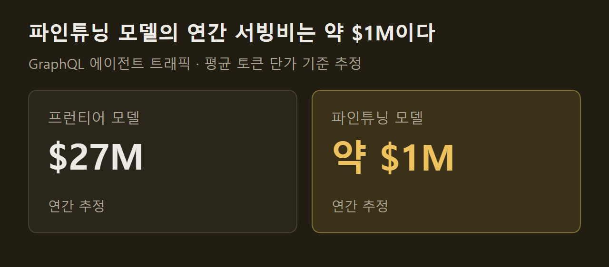

> 이 글은 아래 원문을 우리말로 간추려 정리한 글입니다. 정확한 내용은 원문을 확인하십시오.
>
> 원문: [pytorch.org/blog/how-shopify-built-a-continual-learning-loop-with-pytorch-and-vllm](https://pytorch.org/blog/how-shopify-built-a-continual-learning-loop-with-pytorch-and-vllm/)  
> 원문을 소개한 뉴스레터: Deep Learning Weekly

새 AI 제품은 프런티어 모델로 시작하면 빨리 내놓을 수 있지만, 사용량이 늘면 모든 요청을 처리하기에는 느리고 비싸다. 배포된 모델의 가중치는 고정되어 있어서 사용자가 답을 고치거나 거절해도 다음 답은 나아지지 않고, 개선은 프롬프트나 하네스 코드처럼 모델 바깥에만 쌓인다. Shopify는 이 문제를 풀려고 [플라이휠](https://pytorch.org/blog/how-shopify-built-a-continual-learning-loop-with-pytorch-and-vllm/)이라 부르는 지속 학습 루프를 PyTorch와 vLLM으로 만들었다. 운영 중에 낮은 점수를 받은 대화를 넣으면 고쳐진 대화가 학습 데이터로 나오고, 이 데이터로 더 작은 모델을 매일 다시 학습시켜 프런티어 모델 대신 서비스에 쓰는 체계다.

```요약
요약: 운영 중 실패한 대화를 매일 고쳐 작은 모델의 가중치에 학습시키는 루프이며, Shopify는 GraphQL 에이전트에서 프런티어 모델을 넘는 판정 점수와 서빙 비용 96% 절감(추정)을 얻었다고 밝혔다.
```

```용어
프런티어 모델: 외부에서 제공하는 최상위 범용 모델. 이 기사에서는 Shopify가 첫 제품을 만들 때 쓴 모델을 가리킨다.
판정 모델: 대화를 품질 기준에 따라 채점하는 LLM. 출시 전 평가 지표이자 강화 학습의 보상으로 쓰인다.
하네스: 모델을 둘러싼 프롬프트, 도구 정의, 제어 흐름 코드를 통틀어 이르는 말.
하드 네거티브: 판정 모델이 낮은 점수를 준 것이 옳은 대화. 모델이 약한 지점을 드러낸다.
기스트 토큰: 긴 시스템 프롬프트와 같은 동작을 내도록 학습한 짧은 토큰 열.
```

## 1. 플라이휠의 순서

루프는 품질 기준을 세우는 일에서 시작해 모델 학습과 프롬프트 압축으로 끝난다. 사람이 채점한 정답 데이터를 만들고, 판정 모델을 사람의 채점에 맞춘 다음, 프런티어 모델로 첫 제품을 빠르게 만든다. 그 뒤에는 운영 데이터에서 실패 사례를 모아 고치고, 이를 공개 가중치 모델의 파인튜닝과 시스템 프롬프트 압축에 쓴다.

==운영에서 얻은 경험을 프롬프트가 아니라 가중치에 담는다.== Shopify가 든 이유는 프런티어 모델에는 운영에서 배운 것을 스스로 받아들이는 장치가 없다는 점이다.

")

## 2. 품질 기준과 판정 모델

Shopify는 품질 정의를 루프에서 가장 중요한 단계로 꼽는다. 이 정의가 나중에 학습의 보상이 되므로, 여기서 틀리면 뒤의 모든 단계가 잘못된 행동을 최적화한다. 출발점은 제품 요구 사항을 완결성, 실행, 응답 품질, 안전이라는 채점 항목으로 바꾼 채점 기준표이고, 점수마다 구체적인 기준이 붙는다. 정답 데이터에는 골라 낸 예시뿐 아니라 무작위로 뽑은 실제 트래픽도 넣는다.

기준표가 쓸 만한지는 사람끼리 먼저 확인한다. 가장 뛰어난 채점자 두 명이 서로의 결과를 보지 않고 무작위 표본 25개를 채점한 뒤, 우연 이상의 일치 정도를 재는 코헨 카파 값을 구한다. 이 값이 0.2 근처로 낮으면 기준표가 모호하다는 뜻이므로 다시 고친다. ==사람끼리의 일치도가 판정 모델이 닿을 수 있는 상한이다.== 원문 그림의 예에서는 사람 간 일치도가 83%, 판정 모델이 80%로 적혀 있다.

")

기준표는 판정 모델의 첫 프롬프트일 뿐이어서, DSPy 위에서 GEPA와 ACE 같은 최적화 기법으로 정답 데이터에 맞게 보정한다. 보정한 판정 모델은 두 가지로 검증한다. 과거 A/B 테스트의 승패 방향을 되짚어 내는지 보고, 한 가지 행동을 일부러 나쁘게 만들었을 때 해당 항목의 점수만 떨어지는지 확인한다. 판정 모델은 제품의 모든 행동을 하나에 넣지 않고 작게 나누어 둔다.

## 3. 가중치를 건드리지 않는 개선

판정 모델이 준비되면 먼저 프런티어 모델 기반 제품을 가중치 변경 없이 끌어올린다. 운영 중인 애플리케이션은 프롬프트가 동적으로 조립되고 제어 흐름이 코드 곳곳에 흩어져 있어서, 프롬프트 하나를 다듬어서는 일부만 바뀐다. 그래서 프롬프트, 도구 정의, 오케스트레이션 코드를 포함한 하네스 전체를 최적화 대상으로 삼는다.

방법은 카파시의 autoresearch 프로젝트를 따른다. 에이전트가 수정안을 하나 제안하고 판정 모델로 평가해서, 점수가 오르면 남기고 아니면 버린다. 데이터 위치, 에이전트가 고칠 수 있는 디렉터리, 지표, 최적화 기법은 `program.md`라는 마크다운 파일 하나에 적는다.

")

## 4. 실패 대화의 자가 복구와 학습

하네스 개선이 한계에 닿으면 익명화한 운영 트래픽에서 하드 네거티브를 골라 가중치 학습으로 넘어간다. 예전 방식이라면 버그 리포트나 Slack 스레드가 되었을 실패가 여기서는 자동으로 복구 파이프라인에 들어간다.

프런티어 추론 모델 여러 개가 실패한 대화를 각각 비평하고, 중재 모델이 이를 수정 지시 하나로 합쳐 사용자 발화 앞에 끼워 넣는다. 그 지점부터 대화를 다시 실행해 판정 모델이 재채점한다. 통과한 대화는 판정 점수를 보상으로 삼는 강화 학습용 데이터가 되고, 통과하지 못한 대화는 Toloka의 전문 채점자가 같은 기준표로 직접 고친다.

")

학습은 두 단계로 진행된다. 먼저 고쳐진 대화를 최종 답뿐 아니라 추론 과정까지 통째로 써서 작은 모델에 지도 파인튜닝한다. 이어서 GRPO를 적용하는데, 프롬프트마다 모델이 응답을 여러 개 만들고 판정 모델이 채점하면 점수가 높은 응답을 강화한다. ==복구 파이프라인과 전체 파라미터 파인튜닝은 매일 돈다.== 새 데이터와 이전 데이터를 함께 학습해 주기를 거듭할 때 생기는 드리프트와 망각을 줄인다.

## 5. GraphQL 에이전트의 품질 변화

이 루프가 실제로 도는 곳은 운영 환경에서 분당 최대 2,000건을 처리하는 GraphQL 에이전트다. 판매자가 매장에 관해 물으면 Shopify Admin GraphQL API에 보낼 쿼리를 작성해 실행하고, 결과를 평이한 문장으로 답한다. 원문 예시에서는 재고가 거의 떨어진 상품을 묻자 스키마를 조회하고, 문서에서 필터 문법을 확인하고, 쿼리를 실행한 뒤 상품 세 개와 남은 수량을 답한다.

")

원문 그래프는 학습 데이터가 늘수록 판정 점수가 오르는 모습을 보여 준다. 데이터가 13k일 때 61.5점이던 점수는 26k에서 64.5점, 30k에서 66.7점, 39k에서 68.5점, 46k에서 70.7점을 거쳐 61k에서 73.5점이 됐다. 30k 지점에서 운영 기준선을 넘었고, 61k 지점에서 프런티어 모델 기준선을 넘었다.

")

## 6. 서빙 비용과 응답 속도

모델은 PyTorch 기반 추론 엔진인 vLLM으로 서빙한다. Shopify는 이 트래픽을 프런티어 모델로 처리하면 평균 토큰 단가 기준으로 연간 2,700만 달러쯤 들고, 파인튜닝한 모델로는 100만 달러에 가깝게 든다고 추정했다. 96% 절감은 이 추정치에서 나온 값이다.



속도는 기스트 압축으로 끌어올렸다. 에이전트의 시스템 프롬프트는 길고 내용이 바뀌지 않는데, 생성하는 토큰마다 이 앞부분 전체를 참조하므로 요청마다 지연과 비용이 붙는다. Shopify는 같은 모델을 전체 프롬프트를 받는 교사와 기스트 토큰만 받는 학생으로 돌리고, 가중치는 고정한 채 학생의 출력 분포가 교사와 같아지도록 기스트 토큰 임베딩만 학습하는 PyTorch 트레이너를 직접 만들었다.

==시스템 프롬프트는 약 6,000토큰에서 약 1,500토큰으로 줄었다.== 판정 점수로 잰 품질 손실은 없었다고 한다. 분당 350건 부하 시험에서 첫 토큰까지 걸리는 시간은 약 19%, 전체 응답 시간은 약 38% 줄었다. 같은 GPU에서 초당 요청 수는 약 16%, 초당 출력 토큰은 약 12% 늘어서, 같은 트래픽을 약 14% 적은 GPU로 처리할 수 있다.

## 출처와 작성 방식

- 원문: [pytorch.org/blog/how-shopify-built-a-continual-learning-loop-with-pytorch-and-vllm](https://pytorch.org/blog/how-shopify-built-a-continual-learning-loop-with-pytorch-and-vllm/)
- 원문을 소개한 뉴스레터: Deep Learning Weekly
- 그림: 아래에 출처가 적힌 그림은 원문에 실린 그림을 인용한 것이며 저작권은 원저작자에게 있습니다. 출처가 없는 그래프는 원문에 적힌 값으로 직접 그린 것입니다.
- 작성 방식: 직접 만든 뉴스 정리 파이프라인(VISER)으로 생성하고 검수한 글입니다. 본문의 수치와 주장은 원문에서 가져온 것입니다.
- 정리 주차: 2026-W39
