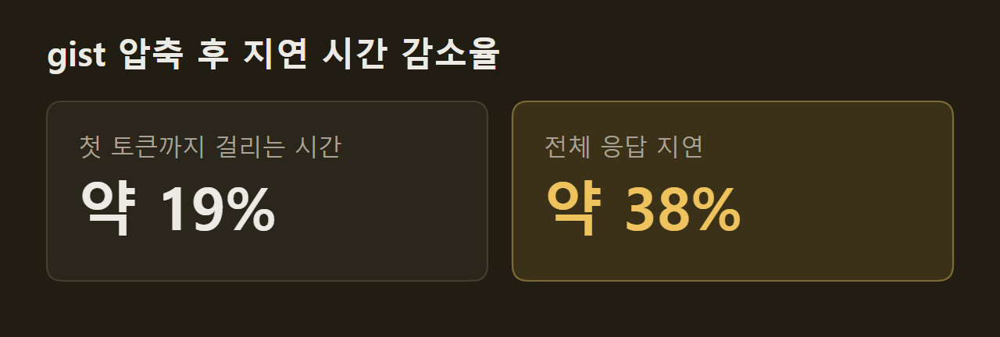
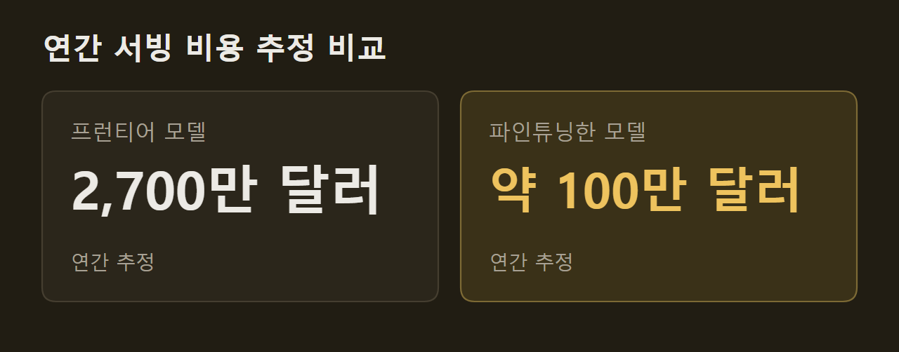

> 이 글은 아래 원문을 우리말로 간추려 정리한 글입니다. 정확한 내용은 원문을 확인하십시오.
>
> 원문: [pytorch.org/blog/how-shopify-built-a-continual-learning-loop-with-pytorch-and-vllm](https://pytorch.org/blog/how-shopify-built-a-continual-learning-loop-with-pytorch-and-vllm/)  
> 원문을 소개한 뉴스레터: Deep Learning Weekly

새 AI 제품을 내놓을 때는 프런티어 모델을 쓰는 것이 가장 빠르다. 하지만 사용량이 늘면 모든 요청을 그 모델로 처리하기에는 응답이 느리고 비용이 크다. 게다가 배포된 모델은 사용자가 고친 답이나 반복되는 실패에서 스스로 배우지 못한다. Shopify는 이 문제를 풀기 위해 PyTorch와 vLLM으로 [지속 학습 루프(continual learning loop)](https://pytorch.org/blog/how-shopify-built-a-continual-learning-loop-with-pytorch-and-vllm/)를 만들었다. 운영 중 실패한 대화를 모아 고친 뒤 매일 더 작은 모델의 가중치에 학습시키고, 그렇게 학습한 모델로 서비스를 운영하는 체계다.

```요약
요약: Shopify는 운영 중 실패한 대화를 매일 작은 모델의 학습 데이터로 바꾸는 지속 학습 루프를 만들었고, GraphQL 에이전트에서 프런티어 모델보다 높은 품질을 내면서 추정 서빙 비용을 96% 줄였다.
```

```용어
판정 모델: 대화가 품질 기준을 얼마나 충족하는지 점수를 매기는 LLM이다. 출시 전 지표이자 강화 학습의 보상으로 쓰인다.
하네스: 에이전트를 움직이는 프롬프트, 도구 정의, 제어 흐름 코드를 함께 이르는 말이다.
하드 네거티브: 판정 모델이 정확히 낮은 점수를 준 대화로, 모델이 가장 약한 곳을 드러낸다.
GRPO: 프롬프트마다 응답 여러 개를 뽑아 판정 모델 점수가 높은 응답을 강화하는 강화 학습 방법이다.
gist 토큰: 긴 시스템 프롬프트가 하던 역할을 대신하도록 학습한 짧은 토큰 열이다.
```

## 1. 모델 바깥에만 쌓이는 운영 경험

배포된 프런티어 모델은 가중치가 고정되어 있어서, 운영에서 얻은 교훈은 모델 바깥에만 쌓인다. 프롬프트 수정, 검색용 예시, 라우팅 규칙, 하네스(harness) 코드가 모두 그렇다. Shopify는 글과 코드로 흩어진 이 경험을 모델 가중치로 옮기는 루프를 '플라이휠(flywheel)'이라 부르며, 이 학습은 PyTorch 위에서 이뤄진다.

다음 그림의 왼쪽에는 정답 세트 작성, 판정 모델(judge) 보정, 프런티어 모델로 만든 MVP, 데이터 수집과 자가 치유가 차례로 놓여 있다. 오른쪽의 모델 학습과 gist 압축은 이 앞 단계들에 이어 반복되는 최적화 과정으로 묶여 있다.

")

## 2. 품질 기준과 판정 모델 보정

**품질 정의는 루프에서 가장 중요한 단계다.** 처음에 정한 품질 정의는 나중에 학습을 이끄는 보상 신호가 되므로, 여기서 틀리면 뒤 단계 전체가 잘못된 행동을 최적화한다. Shopify는 제품 요구 사항을 완결성, 실행, 응답 품질, 안전성 네 기준으로 나눈 평가 기준표(rubric)를 만들었다. 정답 세트에는 골라 둔 사례뿐 아니라 무작위로 뽑은 실제 트래픽도 넣는다.

기준표가 명확한지는 사람끼리 판정이 얼마나 일치하는지로 확인한다. 가장 숙련된 평가자 두 명이 무작위 표본 25개를 서로 모르게 채점한 뒤, 우연을 넘어선 일치도를 재는 코언의 카파(Cohen's kappa)를 구한다. 값이 0.2 안팎으로 낮으면 기준표가 모호하다는 뜻이므로 다시 고친다.

사람끼리의 일치도는 판정 모델이 도달할 수 있는 상한이기도 하다. 전문가도 늘 같은 판정을 내리지는 않으므로, 판정 모델의 목표는 사람끼리 맞는 정도만큼 사람과 맞는 것이다. 다음 그림의 예시에서는 평가자 네 명 가운데 한 명이 '경계'로 판정했고, 사람끼리 일치율 83%와 판정 모델의 일치율 80%가 나란히 놓여 있다.

")

보정에는 DSPy를 쓰며, 최적화기로는 GEPA와 ACE(Agentic Context Engineering)를 쓴다. GEPA는 자연어로 남은 실패 기록을 되짚어 프롬프트를 고치고, ACE는 작은 수정을 쌓아 구조화된 지침서를 만든다. 이 알고리즘들이 배울 수 있도록 평가자는 점수마다 그렇게 판단한 이유를 자세히 적는다.

보정한 판정 모델은 실제 성과와 맞는지 따로 검증한다. 과거 A/B 테스트의 승패 방향을 되살리는지 백테스트하고, 행동 하나를 일부러 나쁘게 만들었을 때 해당 기준의 점수만 떨어지는지 확인한다.

## 3. 오토리서치(autoresearch)로 하네스 개선

판정 모델이 준비되면, 가중치를 바꾸기 전에 이미 출시한 프런티어 기반 제품부터 개선할 수 있는 데까지 개선한다. 이 제품은 동적으로 조립되는 프롬프트와 큰 코드베이스에 퍼진 조율 코드로 움직이므로, 프롬프트 하나를 다듬어서는 일부만 바뀐다. 이 때문에 최적화 대상은 하네스 전체다.

Shopify는 Karpathy의 최근 프로젝트를 본떠 이 작업을 오토리서치 문제로 다룬다. 에이전트가 수정안을 내면 판정 모델로 평가하고, 점수가 오르면 남기고 아니면 버린다. 데이터 출처, 수정할 수 있는 디렉터리, 지표, 최적화기, 반복 절차는 마크다운 파일 하나에 적는다.

")

## 4. 실패한 대화를 학습 데이터로 바꾸는 과정

하네스 개선이 한계에 이르면 가중치를 학습시키는 단계로 넘어간다. 익명화한 운영 트래픽에서 하드 네거티브(hard negative)를 골라내는데, 수많은 판매자의 요청에서는 부족한 맥락, 모호한 요청, 도구 실패 같은 어려운 사례가 끊임없이 나온다.

골라낸 실패는 자가 치유(self-healing) 파이프라인으로 자동으로 들어간다. 프런티어 추론 모델 여러 개가 실패를 비평하면 중재 모델이 이를 수정 지시 하나로 합치고, 그 지시를 사용자 발화 바로 앞에 넣은 뒤 그 지점부터 대화를 다시 실행한다. 이렇게 지시를 끼워 넣는 기법을 힌팅(hinting)이라 부른다. 다음 그림의 왼쪽은 판정 점수 2/5를 받은 대화이고, 가운데에서 비평 세 개가 하나로 합쳐져 오른쪽 대화 기록에 삽입된다.

")

다시 실행한 대화가 판정을 통과하면, 그 대화는 판정 점수를 보상으로 쓰는 학습 궤적이 된다. 그래도 실패한 대화는 Toloka의 전문 평가자가 직접 고치고, 판정 모델 보정에 쓴 것과 같은 기준표로 채점한다.

학습은 두 단계로 진행된다. 먼저 고친 궤적을 추론 과정까지 포함해 작은 모델에 지도 파인튜닝(SFT)으로 증류하는데, 최종 답만으로는 배울 수 없는 행동까지 익히게 하려는 것이다. 이어 GRPO로 판정 모델이 정의한 품질을 직접 최적화한다.

이 과정은 매일 반복된다. 누적된 데이터 전체로 전체 파라미터 파인튜닝을 다시 하고 GRPO를 다시 돌리는데, 새 궤적과 이전 궤적을 함께 학습하므로 앞서 배운 것을 잊는 파국적 망각(catastrophic forgetting)이 줄어든다.

## 5. gist 토큰을 이용한 시스템 프롬프트 압축

긴 시스템 프롬프트는 모든 요청에서 지연 시간과 서빙 비용을 늘린다. 어텐션 계산량은 시퀀스 길이에 따라 늘고, 새로 생성되는 토큰마다 이 고정된 앞부분 전체를 참조하기 때문이다.

gist 압축에서는 같은 모델을 두 방식으로 실행한다. 교사 모델은 전체 시스템 프롬프트를 받고, 학생 모델은 프롬프트 대신 짧은 gist 토큰 열을 받는다. Shopify는 모델 가중치를 고정한 채 교사의 출력 분포를 따라가도록 gist 토큰 임베딩만 학습하는 PyTorch 트레이너를 직접 만들었다. 압축 후 판정 모델로 측정한 품질 손실은 없었다.

GraphQL 에이전트의 시스템 프롬프트는 약 6,000토큰에서 약 1,500개의 gist 토큰으로 줄었다. 분당 350건의 요청을 보낸 부하 시험에서 첫 토큰까지 걸리는 시간(TTFT)은 약 19%, 전체 응답 지연은 약 38% 줄었다.



같은 압축으로 처리량도 늘었다. 같은 GPU에서 초당 처리 요청은 약 16%, 초당 출력 토큰은 약 12% 늘어, 같은 트래픽을 처리하는 데 필요한 GPU가 약 14% 줄었다.

## 6. 사례: Shopify GraphQL 에이전트

GraphQL 에이전트는 운영 환경에서 분당 최대 2,000건의 요청을 처리한다. 판매자가 자기 상점에 대해 물으면 Shopify Admin GraphQL API에 보낼 쿼리를 작성해 실행하고, 결과를 쉬운 말로 답한다. 다음 그림에서는 품절이 임박한 상품을 묻는 질문에 에이전트가 스키마 조회, 문서 검색, 쿼리 실행을 거친 뒤 재고가 적은 상품 세 개로 답한다.

")

학습 데이터가 늘수록 판정 점수도 올랐다. 데이터셋 크기가 13k일 때 61.5점이던 점수는 30k에서 66.7점으로 운영 기준선을 넘었고, 61k에서는 73.5점으로 프런티어 참조 기준선보다 높아졌다. 결국 SFT와 강화 학습을 함께 거친 특화 모델이 프런티어 모델의 성능을 앞섰다.

")

서빙 비용도 크게 줄었다. Shopify는 PyTorch 기반 추론 엔진인 vLLM으로 모델을 서빙하는데, vLLM은 연속 배칭(continuous batching)으로 처리량을 높게 유지하고 도구 호출이 많은 작업에도 잘 맞는다. 평균 토큰 단가로 추정하면 이 트래픽을 프런티어 모델로 처리할 때 연 2,700만 달러가 들지만, 파인튜닝한 모델로는 약 100만 달러가 든다.



Shopify는 이 96%의 차이를 Shopify 규모에서는 운영하기 버거운 기능과 모든 판매자에게 켜 둘 수 있는 기능의 차이라고 설명한다. 프롬프트와 하네스를 고치면 하네스는 나아지지만 모델 자체는 그대로다. 반면 지속 학습은 같은 교훈을 가중치 갱신으로 옮기므로 주기마다 더 나은 모델에서 다시 출발하고, 이를 통해 작은 모델이 특정 작업에서 프런티어 기준선보다 빠르고 싸고 나은 성능을 낸다. Shopify는 오래 유지되는 이점이 모델 하나가 아니라 운영 경험을 계속 더 나은 가중치로 바꾸는 이 루프에 있다고 본다.

## 출처와 작성 방식

- 원문: [pytorch.org/blog/how-shopify-built-a-continual-learning-loop-with-pytorch-and-vllm](https://pytorch.org/blog/how-shopify-built-a-continual-learning-loop-with-pytorch-and-vllm/)
- 원문을 소개한 뉴스레터: Deep Learning Weekly
- 그림: 아래에 출처가 적힌 그림은 원문에 실린 그림을 인용한 것이며 저작권은 원저작자에게 있습니다. 출처가 없는 그래프는 원문에 적힌 값으로 직접 그린 것입니다.
- 작성 방식: 직접 만든 뉴스 정리 파이프라인(VISER)으로 생성하고 검수한 글입니다. 본문의 수치와 주장은 원문에서 가져온 것입니다.
- 정리 주차: 2026-W39
