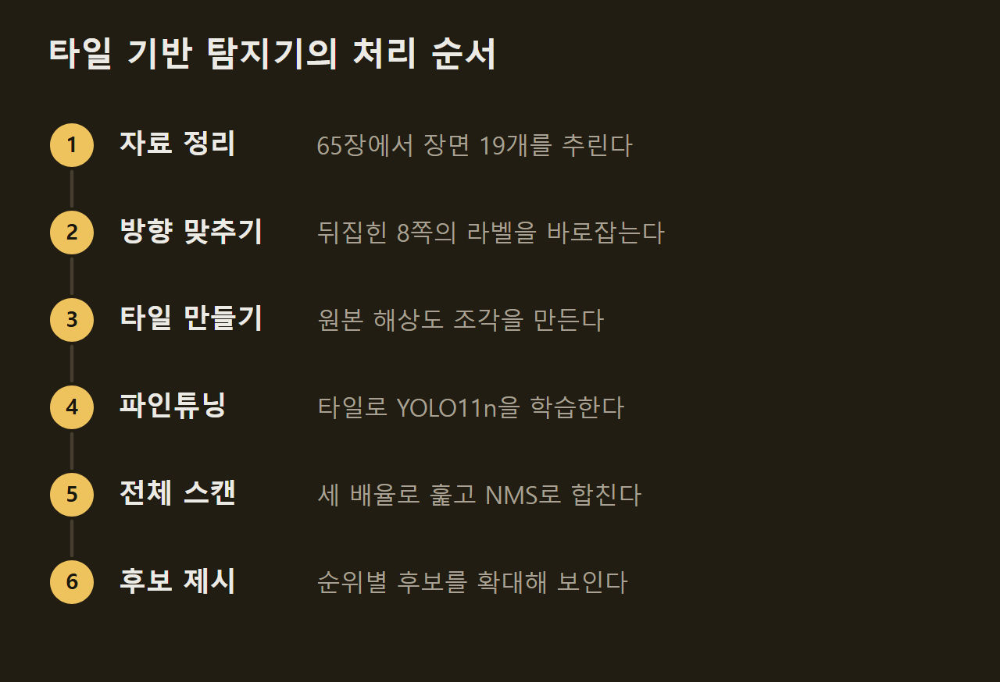
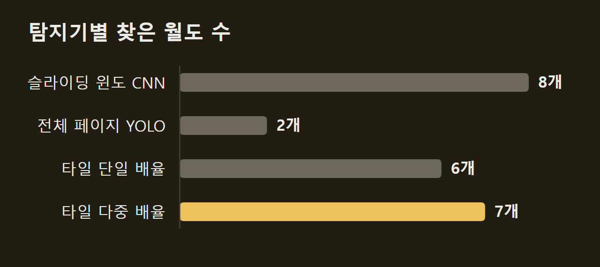
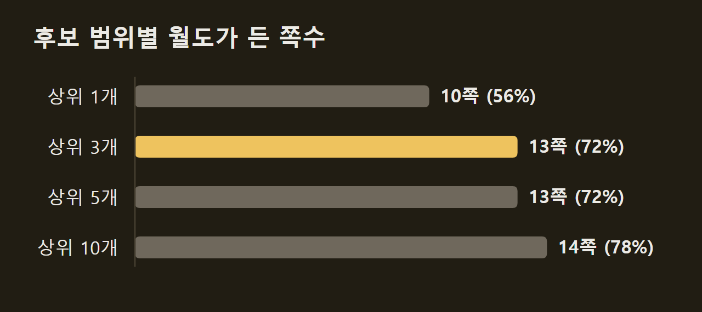
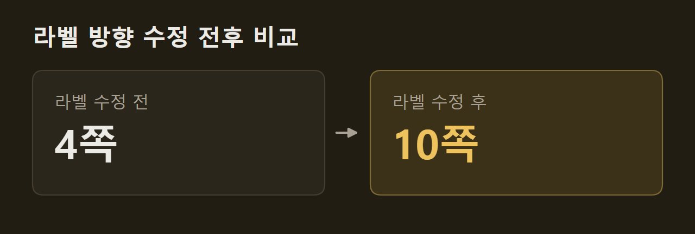

> 이 글은 아래 원문을 우리말로 간추려 정리한 글입니다. 정확한 내용은 원문을 확인하십시오.
>
> 원문: [github.com/VasilisVas1/wheres-waldo](https://github.com/VasilisVas1/wheres-waldo)  
> 원문을 소개한 뉴스레터: The Living Edge

『Where's Waldo?』 그림책의 한 쪽에서 월도가 차지하는 면적은 약 0.14%이고, 월도 주위에는 비슷하게 생긴 인물이 수백 명 그려져 있다. 개발자 VasilisVas1은 컴퓨터 비전으로 월도를 찾는 탐지기 세 가지를 만들어 학습에 쓰지 않은 페이지로 비교하고, 그 결과를 [wheres-waldo](https://github.com/VasilisVas1/wheres-waldo) 저장소에 공개했다. 가장 나은 탐지기를 담은 Streamlit 앱에 그림책 페이지 스캔을 올리면, 월도일 가능성이 높은 자리에 확신도 순으로 번호를 매긴 상자를 그리고 후보마다 확대 화면을 보여 준다.

```요약
요약: wheres-waldo는 월도를 찾는 탐지기 세 가지를 비교한 프로젝트로, 가장 나은 다중 배율 타일 YOLO는 월도가 있는 평가용 18쪽 중 13쪽(72%)에서 월도를 상위 3개 후보 안에 넣었다.
```

```용어
타일(tile): 큰 페이지를 줄이지 않고 640×640픽셀 크기로 겹치게 잘라 낸 조각이다.
NMS(Non-max suppression): 같은 대상을 가리키며 겹친 상자 가운데 확신도가 가장 높은 것만 남기는 처리다.
IoU: 예측한 상자와 정답 상자가 겹치는 정도를 나타내는 값이다. 이 프로젝트는 0.3 이상이면 맞힌 것으로 셌다.
5겹 교차 검증: 장면 19개를 다섯 몫으로 나눠, 각 장면을 그 장면을 학습에 쓰지 않은 모델로 평가하는 방식이다.
상위 k개 적중(hit@k): 월도가 확신도 순 후보 k개 안에 들었는지로 성능을 매기는 지표다.
```

## 1. 월도를 찾기 어려운 이유

월도를 찾기 어려운 가장 큰 이유는 크기다. 공개 주석 데이터셋은 모든 페이지를 640×640픽셀로 늘이거나 줄여서 내보내므로, 이 이미지에서 월도는 중앙값 기준 약 18×35픽셀에 그친다. 이 크기는 YOLO11n이 쓰는 가장 거친 특징 맵(feature map)의 칸 하나 정도다.

반면 원본 스캔은 폭이 1,300~2,800픽셀이고, 여기서 월도는 약 50×60픽셀이다. 개발자는 이 차이 때문에 가장 나은 탐지기에서 페이지를 아예 줄이지 않았다.

## 2. 세 가지 탐지기와 타일 방식

학습 자료는 두 가지다. 하나는 Roboflow의 주석 이미지 65장으로, 대부분이 페이지와 관계없는 초상화 확대본이어서 실제로 쓸 수 있는 장면은 19개뿐이었다. 다른 하나는 Hey-Waldo의 원본 해상도 스캔과 라벨이 붙은 조각 약 3,000개다.

**슬라이딩 윈도 CNN은 모든 부분을 직접 구현했다.** 매개변수 9만 8천 개짜리 CNN이 64×64 조각을 보고 월도인지 아닌지 판정하며, 이 판정 창을 다섯 가지 크기로 페이지 위에 밀어 가며 적용한다(슬라이딩 윈도, sliding window). IoU와 NMS를 프레임워크에 맡기지 않고 코드로 드러내려고 만든 탐지기다.

**전체 페이지 YOLO는 프레임워크 기준 모델이다.** 페이지를 640×640으로 줄인 이미지로 YOLO11n을 파인튜닝했다.

**타일 YOLO는 페이지를 줄이지 않는다.** 같은 YOLO11n을 원본 해상도 타일로 학습하는데, 타일은 실제 월도가 무작위 위치에 놓인 것, 배경만 있는 것, 다른 학습 페이지의 월도를 오려 붙인 것으로 구성된다. 추론할 때는 0.75배, 1배, 1.5배 세 배율로 겹치는 타일을 훑어 상자를 원래 좌표로 되돌리고, 직접 작성한 NMS로 중복을 합친다. 학습 전에는 라벨과 스캔의 방향을 맞추는 단계도 거치며, 이 단계가 생긴 경위는 4절에서 다룬다.



## 3. 교차 검증으로 잰 탐지 성능

평가는 장면 단위 5겹 교차 검증으로 했다. 장면 19개 중 월도가 있는 장면은 18개이고 정답 상자는 21개이며, 정밀도와 재현율에 쓴 확신도 기준은 평가 대상이 아닌 나머지 네 몫에서 골랐다.

원본 해상도를 지킨 타일 방식이 가장 나은 결과를 냈다. 전체 페이지 YOLO는 월도를 2개 찾는 동안 오탐을 22개 냈지만, 타일 YOLO는 단일 배율에서 6개를 오탐 없이 찾았고 다중 배율에서는 오탐 14개와 함께 7개를 찾았다. 슬라이딩 윈도 CNN은 8개로 가장 많이 찾았으나, 오탐이 4,203개여서 정밀도가 0.002에 그쳤다.



다만 다중 배율 수치는 다소 낙관적이다. 세 배율 조합을 네 가지 후보 가운데 같은 평가 장면으로 골랐기 때문이고, 개발자는 조정을 거치지 않은 기준값으로 단일 배율 결과를 제시했다. 쉽게 틀리는 배경 조각을 골라 다시 학습시키는 방법(hard-negative mining)은 효과가 없었고, 오려 붙인 합성 데이터의 효과는 따로 떼어 실험하지 않아 확인되지 않았다.

정답이 한 쪽에 하나뿐이므로, 개발자는 "월도가 상위 k개 후보 안에 있는가"를 가장 쓸모 있는 물음으로 꼽았다. 다중 배율 타일 YOLO는 18쪽 중 10쪽(56%)에서 월도를 1순위로 꼽았고, 상위 3개까지 넓히면 13쪽(72%)이 됐다.



평가 자료가 작아서 이 수치들은 오차 범위가 넓다. 상자가 21개뿐이라 탐지 하나에도 결과가 크게 바뀌며, 실제로 같은 노트북을 두 번 실행하자 전체 페이지 YOLO의 적중 수가 4개에서 2개로 달라졌다. 2·3·13쪽에서는 확신도 0.01 이상인 후보 중에 월도가 한 번도 없었고 7쪽은 36순위에서야 나왔는데, 개발자도 그 원인을 밝히지 못했다.

## 4. 뒤집힌 라벨 8쪽을 바로잡은 과정

타일 YOLO의 첫 결과가 낮았던 원인은 모델이 아니라 라벨에 있었다. 첫 시도에서 월도가 상위 10개 안에 든 쪽은 18쪽 중 4쪽뿐이었고, 확신도가 가장 높은 오탐은 오히려 월도와 꼭 닮은 인물이었다.

주석 데이터셋을 내보내는 과정에서 19쪽 중 8쪽이 원본 스캔과 견주어 뒤집히거나 회전되어 있었다. 이 때문에 크기 비율만 맞춰 상자를 옮기자 정답 위치가 경찰관, 편지, 빨간 판 위에 놓였다. 앞서 무작위로 4쪽을 점검했지만, 우연히 영향을 받지 않은 쪽만 뽑혔다.

개발자는 쪽마다 주석 이미지를 스캔의 뒤집기·회전 8가지와 이미지 상관값으로 견주어 방향을 찾았다. 맞는 방향은 약 0.99, 틀린 방향은 모두 0.75 이하였으며, 뚜렷하게 앞서는 방향이 없으면 처리를 멈추게 했다. 상자는 찾은 변환의 역변환으로 되돌렸고, 단위 테스트가 8가지 경우의 계산을 모두 검사한다.



학습 방식을 그대로 두고 라벨만 고치자 4쪽이 10쪽으로 늘었다. 이 값은 첫 시도의 학습 방식으로 다시 잰 것이어서, 3절의 다중 배율 결과(14쪽)와는 조건이 다르다. 개발자는 라벨을 표본만이 아니라 모든 예제에서 확인해야 한다는 교훈을 노트북 06에 적었다.

## 5. 데모 앱의 후보 순위 화면

데모 앱은 탐지 결과를 상자 하나가 아닌 후보 순위로 보여 준다. 페이지를 올리고 탐지기를 고른 뒤 Find Waldo! 버튼을 누르면, CPU에서 몇 초 안에 확신도 순 번호 상자와 후보별 확대 화면이 나온다. 개발자는 폭 1,300픽셀 이상의 원본 스캔을 권하는데, 작은 웹 이미지로는 월도에 할당되는 픽셀이 너무 적기 때문이다.

")

월도가 늘 1번 후보로 나오지는 않는다. 다음 판타지 장면에서 1번 후보(88%)는 월도가 아니라 웬다(Wenda)였고 진짜 월도는 2번 후보였는데, 확대 화면이 있어서 전체 페이지를 키우지 않고도 확인할 수 있었다.

")

개발자가 데모를 써 보며 받은 인상으로는 웬다가 가장 흔한 오탐이었다. 웬다는 월도와 같은 빨강·하양 줄무늬 옷에 안경을 쓰고 있다. 데모 모델은 19쪽 전부로 학습했으므로 데모 결과로는 성능을 잴 수 없고, 새 페이지에서의 성능은 교차 검증 수치로 추정해야 한다.

## 6. 상위 3개 밖에 있는 월도

닮은 인물이 많은 페이지에서는 월도가 상위 3개 밖으로 밀려난다. 작은 초상화 수백 장으로 덮인 다음 페이지에서 1번 후보(93%)는 엽서 우표에 인쇄된 월도 초상이었다.

")

숨은 월도 초상은 더 아래 순위에서 나왔다. 예를 들어 6번 후보(38%)는 빨강·하양 방울 모자와 둥근 안경을 쓰고 있어서, 후보를 3개에서 끊으면 놓친다. 이 때문에 개발자는 기본값 3개로 시작하되, 닮은 인물이 많은 페이지에서는 후보를 10개까지 늘려 확대 화면을 훑어보라고 권한다.

")

확신도는 모델이 매긴 점수일 뿐 확률이 아니어서, 우표 초상이 93%를 받고 웬다도 자주 높은 점수를 받는다. 개발자의 결론은 이 탐지기가 페이지에서 월도가 있을 만한 구역을 짚는 데는 충분하지만, 결과를 그대로 믿을 수준은 아니라는 것이다. 성능을 끌어올린 요인은 페이지를 줄이지 않은 타일 방식과 라벨 방향 수정이었다.

## 출처와 작성 방식

- 원문: [github.com/VasilisVas1/wheres-waldo](https://github.com/VasilisVas1/wheres-waldo)
- 원문을 소개한 뉴스레터: The Living Edge
- 그림: 아래에 출처가 적힌 그림은 원문에 실린 그림을 인용한 것이며 저작권은 원저작자에게 있습니다. 출처가 없는 그래프는 원문에 적힌 값으로 직접 그린 것입니다.
- 작성 방식: 직접 만든 뉴스 정리 파이프라인(VISER)으로 생성하고 검수한 글입니다. 본문의 수치와 주장은 원문에서 가져온 것입니다.
- 정리 주차: 2026-W39
