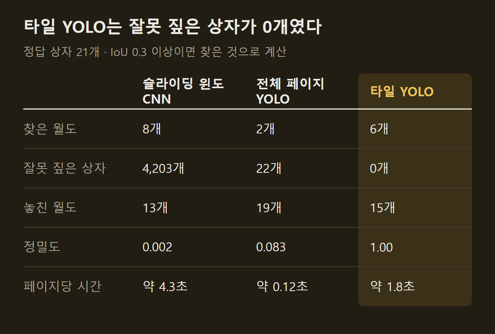
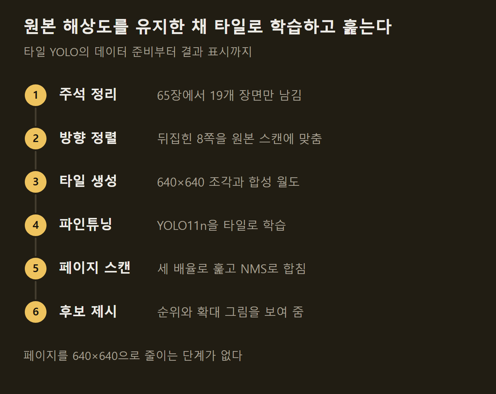
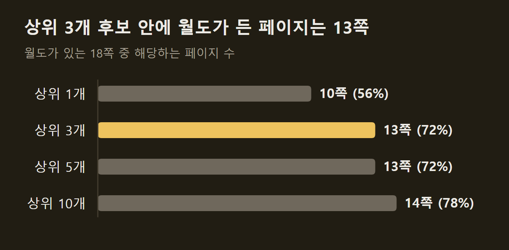
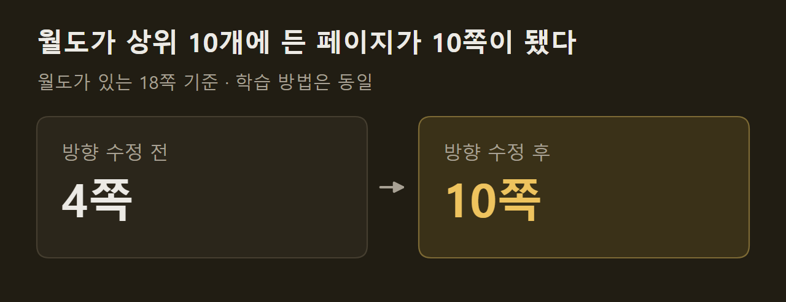

> 이 글은 아래 원문을 우리말로 간추려 정리한 글입니다. 정확한 내용은 원문을 확인하십시오.
>
> 원문: [github.com/VasilisVas1/wheres-waldo](https://github.com/VasilisVas1/wheres-waldo)  
> 원문을 소개한 뉴스레터: The Living Edge

『월리를 찾아라』 한 페이지에서 월도가 차지하는 면적은 약 0.14%이고, 주변에는 비슷하게 생긴 인물이 수백 명 그려져 있다. 개발자 VasilisVas1은 이 그림에서 월도를 찾는 탐지기 세 가지를 만들어 [wheres-waldo](https://github.com/VasilisVas1/wheres-waldo) 저장소로 공개했다. 책 페이지를 스캔한 그림을 올리면 월도일 가능성이 높은 자리를 순위대로 골라 번호 상자로 표시하고, 후보마다 확대한 그림을 함께 보여 준다.

```요약
요약: 월도를 찾는 탐지기 세 가지를 학습에 쓰지 않은 페이지로 비교한 프로젝트로, 원본 해상도 타일로 학습한 YOLO11n이 월도가 있는 18쪽 중 72%에서 월도를 상위 3개 후보 안에 넣었지만 정답 상자가 21개뿐이라 수치가 크게 흔들릴 수 있다.
```

```용어
YOLO11n: 그림 안에서 물체의 위치를 상자로 찾아내는 객체 탐지 모델 YOLO11의 가장 작은 버전이다.
파인튜닝: 이미 학습된 모델을 새 데이터로 조금 더 학습시켜 특정 대상에 맞추는 일이다. 여기서는 YOLO11n을 월도 그림으로 다시 학습시켰다.
타일: 큰 페이지를 줄이지 않고 640×640 크기로 잘라 낸 조각이다.
IoU: 모델이 그린 상자와 정답 상자가 겹치는 비율이다. 이 프로젝트는 0.3 이상이면 찾은 것으로 쳤다.
NMS: 같은 대상에 겹쳐 그려진 상자 가운데 점수가 가장 높은 것만 남기는 처리다.
```

## 1. 세 가지 탐지기와 성적

저장소에는 탐지기 세 가지가 들어 있다.

1. 슬라이딩 윈도 CNN: 64×64 조각이 월도인지 아닌지만 답하는 파라미터 9만 8천 개짜리 신경망을 다섯 가지 크기로 페이지 위에서 옮겨 가며 적용한다. IoU와 NMS 계산이 코드에 드러나도록 프레임워크 없이 직접 짰다.
2. 전체 페이지 YOLO: 페이지 전체를 640×640으로 줄여 YOLO11n을 파인튜닝한 기준 모델이다.
3. 타일 YOLO: 같은 YOLO11n을 원본 해상도 타일로 학습시킨 모델이고, 여러 배율로 훑는 방식을 더할 수 있다.

평가는 장면 단위 5겹 교차 검증으로 했다. 19개 장면을 다섯 무리로 나누어, 각 장면을 그 장면을 학습에 쓰지 않은 모델이 채점하게 한 방식이다. 월도가 있는 장면은 18개이고 정답 상자는 모두 21개다.



CNN은 월도를 8개 찾았지만 잘못 짚은 상자가 4,203개여서, 페이지마다 약 220개의 틀린 상자 속에 정답이 묻힌다. 전체 페이지 YOLO는 2개밖에 찾지 못했다. 타일 YOLO는 6개를 찾으면서 틀린 상자를 하나도 내지 않았고, 세 배율로 훑으면 찾은 수가 7개로 늘지만 틀린 상자도 14개 생기고 시간은 약 6초가 걸린다. 앞의 두 방식은 640×640 그림에서, 타일 방식은 원본 크기 스캔에서 잰 시간이다.

## 2. 페이지를 줄이지 않는 타일 방식

전체 페이지 YOLO가 부진한 이유는 월도가 너무 작아지기 때문이다. 공개 데이터는 모든 페이지를 640×640으로 늘이거나 줄여 놓았는데, 이 크기에서 월도는 중앙값 기준 약 18×35픽셀이다. YOLO11n이 그림을 가장 성기게 나눠 볼 때의 한 칸 정도에 해당한다. 원본 스캔은 폭이 1,300~2,800픽셀이고 여기서는 월도가 약 50×60픽셀로 남는다.

그래서 타일 YOLO는 페이지를 줄이지 않는다. ==성능을 끌어올린 것은 페이지를 줄이지 않은 선택 하나였다.== 학습에는 월도가 임의의 위치에 놓인 타일, 배경만 있는 타일, 다른 학습 페이지에서 오려 낸 월도를 붙여 넣은 타일을 쓴다. 추론할 때는 서로 겹치는 타일로 페이지 전체를 0.75배, 1배, 1.5배로 훑은 뒤 상자를 원래 좌표로 되돌리고, 겹친 상자는 직접 작성한 NMS로 합친다.



효과가 없었던 시도도 적혀 있다. 모델이 자주 틀리는 배경을 골라 다시 학습시키는 방법은 결과를 바꾸지 못했다. 월도를 붙여 넣은 합성 데이터는 그것만 빼고 비교한 실험이 없어서 도움이 됐는지 가려내지 못했다.

## 3. 상위 후보 순위로 본 성능

퍼즐 한 페이지에 숨은 월도는 한 명이다. 작성자는 그래서 정밀도보다 "월도가 상위 몇 개 후보 안에 드는가"가 더 쓸모 있는 질문이라고 보았고, 가장 성적이 좋은 다중 배율 타일 YOLO를 월도가 있는 18쪽에서 이 기준으로 다시 쟀다.



첫 번째 후보가 월도인 페이지는 절반을 조금 넘고, 후보를 세 개까지 보면 72%로 오른다. 데모 앱이 확신하는 상자 하나만 내놓지 않고 후보를 순위대로 여러 개 보여 주는 까닭이 여기에 있다.

이 수치에는 조건이 붙는다. 정답 상자가 21개뿐이어서 탐지 하나만 달라져도 결과가 크게 바뀌고, 같은 노트북을 두 번 돌렸을 때 전체 페이지 YOLO가 찾은 수는 4개에서 2개로 달라졌다. 배율 조합 0.75·1·1.5는 네 가지 후보 중에서 평가용 장면을 보고 골랐으므로 다중 배율 수치는 다소 낙관적이다. 2, 3, 13쪽에서는 월도를 끝내 찾지 못했고 7쪽에서는 36번째 후보로 밀렸는데, 작성자는 그 이유를 설명하지 못했다고 적었다.

## 4. 데모 앱의 후보 화면

타일 YOLO는 Streamlit 앱으로 만들어져 있다. 페이지를 올리고 탐지기를 고르면 페이지 위에 확신도 순으로 번호 상자가 그려지고, 아래에는 후보마다 확대한 그림이 나오는데 1번 후보가 가장 크다. 폭이 1,300픽셀쯤 되는 원본 크기 스캔을 넣어야 하고, 작은 웹 그림은 월도에게 남는 픽셀이 너무 적다.

1번 후보가 늘 월도인 것은 아니다. 작성자가 예로 든 페이지에서 확신도 88%인 1번 후보는 월도가 아니라 웬다였고, 진짜 월도는 54%인 2번 후보였다. 웬다는 같은 빨간 줄무늬 옷과 안경 차림이어서 가장 자주 나오는 오답이다.

")

후보 세 개로 모자란 페이지도 있다. 작은 초상화 수백 장으로 덮인 페이지에서 1번 후보(93%)는 엽서 우표에 인쇄된 월도 초상화였고, 숨겨진 월도풍 초상화는 순위가 더 내려가야 나온다. 빨간 줄무늬 방울 모자와 둥근 안경을 쓴 6번 후보의 확신도는 38%다. 후보 수 슬라이더를 10까지 올려야 이런 후보가 보인다.

")

==확신도는 모델이 매긴 점수이지 확률이 아니다.== 우표 초상화가 93%를 받고 웬다 같은 닮은꼴도 높은 점수를 자주 받는다. 앱에 든 모델은 19쪽 전부로 학습했으므로 이 페이지들에서는 실제보다 좋게 보이고, 새 페이지에서의 성능은 3절의 교차 검증 수치로 짐작해야 한다. 설치와 실행 방법, 전체 결과를 다시 만드는 절차는 원문에 정리되어 있고, 재현에는 CPU 노트북으로 9~10시간쯤 걸린다.

## 5. 뒤집힌 정답 위치

타일 YOLO의 첫 시도는 결과가 나빴다. 월도가 상위 10개 후보에 든 페이지가 18쪽 중 4쪽뿐이었고, 모델이 가장 확신한 오답들을 들여다보니 월도를 빼닮은 인물이었다. 모델이 아니라 정답 표시가 잘못되어 있었다.

원인은 데이터의 방향이었다. 상자 주석이 달린 데이터는 19쪽 중 8쪽이 원본 해상도 스캔과 달리 뒤집히거나 회전된 채 내보내져 있었다. 크기만 맞춰 상자를 옮기자 정답 상자가 경찰관, 편지, 빨간 판 위에 놓였다. 앞서 무작위로 네 쪽을 뽑아 확인했지만 마침 문제가 없는 페이지만 뽑혔다.

작성자는 페이지마다 주석이 달린 그림을 스캔의 뒤집기·회전 여덟 가지와 비교하도록 고쳤다. 두 그림의 상관값은 맞는 방향에서 약 0.99이고 틀린 방향에서는 0.75 이하다. 뚜렷하게 맞는 방향이 없으면 처리를 멈추고, 찾은 방향의 역변환으로 상자를 옮긴다.



학습 방법을 그대로 둔 채 정답 위치만 바로잡았는데 4쪽이 10쪽이 됐다. ==정답 표시는 표본이 아니라 모든 예제에서 확인해야 한다.== 작성자는 이 교훈을 마지막 노트북에 적었고, 지금은 전처리 노트북이 모든 상자를 그림으로 보여 준다.

## 출처와 작성 방식

- 원문: [github.com/VasilisVas1/wheres-waldo](https://github.com/VasilisVas1/wheres-waldo)
- 원문을 소개한 뉴스레터: The Living Edge
- 그림: 아래에 출처가 적힌 그림은 원문에 실린 그림을 인용한 것이며 저작권은 원저작자에게 있습니다. 출처가 없는 그래프는 원문에 적힌 값으로 직접 그린 것입니다.
- 작성 방식: 직접 만든 뉴스 정리 파이프라인(VISER)으로 생성하고 검수한 글입니다. 본문의 수치와 주장은 원문에서 가져온 것입니다.
- 정리 주차: 2026-W39
