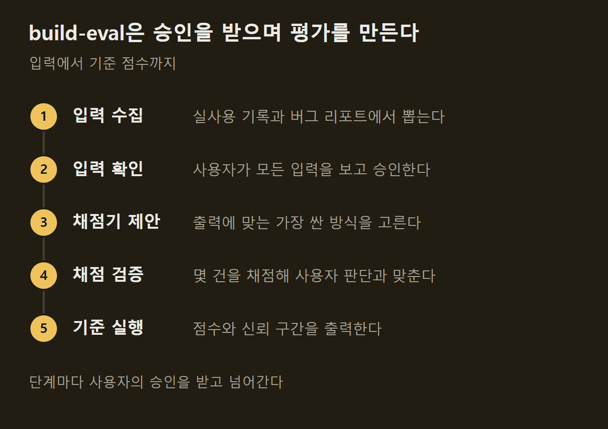
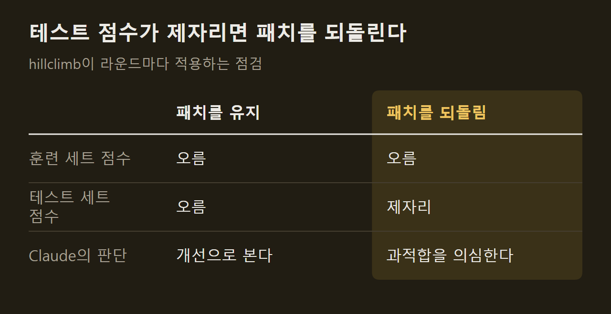
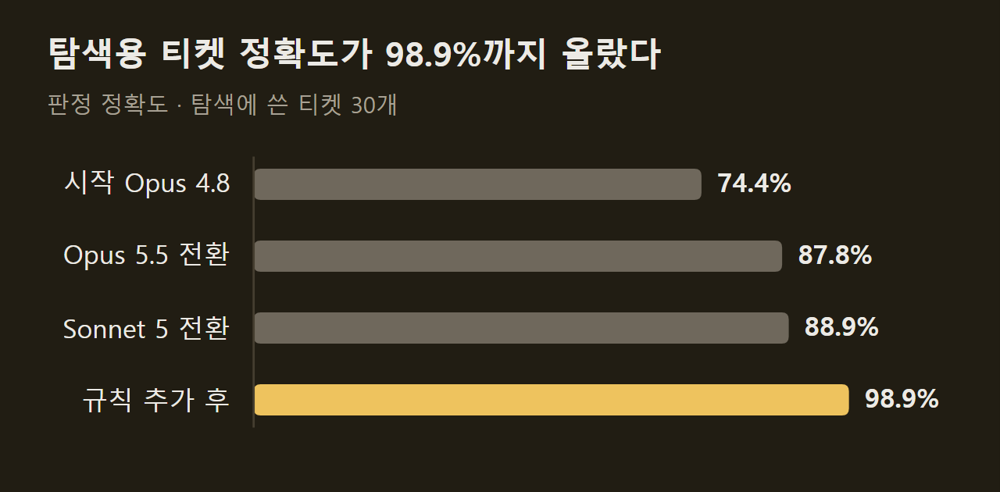
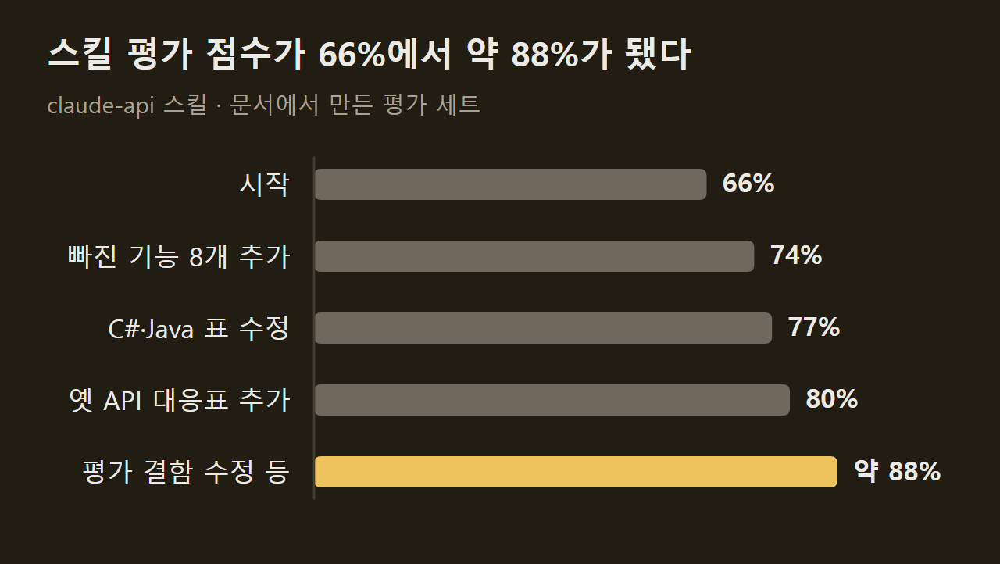

> 이 글은 아래 원문을 우리말로 간추려 정리한 글입니다. 정확한 내용은 원문을 확인하십시오.
>
> 원문: [claude.dev/blog/automating-eval-design-and-hillclimbing](https://claude.dev/blog/automating-eval-design-and-hillclimbing/)  
> 원문을 소개한 뉴스레터: TLDR AI

AI 애플리케이션의 프롬프트를 고친 뒤 성능이 실제로 나아졌는지 알려면, 같은 과제를 다시 풀게 하고 점수를 매기는 평가가 있어야 한다. 그런데 평가를 잘못 만들면 점수가 실제 성능을 반영하지 못하고, 평가 점수만 보고 고치다 보면 평가에만 잘 맞는 시스템이 되기 쉽다. Claude Code에 들어 있는 [claude-api 스킬](https://claude.dev/blog/automating-eval-design-and-hillclimbing/)에 이 두 작업을 맡는 명령이 추가됐다. `/claude-api build-eval`은 사용자에게 질문하면서 코드베이스 안에 평가 세트와 채점기를 만들고, `/claude-api hillclimb`은 그 평가를 기준으로 프롬프트나 모델 설정을 한 번에 하나씩 바꾸면서 점수나 비용을 개선한다.

```요약
요약: 평가 세트를 만드는 명령과 그 평가로 애플리케이션을 고치는 명령이며, 내부 고객 지원 벤치마크에서는 숨겨 둔 티켓 14개의 정확도를 78.6%에서 90.5%로 올리면서 비용을 약 5분의 1로 낮췄다.
```

```용어
평가: 애플리케이션에 정해 둔 과제를 풀게 하고 결과에 점수를 매겨 성능을 재는 절차다.
채점기: 출력이 맞았는지 판정하는 부분이다. 코드로 검사하거나 다른 모델에게 판정을 맡긴다.
힐클라이밍: 변경을 하나 적용하고 평가 점수를 본 뒤 유지하거나 되돌리는 일을 되풀이하는 개선 방식이다.
과적합: 평가 점수는 오르는데 실제 사용 환경의 성능은 나아지지 않는 상태다.
하네스: 모델을 둘러싼 코드로, 프롬프트와 도구, Claude를 호출하는 루프가 여기에 든다.
```

## 1. build-eval의 진행 순서

`/claude-api build-eval`을 실행하면 Claude가 사용자를 인터뷰하고, 정해진 지점마다 멈춰 승인을 받으면서 평가를 만든다. 입력은 실제 사용 기록을 가장 먼저 쓰는데, 보존 기간과 민감한 데이터를 먼저 묻는다. 그다음은 버그 리포트와 지원 티켓, 사용자가 직접 쓴 사례 5~10개, 코드베이스에서 합성한 사례 순서다. 모은 입력은 한 페이지에 전부 나열되고, 사용자가 확인하기 전에는 다음으로 넘어가지 않는다.

입력이 정해지면 Claude는 출력 형태에 맞는 채점기 가운데 가장 싼 것을 제안한다. 정답이 정해진 라벨이나 스키마에 맞는 JSON처럼 출력 범위가 좁으면 코드로 검사하고, 정답이 여러 개일 수 있는 열린 출력이면 다른 모델이 채점하는 방식(LLM-as-judge)을 쓴다. 이때 채점 모델은 1~5점 척도가 아니라 확인할 수 있는 항목으로 쓴 기준표를 읽고 점수와 이유를 함께 내며, 평가 대상 모델과 다른 모델이어야 한다.

Claude는 몇 건을 먼저 채점해 보이고 사용자라면 다르게 매겼을 건이 있는지 묻는다. ==채점 오류는 평가가 잘못 설정되는 가장 흔한 원인에 속한다.== 채점기를 확인한 뒤에는 평가 규모와 예상 소요 시간을 알리고 기준 실행을 돌려 점수와 신뢰 구간을 출력한다.



기준 실행 중에는 세 가지를 함께 점검한다.

1. 채점기: 같은 출력을 두 번 채점해 판정이 바뀌는지 본다.
2. 실행 환경: 타임아웃, API 오류, 잘린 답변이 모델의 변동으로 잡히지 않게 걸러 낸다.
3. 개선 여지: 기준 점수가 이미 약 95% 이상이면 품질 대신 비용이나 지연 시간을 목표로 삼으라고 알린다.

## 2. 좋은 평가의 조건

이 절차는 원문이 먼저 제시한 평가 설계 원칙을 따른 것이다. 잘 만든 평가가 공통으로 갖추는 요소는 네 가지다.

1. 실사용 반영: 만들기 쉽거나 채점하기 쉬운 과제가 아니라 실제 사용 환경에서 중요한 과제를 뽑는다.
2. 모델에 따른 향상: 더 강한 모델과 더 높은 effort 설정에서 점수가 오른다. 그렇지 않으면 과제가 모호하거나 채점기가 어긋난 경우가 많다.
3. 개선 여지: 가장 강한 모델도 100%에 한참 못 미쳐야 하고, 그 차이가 풀 수 없거나 모호한 과제 때문이어서는 안 된다.
4. 낮은 변동: 같은 조건으로 다시 돌려도 점수가 크게 달라지지 않는다. 앞선 시도가 남긴 파일이나 git 기록이 답을 알려 주는 경우도 변동의 원인이 된다.

사례를 고르는 기준도 따로 다룬다. 모델의 능력은 과제에 따라 들쭉날쭉해서, 지금 모델이 틀린다는 이유로 사례를 고르면 그 모델이 약한 지점만 모이게 된다. ==그런 평가는 애플리케이션에 어려운 일이 아니라 한 모델의 실패 양상을 잰다.==

원문은 어려운 사례를 사람이 어렵다고 판단해서 고르라고 하고, 넣기 전에 왜 어려운지 말할 수 있는지를 기준으로 제시한다. 실사용 기록도 그대로 믿지는 말라고 덧붙인다. 사용자는 될 것 같은 일만 시도하는 경향이 있어서, 기록에서만 뽑은 과제는 쉬운 쪽으로 치우칠 수 있다.

## 3. hillclimb의 과적합 점검

평가는 실제 사용 환경의 과제 분포와 완전히 같을 수 없으므로, 평가 점수만 보고 고치면 평가에만 잘 맞는 시스템이 된다. 원문이 든 예는 OCR이다. 평가 과제에는 OCR이 도움이 되지만 실제 업무에서는 거의 쓸 일이 없다면, OCR 도구를 추가해 점수가 올라도 실제 성능은 달라지지 않는다.

`/claude-api hillclimb`은 시작할 때 무엇을 최적화할지 묻고 평가 세트를 무작위로 훈련 세트와 테스트 세트로 나눈다. 바꿀 수 있는 대상은 시스템 프롬프트, 스킬과 지시 파일, 도구 설명, 모델과 effort 같은 API 설정, 하네스 코드 가운데 사용자가 허용한 것이다. 첫 라운드 전에는 평가 점수가 우연만으로 움직이는 폭이 사용자가 의미 있다고 볼 최소 개선 폭보다 작은지 확인하고, 그렇지 않으면 반복 횟수나 사례를 늘리라고 제안한다.

라운드마다 Claude는 직전 라운드의 훈련 세트 기록을 읽고 변경 하나를 패치로 제안한다. 문장 하나를 다듬는 수준이 아니라 실패를 일으킨 부분을 다시 쓰거나 빠진 규칙을 넣는 식으로 원인을 고치며, 실패한 내용을 프롬프트에 그대로 붙여 넣지는 않는다. 패치를 적용해 평가를 돌린 뒤에는 두 세트의 점수를 견주어 유지할지 정한다. ==훈련 점수만 오르고 테스트 점수가 제자리면 패치를 되돌린다.== 점수가 떨어진 경우에도 되돌린다.



점수가 두세 라운드 동안 멈추면 Claude는 변경을 만들지 않고 남은 훈련 세트 실패를 하나씩 읽어 원인별로 분류한다. 이 단계에서 모호한 평가 사례, 하네스 오류, 실행마다 달라지는 변동이 걸러지고, 정당한 실패만 다음 라운드로 넘어간다. 작업이 끝나면 코드는 테스트 세트에서 가장 좋았던 버전으로 남고, 결과는 기준 실행과 견준 값에 신뢰 구간을 붙여 보고된다. 개선 폭이 변동 범위 안이면 그렇다고 밝히고 병합하지 말라고 권한다.

## 4. 사례 1: 고객 지원 벤치마크

글쓴이들은 내부 고객 지원 벤치마크에 비용 절감과 성능 향상을 목표로 이 명령을 돌렸다. 티켓 44개 가운데 30개를 탐색에 쓰고 14개는 숨겨 두었다. 출발점은 기본 effort로 돌린 Opus 4.8이었고, 탐색용 티켓에서 판정 정확도는 74.4%, 토큰 비용은 티켓당 4.6센트였다.

힐클라이밍은 프롬프트 점검부터 시작해 의무적인 도구 호출 절차, 스크래치패드 단계, 서로 모순되는 규칙을 걷어 냈다. 이어 Opus 5.5를 낮은 effort로 돌리자 정확도가 87.8%로 올랐고 비용은 티켓당 1.9센트로 내려갔다. 절감분의 일부는 요금 차이에서 나오는데, Opus 5.5는 입력·출력 토큰이 Opus 4.8보다 20%, 캐시 읽기가 60% 싸다. 한 단계 낮은 Sonnet 5도 낮은 effort에서 88.9%를 기록했고 비용은 티켓당 1센트였다. 마지막으로 라우팅 규칙과 환불 한도 참조를 프롬프트에 넣자 Sonnet 5의 정확도는 비슷한 비용에서 98.9%가 됐다.



이 수치는 힐클라이밍이 직접 읽은 탐색용 티켓에서 나온 것이다. ==숨겨 둔 티켓 14개에서는 78.6%가 90.5%로 올랐다.== 비용은 처음 설정의 약 5분의 1이었다.

## 5. 사례 2: claude-api 스킬

두 번째 대상은 이 명령이 들어 있는 claude-api 스킬 자체다. 스킬이 API를 쓰는 코드를 올바르게 작성하게 하는지 재려고 문서에서 평가 세트를 만들었고, 시작 점수는 66%였다. 힐클라이밍에는 문서와 SDK를 볼 수 있게 했다.

Claude는 스킬이 다루지 않는 기능 여덟 개를 찾아 절을 추가했고 점수는 74%가 됐다. C#과 Java 타입 표의 오류를 고치자 77%로 올랐다. 그 뒤 두 라운드 동안 점수가 멈추자 남은 실패를 원인별로 분류했는데, 여기서 두 가지가 드러났다.

하나는 스킬에 내용이 있는데도 Claude가 학습 때 익힌 옛 API 형태로 코드를 쓴다는 점이었다. 그래서 기억하고 있는 옛 형태를 현재 형태로 바꿔 주는 표를 스킬 앞쪽에 넣었고 점수는 80%가 됐다. 다른 하나는 평가 자체의 결함이었다. 한 과제는 오류 유형 하나를 잡는 코드를 요구했는데 채점기는 셋 이상을 기대했고, 또 다른 채점기의 지시는 문서와 어긋났으며 실제 API로 확인해 보니 문서가 맞았다. ==내용을 채워도 오르지 않는 과제는 과제나 채점기의 결함을 뜻한다.== 이런 결함을 고치고 스킬을 더 손본 뒤 점수는 약 88%에 이르렀다.



두 명령은 Claude Code를 최신 버전으로 업데이트하면 쓸 수 있고, 실행 방법은 원문에 적혀 있다.

## 출처와 작성 방식

- 원문: [claude.dev/blog/automating-eval-design-and-hillclimbing](https://claude.dev/blog/automating-eval-design-and-hillclimbing/)
- 원문을 소개한 뉴스레터: TLDR AI
- 그래프: 원문에 적힌 값으로 새로 그린 그림입니다. 원문에 실린 그림이 아닙니다.
- 작성 방식: 직접 만든 뉴스 정리 파이프라인(VISER)으로 생성하고 검수한 글입니다. 본문의 수치와 주장은 원문에서 가져온 것입니다.
- 정리 주차: 2026-W40
