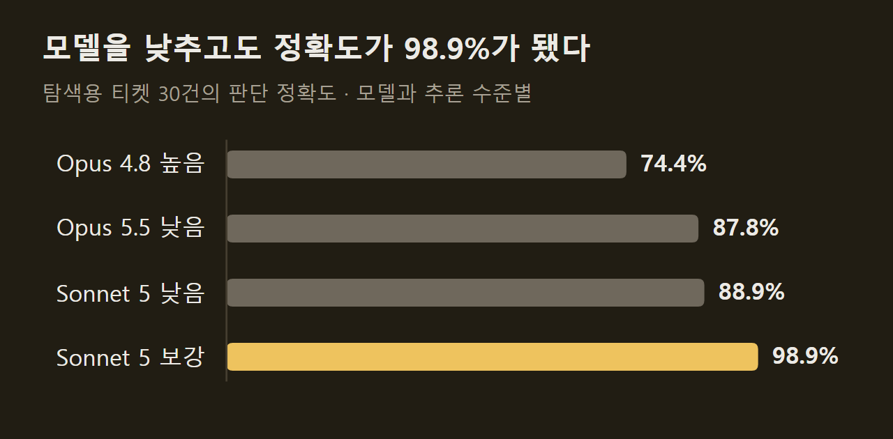
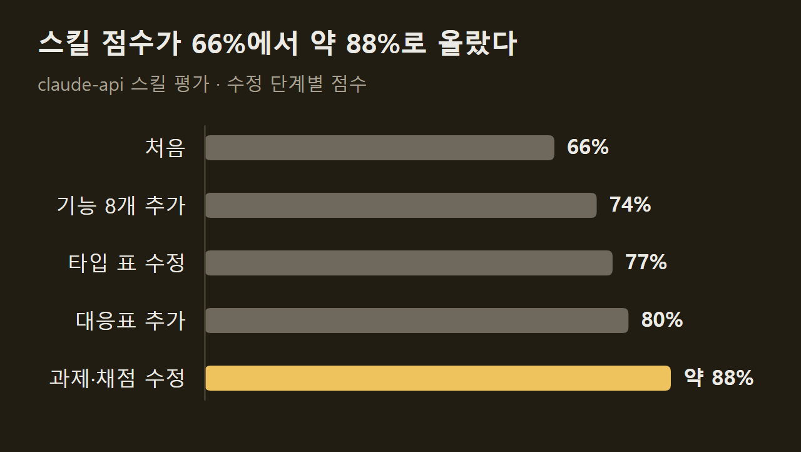

> 이 글은 아래 원문을 우리말로 간추려 정리한 글입니다. 정확한 내용은 원문을 확인하십시오.
>
> 원문: [claude.dev/blog/automating-eval-design-and-hillclimbing](https://claude.dev/blog/automating-eval-design-and-hillclimbing/)  
> 원문을 소개한 뉴스레터: TLDR AI

AI 앱의 프롬프트를 고친 뒤 점수가 올랐더라도, 평가 문제가 실제 사용 환경과 다르거나 채점이 흔들리면 그 점수는 믿기 어렵다. 점수를 올리려고 손본 내용이 평가 문제에만 통하고 실제 서비스에서는 효과가 없는 일도 흔하다. Anthropic은 Claude Code에 들어 있는 [claude-api 스킬](https://claude.dev/blog/automating-eval-design-and-hillclimbing/)에 `build-eval`과 `hillclimb` 두 명령을 추가했다. 앞의 것은 사용자에게 질문하면서 코드베이스 안에 평가 세트와 채점기를 만들고, 뒤의 것은 그 평가를 기준으로 프롬프트나 모델 설정을 한 번에 하나씩 바꿔 가며 점수나 비용을 개선한다.

```요약
요약: 평가를 만드는 build-eval과 그 평가로 앱을 한 단계씩 고치는 hillclimb 명령이며, Anthropic 사내 고객 지원 벤치마크에서는 모델을 Opus 4.8에서 Sonnet 5로 낮추고 프롬프트를 고쳐 탐색용 티켓 30건의 정확도를 높이면서 비용을 줄였다.
```

```용어
평가: 앱이나 스킬이 정해진 과제를 얼마나 잘 해내는지 점수로 재는 시험. 과제 사례와 채점기로 이루어진다.
채점기: 모델의 출력이 맞았는지 판정하는 장치. 코드로 검사하거나 다른 모델이 읽고 판정한다.
힐클라이밍: 무언가를 조금 바꾸고 점수를 다시 재어, 나아졌으면 남기고 아니면 되돌리기를 반복하는 개선 방식.
과적합: 평가 점수는 오르는데 실제 사용 환경의 성능은 그대로인 상태.
하니스: 모델을 둘러싼 코드. 프롬프트, 도구, Claude를 호출하는 반복 구조가 여기에 든다.
```

## 1. 좋은 평가의 조건

기사는 명령을 소개하기 전에 잘 설계된 평가가 공통으로 갖춘 요소 네 가지를 든다.

1. 실제 환경 반영: 만들기 쉽거나 채점하기 쉬운 과제가 아니라 실제로 쓰일 환경의 과제 분포를 따른다.
2. 모델 성능과 함께 오르는 점수: 더 강한 모델이나 더 높은 추론 수준에서 점수가 오르지 않으면 과제가 모호하거나 채점기가 잘못 맞춰진 경우가 많다.
3. 남은 여유: 가장 강한 모델도 100%에 한참 못 미쳐야 변경의 효과를 가릴 수 있다. 다만 그 차이가 불가능하거나 모호한 과제 때문이어서는 안 된다.
4. 낮은 실행 간 편차: 같은 출력에 다른 판정을 내는 채점기, 일관되지 않은 설정, 이전 실행이 남긴 파일이나 git 기록이 편차를 만든다.

어려운 사례를 고르는 방법도 따로 짚는다. 모델의 능력은 과제마다 들쭉날쭉하므로, 지금 모델이 틀린 사례만 모으면 그 모델이 약한 지점만 표본으로 삼게 된다. ==그런 평가는 과제의 어려움이 아니라 한 모델의 실패 양상을 잰다.== 기사는 사람이 어렵다고 판단했고 왜 어려운지 설명할 수 있는 사례를 넣으라고 한다. 운영 트래픽, 버그 리포트, 티켓에서 나온 실패 사례가 좋은 재료지만, 사용자는 될 법한 일만 시도하는 경향이 있어서 트래픽만으로 만든 평가는 쉬운 쪽으로 치우칠 수 있다.

")

## 2. build-eval의 진행 순서

`build-eval`을 실행하면 Claude가 사용자에게 질문하고, 평가를 코드베이스 안에 만들고, 정해진 지점마다 멈춰 승인을 받는다. 먼저 입력 사례를 모으는데, 재료를 찾는 순서는 다음과 같다.

1. 운영 대화 기록: 보존 정책과 민감한 데이터가 있는지 먼저 묻는다.
2. 버그 리포트와 지원 티켓
3. 사용자가 직접 쓴 사례 5~10개
4. 코드베이스에서 합성한 사례

실제 예시 몇 개를 기준으로 합성 데이터를 만들 수도 있다. 모은 입력은 한 페이지에 전부 보여 주고 사용자가 확인할 때까지 기다린다. 기사가 예로 든 것은 고객 메일을 담당 부서로 나누는 앱의 입력 24건이며, 각 메일에는 '결제', '쉬움', '모호함' 같은 태그가 붙어 있다.

")

입력이 확정되면 Claude는 출력 형태에 맞는 채점기 가운데 가장 싼 것을 제안한다. 정해진 라벨이나 스키마에 맞는 JSON처럼 출력의 범위가 좁으면 코드로 검사한다. 정답이 여럿인 열린 출력이면 두 번째 모델이 입력과 출력, 채점 기준을 읽고 점수와 이유를 낸다. 이때 채점 기준은 1~5점 척도가 아니라 하나씩 확인할 수 있는 주장으로 쓰고, 채점 모델은 시험 대상 모델과 달라야 한다. Claude는 몇 건을 채점해 보인 뒤 사용자라면 다르게 매겼을 사례가 있는지 묻는다. 채점 오류는 평가가 잘못 구성되는 가장 흔한 원인에 속하기 때문이다.

채점기를 확인하면 평가 규모와 예상 소요 시간을 알리고 기준 점수를 재어 신뢰 구간과 함께 출력한다. 이 과정에서 같은 출력을 두 번 채점해 판정이 바뀌는지 보고, 시간 초과·API 오류·잘린 답변을 걸러낸다. 기준 점수가 이미 약 95% 이상이면 품질 대신 비용이나 지연 시간을 목표로 삼으라고 경고한다. 예시 화면에서 Haiku 4.5 모델의 기준 점수는 24건 평균 0.681이었고 시간 초과로 실패한 시도가 1건 기록됐다.

## 3. 평가가 하니스로 새는 경로

잘 만든 평가도 실제 과제 분포와 똑같지는 않아서, 점수를 올리는 과정에서 평가의 특징이 하니스에 스며든다. 기사의 예는 문자 인식 도구다. 평가 과제에는 문자 인식이 도움이 되지만 실제 과제에는 거의 쓸모가 없을 때, 이 도구를 추가하면 벤치마크 점수만 오른다. 평가 과제가 놓인 폴더, 과제 문장의 독특한 표현, 읽어 본 실패 사례도 같은 식으로 하니스를 바꾼다.

")

기사가 제시한 대책은 세 가지다.

1. 사례 분리: 개선 과정에서 읽어도 되는 훈련 세트와 한 번도 보여 주지 않는 테스트 세트로 나눈다.
2. 실패 내용 붙여 넣기 금지: 실패한 대화 기록을 읽더라도 그 내용을 프롬프트에 그대로 넣지 않는다.
3. 정답 차단: 모델이 평가의 정답을 직접 찾아내지 못하도록 구조적으로 막는다.

==훈련 점수만 오르고 테스트 점수가 제자리면 과적합의 신호다.==

## 4. hillclimb의 한 라운드

`hillclimb`은 사용자가 허락한 범위 안에서만 고친다. 시스템 프롬프트, 스킬과 지침 파일, 도구 설명, 모델 선택과 추론 수준 같은 API 파라미터, 하니스 코드 가운데 무엇을 바꿔도 되는지 사용자가 정한다. 기사는 프롬프트처럼 고치고 되돌리기 쉬운 텍스트가 대상으로 적합하고, 하니스 전체를 자유롭게 고치라는 요청은 멈춰 서기 쉽다고 설명한다.

시작 전에 Claude는 성능과 비용 중 무엇을 목표로 할지 묻고 평가 세트를 무작위로 훈련용과 테스트용으로 나눈다. 우연만으로 점수가 움직이는 폭이 사용자가 의미 있게 볼 최소 개선 폭보다 큰지도 확인하며, 크다면 반복 횟수나 사례를 늘리라고 제안한다.

라운드마다 Claude는 이전 라운드의 훈련용 기록을 읽고 변경 하나를 패치로 제안한다. 문장 하나를 다듬는 대신 실패를 일으킨 부분을 다시 쓰거나 빠진 규칙을 넣어 원인을 고친다. 패치를 적용해 평가를 돌린 뒤, 훈련과 테스트 점수가 함께 오르면 남기고 훈련만 오르거나 점수가 떨어지면 되돌린다.

")

점수가 두세 라운드 동안 멈추면 Claude는 수정을 멈추고 남은 훈련 실패를 원인별로 분류한다. 모호한 평가 사례, 하니스 오류, 실행 간 편차가 여기서 걸러지고 정당한 실패만 다음 라운드로 넘어간다. 작업이 끝나면 코드는 테스트 세트에서 가장 좋았던 버전으로 남고, 개선 폭이 잡음 범위 안이면 병합하지 말라고 권한다.

메일 분류 예시의 결과 화면에는 세 버전이 나란히 있다. 기준 버전은 전체 평균 0.681에 테스트 8건 평균 0.667이었고, 부서별 정의와 동점 처리 규칙을 넣은 v1은 둘 다 0.875였다. 예시 두 개를 더 넣은 v2는 전체 평균이 0.917로 올랐지만 테스트 평균은 0.833이어서 되돌려졌다.

")

## 5. 사례 1: 고객 지원 벤치마크

Anthropic은 사내 고객 지원 벤치마크에 비용 절감과 성능 향상을 목표로 `hillclimb`을 적용했다. 티켓 44건 가운데 30건을 탐색에 쓰고 14건을 따로 떼어 두었다. 출발점은 기본 추론 수준인 높음으로 설정한 Opus 4.8이었고, 탐색용 티켓의 판단 정확도는 74.4%, 토큰 비용은 티켓당 4.6센트였다.

먼저 프롬프트를 점검해 의무적인 도구 호출 절차, 메모 단계, 서로 모순되는 규칙을 걷어 냈다. 이어 Opus 5.5를 낮은 추론 수준으로 시험하자 정확도 87.8%에 비용은 티켓당 1.9센트가 됐다. 기준을 넘었으므로 한 등급 아래인 Sonnet 5를 같은 추론 수준으로 시험했고, 정확도는 88.9%로 비슷하면서 비용은 약 절반인 1센트였다. 마지막으로 분류 규칙과 환불 한도 참조를 프롬프트에 넣자 Sonnet 5의 정확도가 비슷한 비용에서 98.9%로 올랐다.



탐색 과정에서 한 번도 쓰지 않은 14건에서는 최종 설정이 90.5%, 원래 설정이 78.6%였고 비용은 약 5분의 1이었다. ==탐색에 쓰지 않은 14건에서도 정확도는 78.6%에서 90.5%로 올랐다.== 절감분의 일부는 요금 차이에서 나왔다. Opus 5.5는 Opus 4.8보다 입출력 토큰이 20%, 캐시 읽기가 60% 싸다.

## 6. 사례 2: claude-api 스킬 자체

두 번째 대상은 claude-api 스킬이다. Anthropic은 이 스킬이 자사 API를 쓰는 코드를 올바르게 작성하게 하는지 재려고 문서에서 평가 세트를 만들었고, 처음 점수는 66%였다. Claude는 문서와 SDK를 참조하면서 스킬에 기능 8개의 설명이 빠져 있음을 찾아 추가했고, 이어 C#과 Java 타입 표의 오류를 고쳤다.

점수가 두 라운드 동안 멈추자 Claude는 수정 없이 남은 실패를 원인별로 분류했다. 그 결과 스킬에 내용이 있는데도 모델이 학습 때 익힌 옛 API 형태로 코드를 쓴다는 점이 드러났다. Claude는 기억하는 옛 형태를 현재 형태로 안내하는 표를 스킬 앞쪽에 넣었다. 고정 토큰 예산을 쓰는 확장 사고를 적응형 사고로 바꾸도록 안내하는 항목이 그 예다.



내용의 빈틈을 메워도 끝내 오르지 않는 과제는 과제나 채점기에 결함이 있다는 신호였다. 한 과제는 오류 유형 하나를 잡는 코드를 요구했는데 채점기는 셋 이상을 기대하고 있었고, 다른 채점기의 지침은 문서와 어긋났는데 실제 API를 시험해 보니 문서가 맞았다. ==점수가 멈춘 원인 일부는 스킬이 아니라 평가 쪽 결함이었다.== 설치와 실행 명령은 원문 끝에 정리되어 있다.

## 출처와 작성 방식

- 원문: [claude.dev/blog/automating-eval-design-and-hillclimbing](https://claude.dev/blog/automating-eval-design-and-hillclimbing/)
- 원문을 소개한 뉴스레터: TLDR AI
- 원문 그림: 아래에 출처를 적은 그림은 원문에 실린 그림을 인용한 것이며, 저작권은 원저작자에게 있습니다.
- 그래프: 출처 표기가 없는 그림은 원문에 적힌 값으로 새로 그린 것입니다. 원문에 실린 그림이 아닙니다.
- 작성 방식: 직접 만든 뉴스 정리 파이프라인(VISER)으로 생성하고 검수한 글입니다. 본문의 수치와 주장은 원문에서 가져온 것입니다.
- 정리 주차: 2026-W40
