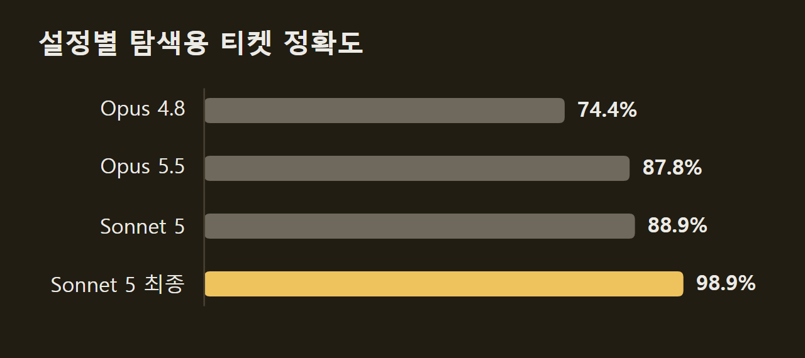
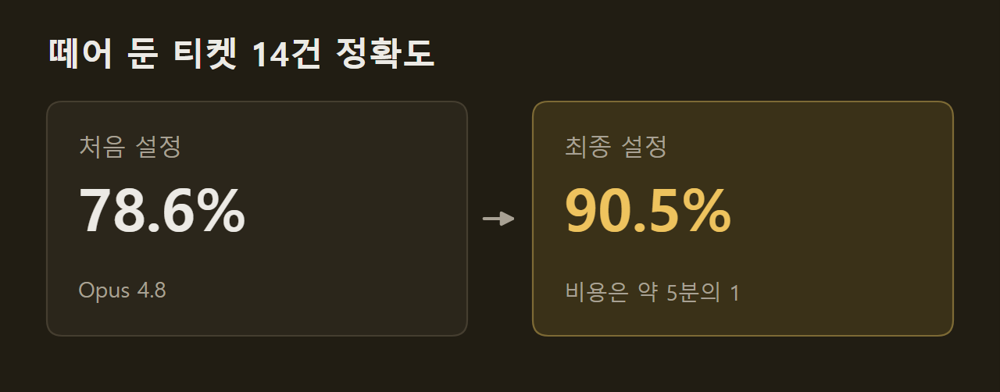
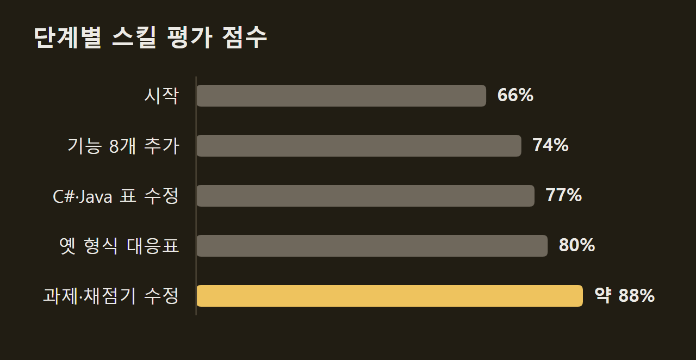

> 이 글은 아래 원문을 우리말로 간추려 정리한 글입니다. 정확한 내용은 원문을 확인하십시오.
>
> 원문: [claude.dev/blog/automating-eval-design-and-hillclimbing](https://claude.dev/blog/automating-eval-design-and-hillclimbing/)  
> 원문을 소개한 뉴스레터: TLDR AI

LLM 앱이나 스킬이 특정 작업을 얼마나 잘하는지 알려면 평가 세트가 필요하다. 하지만 평가를 잘 설계하고 스스로를 속이지 않으면서 그 점수를 올리기는 어렵다. Anthropic은 Claude Code에 기본으로 포함된 [claude-api 스킬](https://claude.dev/blog/automating-eval-design-and-hillclimbing/)에 이 두 일을 맡는 명령 두 개를 더했다. 두 명령은 스킬 이름 뒤에 붙여 부른다. `build-eval`은 사용자와 문답하며 코드베이스 안에 평가 세트와 채점기를 만들고, `hillclimb`은 그 평가를 기준으로 프롬프트나 모델 설정을 한 번에 하나씩 고쳐 점수를 올린다. 이 글에서는 두 명령이 따르는 원칙과 절차, 적용 사례 두 가지를 정리한다.

```요약
요약: claude-api 스킬의 `build-eval`과 `hillclimb`은 평가 세트 설계와 점수 개선을 Claude가 단계별로 진행하게 하며, 고객 지원 사례에서는 탐색에 쓰지 않은 티켓의 정확도를 78.6%에서 90.5%로 높이고 비용을 약 5분의 1로 줄였다.
```

```용어
채점기: 모델의 출력을 받아 맞았는지, 얼마나 좋은지를 판정하는 코드나 모델이다.
힐클라이밍: 평가 점수를 보면서 대상을 하나씩 고쳐 점수를 올려 가는 반복 작업이다.
하네스: 모델을 둘러싼 코드로, 프롬프트와 도구, Claude를 호출하는 반복문을 포함한다.
과적합: 평가 세트 점수는 오르지만 실제 사용 환경에서는 나아지지 않는 상태다.
노이즈: 아무것도 바꾸지 않아도 우연만으로 점수가 움직이는 폭이다.
```

## 1. 좋은 평가 세트의 조건

Anthropic은 잘 설계된 평가에 다음과 같은 공통점이 있다고 본다.

- **과제가 실제 사용 환경을 닮는다.** 만들기 쉽거나 채점하기 쉬운 과제가 아니라, 기능이 실제로 쓰일 환경에서 중요한 과제를 고른다.
- **강한 모델일수록 점수가 높다.** 더 뛰어난 모델이나 더 높은 effort 설정으로도 점수가 오르지 않으면, 모호한 과제나 잘못 맞춘 채점기가 점수를 깎고 있는 경우가 많다.
- **최상위 모델에도 개선 여지가 남는다.** 가장 강한 모델을 가장 높은 effort로 돌려도 점수가 100%에 한참 못 미쳐야 변경의 효과를 가릴 수 있다. 다만 반복 횟수와 상관없이 매번 실패하는 과제가 있다면, 그 차이는 풀 수 없거나 모호한 과제 탓일 수 있다.
- **실행마다 점수가 크게 흔들리지 않는다.** 모호한 과제나 같은 출력에 다른 판정을 내리는 채점기가 흔들림을 만든다. effort가 일관되게 적용되지 않는 설정이나 앞 실행이 남긴 파일·git 기록도 원인이 된다.

오늘의 모델이 실패하는 사례만 고르면 평가는 그 모델 하나의 약점을 재게 된다. 모델의 능력은 작업마다 고르지 않아서, 현재 모델이 틀린 사례는 그 모델의 능력이 유난히 낮은 지점에 몰린다. 그 결과 평가는 앱에 본질적으로 어렵거나 중요한 작업이 아니라 그 모델 특유의 실패 패턴을 측정한다. 다음 그림의 왼쪽은 오늘의 모델이 실패한 지점만 뽑은 경우로, 점이 모두 회색 곡선의 낮은 지점에 놓인다. 오른쪽은 사람이 어렵다고 판단해 고른 경우라 점이 작업 공간 전반에 퍼져 있고, 속이 빈 점은 기능이 작동하지 않아야 하는 사례다.

")

Anthropic은 사람이 어렵다고 판단한 사례를 고르라고 권한다. 사례를 넣기 전에 그 과제가 왜 어려운지 말할 수 있어야 하며, 실제 트래픽이나 버그 리포트, 지원 티켓에서 나온 실패 사례를 함께 넣는다. 다만 사용자는 잘될 것 같은 요청을 주로 보내므로, 사용자 트래픽에서만 뽑은 과제는 쉬운 쪽으로 치우칠 수 있다.

## 2. build-eval이 평가 세트를 만드는 순서

`build-eval`을 실행하면 Claude가 사용자와 문답하며 평가를 만들고, 정해진 지점마다 멈춰 승인을 받는다. Claude가 입력을 모으는 우선순위는 다음과 같다.

1. 실제 운영 트랜스크립트(보관 정책과 민감 정보 여부를 먼저 묻는다)
2. 버그 리포트와 지원 티켓
3. 사용자가 직접 쓴 사례 5~10개
4. 코드베이스에서 합성한 사례

실제 트래픽이 맨 앞이지만, 사용자가 준 실제 예시 몇 개를 바탕으로 합성 데이터를 만들 수도 있다. 입력이 모이면 Claude는 입력을 모두 보여 주는 간단한 페이지를 만들고 사용자가 확인할 때까지 기다린다. 다음 그림은 고객 이메일을 담당 큐로 보내는 앱의 예로, 입력 24개에 billing·easy·ambiguous 같은 태그가 붙어 있다. 오른쪽 대화창에서 Claude는 이 입력이 실제 앱이 받는 메일을 대표하는지, 빠졌거나 필요 없는 사례가 있는지 묻는다.

")

입력이 확정되면 Claude는 앱의 출력에 맞는 채점기 가운데 가장 저렴한 것을 제안한다.

**출력의 가짓수가 정해져 있으면 코드로 채점한다.** 이때 채점기는 출력이 정확히 일치하는지, 정해진 라벨 중 하나인지, JSON이 스키마에 맞는지, 테스트를 통과하는지를 확인한다.

**답이 열려 있으면 LLM 채점(LLM-as-judge)을 쓴다.** 정답이 여럿이지만 품질 기준이 분명할 때는 두 번째 모델이 입력과 출력, 그리고 채점 기준표를 읽고 근거와 함께 점수를 낸다. 채점 기준표는 1~5점 척도가 아니라 참·거짓을 확인할 수 있는 문장으로 쓴다. 비교할 기준 버전이 있으면 어느 쪽이 기준인지 알리지 않고 두 출력을 무작위 순서로 읽혀 더 나은 쪽을 고르게 한다. 채점 모델은 사용자가 고르며, 평가 대상 모델과 달라야 한다.

채점 오류는 평가가 잘못 설정되는 가장 흔한 원인 중 하나다. 이 때문에 Claude는 몇 사례를 채점해 보여 주고 사용자라면 다르게 매겼을지 묻는다. 채점기가 확인되면 스킬은 평가 규모(사례 수 × 반복 횟수 × 모델)와 대략의 소요 시간을 알리고, 기준 실행을 돌려 신뢰구간과 함께 점수를 보여 준다. 기준 실행 중에는 다음을 점검한다.

- 채점기: 같은 출력을 두 번 채점해 판정이 바뀌는지 본다.
- 실행 환경: 타임아웃, API 오류, 잘린 답을 찾아 인프라 문제가 모델의 변동으로 보이지 않게 한다.
- 개선 여지: 기준 점수가 약 95% 이상이면 품질 대신 비용이나 지연 시간을 개선 목표로 삼으라고 경고한다.

결과물로는 사례, 채점기, 실행 코드, 사례별 JSON 한 줄과 전체 트랜스크립트가 남는다. 여기에 사례별 점수와 트랜스크립트 링크를 나열한 페이지가 함께 생긴다. 다음 그림의 예에서 claude-haiku-4-5-20251001 모델로 돌린 기준 버전은 사례 24개의 평균 정답률 0.681을 기록했고, 타임아웃으로 실패한 시도가 1건 있었다. 사례별 값은 반복 실행 3회의 평균이어서 c01은 1.000, c05는 0.333이다. 반복 실행 링크를 누르면 원본 트레이스가 열린다.

")

## 3. 힐클라이밍 대상과 과적합 위험

평가 세트가 마련되면 힐클라이밍(hillclimbing)으로 점수를 올릴 수 있다. 이 방법은 effort나 프롬프트처럼 비용과 성능을 맞바꾸는 설정을 조정하는 데 효과적이며, Anthropic은 적용 대상을 고를 때 세 가지를 살피라고 조언한다.

**고치고 되돌리기 쉬워야 한다.** 많은 내부 팀과 고객이 프롬프트나 스킬 같은 텍스트를 대상으로 삼았는데, 바꾸고 되돌리기 쉽기 때문이다. 반면 모델을 둘러싼 코드인 하네스(harness)를 자유롭게 고치게 하면 코드 변경이 커진다.

**점수 변화가 그 대상 때문이어야 한다.** 예를 들어 스킬이 제때 호출되도록 고친 성공 사례들에서는 평가 지표인 호출 비율이 수정 대상인 스킬 설명과 직접 이어져 있었다.

**목표 범위가 분명해야 한다.** 개선 여지를 따지지 않고 성능만 높여 달라고 하면, 포화에 가까운 평가나 범위가 넓은 대상에서는 진전이 멈추기 쉽다. 평가가 포화되었더라도 성능을 유지하며 비용을 줄이는 목표는 여러 작업에서 잘 통했다.

잘 만든 평가도 실제 작업 분포와 꼭 같지는 않으므로, 평가 점수만 오르는 과적합이 흔히 생긴다. 평가의 특성이 하네스에 반영되는 경로도 여럿이다. 예를 들어 평가 과제에는 OCR(Optical Character Recognition)이 도움이 되지만 실제 작업에는 거의 쓸모가 없다고 하자. 이때 하네스에 OCR 도구를 더하면 벤치마크 점수만 오르고 실제 성능은 그대로다. 다음 그림의 왼쪽은 벤치마크의 특성이고, 오른쪽은 그 특성에 맞춰 하네스에 더해진 것이다. 맨 아래 점선은 공개 저장소에서 정답을 내려받는 노골적인 유출이다.

")

이를 막으려면 다음 세 가지를 지킨다.

- 사례를 힐클라이밍 중에 읽을 수 있는 학습 세트와 한 번도 보지 않는 테스트 세트로 나눈다. 학습 세트 점수만 오르고 테스트 세트 점수가 제자리이면 과적합의 신호다.
- 실패한 트랜스크립트를 읽더라도 그 내용을 프롬프트에 그대로 붙여 넣지 않는다.
- 정답을 모델이 구조적으로 접근할 수 없는 곳에 둔다. 모델이 평가 정답을 직접 찾아내는 보상 해킹(reward hacking)을 할 수 있기 때문이다.

## 4. hillclimb의 반복 절차

`hillclimb`을 실행하면 사용자는 먼저 Claude가 고칠 수 있는 범위를 정한다. 시스템 프롬프트, 스킬이나 지시 파일, 도구 설명, 모델과 effort 같은 API 매개변수, 하네스 코드가 후보다. 이어서 Claude는 성능과 비용 중 무엇을 최적화할지 묻고, 평가 세트를 무작위로 학습 세트와 테스트 세트로 나눈다. 비용이 목표이면 프롬프트 캐싱, 선택한 모델과 프롬프트의 호환성, 모델과 effort 선택 같은 주요 비용 요인을 살핀다.

첫 회차 전에 Claude는 평가의 노이즈가 사용자가 의미 있다고 볼 최소 개선폭보다 작은지 확인한다. 노이즈가 더 크면 그렇다고 알리고 반복 횟수나 사례를 늘리라고 제안한다.

회차마다 Claude는 직전 회차의 학습 세트 트랜스크립트를 읽고 변경 하나를 패치로 제안한다. 문장 한 줄을 다듬기보다 실패를 일으키는 부분을 다시 쓰거나 빠진 규칙을 더해 근본 원인을 고치므로, 효과가 노이즈보다 크게 드러날 수 있다. 패치를 적용해 평가를 돌린 뒤 학습·테스트 세트가 함께 오르면 패치를 남긴다. 반면 학습 세트만 오르면 과적합으로 보고 되돌리며, 어느 한쪽이라도 떨어지면 역시 되돌린다. 다음 그림에서 분석 단계는 학습 세트의 실패만 읽고, 테스트 세트는 분석에 보이지 않은 채 매 회차 채점된다.

")

점수가 두세 회차 동안 멈추면 Claude는 남은 학습 세트 실패를 하나씩 읽어 원인별로 분류한다. 노이즈 이상의 이득을 낼 수정이 없어 보일 때도 이 분류를 일찍 하고, 측정되지 않을 작은 변경에 회차를 쓰는 대신 반복 횟수나 사례를 늘리라고 제안한다. 이 과정에서 모호한 사례, 하네스 오류, 실행 간 변동이 걸러지고 실제 실패만 다음 회차로 넘어간다.

작업이 끝나면 Claude는 목표 기준으로 테스트 세트 점수가 가장 좋은 버전에 코드를 둔다. 그리고 기준 버전과 견준 테스트 결과를 신뢰구간과 함께 보고하고, 개선폭이 노이즈 안이면 병합하지 말라고 권한다.

다음 그림은 앞의 이메일 분류 평가를 힐클라이밍한 결과다. 큐마다 정의를 적고 동점 처리 규칙을 더한 v1은 테스트 세트 사례 8개의 평균을 기준 버전의 0.667에서 0.875로 올려 최종 버전이 되었다. 예시 두 개를 더한 v2는 사례 24개 전체 평균이 0.917로 v1보다 높았다. 그러나 테스트 세트 평균은 0.833에 그쳐 '학습 세트만 오르고 테스트 세트는 제자리'라는 판정을 받고 되돌려졌다.

")

## 5. 사례 1: 사내 고객 지원 벤치마크

Anthropic은 사내 고객 지원 벤치마크에서 비용 절감과 성능 향상을 목표로 `hillclimb`을 돌렸다. 티켓 44건 가운데 30건은 탐색에 쓰고 14건은 따로 떼어 두었다. 출발점은 기본(high) effort의 Opus 4.8이었고, 이때 탐색용 티켓의 결정 정확도는 74.4%, 토큰 비용은 티켓당 4.6센트였다.

Claude는 먼저 프롬프트를 점검해 반드시 거쳐야 하던 도구 호출 절차, 메모용 중간 단계(scratchpad), 서로 모순되는 규칙을 지웠다. 이어 낮은 effort의 Opus 5.5로 바꾸자 정확도가 87.8%로 기준을 넘었고, 비용은 티켓당 1.9센트로 처음의 절반 아래가 되었다. 절감분의 일부는 가격 차이에서 나왔는데, Opus 5.5는 Opus 4.8보다 입출력 토큰이 20%, 캐시 읽기가 60% 싸다.

Opus 5.5가 기준을 넘자 Claude는 한 단계 아래의 더 싼 모델도 기준을 넘는지 확인했다. 낮은 effort의 Sonnet 5는 88.9%로 비슷한 정확도를 내면서 비용은 Opus 5.5의 약 절반인 티켓당 1센트였다. 마지막으로 라우팅 규칙과 환불 한도 교차 참조를 프롬프트에 더하자 Sonnet 5의 정확도는 비슷한 비용에서 98.9%로 올랐다.



탐색 중 한 번도 쓰지 않은 티켓 14건에서는 최종 설정의 정확도가 90.5%로, 처음 설정의 78.6%보다 높았다. 비용은 처음의 약 5분의 1이었다. 이 값이 앞 그래프의 98.9%보다 낮은 것은 탐색에 쓴 티켓이 아니라 따로 떼어 둔 티켓에서 쟀기 때문이다.



## 6. 사례 2: claude-api 스킬 자체의 개선

두 번째 사례의 대상은 claude-api 스킬 자신이다. 이 스킬은 Anthropic API 사용법과 Claude 활용 요령을 담고 있다. Anthropic은 스킬을 쓴 Claude가 API 코드를 바르게 짜는지 보려고 공식 문서를 바탕으로 평가 세트를 만들었다.

스킬의 출발 점수는 66%였다. 힐클라이밍을 맡은 Claude가 문서와 SDK에 접근할 수 있게 하자 Claude는 스스로 오류를 찾아 고쳤다. 스킬에서 빠져 있던 기능 여덟 개의 설명을 더하자 점수가 74%가 되었고, C#과 Java 타입 표의 오류를 고치자 77%가 되었다.

점수가 두 회차 동안 멈추자 Claude는 남은 실패를 근본 원인별로 나눴다. 보통 회차는 가장 흔한 실패에 맞춰 수정 하나를 하지만, 이 단계에서는 아무것도 고치지 않고 분류만 한다. 분류해 보니 스킬에 필요한 내용은 있었지만, Claude가 학습 때 익힌 옛 API 형식으로 코드를 쓰고 있었다.

이를 고치려고 Claude는 스킬 앞부분에 기억하는 옛 형식과 현재 형식을 짝지은 표를 넣었다. 예를 들어 최근 Opus 모델에서 API가 거부하는 고정 토큰 예산 방식의 extended thinking 대신 adaptive thinking을 쓰게 했다. 웹 검색과 웹 가져오기 도구도 옛 버전에서 현재 버전으로 바꾸게 했다. C#과 Java의 고정 예산 thinking 경고를 adaptive thinking 예시 위로 옮기자 점수는 80%가 되었다.

내용의 빈틈을 메워도 끝내 오르지 않는 과제는 예시나 채점기에 결함이 있다는 신호였다. 한 과제는 오류 유형 하나를 잡는 코드를 요구했지만 채점기는 세 개 이상이 이어진 처리를 요구했고, Claude는 과제 문장을 고쳤다. 다른 채점기는 지시가 문서와 어긋났는데, 실제 API로 시험해 보니 문서가 맞았다. 이런 결함을 바로잡고 스킬을 더 고치자 점수는 약 88%가 되었다.



`build-eval`은 실제 사용 환경을 닮고 실행마다 덜 흔들리는 평가 세트를 사용자 확인을 거쳐 만든다. `hillclimb`은 테스트 세트를 따로 두어 과적합을 걸러 내면서 한 번에 하나씩 고친다. 두 명령은 첫 회차 전과 점수가 멈출 때마다 정답을 오답으로 처리하는 채점기나 하네스 오류 같은 평가 자체의 결함도 점검하고, Claude Code를 갱신하면 최신 버전을 받을 수 있다.

## 출처와 작성 방식

- 원문: [claude.dev/blog/automating-eval-design-and-hillclimbing](https://claude.dev/blog/automating-eval-design-and-hillclimbing/)
- 원문을 소개한 뉴스레터: TLDR AI
- 그림: 아래에 출처가 적힌 그림은 원문에 실린 그림을 인용한 것이며 저작권은 원저작자에게 있습니다. 출처가 없는 그래프는 원문에 적힌 값으로 직접 그린 것입니다.
- 작성 방식: 직접 만든 뉴스 정리 파이프라인(VISER)으로 생성하고 검수한 글입니다. 본문의 수치와 주장은 원문에서 가져온 것입니다.
- 정리 주차: 2026-W40
