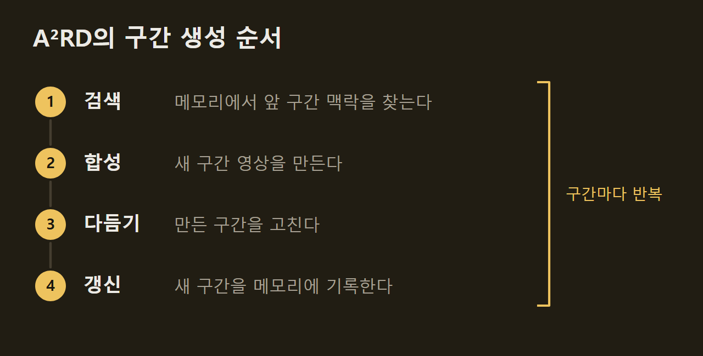
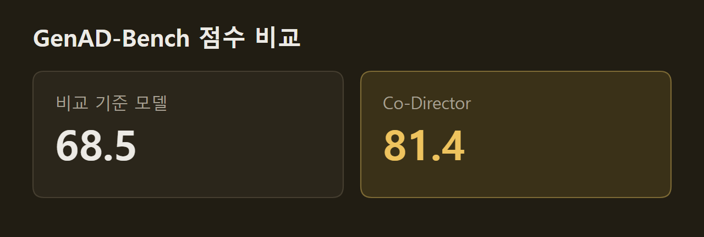

> 이 글은 아래 원문을 우리말로 간추려 정리한 글입니다. 정확한 내용은 원문을 확인하십시오.
>
> 원문: [research.google/blog/coherent-long-form-video-generation](https://research.google/blog/coherent-long-form-video-generation/)  
> 원문을 소개한 뉴스레터: Turing Post

영상 확산 모델은 사실적인 장면을 몇 초 만에 그려 낸다. 하지만 짧은 클립을 이어 몇 분짜리 이야기를 만들면 샷이 바뀔 때마다 인물의 옷차림이 달라지고 배경 구조가 흔들린다. Google 연구진은 이 문제를 다루는 멀티 에이전트 프레임워크 네 가지, [Co-Director, CANVAS, A²RD, VQQA](https://research.google/blog/coherent-long-form-video-generation/)를 2026년 9월 24일 발표했다. 사용자가 텍스트 프롬프트와 참고 이미지를 넣으면 이 프레임워크들이 Gemini와 Veo를 불러 스토리보드, 장면 이미지, 영상, 오디오를 차례로 만들고, 인물과 배경이 처음부터 끝까지 같은 모습을 유지하는 몇 분 길이의 영상을 내놓는다. 이 글에서는 네 프레임워크가 각각 맡는 일과 평가 결과를 정리한다.

```요약
요약: Google 연구진은 Gemini와 Veo 위에서 동작하는 멀티 에이전트 프레임워크 네 개로 몇 분 길이 영상의 인물·배경 일관성을 유지했고, CANVAS는 가장 강한 비교 방식과 견주어 배경 일관성을 최대 21.6% 높였다.
```

```용어
의미 표류(semantic drift): 샷이 바뀌면서 인물의 옷차림이나 배경이 조금씩 달라지는 현상이다.
연쇄 실패(cascading failure): 앞 단계에서 생긴 결함이 뒤 단계의 영상 생성까지 망가뜨리는 현상이다.
멀티 암드 밴딧(MAB): 새 선택지를 시험하는 일과 효과가 확인된 선택지를 다시 쓰는 일 사이에서 균형을 잡으며 고르는 알고리즘이다.
시각 메모리(persistent visual memory): CANVAS가 인물, 장소, 물건의 모습을 저장해 두었다가 같은 대상이 다시 나올 때 꺼내 쓰는 저장소다.
의미 기울기(semantic gradient): 시각-언어 모델이 영상을 평가하며 내놓은 자연어 비평으로, 다음 수정의 방향을 알려 준다.
```

## 1. 기존 영상 생성 파이프라인의 한계

기존 에이전트 파이프라인은 여러 모듈을 차례로 이어 영상을 만들기 때문에 앞에서 생긴 오류가 뒤로 번진다. 모듈마다 사람이 따로 작성한 프롬프트로 움직이므로 샷 사이에 의미 표류가 생긴다. 앞 단계에서 만든 이미지의 결함이 뒤 단계의 영상 합성까지 망가뜨리는 연쇄 실패도 일어나서, 이를 바로잡으려면 사람이 일일이 손을 대야 한다.

연구진은 이 상황을 고전적인 기여도 할당 문제(credit assignment problem)로 설명한다. 최종 영상에서 실패가 드러나도 어느 프롬프트가 원인인지 거슬러 찾기 어렵다는 뜻이다. 그 밖에 인물과 배경이 의도와 달리 서서히 바뀌는 특징 표류(feature drift)와 이야기가 제대로 진행되지 못하는 내용 붕괴(content collapse)도 기존 방법의 문제로 꼽힌다.

이 때문에 연구진은 긴 영상 생성을 전역 최적화 문제이자 세계 상태(world-state) 추적 문제로 다뤘다. 네 프레임워크는 Gemini와 Veo 위에서 프롬프트를 짜고 샷을 잇는 조정 계층(orchestration layer)으로 동작한다. 그래서 생성된 이미지, 영상, 오디오에는 SynthID 워터마크 같은 기반 모델의 안전 장치가 그대로 적용된다. Co-Director는 COLM 2026에서, CANVAS는 EMNLP 2026에서 발표될 예정이다.

## 2. Co-Director: 창작 방향을 정하는 계층 구조

Co-Director는 영상 한 편의 전체 방향을 먼저 정하고 하위 에이전트가 그 방향을 따르게 하는 계층형 프레임워크다. 정해진 순서로 프롬프트를 잇는 대신 멀티 암드 밴딧(MAB)이 유망한 창작 방향을 고른다. 새로운 서사 전략을 시험하는 일과 효과가 확인된 설정을 다시 쓰는 일 사이에서 균형을 찾는 방식이다.

오케스트레이터 에이전트가 고르는 창작 설정은 창작 전략(의도), 서사 방식(이야기 구조), 미적 원형(시각 톤과 촬영 방식)의 세 축으로 이뤄진다. 예를 들어 정보 전달 전략에 비네트(vignette) 서사 방식과 특정 미적 원형을 묶은 조합이 후보 하나가 된다. 시스템은 고른 조합을 하위 에이전트의 시스템 프롬프트에 넣어 파이프라인 전체가 같은 방향으로 움직이게 한다.

제작은 단계별 에이전트가 나눠 맡는다. 사전 제작 에이전트가 장면별 줄거리와 시각 자산을 스토리보드로 묶으면, 제작 에이전트 아래의 키프레임 에이전트가 인물과 장면의 모습을 고정한다. 이어서 영상 에이전트가 움직임을 더하고 오디오 에이전트가 내레이션과 배경 음악을 입힌다.

마지막으로 멀티모달 LLM(MLLM) 판정 모델이 편집을 마친 영상을 세 축에 맞춰 평가하고, 축별로 나눈 보상 신호를 MAB에 돌려준다. 생성이 반복될수록 창작 설정의 선택이 다듬어지는 것은 이 순환 덕분이다. 다음 그림에서 위쪽 보라색 상자가 MAB의 세 축이고, 아래쪽 초록 영역이 제작 단계다.

")

## 3. CANVAS: 시각 메모리로 지키는 장면 연속성

CANVAS(Continuity-Aware Narratives via Visual Agentic Storyboarding)는 대본이 하나로 정해져 있어도 샷이 길게 이어지면 인물과 배경이 흔들리는 문제를 다룬다. CANVAS는 이야기가 진행되는 동안 인물, 장소, 물건의 상태를 구조화해 기록하고 이를 시각 메모리에 보관한다. 같은 장소가 다시 나오면 메모리에서 시각 기준을 꺼내 쓰고, 처음 나오는 대상이면 새 기준을 만든다.

연구진은 박물관 도난 장면을 여러 샷으로 만들어 CANVAS를 두 방식과 비교했다. 하나는 기반 모델 Gemini-3.1-Pro로 바로 생성하는 방식이고, 다른 하나는 멀티 에이전트 프레임워크 AutoStudio다. 다음 그림은 위에서부터 AutoStudio, Gemini, CANVAS의 결과이며, 맨 아래 줄에는 샷마다 넣은 장면 설명이 있다. 장면 설명에서 색으로 표시한 전시실, 인물, 유물은 모든 샷에서 같은 모습이어야 한다.

Gemini-3.1-Pro만 쓴 결과에서는 유물의 모양이 바뀌고 전시실 구조가 달라졌다. AutoStudio에서는 인물의 모자가 갑자기 사라졌고 배경도 샷마다 달랐다. 반면 CANVAS는 다른 장소를 거쳐 전시실로 돌아온 샷에서도 인물, 공간 구조, 유물의 상태를 그대로 유지했다.

")

## 4. A²RD: 구간 단위로 이어 만드는 긴 영상

A²RD는 스토리보드를 몇 분 길이의 실제 영상으로 옮기는 에이전트형 자기회귀(autoregressive) 생성 구조다. A²RD는 영상을 구간(segment) 단위로 차례로 만들고, 구간마다 맥락과 움직임을 멀티모달 영상 메모리에 기록한다. 구간을 하나 만들 때마다 검색, 합성, 다듬기, 갱신 순서를 거친다.



이 과정에서 에이전트는 구간마다 생성 방식을 고른다. 외삽(extrapolation)은 이야기를 새로운 전개로 밀고 나갈 때 쓰고, 보간(interpolation)은 다시 나온 인물과 배경을 처음 모습에 맞출 때 쓴다. 이렇게 해서 이야기를 앞으로 진행하는 일과 장면의 물리적 일관성을 지키는 일을 함께 처리한다.

연구진은 10분 길이의 영화를 만들어 이 구조를 시험했다. 일반적인 영상 생성기에서는 시간이 지날수록 인물이 변형되고 장소가 바뀐다. 그러나 A²RD는 구간마다 메모리를 조회해 첫 장면부터 마지막 프레임까지 인물의 정체성, 의상 세부, 공간 구조를 유지했다.

## 5. VQQA: 프롬프트를 고쳐 결함을 잡는 방식

VQQA(Video Quality Question Answering)는 생성된 영상의 결함을 시스템이 스스로 찾아 고치게 하는 멀티 에이전트 프레임워크다. 기존의 테스트 시점 최적화 방법은 계산 비용이 크거나 모델 내부에 접근할 수 있어야 했다. 반면 VQQA는 모델 내부를 보지 않고 텍스트 프롬프트만 고치므로 입력 형식이나 생성 작업이 달라도 쓸 수 있다.

VQQA는 프롬프트에 맞춘 시각 질문을 만들고, 시각-언어 모델(VLM)이 그 질문에 답하며 내놓은 비평을 의미 기울기로 쓴다. 영상을 만들고, 질문으로 평가하고, 비평에 따라 프롬프트를 고치는 과정을 되풀이한다. 다만 수정을 거듭하면 원래 의도가 흐려질 수 있어서, 전역 VLM 평가 모델이 그동안 만든 모든 영상을 수정 전 원래 프롬프트에 비춰 채점하고 가장 높은 점수의 영상을 고른다. 연구진은 이를 전역 선택(Global Selection)이라고 부른다.

VQQA는 원래 프레임의 일부를 가리거나 덧칠하지 않는다. 대신 고친 프롬프트로 생성기가 새 결과를 다시 뽑게 하며, 속성 결합 오류(attribute binding error)처럼 장면 구성에서 생기는 결함을 바로잡는다. 예를 들어 "직육면체 풍선이 둥근 창 앞을 떠가고, 유리창으로 햇빛이 들어온다"는 프롬프트에서 다음 그림의 왼쪽 원래 생성 결과는 풍선을 단단한 물체로 그렸다. 오른쪽 VQQA 결과는 직육면체 모양을 지키면서 마일러(mylar) 풍선의 질감을 입혔다.

")

두 번째 예는 연주 도중 악기가 뒤바뀌는 결함이다. VQQA는 컷이 바뀌어도 바이올린 연주자와 피아노 연주자가 각자의 악기를 계속 다루도록 프롬프트를 고쳤다.

")

## 6. 새 벤치마크 세 개와 평가 결과

연구진은 실제 영상 제작에서 부딪히는 어려움을 반영하려고 벤치마크 세 개를 새로 만들었다.

- GenAD-Bench: Gemini 3 Pro와 전용 이미지 모델에 사람의 검토를 더해 가상 브랜드 50개를 만들고 브랜드마다 제품 4개를 두었다. 시나리오 400개로 저작권 문제나 학습 데이터의 사전 지식에 기대지 않고 광고의 세부 조건을 지키는지 본다.
- HardContinuityBench: GPT-5.2로 만든 여러 샷짜리 스토리보드로 공간·배경 연속성을 평가한다. 장면이 다시 나오기까지의 간격이 길고, 배우의 의상과 소품 상태가 자주 바뀐다.
- LVBench-C: 텍스트로만 된 시나리오 120개로 긴 시간에 걸친 변화를 평가한다. 중요한 시각 요소가 최소 10구간 동안 사라졌다가 이야기에 맞게 바뀐 모습으로 돌아와야 한다.

**Co-Director는 GenAD-Bench에서 81.4를 받았다.** 비교 기준 모델의 68.5와 견주면 전체 품질이 18.8% 높고, ViStoryBench에서도 최상위권의 일관성을 보였다.



**CANVAS는 세 가지 연속성을 모두 높였다.** ViStoryBench, ST-Bench, HardContinuityBench에서 가장 강한 비교 방식과 견주어 배경 일관성은 최대 21.6%, 인물 일관성은 최대 9.6%, 소품 일관성은 최대 7.6% 올랐다.

A²RD는 VBench-Long과 LVBench-C의 3분, 5분, 10분 연속 생성에서 최신 자기회귀 방법과 견주어 일관성을 최대 30%, 서사 일관성을 최대 20% 높였다. 한편 VQQA는 T2V-CompBench, VBench2, VBench-I2V에서 별도 처리를 하지 않은 기반 모델과 견주어 장면 구성 품질과 절대 시각 품질 지표를 11.57%와 8.43% 끌어올렸다. 모델 구조, 학습 설정, 비교 실험의 세부 내용은 각 논문에 실려 있다.

연구진은 네 프레임워크가 긴 영상 이야기를 일관되게 만드는 기초 단계라고 밝혔다. 다음 과제로는 사람이 중간에 개입하는 작업 흐름을 붙이는 방법을 연구하고 있다. 연구진이 밝힌 목표는 사람의 이야기 창작을 대신하는 것이 아니다. 시간적 일관성 유지와 세계 상태 추적 같은 번거로운 일을 자동으로 처리하고, 연출과 서사 설계는 창작자가 계속 결정하게 하는 것이다.

## 출처와 작성 방식

- 원문: [research.google/blog/coherent-long-form-video-generation](https://research.google/blog/coherent-long-form-video-generation/)
- 원문을 소개한 뉴스레터: Turing Post
- 그림: 아래에 출처가 적힌 그림은 원문에 실린 그림을 인용한 것이며 저작권은 원저작자에게 있습니다. 출처가 없는 그래프는 원문에 적힌 값으로 직접 그린 것입니다.
- 작성 방식: 직접 만든 뉴스 정리 파이프라인(VISER)으로 생성하고 검수한 글입니다. 본문의 수치와 주장은 원문에서 가져온 것입니다.
- 정리 주차: 2026-W40
