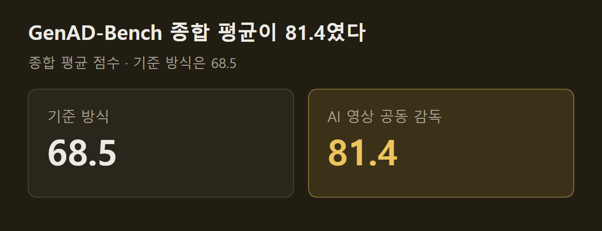
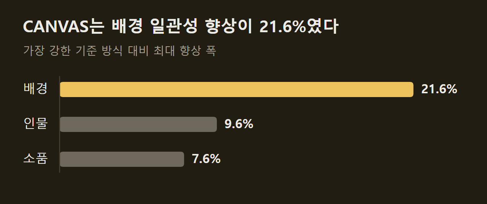

> 이 글은 아래 원문을 우리말로 간추려 정리한 글입니다. 정확한 내용은 원문을 확인하십시오.
>
> 원문: [research.google/blog/coherent-long-form-video-generation](https://research.google/blog/coherent-long-form-video-generation/)  
> 원문을 소개한 뉴스레터: Turing Post

영상 생성 모델은 몇 초짜리 장면을 사실적으로 그려 내지만, 여러 장면을 이어 붙여 몇 분짜리 이야기를 만들면 인물의 옷이 바뀌고 배경의 구조가 달라진다. Google 연구진은 2026년 9월 24일 이 문제를 다루는 연구인 [AI 영상 공동 감독](https://research.google/blog/coherent-long-form-video-generation/)을 공개했다. 사용자가 프롬프트와 참조 이미지로 만들고 싶은 영상을 설명하면, Gemini와 Veo 위에서 여러 에이전트가 줄거리 작성, 장면 생성, 편집, 결함 수정을 나눠 맡아 인물과 배경이 끝까지 유지되는 긴 영상을 만든다.

```요약
요약: Gemini와 Veo 위에서 기획, 스토리보드, 구간별 생성, 결함 수정을 네 프레임워크가 나눠 맡아 몇 분 길이의 영상을 만들며, 연구진 평가에서 GenAD-Bench 종합 점수가 기준 방식 68.5보다 높은 81.4였다.
```

```용어
멀티 에이전트: 역할이 다른 여러 AI 에이전트가 한 작업을 단계별로 나눠 맡는 구성이다.
드리프트: 장면이 이어지는 동안 인물의 옷이나 배경이 의도와 다르게 조금씩 달라지는 현상이다.
멀티암드 밴딧: 여러 선택지를 시험해 보면서 결과가 좋았던 선택지를 점점 더 자주 고르는 알고리즘이다.
외삽과 보간: 외삽은 앞 구간에 이어 새 내용을 만드는 방식이고, 보간은 이미 정해진 인물과 배경에 맞춰 사이를 채우는 방식이다.
속성 결합 오류: 프롬프트가 한 물체에 붙인 여러 성질 가운데 일부만 영상에 반영되는 결함이다.
```

## 1. 긴 영상에서 생기는 문제

기존 영상 제작 파이프라인은 모듈을 한 줄로 이어 놓고 단계마다 사람이 따로 쓴 프롬프트를 넣는다. 이 구조에서는 장면이 바뀔 때마다 인물의 옷차림이나 배경이 조금씩 달라지고, 앞 단계에서 만든 이미지에 결함이 있으면 뒤 단계의 영상까지 망가진다. 앞에서 생긴 오류가 뒤로 퍼지므로 사람이 계속 손을 대야 하고, 마지막 결과물이 잘못됐을 때 어느 프롬프트가 원인인지 거슬러 찾기도 어렵다.

연구진은 긴 영상 생성을 전체를 한꺼번에 최적화하고 장면 속 세계의 상태를 추적하는 문제로 보았고, 병목마다 프레임워크를 하나씩 두었다.

1. Co-Director: 영상 전체의 창작 방향을 정하고 하위 에이전트를 지휘한다.
2. CANVAS: 인물, 장소, 사물의 상태를 기억해 장면 사이의 연속성을 계획한다.
3. A²RD: 스토리보드를 구간별로 생성해 몇 분 길이의 영상으로 만든다.
4. VQQA: 생성된 영상의 결함을 스스로 찾아 프롬프트를 고친다.

Co-Director는 COLM 2026에, CANVAS는 EMNLP 2026에 실릴 예정이다. 생성되는 이미지, 영상, 음성에는 Gemini와 Veo의 SynthID 워터마크 같은 안전장치가 그대로 적용된다.

## 2. AI 영상 공동 감독의 구조

AI 영상 공동 감독은 고정된 프롬프트를 차례로 넘기지 않고, 창작 방향을 먼저 정한 뒤 그 방향을 모든 하위 에이전트의 시스템 프롬프트에 넣는다. 방향을 고르는 일은 멀티암드 밴딧(MAB) 알고리즘이 맡아서, 새로운 서사 전략을 시도하는 탐색과 효과가 확인된 설정을 다시 쓰는 활용 사이에서 균형을 잡는다. 오케스트레이터 에이전트가 이 알고리즘으로 고르는 창작 설정은 세 가지다.

1. 창작 전략: 영상의 의도를 정한다.
2. 서사 방식: 이야기의 구조를 정한다.
3. 미적 유형: 화면의 분위기와 촬영 방식을 정한다.

설정이 정해지면 사전 제작 에이전트가 장면별 줄거리와 시각 자료를 하나의 스토리보드로 만든다. 제작 에이전트는 이를 실제 영상과 음성으로 옮기는데, 키프레임 에이전트가 인물과 장면의 모습을 고정하고 영상 에이전트가 움직임을 더하며 오디오 에이전트가 내레이션과 음악을 입힌다.

마지막에는 멀티모달 LLM 심사자가 편집된 영상을 세 설정 항목별로 평가하고, 그 점수가 보상 신호로 멀티암드 밴딧에 돌아간다. ==생성과 평가가 반복될수록 설정 선택이 평가 결과에 맞춰 조정된다.== 연구진은 이 구조가 특정 모델에 묶여 있지 않아 다른 생성 모델 위에도 올릴 수 있다고 밝혔다.

")

## 3. CANVAS의 시각 메모리

대본이 하나로 정해져 있어도 장면을 순서대로 길게 생성하면 인물이 달라지고 배경이 흔들린다. CANVAS는 이야기가 진행되는 동안 인물, 장소, 사물의 상태를 구조화된 형태로 기록해 두고, 장면을 만들 때마다 지속되는 시각 메모리에서 기준이 되는 이미지를 꺼내 쓴다. 메모리에 없는 대상이 나오면 새 기준 이미지를 만들어 넣는다. ==같은 장소로 돌아오면 저장된 기준 이미지를 다시 써서 공간 구조를 유지한다.==

연구진은 박물관 도난 장면을 여러 샷으로 만들어 세 방식을 비교했다. 아래 그림의 맨 아랫줄은 샷별 프롬프트이고, 전시실과 유물처럼 여러 샷에 되풀이되는 요소가 색으로 표시되어 있다. 첫째 줄의 AutoStudio는 다른 멀티 에이전트 프레임워크인데, 인물이 쓰고 있던 모자가 갑자기 사라지고 전시실 모습이 샷마다 달라졌다. 둘째 줄은 Gemini-3.1-Pro만으로 생성한 결과로, 유물의 모양이 바뀌고 방의 배치가 달라졌다. 셋째 줄의 CANVAS에서는 유물, 전시실 구조, 인물이 다섯 샷에 걸쳐 같은 모습으로 유지된다.

")

## 4. A²RD의 구간별 생성

A²RD는 스토리보드를 몇 분 길이의 실제 영상으로 만드는 단계다. 영상을 구간 단위로 이어서 생성하고, 각 구간의 맥락과 움직임을 멀티모달 영상 메모리에 기록한다. 구간 하나를 만들 때마다 메모리 검색, 생성, 수정, 메모리 갱신을 차례로 거친다.

이 과정에서 에이전트는 구간마다 생성 방식을 스스로 고른다. 이야기를 새 국면으로 넘길 때는 외삽을 쓰고, 앞서 나온 인물이나 장소가 다시 등장할 때는 보간으로 원래 모습에 맞춘다. 연구진은 10분짜리 영상을 예시로 공개했으며, 일반적인 영상 생성기에서는 인물과 장소가 점점 변형되지만 A²RD는 첫 장면부터 마지막까지 인물의 정체성, 의상, 공간 구조를 유지한다고 설명했다.

## 5. VQQA의 결함 수정

기존의 추론 시점 최적화 기법은 계산 비용이 크거나 모델 내부에 접근할 수 있어야 한다. VQQA는 모델 내부를 건드리지 않고 프롬프트만 고친다. 먼저 프롬프트에 맞춘 시각 질문을 만들어 생성된 영상을 비전-언어 모델에 평가하게 하고, 자연어로 돌아온 비평을 어느 방향으로 고칠지 알려 주는 신호로 삼아 프롬프트를 다시 쓴다. 생성, 질문 평가, 프롬프트 수정이 이 순서로 반복된다.

수정을 거듭하다 원래 의도에서 멀어지는 일을 막는 장치도 있다. 마지막 반복의 결과를 그대로 쓰지 않고, 반복 과정에서 나온 모든 영상을 수정 전 원래 프롬프트에 비추어 채점한 뒤 점수가 가장 높은 것을 고른다.

VQQA는 픽셀을 덧칠하지 않는다. 아래는 "직육면체 풍선이 둥근 창문 앞을 떠간다"는 프롬프트의 결과인데, 왼쪽 기본 생성은 풍선의 성질을 살리지 못하고 딱딱한 붉은 판을 그렸고 오른쪽 VQQA 결과는 직육면체 형태에 풍선 재질을 입혔다. 연주 도중 악기가 바뀌던 영상에서 바이올린 연주자와 피아노 연주자가 각자의 악기를 끝까지 연주하게 고친 예도 함께 실렸다.

")

## 6. 벤치마크와 결과

연구진은 평가를 위해 벤치마크 세 개를 새로 만들었다.

1. GenAD-Bench: 제품을 4개씩 둔 가상 브랜드 50개와 시나리오 400개로 마케팅 제약 조건을 지키는지 본다.
2. HardContinuityBench: 장면이 다시 나오기까지의 간격이 길고 의상과 소품 상태가 자주 바뀌는 스토리보드로 연속성을 본다.
3. LVBench-C: 텍스트 시나리오 120개로 구성되며, 핵심 대상이 10개 구간 이상 사라졌다가 달라진 모습으로 돌아온다.

AI 영상 공동 감독은 GenAD-Bench 종합 평균 점수에서 기준 방식 68.5보다 높은 81.4를 기록했고, 연구진은 이를 전체 품질 18.8% 향상으로 표기했다. ViStoryBench에서도 최상위권의 일관성을 보였다고 밝혔다.



CANVAS는 ViStoryBench, ST-Bench, HardContinuityBench에서 가장 강한 기준 방식보다 일관성이 높았고, 향상 폭은 배경에서 가장 컸다.



A²RD는 VBench-Long과 LVBench-C에서 3분, 5분, 10분 연속 생성을 평가했고, 최신 자기회귀 방식보다 일관성이 최대 30%, 서사 정합성이 20% 높았다. VQQA는 T2V-CompBench, VBench2, VBench-I2V에서 기본 모델 대비 절대값으로 11.57%와 8.43% 향상됐는데, 두 값이 각각 어느 벤치마크의 것인지는 표에 적혀 있지 않다. 모델 구조, 학습 설정, 기준 방식의 세부 조건은 개별 논문에 실려 있다.

연구진은 사람이 제작 과정에 개입하는 방식을 이 구조에 통합하는 방법을 탐색하고 있다. 목표는 사람의 이야기 창작을 대체하는 것이 아니라 일관성 유지와 상태 추적 같은 번거로운 작업을 대신 맡고, 창작 방향과 서사 설계는 창작자가 쥐게 하는 것이라고 밝혔다.

## 출처와 작성 방식

- 원문: [research.google/blog/coherent-long-form-video-generation](https://research.google/blog/coherent-long-form-video-generation/)
- 원문을 소개한 뉴스레터: Turing Post
- 그림: 아래에 출처가 적힌 그림은 원문에 실린 그림을 인용한 것이며 저작권은 원저작자에게 있습니다. 출처가 없는 그래프는 원문에 적힌 값으로 직접 그린 것입니다.
- 작성 방식: 직접 만든 뉴스 정리 파이프라인(VISER)으로 생성하고 검수한 글입니다. 본문의 수치와 주장은 원문에서 가져온 것입니다.
- 정리 주차: 2026-W40
