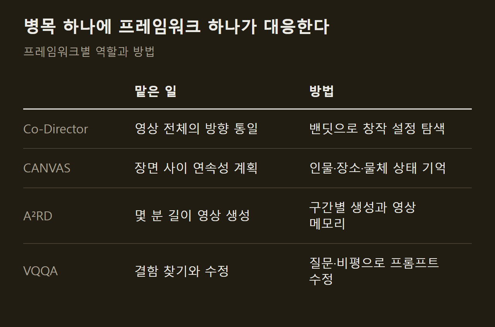
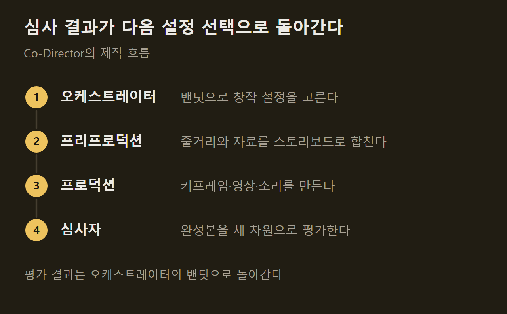
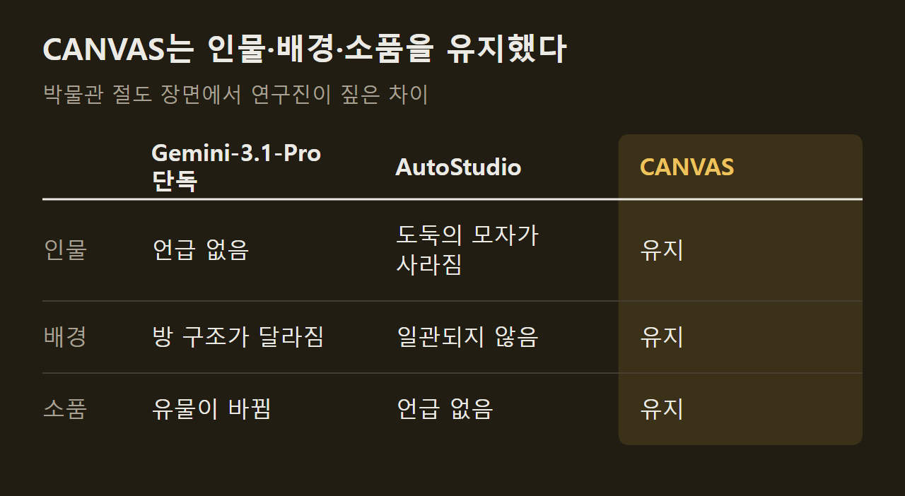

> 이 글은 아래 원문을 우리말로 간추려 정리한 글입니다. 정확한 내용은 원문을 확인하십시오.
>
> 원문: [research.google/blog/coherent-long-form-video-generation](https://research.google/blog/coherent-long-form-video-generation/)  
> 원문을 소개한 뉴스레터: Turing Post

영상 생성 모델은 몇 초짜리 장면을 사실적으로 만들어 내지만, 여러 장면을 이어 몇 분짜리 이야기로 만들면 등장인물의 옷이 바뀌거나 방 구조가 달라지는 문제가 생긴다. Google 연구진은 이 문제를 다루는 [AI 비디오 코디렉터](https://research.google/blog/coherent-long-form-video-generation/) 연구를 공개했다. 사람이 만들고 싶은 영상의 의도를 높은 수준에서 지정하면, 여러 에이전트가 프롬프트 작성과 장면 연결, 결과물 수정을 나눠 맡아 인물과 배경이 끝까지 유지되는 몇 분 길이의 영상을 만들어 내는 프레임워크다. Gemini와 Veo 위에 얹는 조율 계층으로 설계했고, Co-Director·CANVAS·A²RD·VQQA 네 가지 프레임워크로 이루어진다.

```요약
요약: Google 연구진이 Gemini와 Veo 위에서 동작하는 네 가지 멀티 에이전트 프레임워크로 몇 분 길이 영상의 인물·배경 일관성을 유지하는 방법을 내놓았고, 자체 평가에서 Co-Director가 GenAD-Bench 최고 품질 점수 81.4를 기록했다고 밝혔다.
```

```용어
의미 표류: 장면이 넘어가면서 인물의 옷차림이나 배경이 의도와 달리 조금씩 달라지는 현상이다.
연쇄 실패: 앞 단계에서 생긴 결함이 뒤 단계의 영상 합성까지 망가뜨리는 현상이다.
멀티 암드 밴딧: 새로운 선택지를 시험하는 일과 효과가 확인된 선택지를 다시 쓰는 일 사이에서 균형을 찾는 알고리즘이다.
시각 메모리: 인물, 장소, 물체의 상태를 저장해 두고 다음 장면을 만들 때 꺼내 쓰는 기록이다.
의미적 그래디언트: 수치 대신 자연어 비평으로 어느 방향으로 고칠지 알려 주는 피드백이다.
```

## 1. 긴 영상에서 생기는 문제

기존 에이전트 파이프라인은 여러 모듈을 한 줄로 이어 영상 제작을 자동화한다. 그런데 모듈마다 사람이 따로 짠 프롬프트를 쓰기 때문에 장면 사이에서 인물의 옷이나 배경이 미묘하게 달라지고, 앞 단계에서 만든 이미지에 결함이 있으면 그 뒤의 영상 합성까지 함께 망가진다. 초반의 오류가 뒤로 번지면서 긴 구간의 일관성이 깨지므로 사람이 일일이 손을 대야 하는 일이 많다.

연구진은 이를 구조적으로는 기여도 할당 문제로 본다. 최종 결과가 실패했을 때 어느 프롬프트가 원인인지 거슬러 찾기 어렵다는 뜻이다. 여기에 인물과 환경이 의도와 무관하게 서서히 변하는 현상, 이야기가 의미 있게 나아가지 못하는 현상도 기존 방법의 한계로 꼽았다.

==연구진은 긴 영상 생성을 전체 최적화와 세계 상태 추적 문제로 다룬다.== 문제를 네 부분으로 나누고 병목 하나에 프레임워크 하나를 대응시켰다.



## 2. Co-Director의 방향 설정

Co-Director는 영상 전체가 하나의 방향을 따르도록 만드는 계층형 멀티 에이전트 프레임워크다. 고정된 프롬프트 사슬에 기대지 않고, 멀티 암드 밴딧으로 유망한 창작 방향을 먼저 고른 뒤 그 설정을 하위 에이전트들의 시스템 프롬프트에 넣어 준다. 위에서 정한 방향이 아래로 내려가므로 파이프라인 전체가 같은 구상 아래에서 움직인다.

오케스트레이터 에이전트가 고르는 창작 설정은 세 차원으로 이루어진다.

1. 창작 전략: 영상이 전하려는 의도
2. 서사 방식: 이야기의 구조
3. 미적 유형: 시각적 분위기와 촬영 방식

설정이 정해지면 제작이 단계별로 이어진다. 프리프로덕션 에이전트가 장면별 줄거리와 시각 자료를 하나의 스토리보드로 합치고, 프로덕션 에이전트가 이를 실제 영상과 소리로 옮긴다. 프로덕션 단계에서는 키프레임 에이전트가 인물과 장면의 모습을 고정하고, 비디오 에이전트가 움직임을 더하며, 오디오 에이전트가 내레이션과 음악을 입힌다. 마지막으로 멀티모달 LLM 심사자가 완성본을 세 차원별로 평가해 보상 신호를 밴딧에 돌려주고, 생성이 반복될수록 선택이 다듬어진다.



이 구조는 생성 모델에 구조화된 프롬프트를 넣어 주는 조율 계층이므로 특정 모델에 묶이지 않는다. 연구진은 Gemini와 Veo를 썼고, 그래서 생성된 이미지·영상·소리에 SynthID 워터마크 같은 기본 안전 장치가 그대로 따라온다고 설명한다. 각각은 안전한 클립이 이어지면서 의도하지 않은 맥락이 생기는 경우에 대비해, 실제 서비스에서는 최종 영상 전체에 안전 분류기를 추가로 적용할 수 있다고 덧붙였다.

## 3. CANVAS의 시각 메모리

대본이 통일되어 있어도 장면을 차례로 길게 만들다 보면 인물이 달라지고 배경이 흔들린다. CANVAS는 이야기가 진행되는 동안 인물, 장소, 물체 상태를 구조화해 기록하고, 장면을 만들 때 이 시각 메모리에서 기준 이미지를 꺼내 쓰거나 필요하면 새로 만든다. ==같은 장소로 돌아오면 인물의 정체성과 공간 구조가 그대로 유지된다.==

연구진은 박물관 절도 장면으로 세 방식을 비교했다. 도둑, 전시실, 보석처럼 반복해 나오는 요소가 같은 모습을 유지해야 하는 장면이고, 바로 이어지는 장면 전환과 카메라가 다른 곳을 거쳐 전시실로 돌아오는 전환을 모두 포함한다.



## 4. A²RD의 구간별 생성

스토리보드를 실제 몇 분짜리 영상으로 옮기는 일은 A²RD가 맡는다. 영상을 구간 단위로 차례로 만들고, 각 구간의 맥락과 움직임을 기록하는 멀티모달 영상 메모리를 함께 쓴다. 구간마다 검색, 합성, 다듬기, 메모리 갱신을 한 바퀴씩 돈다.

이 과정에서 에이전트는 구간을 만드는 방식을 상황에 맞춰 고른다. 방식은 두 가지다. 외삽은 이야기를 새로운 대목으로 밀고 나갈 때 쓰고, 보간은 다시 등장하는 인물과 장소를 원래 모습에 맞춰 고정할 때 쓴다. ==이야기를 진전시키는 일과 장면을 유지하는 일을 두 방식으로 나눠 맡긴다.==

연구진은 10분 길이의 영화를 사례로 제시했다. 일반적인 영상 생성기는 시간이 지나면서 인물과 장소가 변형되지만, A²RD는 영상 메모리를 계속 조회해 인물의 정체성과 의상, 공간 구조를 첫 장면부터 마지막 프레임까지 유지한다는 설명이다.

## 5. VQQA의 자동 수정

마지막은 시스템이 결함을 스스로 찾아 고치는 단계다. 기존의 테스트 시점 최적화 방법은 계산 비용이 크거나 모델 내부에 접근해야 한다는 제약이 있었다. VQQA는 주어진 프롬프트에 맞춘 시각 질문을 만들어 내고, 비전-언어 모델이 내놓은 비평을 의미적 그래디언트로 삼아 프롬프트를 고친다. 영상을 만들고, 질문으로 평가하고, 비평에 따라 프롬프트를 다듬는 과정이 자연어로 반복된다.

==VQQA는 픽셀을 고치지 않고 프롬프트를 고친다.== 원래 프레임을 가리거나 덧칠하지 않고, 수정된 프롬프트로 생성 모델이 새 결과를 뽑게 하는 블랙박스 방식이다. 속성이 엉뚱한 대상에 붙는 오류나 인물 속성이 일관되지 않는 문제 같은 구성상의 결함이 대상이다. 연구진은 직육면체 형태에 마일라 풍선 질감을 입히지 못하던 경우와, 연주 도중 바이올린 연주자와 피아노 연주자의 악기가 뒤섞이던 경우를 바로잡은 예로 들었다.

반복해서 고치다 보면 원래 의도에서 멀어질 수 있다. 그래서 마지막 반복의 결과를 그대로 쓰지 않고, 최적화 과정에서 나온 모든 영상을 평가 모델이 수정 전 원래 프롬프트에 비추어 채점한 뒤 점수가 가장 높은 것을 고른다.

## 6. 벤치마크와 평가 결과

연구진은 평가를 위해 벤치마크 세 가지를 새로 만들었다.

1. GenAD-Bench: 제품 4개씩을 가진 가상 브랜드 50개와 시나리오 400개로, 저작권이나 학습 데이터의 영향 없이 마케팅 제약을 정확히 지키는지 본다.
2. HardContinuityBench: 장면이 다시 나오기까지의 간격이 길고 의상·소품 상태가 자주 바뀌는 스토리보드로 공간과 환경의 연속성을 본다.
3. LVBench-C: 텍스트 시나리오 120개로, 핵심 시각 요소가 최소 10개 구간 동안 사라졌다가 이야기에 맞게 변한 모습으로 돌아오는 조건을 둔다.

수치로 제시된 결과는 Co-Director가 GenAD-Bench에서 기록한 최고 품질 점수 81.4다. 나머지는 방향만 밝혔다. Co-Director는 ViStoryBench에서 이야기 일관성이 높아졌고, CANVAS는 ST-Bench와 HardContinuityBench에서 장면이 다시 나올 때의 연속성이 좋아졌다. A²RD는 VBench-Long과 LVBench-C에서 인물과 환경의 일관성이 개선됐고, VQQA는 T2V-CompBench, VBench2, VBench-I2V에서 품질 점수가 올랐다. 비교 대상과 모델 구조, 세부 수치는 프레임워크별 논문에 실려 있으며, Co-Director는 COLM 2026, CANVAS는 EMNLP 2026에 발표될 예정이다.

연구진은 사람이 제작 과정에 개입하는 작업 흐름을 통합하는 방법을 탐색하고 있다. 목표는 사람의 스토리텔링을 대체하는 것이 아니라 시간적 일관성 유지와 세계 상태 추적을 자동화해 창작 방향과 서사 설계의 결정권을 창작자에게 남기는 것이라고 밝혔다.

## 출처와 작성 방식

- 원문: [research.google/blog/coherent-long-form-video-generation](https://research.google/blog/coherent-long-form-video-generation/)
- 원문을 소개한 뉴스레터: Turing Post
- 그래프: 원문에 적힌 값으로 새로 그린 그림입니다. 원문에 실린 그림이 아닙니다.
- 작성 방식: 직접 만든 뉴스 정리 파이프라인(VISER)으로 생성하고 검수한 글입니다. 본문의 수치와 주장은 원문에서 가져온 것입니다.
- 정리 주차: 2026-W40
