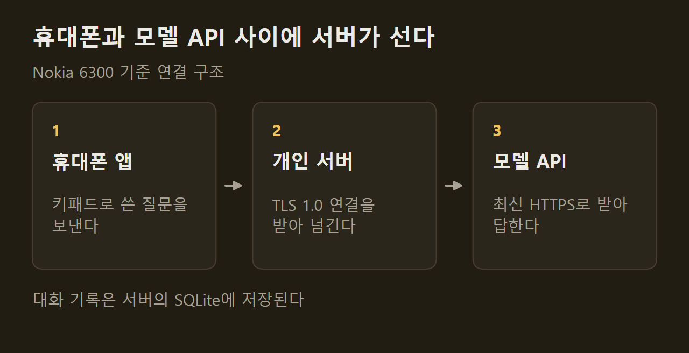
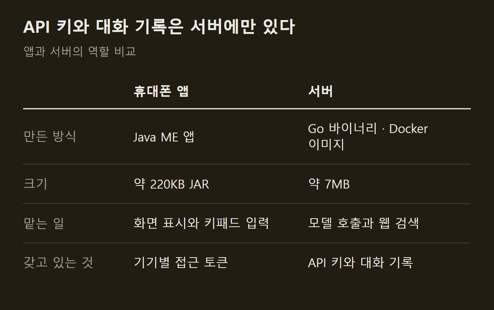
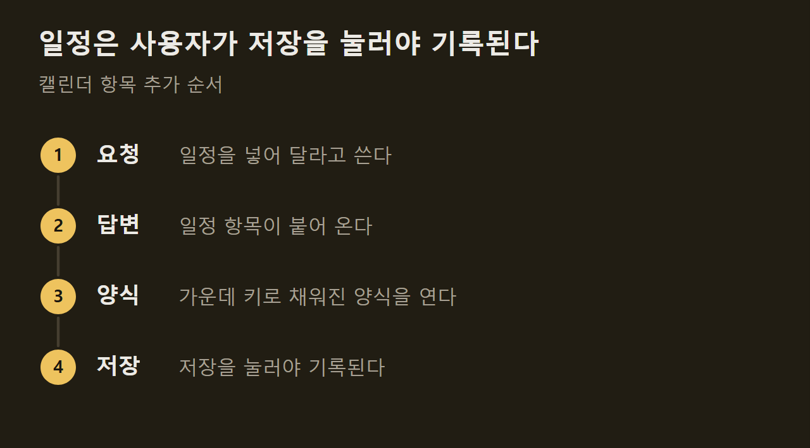

> 이 글은 아래 원문을 우리말로 간추려 정리한 글입니다. 정확한 내용은 원문을 확인하십시오.
>
> 원문: [github.com/emir/AIKON](https://github.com/emir/AIKON)  
> 원문을 소개한 뉴스레터: AlphaSignal

2007년에 나온 Nokia 6300은 화면이 240x320 픽셀이고 숫자 키패드로 글자를 입력하는 휴대폰이다. 이 기기는 요즘 웹 서비스가 요구하는 보안 연결 방식을 지원하지 않아서 AI 모델의 API에 직접 접속할 수 없다. 개발자 Emir Karşıyakalı는 이 휴대폰에서 돌아가는 채팅 앱과 그 앱이 접속하는 소형 서버를 [AIKON](https://github.com/emir/AIKON)이라는 이름으로 공개했다. 키패드로 질문을 입력하면 서버가 Claude, OpenAI, Gemini, Grok 가운데 고른 모델에 대신 물어보고 답을 휴대폰 화면에 돌려준다.

```요약
요약: AIKON은 Nokia Series 40·Symbian S60 휴대폰에서 AI 모델과 대화하게 해 주는 앱과 Go 서버이며, 사용자가 직접 띄운 서버가 TLS 1.0 연결을 받아 주어야 동작하고 Nokia 6300과 E63에서만 확인됐다.
```

```용어
Series 40: Nokia가 일반 휴대폰에 쓰던 소프트웨어 플랫폼이다. 이 기사에서는 Nokia 6300이 여기에 속한다.
Java ME: 메모리가 작은 휴대폰에서 앱을 돌리기 위한 자바 규격이다. AIKON의 휴대폰 앱이 이 규격으로 만들어졌다.
TLS 1.0: 인터넷 통신을 암호화하는 규약의 오래된 버전이다. Nokia 6300은 이 버전만 지원한다.
사설 CA: 공인 기관이 아니라 사용자가 직접 만든 인증서 발급 주체다. 여기서 만든 루트 인증서를 휴대폰에 한 번 넣어 두면 휴대폰이 서버를 신뢰한다.
페어링: 휴대폰과 서버를 서로 등록하는 절차다. 휴대폰에 뜬 6자리 코드를 서버 관리자가 승인하면 끝난다.
```

## 1. 휴대폰에서 되는 일

대화를 시작할 때 먼저 제공사를 고르고, 이어서 서버가 내놓은 모델 가운데 하나를 고른다. 대화 도중에도 모델을 바꿀 수 있고 답변마다 어느 모델이 썼는지 표시된다. 답변은 문단과 목록 모양을 유지한 채 나오며, 기다리는 동안에는 경과한 초를 세는 표시가 뜬다.

작은 화면에서 긴 글을 읽기 위한 장치가 따로 있다. 7번 키를 누르면 답변 하나를 화면 전체에 띄워 쪽 단위로 넘겨 읽는 읽기 모드로 들어가고, 긴 답변은 나누어 받는다. 나머지 부분은 서버에 이미 있는 것을 가져오는 방식이어서 모델을 다시 호출하지 않는다.

뉴스, 날씨, 환율처럼 최신 정보가 필요한 질문은 웹 검색으로 처리한다. 검색은 서버 쪽에서 각 제공사의 검색 도구로 이루어지고 휴대폰의 브라우저는 쓰이지 않으며, 출처는 답변 아래에 나열된다. 이 밖에 30초까지 말하면 글자로 바꿔 주는 음성 입력, 사진을 찍거나 골라서 묻는 기능, 답변을 텍스트 파일로 저장하는 기능, 지난 대화 검색과 고정이 들어 있다. 메뉴는 여덟 개 언어로 제공되고, 답변은 메뉴 언어와 관계없이 사용자가 쓴 언어를 따른다.

## 2. TLS 1.0을 받아 주는 서버

Nokia 6300은 RSA 키 교환을 쓰는 TLS 1.0만 지원하고, 접속하려는 서버 이름을 알려 주는 SNI를 보내지 않으며, 내장된 신뢰 인증서 목록도 2008년 무렵에서 멈춰 있다. 원문은 Cloudflare를 포함한 공용 클라우드가 이런 연결 요청을 거부한다고 설명한다.

그래서 AIKON의 서버는 암호화 연결을 직접 받는다. 사용자가 사설 CA를 만들어 서버 인증서를 발급하고, 그 루트 인증서를 휴대폰에 한 번 설치해 둔다. ==서버는 휴대폰과는 TLS 1.0으로, 모델 제공사와는 최신 HTTPS로 통신한다.==



서버를 돌리려면 공인 IPv4 주소와 443번 포트가 열린 Docker 호스트가 필요하고, 원문은 월 4~6달러짜리 가상 서버면 충분하다고 적었다. 인증서 발급부터 페어링까지의 설치 순서는 저장소의 설정 문서에 단계별로 정리되어 있다.

## 3. 앱과 서버의 역할 분담

휴대폰 앱은 화면 표시와 입력만 맡고, 비용이 드는 일과 민감한 정보는 서버에 둔다. API 키는 서버에만 있으며 휴대폰은 페어링으로 받은 기기별 접근 토큰만 갖는데, 이 토큰은 서버에서 취소할 수 있다.



서버는 기기마다 하루 요청 수, 출력 토큰, 웹 검색, 음성 메시지, 사진 횟수에 한도를 건다. 음성 인식은 선택 기능으로 OpenAI의 음성-텍스트 변환을 쓰고, 휴대폰이 녹음한 AMR 파일을 처리하려고 이미지 안에 최소 구성의 ffmpeg를 넣었다. 관리용 API는 서버 자신에서만 접근할 수 있다.

## 4. 보내기 전에 확인하는 설계

AIKON의 여러 기능은 사용자가 마지막에 직접 눌러야만 실행된다. 메시지를 골라 줄이기, 쉽게 설명하기, 번역하기를 선택해도 입력창에 문장만 채워질 뿐이고, 보내기를 누르기 전에는 아무것도 전송되지 않는다. 음성 입력도 변환된 글이 입력창에 열려서 고친 뒤 보내게 되어 있다.

일정 추가가 같은 방식으로 동작한다. "내일 3시 치과를 캘린더에 넣어 줘"라고 하면 답변에 일정 항목이 붙어 오지만, 휴대폰 캘린더에 기록되는 것은 사용자가 저장을 누른 때다.



비용도 같은 원칙으로 다룬다. 오류가 난 뒤 다시 시도하는 것은 키 하나로 되고 요금이 두 번 나가지 않으며, 서버는 유료 호출을 스스로 재시도하지 않는다.

## 5. 저장 기간과 과금

메시지 하나는 그 대화가 쓰는 모델의 API 호출 한 번이고, 요금은 사용자가 등록한 키로 해당 제공사에 청구된다. 웹 검색은 검색 횟수만큼 따로 과금되고 검색 결과는 입력 토큰으로 계산된다. 원문은 제공사 콘솔에서 지출 한도를 걸어 두라고 적었다.

저장 기간은 종류마다 다르다.

1. 대화: 마지막 메시지 이후 30일 동안 서버에 남고, 고정한 대화는 고정을 풀거나 지울 때까지 남는다.
2. 음성: 녹음은 저장하지 않고, 변환된 글만 재시도 때 다시 과금되지 않도록 하루 동안 둔다.
3. 사진: 1024픽셀로 줄여 대화와 함께 서버에 두며, 사진 한 장은 그 대화의 메시지마다 입력 토큰을 약 1,000개 더한다.

서버 로그에는 메시지 본문이 남지 않는다. 다만 서버 주소와 접근 코드 같은 설정이 메모리 카드에도 파일로 저장되므로, 원문은 카드가 다른 사람 손에 넘어가면 그 기기를 취소하라고 안내한다.

## 6. 이름과 확인된 범위

이 프로젝트는 Claude하고만 통신하던 시기에 Claude S40이라 불렸고, OpenAI, Gemini, Grok을 함께 지원하면서 Nokia를 거꾸로 쓴 AIKON으로 이름을 바꿨다. 자바 패키지와 서버 이름에는 옛 이름이 그대로 남아 있다.

동작이 확인된 기기는 Nokia 6300과 쿼티 자판이 달린 Nokia E63 두 종이다. 규격이 같은 다른 Series 40 휴대폰에서도 될 수 있으나 시험하지 않았다고 원문은 밝혔다. 영어 외 여섯 개 언어의 번역은 초안 상태이고, 오른쪽에서 왼쪽으로 쓰는 문자는 화면 배치 작업이 먼저 필요하며, 일본어와 중국어는 휴대폰에 글꼴이 없어 지원할 수 없다. Anthropic, OpenAI, Google, xAI, Nokia 어느 곳도 제작이나 지원에 관여하지 않은 개인 프로젝트다.

## 출처와 작성 방식

- 원문: [github.com/emir/AIKON](https://github.com/emir/AIKON)
- 원문을 소개한 뉴스레터: AlphaSignal
- 그래프: 원문에 적힌 값으로 새로 그린 그림입니다. 원문에 실린 그림이 아닙니다.
- 작성 방식: 직접 만든 뉴스 정리 파이프라인(VISER)으로 생성하고 검수한 글입니다. 본문의 수치와 주장은 원문에서 가져온 것입니다.
- 정리 주차: 2026-W40
