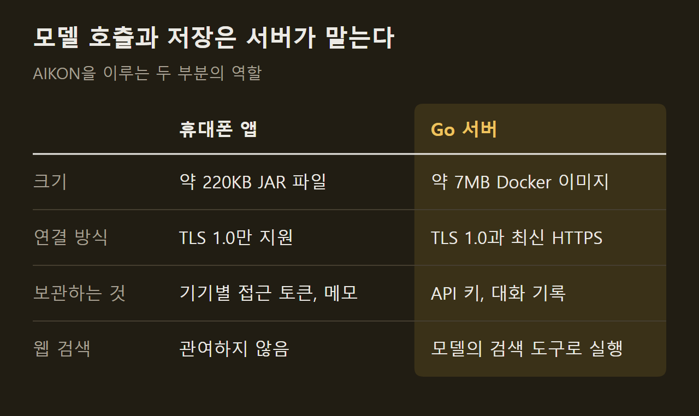
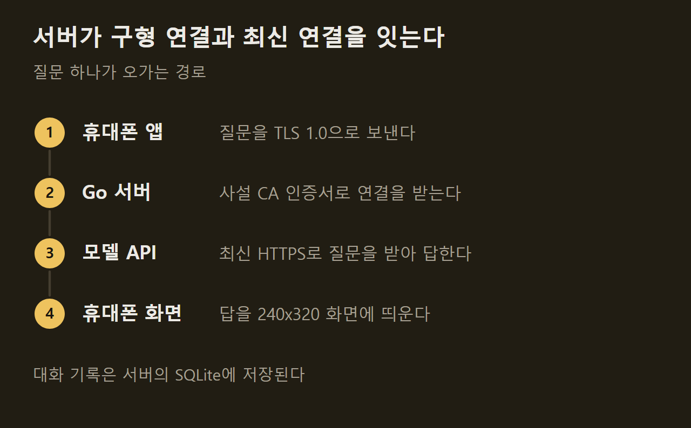

> 이 글은 아래 원문을 우리말로 간추려 정리한 글입니다. 정확한 내용은 원문을 확인하십시오.
>
> 원문: [github.com/emir/AIKON](https://github.com/emir/AIKON)  
> 원문을 소개한 뉴스레터: AlphaSignal

2007년에 나온 Nokia 6300은 숫자 키패드와 240x320 화면을 쓰는 휴대폰이고, 지금의 보안 연결 방식을 지원하지 않아 AI 서비스에 직접 접속할 수 없다. 개발자 Emir Karşıyakalı는 이 휴대폰에서 AI와 대화하는 앱과 중계 서버를 [AIKON](https://github.com/emir/AIKON)이라는 이름으로 공개했다. 키패드로 질문을 입력하면 서버가 Claude, OpenAI, Gemini, Grok 가운데 고른 모델에 대신 물어보고, 답을 휴대폰 화면에 띄워 준다. 처음에는 Claude만 지원해 Claude S40으로 불렸으나, 다른 모델을 더하면서 Nokia를 거꾸로 쓴 지금의 이름으로 바뀌었다.

```요약
요약: AIKON은 구형 Nokia 휴대폰용 AI 채팅 앱과 Go 중계 서버이며, 서버가 TLS 1.0 연결을 직접 받아 주는 방식으로 동작하고 Nokia 6300과 E63에서만 시험되었다.
```

```용어
Series 40: Nokia가 일반 휴대폰에 쓰던 소프트웨어 플랫폼. Nokia 6300이 여기에 속한다.
Java ME: 구형 휴대폰에서 앱을 돌리던 자바 환경. AIKON의 휴대폰 앱이 이 환경에서 실행된다.
TLS: 인터넷 통신을 암호화하는 규격. Nokia 6300은 오래된 1.0 버전만 지원한다.
사설 CA: 사용자가 직접 만든 인증서 발급 주체. 그 루트 인증서를 휴대폰에 넣으면 휴대폰이 서버를 신뢰한다.
페어링: 휴대폰과 서버를 서로 등록하는 절차. 휴대폰에 뜬 6자리 코드를 서버에서 승인한다.
```

## 1. 휴대폰 앱과 서버의 역할

AIKON은 휴대폰에 설치하는 앱과 사용자가 직접 운영하는 서버, 두 부분으로 이루어진다. 휴대폰 앱은 화면을 그리고 입력을 받는 일만 하고, 모델 호출과 웹 검색, 대화 저장은 모두 서버가 맡는다.

앱은 Java ME용으로 만든 약 220KB짜리 JAR 파일이다. 서버는 Go로 작성한 실행 파일 하나이며 Docker 이미지로는 약 7MB다. 공인 IPv4 주소와 443번 포트가 열린 Docker 호스트가 있으면 되고, 원문은 월 4~6달러짜리 가상 서버로 충분하다고 적었다.



API 키는 서버에만 있고 휴대폰에는 기기별 접근 토큰만 내려간다. 이 토큰은 페어링으로 발급되며 서버에서 언제든 폐기할 수 있다.

## 2. TLS 1.0과 사설 인증서

서버를 따로 두어야 하는 이유는 휴대폰의 보안 연결 방식에 있다. Nokia 6300은 TLS 1.0과 RSA 키 교환만 지원하고, 접속하려는 서버 이름을 알려 주는 SNI 정보도 보내지 않는다. 휴대폰에 들어 있는 루트 인증서 목록도 2008년 무렵에서 멈춰 있다. 원문에 따르면 Cloudflare를 포함한 공개 클라우드는 이런 조건의 연결 요청을 거절한다.

그래서 서버가 휴대폰의 TLS 연결을 직접 받는다. 사용자는 사설 CA를 만들어 서버 인증서를 발급하고, 그 루트 인증서를 휴대폰에 한 번 넣어 둔다. ==서버는 휴대폰에는 TLS 1.0으로, 모델 제공사에는 최신 HTTPS로 통신한다.==



프로토콜 설계와 측정값은 저장소의 `docs/ARCHITECTURE.md`에, 설치 절차는 `docs/SETUP.md`에 정리되어 있다.

## 3. 키패드 중심의 채팅 화면

모든 화면은 키패드만으로 조작한다. 대화를 시작할 때 제공사와 모델을 고르고 대화 도중에도 바꿀 수 있으며, 답마다 어느 모델이 썼는지 표시된다. 답은 문단과 목록 모양을 유지한 채 나오고, 기다리는 동안에는 경과한 초가 표시된다.

작은 화면에서 긴 답을 읽기 위한 기능이 따로 있다. 7번 키를 누르면 읽기 모드로 들어가 답 하나를 화면 전체에 페이지 단위로 보여 주고, 9번 키로 글자 크기를 바꿔도 읽던 위치가 유지된다. 긴 답은 나누어 전달되는데, 나머지를 불러올 때는 서버에 저장된 부분을 가져올 뿐 모델을 다시 호출하지 않으므로 비용이 들지 않는다.

뉴스, 날씨, 환율 같은 질문은 모델이 서버 쪽에서 제공사의 검색 도구로 찾아 답하고, 출처가 답 아래에 붙는다. 휴대폰의 2007년형 브라우저는 이 과정에 쓰이지 않는다. 메시지를 골라 줄이기, 쉽게 설명하기, 번역하기를 요청할 수도 있지만, 이 동작은 입력창에 문장을 채워 넣기만 하고 사용자가 전송을 눌러야 보내진다.

메뉴는 영어, 터키어, 스페인어 등 여덟 언어를 지원한다. 영어와 터키어를 뺀 여섯 언어는 초안 상태라고 개발자가 밝혔고, 휴대폰 글꼴에 없는 일본어와 중국어는 이 기기에서 지원할 수 없다고 적었다.

## 4. 음성, 사진, 일정 기능

글자 입력 말고도 세 가지 입력·출력 방식이 있다.

1. 음성 메시지: 최대 30초까지 말하면 서버가 글로 바꾸고, 그 글이 입력창에 열려 보내기 전에 고칠 수 있다.
2. 사진: 카메라로 찍거나 저장된 사진을 골라 질문하며, 같은 대화의 이어지는 질문에서도 그 사진이 참조된다.
3. 일정과 할 일: "내일 3시 치과를 캘린더에 추가해 줘"라고 쓰면 답에 일정 항목이 딸려 오고, 미리 채워진 양식에서 저장을 눌러야 휴대폰 캘린더에 기록된다.

음성 변환은 OpenAI의 음성 인식 기능을 쓰므로 OpenAI 키로 요금이 나가고, 기본값은 꺼짐이다. 녹음 파일은 저장하지 않지만, 변환된 글은 하루 동안 보관해 재시도할 때 요금이 다시 나가지 않게 한다. 사진은 1024픽셀로 줄여 서버에 보관하며, 사진 한 장은 그 대화의 메시지마다 입력 토큰을 약 1,000개씩 늘린다.

## 5. 요금 제한과 데이터 보관

메시지 하나는 선택한 모델의 API 호출 한 번이고, 요금은 사용자가 등록한 키로 청구된다. 서버는 기기마다 하루 요청 수, 출력 토큰, 웹 검색, 음성 메시지, 사진 횟수에 한도를 둔다. ==유료 호출은 자동으로 재시도하지 않아 오류가 나도 요금이 두 번 나가지 않는다.== 웹 검색은 건당 요금이 붙고 검색 결과가 입력 토큰으로 계산되므로, 원문은 제공사 콘솔에서 지출 한도를 따로 설정하라고 안내한다.

대화는 서버의 SQLite에 마지막 메시지로부터 30일 동안 저장되고, 고정한 대화는 고정을 풀거나 지울 때까지 남는다. 휴대폰은 설정을 켰을 때만 마지막 대화 하나를 보관한다. 서버 주소와 접근 코드는 메모리 카드의 파일에도 저장되므로, 카드를 분실하면 해당 기기를 서버에서 폐기해야 한다. 로그에는 메시지 본문이 남지 않는다.

시험한 기기는 Nokia 6300과 QWERTY 자판을 쓰는 Nokia E63 두 종이다. 화면 크기와 Java ME 규격이 같은 다른 Series 40 휴대폰에서는 동작할 수 있으나 확인되지 않았다. AIKON은 개인이 만든 프로젝트이며 Anthropic, OpenAI, Google, xAI, Nokia 어느 쪽의 지원도 받지 않는다.

## 출처와 작성 방식

- 원문: [github.com/emir/AIKON](https://github.com/emir/AIKON)
- 원문을 소개한 뉴스레터: AlphaSignal
- 그래프: 원문에 적힌 값으로 직접 그린 그림입니다.
- 작성 방식: 직접 만든 뉴스 정리 파이프라인(VISER)으로 생성하고 검수한 글입니다. 본문의 수치와 주장은 원문에서 가져온 것입니다.
- 정리 주차: 2026-W40
