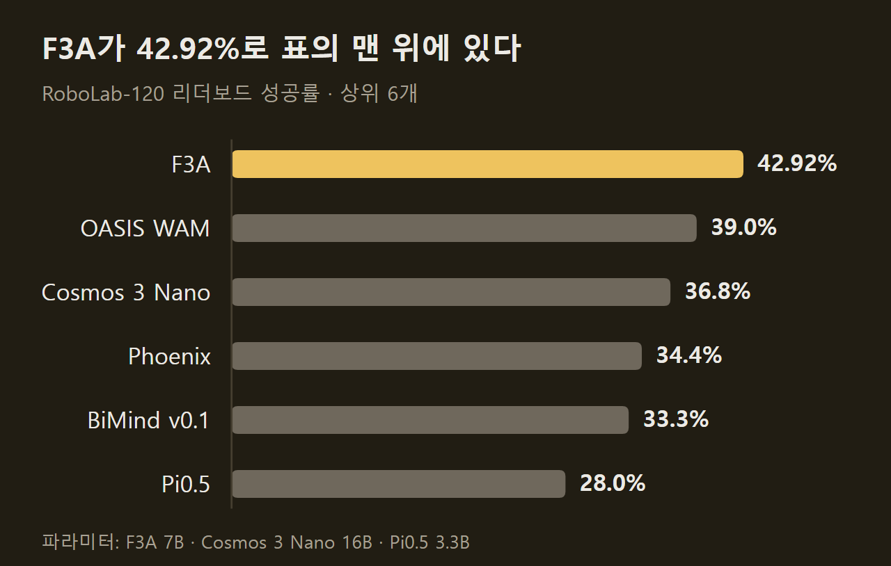
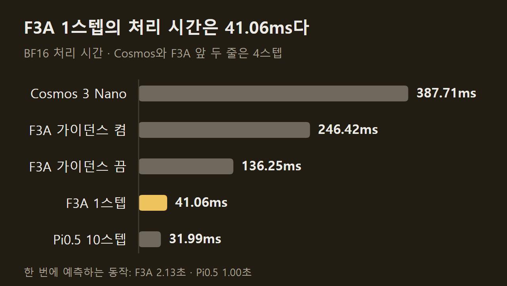
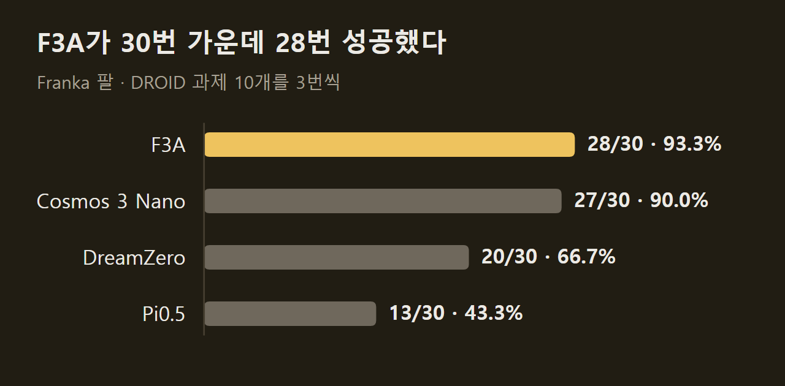
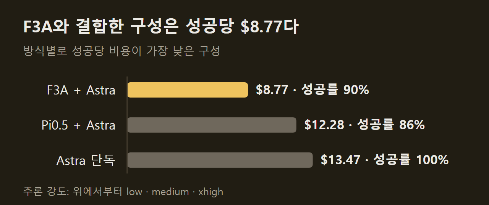

> 이 글은 아래 원문을 우리말로 간추려 정리한 글입니다. 정확한 내용은 원문을 확인하십시오.
>
> 원문: [bfl.ai/models/flux-3-action](https://bfl.ai/models/flux-3-action)  
> 원문을 소개한 뉴스레터: Turing Post

로봇 팔에 "빨간 큐브를 왼쪽 통에 넣어라"라고 지시하면, 로봇은 카메라 화면과 자기 관절 위치를 보고 다음에 보낼 모터 명령을 정해야 한다. 이 일을 맡는 공개 모델은 성공률이 높으면 느리고, 빠르면 성공률이 낮았다. Black Forest Labs가 가중치와 함께 공개한 [FLUX 3 Action](https://bfl.ai/models/flux-3-action)(이하 F3A)은 지시문, 카메라 영상, 관절 위치를 넣으면 앞으로의 모터 명령과 그 결과로 보일 영상을 함께 예측하는 7B 크기의 모델이다. 로봇은 예측된 동작 가운데 정해진 개수만 실행한 뒤, 다시 화면을 보고 새로 예측을 받는다.

```요약
요약: F3A는 영상과 동작을 함께 예측하는 7B 공개 모델로, 샘플링을 한 단계로 줄인 체크포인트가 RoboLab에서 38.3% ± 0.38의 성공률을 기록했고 워크스테이션·데이터센터 GPU에서는 Pi0.5보다 1.34~2.28배 빨랐지만 RTX 5090 같은 소비자용 GPU에서는 Pi0.5보다 느렸다.
```

```용어
월드 액션 모델: 앞으로의 동작과 그 결과로 보일 영상을 한 모델이 함께 예측하는 로봇 제어 모델. 줄여서 WAM이라고 부른다.
VLA: 영상과 지시문을 받아 동작만 예측하는 모델. 이 기사에서는 Pi0.5가 대표로 나온다.
가이던스: 조건을 준 예측과 주지 않은 예측을 모두 계산해 결과를 조건 쪽으로 당기는 샘플링 기법. 샘플링 단계마다 모델을 두 번 실행한다.
증류: 학습을 마친 교사 모델의 출력을 목표로 삼아, 더 적은 계산으로 같은 출력을 내도록 학생 모델을 학습시키는 방법.
실시간 계수: 처리 시간을 한 번에 예측한 동작 구간의 길이로 나눈 값. 작을수록 로봇 동작 1초를 만드는 계산이 빨리 끝난다.
```

## 1. 공개 동작 정책의 성공률과 속도

로봇 동작을 예측하는 공개 모델은 두 종류다. 월드 액션 모델(WAM)은 동작과 함께 앞으로의 영상까지 예측하고, 비전-언어-액션(VLA) 모델은 동작만 예측한다. RoboLab 벤치마크에서 WAM인 Cosmos 3 Nano는 과제의 36.8%를 성공했고, 공개 VLA 가운데 가장 강한 Pi0.5는 28.0%였다. 그 대신 WAM은 느리다. B200 GPU에서 로봇 동작 1초를 만드는 데 Cosmos 3 Nano(FP8)는 Pi0.5(BF16)의 약 4.7배 처리 시간을 쓴다.

원문은 WAM이 느린 이유를 세 가지로 든다.

1. 긴 시퀀스: 영상과 동작을 함께 예측하므로 한 번에 처리할 토큰이 많다.
2. 가이던스: 샘플링 단계마다 모델을 두 번 실행하므로 계산량이 두 배가 된다.
3. 큰 백본: Cosmos 3의 파라미터 수는 Pi0.5의 4.85배다.

F3A는 영상과 동작을 함께 예측하는 구조를 그대로 두고 두 가지를 바꿨다. 백본은 Self-Flow 방식의 멀티모달 사전 학습으로 Cosmos 3 Nano의 절반 이하인 7B로 줄였고, 증류로 가이던스 계산을 없애면서 샘플링을 한 단계로 줄였다. ==1스텝 체크포인트의 RoboLab 성공률은 38.3% ± 0.38이다.== 속도보다 성공률이 중요할 때 쓰는 가이던스 증류 체크포인트는 42.2% ± 0.36을 기록했다. 리더보드 표에는 F3A가 42.92%로 올라 있다.



## 2. 사전 학습과 중간 학습

F3A의 바탕은 이미지·영상·오디오로 사전 학습한 FLUX 3 백본이고, 학습 토큰의 95% 이상이 영상이다. 동작 시연 데이터만으로는 양이 부족하므로, 훨씬 넓은 영상 데이터에서 얻은 표현을 동작 예측으로 옮긴다는 구상이다.

사전 학습의 효과는 체크포인트마다 동작 출력부를 새로 붙이고 로봇 데이터셋 DROID로 파인튜닝한 뒤 RoboLab에서 확인했다. 사전 학습 없이 DROID만 학습하면 성공률이 1% 아래에 머물렀고, 사전 학습을 거치면 11.6%로 뛰어 12.4%까지 천천히 올랐다. 다만 이 실험은 배치 크기와 학습률을 작게 잡은 예비 설정이어서, 체크포인트의 최고 성능이 아니라 상대 비교용 수치다.

그다음은 동작에 초점을 둔 중간 학습 단계다. 사전 학습 데이터에 동작이 붙은 영상을 섞어 학습을 이어 가며, 학습 샘플 비율은 다음과 같다.

1. 오디오가 붙은 영상: 36.95%로, 사전 학습 데이터에서 가져온다.
2. 게임 녹화: 19.55%로, 마우스 이동과 버튼, 키보드 입력을 102차원으로 표현한다.
3. 손 자세가 표시된 1인칭 영상: 13.54%다.
4. 손에 쥐는 그리퍼로 모은 데이터: 14.03%다.
5. 원격 조작 데이터: 15.93%로, 로봇 형태 14종에서 모았다.

1인칭 영상, 그리퍼, 원격 조작 데이터는 대부분 EE50이라는 50차원 동작 표현을 함께 쓴다. 왼손과 오른손에 25차원씩 배정하고, 각 25차원에 위치와 회전, 손가락 각도나 그리퍼 개폐 상태를 담는다. 이 공통 표현 덕분에 중간 학습 체크포인트는 추가 파인튜닝 없이 RoboLab에서 바로 평가할 수 있다. 그렇게 잰 성공률은 0%에서 7.2%, 14.7%를 거쳐 17.3%까지 올랐고, DROID로 파인튜닝해 잰 값은 18.6%에 이르렀다. 원문은 중간 학습에서 성능이 아직 포화하지 않았다고 적었다.

게임 데이터를 넣은 이유는 전망 부분에 나온다. 낯선 곳에서 길을 찾거나 다른 행위자의 움직임을 예상하는 능력은 실제 로봇으로 안전하게, 대규모로 평가하기 어렵다. 게임은 병렬로, 실시간보다 빠르게, 위험 없이 돌릴 수 있어서 그런 능력을 시험하기에 알맞다는 설명이다.

## 3. 파인튜닝에서 정한 설정

원문은 로보틱스에서는 가중치만큼 파인튜닝 방법이 중요하다고 보고, DROID 파인튜닝에서 시험한 설정을 공개했다.

먼저 학습 순서다. 파인튜닝을 시작할 때 새로 붙인 동작 출력부는 무작위 값이어서 초기 그래디언트에 잡음이 많다. 중간 학습에서 얻은 가중치가 여기에 망가지지 않도록 첫 1천 스텝은 기존 가중치를 고정하고, 이후 2천 스텝에 걸쳐 학습률을 올렸다. 비교 대상은 중간 학습 때의 EE50 출력부를 그대로 이어 쓰는 방식이다. 배치 크기 512에서는 EE50 쪽이 앞섰지만, 2048로 키운 실험에서는 1만 스텝 이후 관절 값을 직접 예측하는 쪽이 앞서 최종 40.13% 대 37.88%가 됐다. 원문은 데이터나 학습 스텝이 아주 적을 때는 EE50 파인튜닝도 쓸 만하다고 덧붙였다.

학습을 더 길게 해도 성공률은 오르지 않았다. 3만 스텝까지 늘리자 학습 손실은 계속 내려갔지만 2만 스텝 이후 RoboLab 성공률은 나아지지 않았다. 학습률을 2e-4 근처나 그 이상으로 잡으면 손실이 갑자기 튀는 일이 가끔 생겼고, 그 뒤로는 성공률이 한동안 낮아졌기 때문에 매번 튀기 전 체크포인트로 되돌려 학습을 이었다.

그 밖에 실험으로 정한 설정은 세 가지다.

1. 노이즈 수준 분포: 영상과 동작은 노이즈를 섞었을 때 신호가 사라지는 지점이 다르다. 이 지점을 재서 후보 분포를 고르고 격자 탐색을 했는데, 뚜렷한 경향은 찾지 못했다. 다만 로짓-로지스틱 분포에 동작 값을 2배로 키운 조합이 꾸준히 높았다.
2. 가이던스 세기: 영상과 동작에 가이던스를 따로 걸 수 있다. 과제 120개 전체로 탐색한 결과, 영상 4.0·동작 1.0 조합이 42.00%로 가장 높았다.
3. 가중치 평균: 학습 중 가중치를 평균해 쓰는 EMA는 평균하지 않은 모델보다 성공률이 뚜렷이 높았다. 여러 방식 가운데 Power EMA를 매 스텝 갱신하는 설정을 권장값으로 골랐다.

분포의 세부 파라미터와 EMA 수식은 원문에 정리되어 있다.

## 4. 증류와 추론 속도

속도는 증류 두 단계로 끌어올렸다. 첫 단계인 가이던스 증류에서는 같은 체크포인트에서 교사와 학생을 만들고, 고정한 교사가 가이던스를 걸어 낸 예측을 학생이 그대로 내도록 학습시킨다. 학생은 가이던스 없이 한 번만 실행하면 되므로 1.8~2배 빨라졌고, 성공률은 떨어지지 않고 0.6~1.08%p 올랐다.

둘째 단계인 스텝 증류에서는 샘플링 4단계를 1단계로 줄인다. 속도는 3.15~4배 빨라졌고 성공률은 3.51~4.32%p 내려갔다. ==그래도 Cosmos 3보다 1.12~1.88%p 높고 9.19~13.22배 빠르다.== Pi0.5와 견주면 성공률은 9.92~10.68%p 높다.

Pi0.5와의 속도 비교는 하드웨어에 따라 갈린다. 워크스테이션과 데이터센터 GPU에서는 1스텝 F3A(FP8)가 Pi0.5(BF16)보다 1.34~2.28배 빨랐다. 반면 RTX 5090 같은 소비자용 GPU에서는 FP8에서 1.15배, BF16에서 2.42배 느렸다. 또 이 비교의 기준은 호출 한 번의 지연 시간이 아니라 실시간 계수다. F3A는 한 번에 2.13초 분량의 동작을 예측하고 Pi0.5는 1.0초 분량을 예측하므로, 한 번의 처리 시간이 더 길어도 동작 1초당 계산 시간은 짧을 수 있다.



증류 외에 추론 단계의 최적화도 더했다. FP8로 실행하면 로컬 GPU에서 1.4배 넘게 빨라졌고, 성공률 변화는 가이던스 증류 체크포인트의 +0.05%p에서 스텝 증류 체크포인트의 -0.76%p 사이였다. 프롬프트가 바뀌지 않는 동안에는 프롬프트 쪽 계산을 캐시하고, 입력 크기가 고정된다는 점을 이용해 `torch.compile`로 호출 부담을 줄였다.

## 5. 실제 로봇 평가

시뮬레이션 밖의 평가는 제3자인 Positronic Robotics가 맡았다. Franka 로봇 팔로 DROID 과제 10개를 세 번씩 시도했고, 같은 과제와 장비, 시도당 240초 제한, 같은 채점 기준을 Cosmos 3 Nano, DreamZero, Pi0.5에도 적용했다. 조작자는 어느 모델이 로봇을 움직이는지 모르는 상태였으며 모든 시도를 영상으로 남겼다. F3A는 30번 가운데 28번 성공했다.



같은 파인튜닝 방법은 SO-101이라는 다른 로봇 팔에도 적용했다. 원격 조작으로 모은 소량의 데이터로 파인튜닝했고, 학습 때 본 과제와 함께 물체, 용기, 카메라 위치가 달라진 상황에서의 동작을 영상으로 공개했다. 이 실험의 성공률 수치는 자료에 없다.

## 6. 추론 모델과 결합한 하이브리드 정책

F3A를 포함해 어떤 동작 정책도 혼자서는 풀지 못하는 과제가 있다. Su 등(2026)의 과제 10개에서 F3A 단독 성공률은 48%(200번 중 96번)였고, 어질러진 물건 사이에서 호박을 고르는 과제와 블록을 지정한 색 순서로 쌓는 과제는 20번 모두 실패했다. 추론 모델 GPT 6 Astra는 추론 강도를 최대로 올리면 50번을 모두 성공하지만 비용이 크다. 성공 한 번에 $13.47와 16분 23초가 든다. F3A 단독은 시간당 $3인 H200 GPU 한 대에서 성공 한 번에 약 $0.087와 1.75분이 들고, 그 시간의 대부분은 로봇이 움직이기를 기다리는 대기 시간이다.

그래서 평소에는 빠른 정책이 로봇을 움직이고 필요할 때만 추론 모델이 개입하는 구성을 시험했다. 설정은 Su 등(2026)을 그대로 따랐다. 매 차례 정책이 동작을 예측하면 Astra가 그 예측과 관측 화면, 로봇 상태를 보고 넷 중 하나를 고른다.

1. 실행: 정책이 예측한 동작의 일부를 그대로 실행한다.
2. 수정: 예측된 동작 가운데 1~5개를 고친다.
3. 직접 제안: 정책의 예측을 쓰지 않고 자기 동작을 낸다.
4. 중단: 에피소드를 끝낸다.

Pi0.5를 정책으로 쓰면 이 구성의 이득이 작다. 가장 싼 구성이 성공당 $12.28이고, 가장 빠른 구성은 13분 33초였다. ==F3A를 쓰면 성공당 $8.77와 8분 8초로 내려간다.== 추론 강도를 낮게 둔 구성의 값이고, 성공률은 90%(50번 중 45번)였다. 원문은 이를 다른 구성 중 가장 좋은 것보다 29% 싸고 40% 빠르다고 정리했고, 달러당 성공 횟수로는 최대 53.64% 많다고 적었다.



블록 쌓기 과제의 영상이 개입 방식을 보여 준다. F3A 혼자서는 블록을 쌓는 동작은 해내지만 지시한 색 순서를 지키지 않았다. 하이브리드 구성에서는 F3A가 초록 블록 차례에 노란 블록을 집으려 할 때 Astra가 잠깐 개입해 로봇 손끝을 초록 블록 쪽으로 옮겼고, 그 뒤로는 F3A가 다시 혼자 작업을 이어 갔다.

성공률만 보면 최대 강도의 Astra 단독이 여전히 가장 높으므로, 신뢰도와 비용 사이의 선택은 그대로 남는다. 원문은 빠른 정책이 좋아질수록 추론에 맡길 일이 줄어든다고 보면서도, 이번 실험은 두 시스템을 결합하는 방법을 처음 살펴본 수준이라고 밝혔다.

## 출처와 작성 방식

- 원문: [bfl.ai/models/flux-3-action](https://bfl.ai/models/flux-3-action)
- 원문을 소개한 뉴스레터: Turing Post
- 그래프: 원문에 적힌 값으로 새로 그린 그림입니다. 원문에 실린 그림이 아닙니다.
- 작성 방식: 직접 만든 뉴스 정리 파이프라인(VISER)으로 생성하고 검수한 글입니다. 본문의 수치와 주장은 원문에서 가져온 것입니다.
- 정리 주차: 2026-W40
