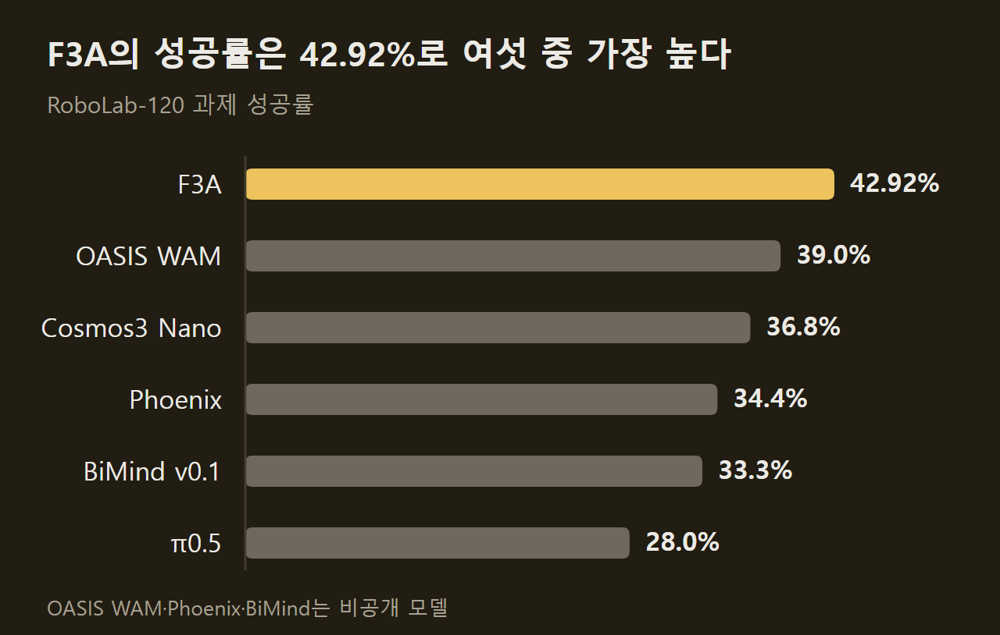
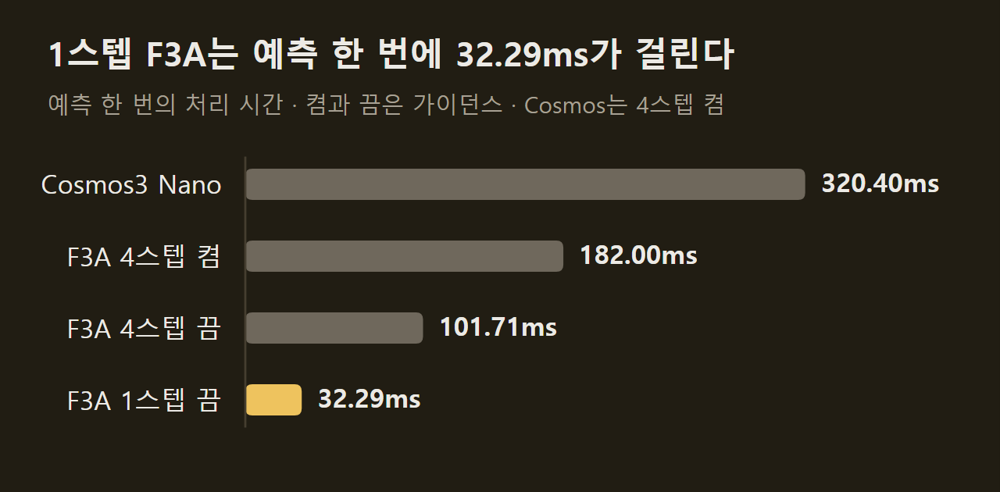
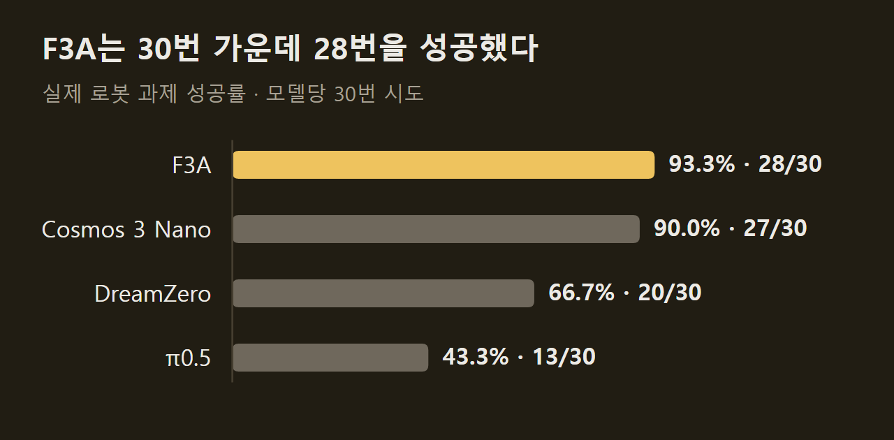
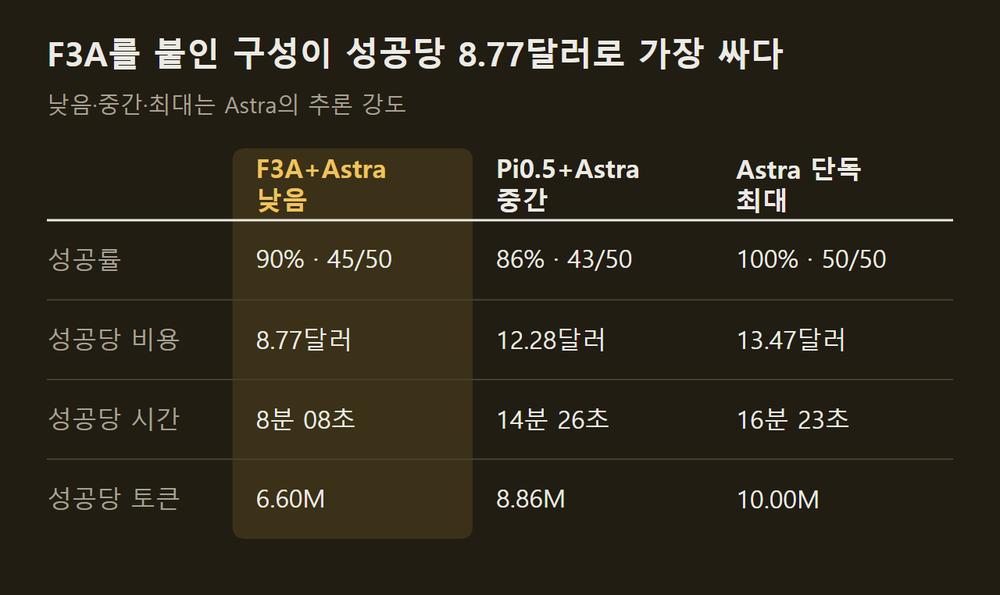

> 이 글은 아래 원문을 우리말로 간추려 정리한 글입니다. 정확한 내용은 원문을 확인하십시오.
>
> 원문: [bfl.ai/models/flux-3-action](https://bfl.ai/models/flux-3-action)  
> 원문을 소개한 뉴스레터: Turing Post

로봇 팔 앞에 상자와 통을 놓고 "파란 상자를 통에 넣어라"라고 지시하면, 로봇을 움직이는 모델은 카메라 영상을 보고 다음 동작을 정해야 한다. 지금까지 공개된 모델 가운데 성공률이 높은 쪽은 느렸고 빠른 쪽은 성공률이 낮았다. Black Forest Labs는 [FLUX 3 Action](https://bfl.ai/models/flux-3-action)(이하 F3A)을 가중치와 함께 공개했다. 지시문과 카메라 영상, 로봇 관절 위치를 넣으면 앞으로 보낼 모터 명령과 그 결과로 보일 영상을 함께 예측하는 7B 크기의 모델이다. 로봇은 예측된 동작 일부를 실행한 뒤 다시 관찰하고, 모델은 새 관찰에서 다시 예측한다.

```요약
요약: F3A는 영상과 동작을 함께 예측하는 7B 공개 모델로, 가이던스 증류본이 RoboLab에서 성공률 42.2% ± 0.36을 기록했고 1스텝 증류본은 성공률이 38.3%로 낮아지는 대신 워크스테이션·데이터센터 GPU에서 Pi0.5보다 빠르다.
```

```용어
월드 액션 모델: 앞으로의 동작과 그 결과로 보일 영상을 한 모델이 함께 예측하는 방식이다. 원문은 WAM으로 줄여 쓴다.
VLA: 영상과 지시문을 받아 동작만 예측하는 방식이다. 영상을 만들지 않아서 계산량이 적다.
가이던스: 조건을 준 예측과 주지 않은 예측을 한 번씩 계산해 결과를 조건 쪽으로 당기는 기법이다. 샘플링 단계마다 계산이 두 번 든다.
증류: 학습을 마친 교사 모델의 출력을 목표로 삼아 학생 모델을 학습시키는 방법이다. 여기서는 가이던스 계산과 샘플링 단계 수를 줄이는 데 쓴다.
실시간 계수: 처리 시간을 한 번에 예측한 동작의 길이로 나눈 값이다. 로봇 동작 1초를 만드는 데 드는 계산 시간을 뜻한다.
```

## 1. 성공률과 속도 사이의 선택

공개된 로봇 정책은 크게 두 방식으로 나뉜다. 월드 액션 모델(WAM)은 동작과 영상을 함께 예측하고, 대규모 영상으로 사전 학습하며 얻은 지식을 동작 예측에 그대로 쓴다. 그 덕에 동작 데이터가 적어도 성능이 나오지만, 영상까지 만들어야 해서 처리할 토큰이 길어진다. 가이던스 때문에 계산이 두 배가 되고 모델 자체도 크다. 비전-언어-액션(VLA) 모델은 동작만 예측해서 빠르지만 성공률이 낮다.

원문이 든 수치로 보면 차이가 뚜렷하다. RoboLab 벤치마크에서 WAM인 Cosmos 3 Nano는 과제의 36.8%를, 공개 VLA 가운데 가장 강한 Pi0.5는 28.0%를 성공한다. 반면 B200 GPU에서 Cosmos 3 Nano는 로봇 동작 1초를 만드는 데 Pi0.5의 약 4.7배 시간을 쓰고, 파라미터 수도 4.85배다.

F3A는 WAM의 구조를 유지한 채 이 간격을 좁혔다. 원문은 두 가지 변화를 이유로 든다. 하나는 Self-Flow 방식의 멀티모달 사전 학습으로 Cosmos 3 Nano의 절반이 안 되는 크기의 모델을 쓸 수 있었다는 점이고, 다른 하나는 영상과 동작을 분리하지 않은 채 증류로 가이던스 계산을 없애고 샘플링을 한 단계로 줄였다는 점이다. ==F3A는 절반 이하의 파라미터로 Cosmos 3 Nano보다 높은 성공률을 냈다.==



리더보드 표에는 42.92%가 적혀 있는데, 이 값은 기본 체크포인트의 여섯 시드 가운데 가장 높은 값과 같다. 시드 평균으로는 가이던스 증류본이 42.2% ± 0.36, 1스텝 증류본이 38.3% ± 0.38이다.

## 2. 사전 학습에서 파인튜닝까지

학습은 세 단계로 진행됐고, 원문은 단계마다 RoboLab 성공률이 어떻게 달라졌는지를 공개했다.

1. 사전 학습: 이미지·영상·오디오를 섞어 학습하며, 학습 토큰의 95% 이상이 영상이다.
2. 중간 학습: 사전 학습 데이터에 동작이 붙은 영상을 섞어 학습을 이어 간다.
3. 파인튜닝: 대상 로봇의 데이터로 동작 출력부를 맞춘다. 여기서는 DROID 데이터셋을 썼다.

사전 학습의 효과는 동작 출력부를 새로 붙여 DROID로 파인튜닝한 뒤 측정했다. 사전 학습 없이 DROID만으로 학습하면 성공률이 1% 아래에 머물렀고, 사전 학습을 거치면 11.6%로 뛰어 학습이 진행되면서 12.4%까지 올랐다. 이 실험은 배치 크기와 학습률을 작게 잡은 예비 설정이어서 최고 성능을 뜻하지는 않으며, 체크포인트끼리 견주는 용도라고 원문은 밝힌다.

중간 학습에서는 샘플의 36.95%를 사전 학습에 쓰던 오디오 포함 영상에, 나머지 63.05%를 동작이 붙은 영상에 배정했다. 동작 데이터는 게임 녹화 19.55%, 손 자세가 표시된 1인칭 영상 13.54%, 손에 쥐는 그리퍼 14.03%, 14종 로봇의 원격 조종 15.93%로 구성된다. 게임과 로봇의 동작을 각각 어떤 차원으로 표현했는지는 원문에 정리되어 있다. 이 단계의 체크포인트는 추가 파인튜닝 없이 평가해도 성공률이 0%에서 17.3%까지 올랐고, 관절 값으로 파인튜닝하면 18.6%였다. 원문은 중간 학습에서 성능이 아직 포화하지 않았다고 적었다.

DROID 파인튜닝에서는 새로 붙인 동작 출력부가 초반에 불안정한 그래디언트를 내므로, 처음 1천 스텝은 기존 가중치를 고정하고 그 뒤 학습률을 천천히 올렸다. 배치 크기 2048로 2만 스텝을 학습하면 성공률이 40.13%였고, 그 뒤로는 손실이 줄어도 성공률이 더 오르지 않았다. 추론 때는 영상과 동작에 가이던스 세기를 따로 줄 수 있는데, 120개 과제 전체로 탐색한 결과 영상 4.0, 동작 1.0 조합이 42.00%로 가장 높았다. 가중치의 이동 평균을 쓰는지도 성능을 크게 좌우했고, 원문이 권하는 설정은 Power EMA다.

## 3. 증류로 줄인 추론 시간

WAM을 로봇에 직접 싣거나 지연 시간이 중요한 곳에 쓰기 어려운 이유는 속도다. 기존에는 영상과 동작을 따로 처리하게 구조를 바꾸거나 가이던스 계산 두 번을 GPU 두 대에 나눠 돌렸는데, 앞의 방법은 WAM의 성질을 바꾸고 뒤의 방법은 하드웨어 비용을 두 배로 늘린다. F3A는 구조를 그대로 두고 증류를 두 번 적용했다.

첫 번째는 가이던스 증류다. 교사 모델이 가이던스를 켜고 낸 예측을 학생 모델이 가이던스 없이 그대로 내도록 학습시킨다. 속도는 1.8~2배 빨라졌고 성공률은 떨어지지 않고 0.6~1.08%p 올랐다. 두 번째는 스텝 증류로, 네 단계이던 샘플링을 한 단계로 줄인다. 속도가 3.15~4배 더 빨라지는 대신 성공률이 3.51~4.32%p 낮아진다. 그래도 Cosmos 3보다 1.12~1.88%p 높고 9.19~13.22배 빠르다고 원문은 밝혔다.



같은 표에서 Pi0.5는 10스텝, BF16 기준 31.99ms로, 호출 한 번의 시간은 1스텝 F3A와 비슷하다. 차이는 한 번에 예측하는 길이에서 난다. Pi0.5는 동작 15개, 곧 1.00초 분량을 예측하고 F3A는 32개, 2.13초 분량을 예측한다. 그래서 원문은 호출당 지연 시간이 아니라 실시간 계수로 비교한다. ==F3A의 속도 우위는 호출당 지연 시간이 아니라 동작 1초당 계산 시간 기준이다.==

이 기준으로 FP8 1스텝 F3A는 워크스테이션과 데이터센터 GPU에서 BF16 Pi0.5보다 1.34~2.28배 빠르다. RTX 5090 같은 소비자용 GPU에서는 반대로 1.15~2.42배 느리다. Cosmos 3 Nano와 비교하면 기본 체크포인트와 가이던스 증류본이 FP8에서 1.52~3.95배 빠르다. FP8로 돌려도 성공률 변화는 +0.05%p에서 -0.76%p 사이였다.

## 4. Franka 로봇 팔 평가

시뮬레이션 밖의 성능은 제3자가 평가했다. Positronic Robotics가 자사 연구실의 Franka 로봇 팔로 DROID 과제 10개를 과제당 세 번씩 시도했고, F3A와 함께 Cosmos 3 Nano, DreamZero, Pi0.5를 같은 조건에 놓았다. 과제와 배치, 시도당 240초의 제한 시간, 채점 방식이 모두 같았으며, 조작자는 어느 모델이 로봇을 움직이는지 모르는 상태였고 모든 시도를 영상으로 남겼다.

과제는 스펀지를 그릇에 넣기, 포크를 접시에 놓기, 컵을 왼쪽으로 옮기기, 서랍 닫기 같은 것들이다. F3A는 30번 가운데 28번을 성공했다.



F3A와 Cosmos 3 Nano의 차이는 한 번의 시도이고, 모델당 시도가 30번이라는 점은 수치를 읽을 때 함께 봐야 한다.

## 5. SO-101 파인튜닝과 낯선 조건

같은 파인튜닝 방법을 다른 로봇에도 적용했다. 대상은 소형 로봇 팔 SO-101이고, 원격 조종으로 소규모 데이터셋을 모아 그 위에서 모델을 파인튜닝했다. 원문은 이 로봇의 성공률 수치는 싣지 않았고 실행 영상을 실었다.

먼저 학습 데이터에 있던 종류의 과제다. 코르크 판 위에 여러 색의 상자가 놓여 있고, 로봇은 지시문에 적힌 파란 상자를 골라 회색 통에 넣어야 한다.

")

원문은 이어서 학습 때 보지 못한 조건을 세 가지로 나눠 보여 준다. 물체를 바꾼 경우, 담을 통을 바꾼 경우, 카메라 위치를 바꾼 경우다. 물체를 바꾼 영상에서는 상자 대신 드라이버나 휴지 갑이 놓이고, 초록색 컵 아래에 있는 흰 상자를 옮기라는 지시도 나온다.

")

통을 바꾼 영상에서는 회색 통 옆에 유리그릇과 검은 통이 함께 놓이거나 파란 통이 추가되고, 지시문이 그중 하나를 지정한다. 카메라를 바꾼 영상은 같은 작업대를 다른 각도에서 비춘다.

## 6. 추론 모델과 함께 쓰는 혼합 정책

빠른 정책만으로 풀리지 않는 과제가 있다. 긴 과제를 단계로 나누거나 여러 단계의 계획을 세워야 하는 경우다. Su 등이 2026년에 낸 벤치마크에서 추론 모델 GPT 6 Astra는 추론 강도를 최대로 두면 50개 에피소드를 모두 풀지만, 성공 한 번에 평균 13.47달러와 16분 23초가 든다. F3A 단독은 같은 벤치마크에서 200번 가운데 96번, 곧 48%를 성공하는 데 그치는 대신 시간당 3달러인 H200 GPU 기준으로 성공 한 번에 약 0.087달러와 1.75분이 든다. 그 시간의 대부분은 로봇이 움직이는 동안 모델이 쉬는 시간이어서, 원문은 같은 GPU로 여러 로봇을 동시에 맡으면 비용이 더 내려간다고 계산했다.

혼합 정책은 둘을 묶는다. 매 차례 F3A나 Pi0.5가 먼저 동작을 예측하고, Astra는 그 예측과 관찰을 받아 네 가지 가운데 하나를 고른다.

1. 실행: 정책이 예측한 동작 가운데 일부를 그대로 실행한다.
2. 수정: 예측된 동작 가운데 1~5개를 고친다.
3. 직접 제안: 정책의 예측을 쓰지 않고 Astra가 동작을 낸다.
4. 정지: 에피소드를 끝낸다.

원문은 Su 등의 설정을 그대로 재현한 뒤, Astra의 추론 강도 세 단계마다 F3A와 Pi0.5를 각각 붙여 비용과 시간을 쟀다. Pi0.5를 붙이면 개선 폭이 작다. 성공당 비용은 가장 좋은 경우 12.28달러이고, 시간은 가장 짧은 경우 13분 33초다. F3A를 붙이면 세 단계 모두에서 효율이 올랐고, 낮은 추론 강도에서 성공당 8.77달러와 8분 08초가 됐다. 원문은 이를 다른 구성 가운데 가장 좋은 것보다 29% 싸고 40% 빠르다고 정리했다. ==빠른 정책의 성능이 높을수록 추론 모델이 개입할 일이 줄어든다.==



성공률은 Astra를 최대 강도로 단독 실행할 때가 100%로 여전히 가장 높다. 신뢰도와 비용 사이의 선택이 사라진 것은 아니다.

개입이 어떻게 일어나는지는 "아래부터 빨강, 파랑, 초록, 노랑 순서로 블록을 쌓아라"라는 과제의 영상에서 볼 수 있다. F3A 단독은 블록을 쌓는 동작은 해내지만 지시된 순서를 지키지 않아, 이 과제를 20번 가운데 한 번도 성공하지 못했다. 혼합 정책에서는 F3A가 빨강과 파랑 위에 노란 블록을 올리려는 순간 Astra가 잠깐 개입해 집게를 초록 블록 쪽으로 옮겼고, 그 뒤로는 F3A가 다시 혼자 과제를 이어 갔다.

원문은 이 실험을 추론과 빠른 동작 예측을 결합하는 첫 시도로 규정하고, 개선할 여지가 많다고 적었다. 결론부에서는 실제 로봇으로 대규모 평가가 가능한 범위가 통제된 환경의 조작 과제에 한정된다는 점을 짚고, 병렬로 실시간보다 빠르게 돌릴 수 있는 게임을 동작 예측 연구의 시험장으로 제시했다.

## 출처와 작성 방식

- 원문: [bfl.ai/models/flux-3-action](https://bfl.ai/models/flux-3-action)
- 원문을 소개한 뉴스레터: Turing Post
- 원문 그림: 아래에 출처를 적은 그림은 원문에 실린 그림을 인용한 것이며, 저작권은 원저작자에게 있습니다.
- 그래프: 출처 표기가 없는 그림은 원문에 적힌 값으로 새로 그린 것입니다. 원문에 실린 그림이 아닙니다.
- 작성 방식: 직접 만든 뉴스 정리 파이프라인(VISER)으로 생성하고 검수한 글입니다. 본문의 수치와 주장은 원문에서 가져온 것입니다.
- 정리 주차: 2026-W40
