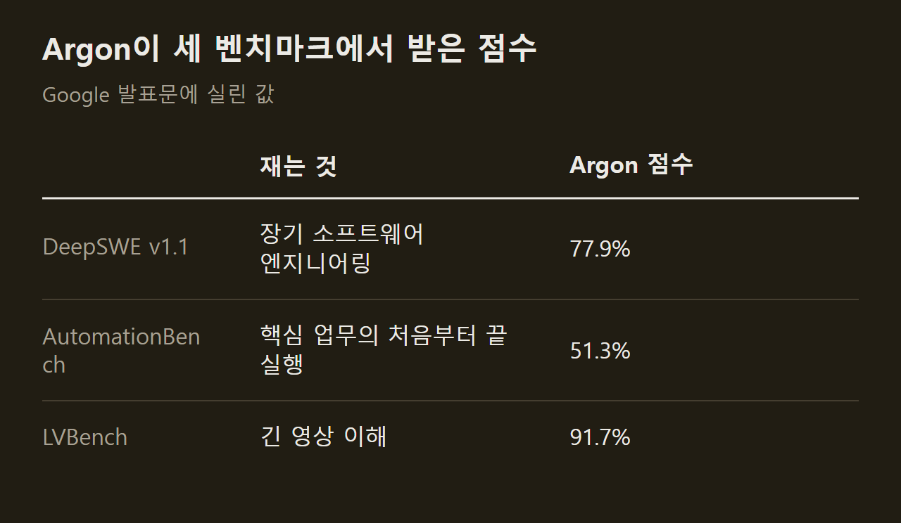
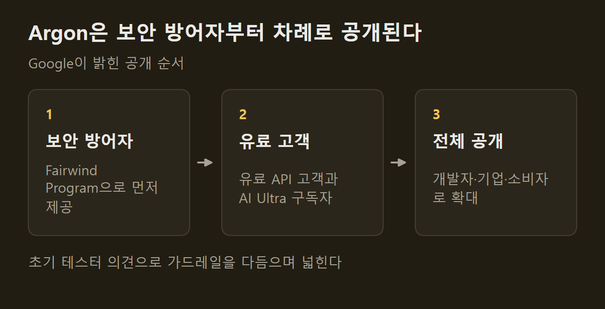

> 이 글은 아래 원문을 우리말로 간추려 정리한 글입니다. 정확한 내용은 원문을 확인하십시오.
>
> 원문: [blog.google/innovation-and-ai/models-and-research/gemini-models/gemini-4-argon](https://blog.google/innovation-and-ai/models-and-research/gemini-models/gemini-4-argon/)  
> 원문을 소개한 뉴스레터: TLDR AI

수십만 줄짜리 코드베이스를 다른 언어로 옮기거나 운영 중인 시스템에서 취약점을 찾아 고치는 일은, 여러 단계를 오래 이어 가야 끝난다. Google이 이런 작업을 겨냥한 새 모델 [Gemini 4 Argon](https://blog.google/innovation-and-ai/models-and-research/gemini-models/gemini-4-argon/)을 발표했다. 작업 지시를 받으면 여러 단계의 추론을 이어 가며 코드 작성과 이전, 금융·법률 문서 작업, 취약점 탐지와 패치를 수행하는 모델이다. 지금은 Fairwind Program에 참여한 일부 보안 방어자에게만 제공된다.

```요약
요약: Gemini 4 Argon은 출력 토큰 한도를 1M으로 늘려 긴 작업을 한 번에 처리하도록 만든 Google의 새 모델이고, 현재는 신뢰할 수 있는 보안 방어자에게만 단계적으로 공개되고 있다.
```

```용어
프런티어 모델: 한 회사가 내놓는 모델 가운데 성능이 가장 높은 최신 모델을 가리킨다.
출력 토큰 한도: 모델이 한 번의 응답에서 만들어 낼 수 있는 토큰 수의 상한이다. 추론 과정과 결과물이 모두 이 안에 들어간다.
가드레일: 모델이 해로운 요청을 거절하도록 걸어 둔 제한이다.
간접 프롬프트 인젝션: 모델이 읽는 문서나 웹 페이지에 악의적인 지시를 숨겨 모델의 행동을 가로채는 공격이다.
블랙박스 침투 테스트: 소스 코드 없이 운영 중인 시스템을 바깥에서 분석해 취약점을 찾는 시험이다.
```

## 1. 출력 한도와 가격

Argon에서 가장 크게 달라진 것은 한 번에 내놓을 수 있는 출력의 길이다. Google은 출력 토큰 한도를 기존 64K에서 1M으로 늘렸고, 이 한도가 업계에서 가장 크다고 밝혔다. 한도가 넉넉하면 모델이 한 번의 작업 흐름 안에서 수십만 토큰을 쓰며 깊이 추론할 수 있으므로, 어려운 문제를 여러 번 나누지 않고 한 번에 풀 수 있다는 것이 Google의 설명이다.


출시 초기 가격은 입력 100만 토큰당 2달러, 출력 100만 토큰당 10달러다. 캐시된 입력 토큰에는 입력 가격에서 95%를 할인한 값이 적용된다.

## 2. Google 내부 사용 사례

Google은 Argon을 이미 사내 업무에 쓰고 있고, 수천 명의 직원이 전문적인 코딩 작업과 깊이 있는 조사, 글의 품질을 강점으로 꼽았다고 전했다. 발표문이 든 사례는 세 가지다.

1. 양자 알고리즘 최적화: 주요 응용에서 병목이 되는 서브루틴의 시공간 자원(큐비트 × 게이트)을 줄이는 데 쓰였고, 한 사례에서는 몇 분 만에 공개된 기준보다 40% 나은 결과를 냈다.
2. 메모리 효율: Argon 에이전트 여럿이 전체 서버의 프로파일링 자료를 분석해 메모리 최적화를 스스로 찾아 적용했고, 배포가 끝나면 300 TiB 이상이 확보되며 전체 절감량은 500 TiB에서 1 PiB로 추정된다.
3. 코드베이스 이전: C/C++ 코드를 Rust로 옮기는 작업이 수만 줄 규모의 `re2`, `libgav1`부터 80만 줄이 넘는 Fuchsia Zircon 커널까지 진행되고 있다.

==대규모 재작성 결과는 감사와 테스트, 리뷰를 거친 뒤에야 배포된다.== 이전 대상이 핵심 시스템이기 때문이고, 자동·수동 감사와 에뮬레이션 테스트가 그 절차에 포함된다.

영상 디코더인 `libgav1`에서는 에이전트가 기존 Rust 이식본의 SIMD 코드 3만 2천 줄을 교체했다. 프로파일 기반 실험을 여러 차례 돌리고 컴파일러 출력을 살펴, 컴파일러가 자동으로 벡터화할 수 있는 안전한 Rust 코드를 쓰는 방식이었다. 결과물은 영상 출력이 동일하면서 기존 Rust 이식본보다 2.7배 빠르고, 최적화된 C++ 버전에 더 가까워졌다.

## 3. 업무 영역별 벤치마크

Google은 코딩 외의 기업 업무에서도 Argon이 앞선다고 밝혔다. 아래 세 점수는 발표문에 실린 값이며, Google은 셋 모두에서 Argon이 최고 성적이라고 설명했다.



이 밖에 Vals Index에서도 선두라고 했는데, 이 지표는 금융·코딩·법률·세무 업무를 미국 GDP 기여도에 따라 가중해 경제적 영향을 잰다. 금융 조사를 다루는 Vals Finance Agent v2와 법률 조사·문서 작성을 다루는 Harvey의 Legal Agent Benchmark에서도 비슷하게 앞섰다고 했지만, 이 세 지표의 점수는 발표문에 없다.

## 4. 보안 방어 능력

Argon은 소프트웨어 취약점을 스스로 찾고 검증한 뒤 패치하도록 학습됐다. 취약점 수정 능력을 재는 CWE-bench v1에서는 68%로 공동 1위에 올랐다.

취약점을 찾는 능력은 이전 보안 특화 모델인 3.8 Flash Cyber보다 높아졌다고 한다. Google 내부 벤치마크에서는 20개 프로그래밍 언어에 걸친 코드베이스에서 여러 종류의 노출을 찾아냈다. Wiz의 내부 블랙박스 침투 테스트에서는 공격 표면 파악, 취약점 식별, 이를 입증하는 개념 증명 작성에서 모두 3.8 Flash Cyber를 앞섰다.

Wiz는 공공 기반 시설의 고위험 노출을 무료로 찾아 고쳐 주는 Scan for Good 프로그램에 Argon을 쓰고 있다. 초기 사례로, 전 세계 병원이 쓰는 의료 소프트웨어에서 민감한 개인 정보를 노출하는 치명적 취약점을 찾아냈는데, 이전 프런티어 모델들은 놓친 것이었다.

==신뢰할 수 있는 방어자에게는 사이버 가드레일을 뺀 버전이 제공된다.== Google 내부 팀도 같은 버전을 받는다.

## 5. 출시 전 안전장치와 공개 순서

Google은 Argon을 널리 공개하기 전에 네 가지 영역의 안전장치를 강화하고 있다고 밝혔다.

1. 오용 방지: 사이버 공격이나 화학·생물·방사능·핵 공격에 쓰이는 요청은 거절하되 정당한 과학 연구는 막지 않도록 설계했고, 모델 내부 활성화를 살펴 오용을 잡아내는 기법을 개선했다.
2. 프롬프트 인젝션 방어: 자동 레드팀과 적대적 학습을 거쳤고, Gray Swan의 간접 프롬프트 인젝션 벤치마크에서 가장 높은 방어 성능을 보였다.
3. 정렬 이탈 감시: 모델의 추론 과정과 행동을 지켜보다가 사용자 의도를 벗어나면 실행을 멈춘다.
4. 시스템 강화: 위험도가 높은 학습이나 평가를 시작하기 전에 샌드박스 환경을 격리하고 봉인한다.

학습 과정도 같은 방식으로 감시했고 이상이 보이면 전담 대응팀에 경보가 갔다. 다만 감시에서 찾은 내용은 학습에 되먹이지 않도록 조심했는데, 모델이 감시를 피하는 쪽으로 추론을 바꿀 위험이 있기 때문이다.

공개는 단계적으로 이루어진다. Google은 미국 정부의 출시 전 모델 접근 절차에 자발적으로 참여하고 있으며, 초기 테스터의 의견을 받아 가드레일을 다듬은 뒤 범위를 넓힐 계획이다.



## 출처와 작성 방식

- 원문: [blog.google/innovation-and-ai/models-and-research/gemini-models/gemini-4-argon](https://blog.google/innovation-and-ai/models-and-research/gemini-models/gemini-4-argon/)
- 원문을 소개한 뉴스레터: TLDR AI
- 그래프: 원문에 적힌 값으로 새로 그린 그림입니다. 원문에 실린 그림이 아닙니다.
- 작성 방식: 직접 만든 뉴스 정리 파이프라인(VISER)으로 생성하고 검수한 글입니다. 본문의 수치와 주장은 원문에서 가져온 것입니다.
- 정리 주차: 2026-W40
