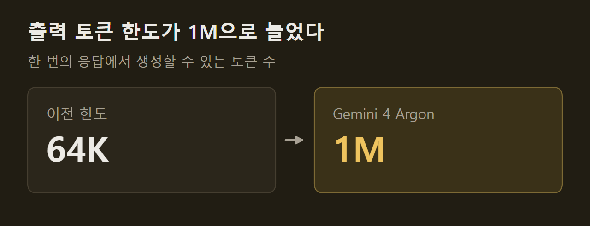

> 이 글은 아래 원문을 우리말로 간추려 정리한 글입니다. 정확한 내용은 원문을 확인하십시오.
>
> 원문: [blog.google/innovation-and-ai/models-and-research/gemini-models/gemini-4-argon](https://blog.google/innovation-and-ai/models-and-research/gemini-models/gemini-4-argon/)  
> 원문을 소개한 뉴스레터: TLDR AI

수십만 줄짜리 코드를 다른 언어로 옮기거나 취약점을 찾아 패치까지 만드는 일은 한 번의 짧은 응답으로 끝나지 않는다. 모델이 여러 단계를 오래 이어 가며 추론해야 하고, 그만큼 긴 출력을 낼 수 있어야 한다. Google은 이런 작업을 겨냥한 새 프런티어 모델 [Gemini 4 Argon](https://blog.google/innovation-and-ai/models-and-research/gemini-models/gemini-4-argon/)을 발표했다. 소프트웨어 엔지니어링, 법률·금융 같은 기업 지식 업무, 사이버 보안 방어에서 여러 단계로 이어지는 긴 작업을 맡기는 모델이다.

```요약
요약: Gemini 4 Argon은 출력 토큰 한도를 64K에서 1M으로 늘린 Google의 프런티어 모델이고, 지금은 Fairwind Program에 속한 보안 방어자에게만 먼저 제공된다.
```

```용어
출력 토큰 한도: 모델이 한 번의 응답에서 생성할 수 있는 토큰 수의 상한이다.
가드레일: 모델이 해로운 요청을 거절하도록 걸어 둔 제한이다. 이 기사에서는 사이버 공격 관련 제한을 주로 가리킨다.
간접 프롬프트 인젝션: 모델이 읽는 문서나 맥락에 악성 지시를 심어 모델의 행동을 가로채는 공격이다.
블랙박스 침투 테스트: 소스 코드를 보지 않고 실제로 돌아가는 웹 시스템을 분석해 취약점을 찾는 시험이다.
정렬 이탈: 모델이 과제를 끝내려고 사용자의 의도를 벗어난 방식으로 행동하는 것을 말한다.
```

## 1. 공개 범위와 가격

Argon은 한꺼번에 공개되지 않는다. Google은 이 수준의 모델을 안전하게 내놓으려면 단계를 나눠야 한다고 밝혔고, 첫 단계로 Fairwind Program에 속한 신뢰할 수 있는 보안 방어자에게 제공한다. 미국 정부의 자발적인 출시 전 모델 접근 절차에도 참여하고 있다.

초기 테스터의 피드백으로 가드레일을 다듬은 뒤에는 유료 API 고객과 Google AI Ultra 구독자부터 시작해 개발자, 기업, 일반 사용자로 넓힌다. 구체적인 날짜는 자료에 없다.

출시 초기 가격은 입력 100만 토큰당 2달러, 출력 100만 토큰당 10달러이고, 캐시된 입력 토큰은 입력 가격에서 95% 할인된다.

## 2. 출력 토큰 한도와 내부 사용 사례

가장 눈에 띄는 변화는 출력 토큰 한도다. 이전 64K였던 한도가 1M으로 늘었다. Google은 모델이 한 번의 작업 흐름에서 수십만 토큰을 생성할 여유가 생기면 어려운 문제를 한 번에 풀 만큼 추론이 깊어진다고 설명한다.



Google 내부에서는 이미 수천 명이 Argon을 쓰고 있다. 발표문이 든 사례는 세 가지다.

1. 양자 알고리즘 최적화: 주요 응용의 병목이 되는 서브루틴의 시공간 자원(큐비트 × 게이트)을 줄이는 작업에서, 한 사례는 몇 분 만에 공개된 기준치보다 40% 나은 결과를 냈다.
2. 메모리 효율: Argon 에이전트 팀이 데이터센터 전체의 프로파일링 자료를 분석해 최적화를 스스로 찾아 적용했고, 배포가 끝나면 300 TiB 넘는 메모리가 확보된다. 총 절감량은 500 TiB에서 1 PiB로 추정된다.
3. 코드베이스 이전: C/C++ 코드를 Rust로 옮기는 작업으로, re2와 libgav1 같은 핵심 라이브러리의 수만 줄에서 Fuchsia Zircon 커널의 80만 줄 이상까지 다룬다.

영상 디코더 libgav1에서는 기존 Rust 이식본의 SIMD 코드 3만 2천 줄을 컴파일러가 자동으로 벡터화할 수 있는 안전한 Rust 코드로 바꿨다. 결과물은 영상 출력이 동일하면서 기존 Rust 이식본보다 2.7배 빠르다. 다만 이런 대규모 재작성은 자동·수동 감사와 에뮬레이션 테스트, 리뷰를 거치는 중이고 아직 운영 환경에 배포되지 않았다.

## 3. 업무 분야별 벤치마크

Google이 점수와 함께 밝힌 벤치마크는 다음과 같다.

1. DeepSWE v1.1: 실제 장기 소프트웨어 엔지니어링 작업을 재는 평가로, 77.9%를 기록했다.
2. AutomationBench: Zapier가 만든 핵심 업무 기능의 처음부터 끝까지 실행을 재는 평가로, 51.3%로 1위다.
3. LVBench: 긴 영상 이해를 재는 평가로, 91.7%를 기록했다.

금융·코딩·법률·세무 업무를 미국 GDP 기여도로 가중해 경제적 영향을 재는 Vals Index에서도 선두라고 했지만 점수는 적지 않았다. Vals Finance Agent v2와 Harvey의 Legal Agent Benchmark도 마찬가지로 선두라는 설명만 있다.

## 4. 방어 보안 성능

Argon은 치명적인 소프트웨어 취약점을 스스로 찾고 검증하고 패치하도록 학습됐다. Wiz는 공공 기반 시설을 무료로 점검하는 Scan for Good 활동에 Argon을 쓰고 있는데, 전 세계 병원이 쓰는 의료 소프트웨어에서 민감한 개인 정보가 노출되는 치명적 취약점을 찾아냈다. Google은 이전 프런티어 모델들이 놓친 위험이라고 밝혔다.

취약점을 고치는 능력을 재는 CWE-bench v1에서 Argon은 68%로 공동 1위다. 그래프를 보면 Grok 4.7과 GPT-6 Astra가 같은 68%이고 Claude Opus 5.5가 67%로 바로 뒤에 있다. 점수는 한 번 시도해 통과한 비율이며, 모델마다 실행에 쓴 도구가 다르다는 점이 막대 아래에 적혀 있다.

")

취약점을 찾는 능력은 자사의 이전 보안 모델인 Gemini 3.8 Flash Cyber와 견줬다. 20개 프로그래밍 언어의 코드를 훑는 Google 내부 벤치마크에서 Argon은 85.8%, 3.8 Flash Cyber는 71.0%였다. 소스 코드 없이 웹 취약점을 공략하는 Wiz의 내부 침투 테스트 벤치마크에서는 70.9% 대 58.2%였다. 두 벤치마크 모두 내부 평가이고, 다른 회사 모델과 견준 값은 없다.

")

==신뢰할 수 있는 방어자와 Google 내부 팀에는 사이버 가드레일을 뺀 Argon이 제공된다.==

## 5. 출시 전 안전장치

넓게 공개하기 전에 Google이 강화하고 있다고 밝힌 영역은 네 가지다.

1. 오용 방어: 사이버 공격과 화학·생물·방사능·핵 공격에 쓰이지 않도록 해로운 요청은 거절하되 정당한 과학 연구는 막지 않게 했고, 모델의 내부 활성값을 감시해 오용을 잡아내는 기법을 개선하고 있다.
2. 프롬프트 인젝션 방어: 자동화된 레드팀 공격과 적대적 학습으로 간접 프롬프트 인젝션에 버티도록 했다.
3. 정렬 이탈 감시: 모델의 추론 과정과 행동을 지켜보다가 필요하면 실행을 멈춘다.
4. 시스템 강화: 위험도가 높은 학습이나 평가를 시작하기 전에 샌드박스 환경을 격리하고 봉인한다.

정렬 이탈 감시와 비슷한 시스템은 학습 과정에도 쓰였다. 이때 감시에서 나온 결과가 학습에 되돌아가지 않도록 했는데, 모델의 추론이 감시를 피하는 쪽으로 다듬어질 위험 때문이다.

프롬프트 인젝션 방어는 Gray Swan의 간접 프롬프트 인젝션 벤치마크로 쟀다. 이 그래프는 공격 성공률이므로 낮을수록 좋다. 15번 시도했을 때 Argon은 0.7%였고, Claude Opus 5.5와 Claude Fable 5.1이 각각 1.0%, Gemini 3.8 Flash가 5.5%, GPT-6 Astra가 8.5%였다. 가장 높은 쪽은 Grok 4.6의 51.8%와 Kimi K3의 52.7%다.

")

## 출처와 작성 방식

- 원문: [blog.google/innovation-and-ai/models-and-research/gemini-models/gemini-4-argon](https://blog.google/innovation-and-ai/models-and-research/gemini-models/gemini-4-argon/)
- 원문을 소개한 뉴스레터: TLDR AI
- 원문 그림: 아래에 출처를 적은 그림은 원문에 실린 그림을 인용한 것이며, 저작권은 원저작자에게 있습니다.
- 그래프: 출처 표기가 없는 그림은 원문에 적힌 값으로 새로 그린 것입니다. 원문에 실린 그림이 아닙니다.
- 작성 방식: 직접 만든 뉴스 정리 파이프라인(VISER)으로 생성하고 검수한 글입니다. 본문의 수치와 주장은 원문에서 가져온 것입니다.
- 정리 주차: 2026-W40
