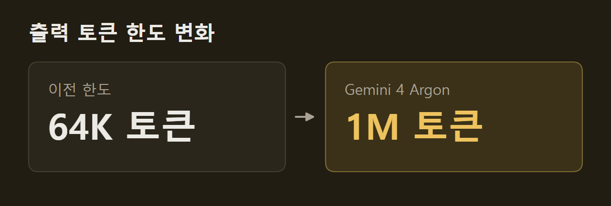

> 이 글은 아래 원문을 우리말로 간추려 정리한 글입니다. 정확한 내용은 원문을 확인하십시오.
>
> 원문: [blog.google/innovation-and-ai/models-and-research/gemini-models/gemini-4-argon](https://blog.google/innovation-and-ai/models-and-research/gemini-models/gemini-4-argon/)  
> 원문을 소개한 뉴스레터: TLDR AI

소프트웨어 개발, 법률·금융 실무, 보안 점검은 질문 한 번에 답 한 번으로 끝나지 않는다. 이런 일은 여러 단계를 오래 이어 가야 한다. Google은 이런 일을 맡기려고 새 프런티어 모델 [Gemini 4 Argon](https://blog.google/innovation-and-ai/models-and-research/gemini-models/gemini-4-argon/)(이하 Argon)을 발표했다. Argon은 코드와 문서, 긴 영상을 읽고 추론을 길게 이어 가는 모델이다. 이 능력으로 취약점을 찾아 고치거나 대규모 코드를 다른 언어로 옮긴다. 지금은 Fairwind 프로그램에 참여한 신뢰할 수 있는 보안 방어 조직에만 먼저 제공된다.

```요약
요약: Gemini 4 Argon은 출력 토큰 한도를 1M 토큰으로 늘린 Google의 새 모델로, CWE-bench v1에서 68%로 공동 1위를 했지만 지금은 일부 보안 방어 조직만 쓸 수 있다.
```

```용어
출력 토큰 한도: 모델이 한 번의 작업 흐름에서 생성할 수 있는 토큰 수의 상한이다.
가드레일(guardrail): 모델이 해로운 요청을 거절하도록 거는 제한이다.
Pass@1: 모델이 한 번 시도한 결과로 매긴 점수다. CWE-bench v1에서는 Pass@1이 같으면 네 번 시도한 결과인 Pass@4로 순위를 가른다.
간접 프롬프트 인젝션(indirect prompt injection): 모델이 읽는 자료에 악의적인 지시나 맥락을 넣어 모델의 행동을 가로채는 공격이다.
```

## 1. 출력 토큰 한도와 공개 방식

Argon에서 가장 크게 바뀐 것은 출력 토큰 한도다. Google은 길고 복잡한 작업을 맡기려고 한도를 이전 64K 토큰에서 1M 토큰으로 늘렸다. Google은 모델이 한 번의 작업 흐름에서 수십만 토큰을 생성할 수 있으면 어려운 문제를 한 번에 풀 만큼 깊이 추론한다고 설명한다.



공개는 단계적으로 진행한다. Google은 미국 정부가 출시 전 모델을 미리 받아 보는 자발적 절차에 참여하고 있다. 동시에 초기 테스터의 피드백을 받아 가드레일을 고치면서 사용 범위를 조금씩 넓힌다. 출시 기념 가격은 입력 100만 토큰당 2달러, 출력 100만 토큰당 10달러이며, 캐시된 입력 토큰은 입력 가격에서 95% 할인된다.

## 2. Google 사내 업무에 쓴 사례

Google 직원 수천 명이 이미 전문 코딩, 심층 조사, 글쓰기에 Argon을 쓰고 있다. 양자 컴퓨팅 연구진은 주요 응용에서 병목이 되는 서브루틴의 시공간 자원(큐비트 수 × 게이트 수)을 Argon으로 최적화했다. 한 사례에서는 몇 분 만에 공개된 기준 결과보다 40% 나은 결과가 나왔다.

여러 Argon 에이전트가 함께 데이터센터 메모리를 아꼈다. 에이전트들은 Google 서버 전체의 프로파일링 자료를 분석해 메모리 최적화 방법을 스스로 찾고 적용했다. 이 변경을 배포하자 300TiB가 넘는 메모리가 비었고, Google은 전체 절감량을 500TiB~1PiB로 추정한다.

C/C++ 코드를 Rust로 옮기는 작업도 진행 중이다. re2 같은 핵심 라이브러리의 수만 줄부터 Fuchsia Zircon 커널의 80만 줄 이상까지가 대상이다. 다만 중요한 시스템이 많아서, 다시 쓴 코드는 자동·수동 감사와 에뮬레이션 테스트, 리뷰를 거친 뒤에야 실서비스에 들어간다.

영상 디코딩 오픈소스인 libgav1에서는 속도도 높아졌다. Argon 에이전트는 기존 Rust 포팅판에 있던 SIMD(Single Instruction, Multiple Data) 코드 3만 2천 줄을 안전한 Rust 코드로 바꿨고, 컴파일러가 이 코드를 자동으로 벡터화한다. 그 결과 디코더는 같은 영상을 출력하면서 기존 Rust 포팅판과 견주어 2.7배 빨라졌다.

## 3. 코딩과 전문 업무 평가 결과

Argon은 코딩과 전문 업무 평가에서도 앞섰다. 실제 장기 소프트웨어 엔지니어링 작업을 재는 DeepSWE v1.1에서 77.9%로 최고 기록을 세웠다. 재무·코딩·법률·세무 업무의 경제적 효과를 재는 Vals Index에서도 1위다. 이 지수는 분야마다 미국 GDP 기여도로 가중치를 준다.

예를 들어 Zapier가 핵심 업무를 처음부터 끝까지 실행하는 능력을 재는 AutomationBench에서 51.3%로 1위를 했다. 시각 이해에서는 긴 영상 이해를 재는 LVBench에서 91.7%로 최고 기록을 세웠다.

## 4. 보안 방어: 취약점 수정과 탐지

Google은 Argon이 중요 소프트웨어 취약점을 스스로 찾아 검증하고 패치하도록 학습시켰다. 신뢰할 수 있는 방어 조직과 Google 사내 팀에는 사이버 가드레일을 뺀 버전을 준다. Wiz는 공공 인프라를 무료로 지키는 Scan for Good 프로그램에서 Argon을 쓴다. 이 과정에서 Argon은 전 세계 병원이 쓰는 의료 소프트웨어의 취약점을 찾았는데, 민감한 개인정보를 노출하고 이전 프런티어 모델들은 놓친 것이었다.

취약점 수정 능력을 재는 CWE-bench v1에서 Argon은 Pass@1 68%로 공동 1위다. 다음 그림을 보면 Grok 4.7과 GPT-6 Astra도 68%이고 Claude Opus 5.5가 67%로 뒤를 잇는다. 막대 아래 작은 글씨는 각 모델을 실행한 에이전트 도구이며 모델마다 다르다.

")

취약점 탐지에서는 Argon이 Gemini 3.8 Flash Cyber를 앞섰다. Google 사내 벤치마크는 20개 언어로 된 코드베이스에서 취약점을 찾게 하며, 여기서 두 모델의 점수는 85.8% 대 71.0%다. 반면 Wiz의 블랙박스 침투 테스트 벤치마크는 소스 코드 없이 실제 웹 시스템을 분석하게 하며, 여기서는 70.9% 대 58.2%다. 두 점수 모두 Pass@1이고, 다음 그림의 왼쪽이 Google 벤치마크, 오른쪽이 Wiz 벤치마크다.

")

## 5. 넓은 공개에 앞서 보강하는 안전장치

Google은 Argon을 넓게 공개하기 전에 네 분야의 안전장치를 보강하고 있다. 첫째는 오용 방지다. Argon은 사이버 공격이나 화학·생물·방사능·핵(CBRN) 공격에 쓰일 요청은 거절하고, 정당한 이중 용도 연구는 계속 돕도록 설계됐다. 이를 위해 Google은 모델 내부 활성값을 감시해 오용을 잡는 기법을 개선했다.

둘째는 간접 프롬프트 인젝션 방어다. Google은 자동 레드팀과 적대적 학습으로 Argon을 자사 모델 가운데 이 공격에 가장 강한 모델로 만들었다. Gray Swan의 간접 프롬프트 인젝션(IPI) 벤치마크에서 15번 공격했을 때 Argon에 대한 공격 성공률은 0.7%로, Claude Opus 5.5와 Claude Fable 5.1의 1.0%보다 낮다. 다음 그림의 막대는 짙은 아래쪽부터 1번, 10번, 15번 공격했을 때의 성공률이고, 막대 위 숫자는 15번 공격한 값이며 낮을수록 좋다.

")

셋째는 정렬 이탈 감시다. Google은 Argon이 사용자 의도를 벗어난 방식으로 과제를 해내지 못하도록, 사고 사슬(chain-of-thought)과 행동을 감시해 필요하면 실행을 멈춘다. 학습 중에도 비슷한 감시 결과를 전담 대응팀에 보냈지만, 이 결과를 학습에 다시 넣지는 않았다. 추론이 감시를 피하는 쪽으로 바뀔 위험을 막기 위해서다.

넷째는 시스템 보강으로, 고위험 학습이나 평가를 시작하기 전에 샌드박스 환경을 격리하고 봉인한다.

Google은 Argon을 코딩, 지식 업무, 보안 방어, 창작 글쓰기에서 프런티어 수준의 능력을 갖춘 모델로 내놓았다. 다만 넓게 공개하기 전에 초기 보안 방어 조직과 테스터의 실사용 평가로 안전장치를 다듬는다. 공개는 유료 API 고객과 Google AI Ultra 구독자부터 시작한다.

## 출처와 작성 방식

- 원문: [blog.google/innovation-and-ai/models-and-research/gemini-models/gemini-4-argon](https://blog.google/innovation-and-ai/models-and-research/gemini-models/gemini-4-argon/)
- 원문을 소개한 뉴스레터: TLDR AI
- 그림: 아래에 출처가 적힌 그림은 원문에 실린 그림을 인용한 것이며 저작권은 원저작자에게 있습니다. 출처가 없는 그래프는 원문에 적힌 값으로 직접 그린 것입니다.
- 작성 방식: 직접 만든 뉴스 정리 파이프라인(VISER)으로 생성하고 검수한 글입니다. 본문의 수치와 주장은 원문에서 가져온 것입니다.
- 정리 주차: 2026-W40
