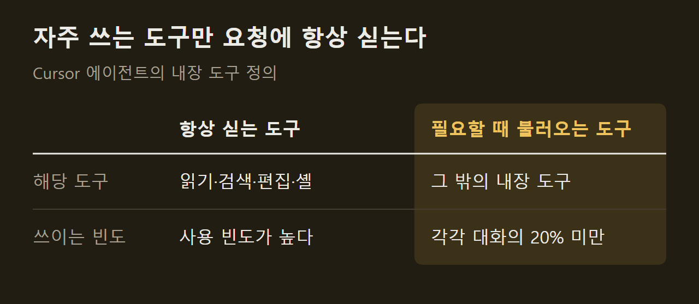

> 이 글은 아래 원문을 우리말로 간추려 정리한 글입니다. 정확한 내용은 원문을 확인하십시오.
>
> 원문: [cursor.com/blog/improved-token-efficiency](https://cursor.com/blog/improved-token-efficiency)  
> 원문을 소개한 뉴스레터: Deep Learning Weekly

코딩 에이전트가 한 번에 맡는 일이 커지면서 작업 시간이 길어졌고, 단계마다 모델에 다시 보내는 맥락도 함께 늘었다. 맥락이 길수록 토큰 비용이 커지므로, 요청을 어떻게 조립하느냐가 비용을 좌우하게 됐다. [Cursor](https://cursor.com/blog/improved-token-efficiency)는 지난 몇 달 동안 자사 에이전트 하네스를 고친 내용을 공개했다. 하네스는 모델에 보낼 요청을 조립하고, 앞서 보낸 맥락을 재사용하고, 일을 여러 에이전트에 나누는 프로그램이다.

```요약
요약: Cursor는 시스템 프롬프트, 도구 정의, 캐시 배치, 파일 읽기, 하위 에이전트 사용을 고쳐 에이전트 품질을 떨어뜨리지 않고 사용자 토큰 비용을 7% 줄였다고 밝혔다.
```

```용어
하네스: 모델을 감싸는 프로그램. 요청 조립, 맥락 재사용, 에이전트 간 작업 분배를 맡는다.
시스템 프롬프트: 모델이 일을 시작하기 전에 Cursor가 매 요청에 넣는 지시문.
도구 정의: 에이전트가 쓸 수 있는 도구의 이름과 동작을 적은 설명. 요청에 함께 실린다.
프롬프트 캐시: 요청 앞부분이 이전 요청과 같으면 모델 제공사가 그 부분을 다시 처리하지 않고 재사용하는 기능.
하위 에이전트: 상위 에이전트가 일의 일부를 맡기려고 따로 띄우는 에이전트. 새 컨텍스트 창에서 시작한다.
```

## 1. 시스템 프롬프트 축소

에이전트의 모든 단계에는 시스템 프롬프트와 도구 정의가 실린다. 대화 내내 반복해서 들어가므로, Cursor가 직접 통제할 수 있는 비용 가운데 가장 큰 항목에 속했다.

모델 성능이 낮던 때에는 도구 사용법과 작업 관리, 코드 수정 절차를 하나하나 적어야 했고, 긴 해시 값이나 바이너리 출력, 이모지 같은 이상 동작도 막아야 했다. 모델이 나아지자 "하지 마라", "반드시"로 이어지는 긴 지시 대신 도구가 어떻게 동작하는지만 정의해도 대체로 따랐다. ==Cursor는 이 방식으로 시스템 프롬프트의 약 66%를 덜어냈다.== 여러 모델 계열에서 똑같이 통했다고 한다.

Cursor는 이런 조정을 실제 사용자 대상 A/B 테스트로 검증한다. 평가 세트는 빠르지만 어려운 문제에 치우쳐 있어서 실제 요청의 분포를 제대로 반영하지 못하기 때문이다.

## 2. 내장 도구의 동적 로드

도구 정의는 올해 크게 늘었다. 백그라운드 셸 모니터링, 클라우드 하위 에이전트, 웹 콘텐츠 접근 같은 기능이 추가됐는데, 이런 도구 대부분은 각각 전체 대화의 20% 미만에서만 쓰였다.

Cursor는 올해 초 MCP 도구를 필요할 때만 불러오도록 바꿔, MCP 도구를 호출한 세션의 총 토큰을 46.9% 줄인 적이 있다. 이번에는 같은 방법을 자체 내장 도구에 적용했다. 어떤 도구를 항상 실을지는 사용 빈도와 모델이 처음부터 봐야 하는지를 기준으로 여러 구성을 A/B 테스트해 정했고, 토큰 사용량, 비용, 지연 시간, 도구 호출 오류, 전체 에이전트 사용량을 함께 추적했다.



빈도가 낮아도 남긴 도구가 있다. `ask_question`은 일부 모델이 정의가 없는데도 호출을 지어내는 경향이 있어 남겼고, 플랜 모드의 `create_plan`처럼 특정 제품 흐름에 꼭 필요한 도구도 그대로 뒀다.

## 3. 캐시 기준점 배치

에이전트는 단계마다 도구, 시스템 지시문, 설정, 지금까지의 대화를 통째로 다시 보낸다. 앞부분은 거의 그대로이고 끝의 대화만 길어지므로, 프롬프트 캐시가 앞부분을 재사용할 수 있다.

다만 GPT-5.6 이전의 OpenAI API에서는 캐시 경계가 최신 요청을 기준으로 자동으로 정해졌다. 도구와 시스템 지시문은 거의 바뀌지 않는데도 따로 재사용할 구간으로 표시되지 않았다. GPT-5.6부터는 기본 자동 캐시에 더해 클라이언트가 캐시 기준점을 직접 지정할 수 있다. Cursor는 변하지 않는 층 뒤, 늘어나는 대화 앞에 기준점을 둔다.

")

==기준점은 그 앞부분이 바뀌지 않을 때만 효과가 있다.== 그래서 도구와 시스템 지시문 자리에는 거의 바뀌지 않는 내용만 두고, 스킬, 하위 에이전트, 환경 정보처럼 사용자와 요청마다 달라지는 설정은 캐시 경계 뒤의 '유령 사용자 메시지(phantom user message)'로 옮겼다. Cursor는 이 변경으로 캐시가 전혀 적중하지 않는 비율이 20% 줄었다고 밝혔다.

## 4. 파일 읽기의 줄 번호

에이전트가 일하면서 쌓는 맥락의 상당 부분은 파일을 읽은 결과다. Cursor의 읽기 도구는 모든 줄에 번호를 붙여 왔는데, 모델이 줄 수를 스스로 세지 못하면서도 사용자에게 코드의 특정 위치를 짚어 줘야 하기 때문이다.

줄 번호 하나는 3~5토큰 정도지만, 한 세션에 수만 줄을 읽으면 그 합이 적지 않다. Cursor는 줄 번호를 열 줄에 한 번만 붙이도록 바꿨다. 이 간격으로도 모델은 코드를 제대로 인용했고, 캐시에서 읽는 토큰이 품질 저하 없이 1.6% 줄었다.

## 5. 하위 에이전트 사용 방식

하위 에이전트는 상위 에이전트의 대화 전체를 물려받지 않고 새 컨텍스트 창에서 시작하며, 결과만 보고하므로 토큰을 아낄 수 있다. 반면 맥락을 공유하지 않아서 같은 일을 중복하거나 이미 필요 없어진 일을 계속하는 조율 비용이 생긴다.

Cursor는 두 가지를 바꿨다. 먼저 코드베이스 탐색에 하위 에이전트를 쓰라고 강하게 권하던 지시를 뺐다. 하위 에이전트가 학습 데이터에 흔해지고 사후 학습에도 반영되면서 모델이 이 패턴을 이미 익혔기 때문이고, 지시를 빼자 사용이 더 균형 잡혔다고 한다. 다음으로 도구 인자를 고쳐, 하위 에이전트가 사용자나 하네스의 지시가 있을 때만 다른 모델을 고르게 했다.

Cursor는 긴 실행에서 맥락이 쌓이는 방식을 계속 측정하겠다고 밝혔고, 같은 방법을 Grok Bot의 하네스에도 적용하고 있다.

## 출처와 작성 방식

- 원문: [cursor.com/blog/improved-token-efficiency](https://cursor.com/blog/improved-token-efficiency)
- 원문을 소개한 뉴스레터: Deep Learning Weekly
- 그림: 아래에 출처가 적힌 그림은 원문에 실린 그림을 인용한 것이며 저작권은 원저작자에게 있습니다. 출처가 없는 그래프는 원문에 적힌 값으로 직접 그린 것입니다.
- 작성 방식: 직접 만든 뉴스 정리 파이프라인(VISER)으로 생성하고 검수한 글입니다. 본문의 수치와 주장은 원문에서 가져온 것입니다.
- 정리 주차: 2026-W40
