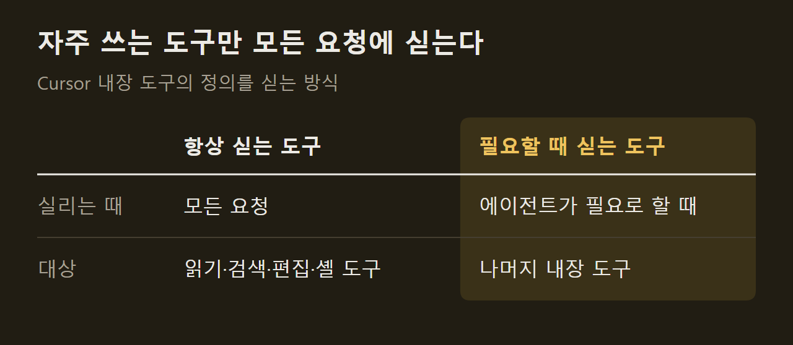

> 이 글은 아래 원문을 우리말로 간추려 정리한 글입니다. 정확한 내용은 원문을 확인하십시오.
>
> 원문: [cursor.com/blog/improved-token-efficiency](https://cursor.com/blog/improved-token-efficiency)  
> 원문을 소개한 뉴스레터: Deep Learning Weekly

코딩 에이전트가 더 큰 작업을 맡으면서 한 번 실행되는 시간이 길어졌고, 단계마다 넘겨받는 컨텍스트도 늘었다. 그만큼 요청에 무엇을 담고 어떻게 재사용하느냐가 토큰 비용을 좌우한다. [Cursor](https://cursor.com/blog/improved-token-efficiency)는 지난 몇 달 동안 자사 에이전트 하네스를 손봤다고 밝혔다. 하네스는 모델에 보낼 요청을 조립하고, 반복되는 컨텍스트를 재사용하고, 작업을 여러 에이전트에 나누는 일을 맡는 프로그램이다.

```요약
요약: Cursor가 에이전트 하네스의 프롬프트, 도구 정의, 캐시, 파일 읽기, 서브에이전트 사용 방식을 고쳐 에이전트 품질을 떨어뜨리지 않고 사용자 토큰 비용을 7% 줄였다고 밝혔다.
```

```용어
하네스: 모델을 감싸고 요청 조립, 컨텍스트 재사용, 에이전트 간 작업 분배를 맡는 프로그램이다.
시스템 프롬프트: 모델이 일을 시작하기 전에 Cursor가 매 턴 붙여 보내는 지시문이다.
도구 정의: 에이전트가 쓸 수 있는 도구의 이름과 동작을 적은 설명으로, 요청에 함께 실린다.
프롬프트 캐시: 요청 앞부분이 이전 턴과 같으면 모델 제공자가 그 부분을 다시 처리하지 않고 재사용하는 기능이다.
서브에이전트: 상위 에이전트가 일부 작업을 맡기려고 새 컨텍스트로 띄우는 하위 에이전트다.
```

## 1. 시스템 프롬프트 축소

에이전트의 모든 턴에는 Cursor가 미리 넣는 시스템 프롬프트와 도구 정의가 들어간다. 대화 내내 반복해서 실리므로, Cursor가 직접 통제할 수 있는 비용 가운데 가장 큰 축에 속했다.

모델 성능이 낮던 시기에는 도구 사용법과 작업 관리, 코드 수정 절차를 일일이 적어야 했고, 긴 해시 출력이나 이모지 같은 이상 행동을 막는 문장도 필요했다. 모델이 나아지면서 "하지 마라", "반드시"로 시작하는 긴 목록 대신 도구가 어떻게 동작하는지만 정의해도 대체로 따르게 됐다. ==Cursor는 이 변화로 시스템 프롬프트를 약 66% 줄였다.== 여러 모델 계열에서 똑같이 통했다고 한다.

지시문을 넣고 빼는 판단은 실제 사용자 대상 A/B 테스트로 내린다. 평가 세트는 빠르게 확인하는 데 쓸모가 있지만 어려운 문제에 치우쳐 있어서 실제 요청 분포를 제대로 반영하지 못한다는 이유다.

## 2. 필요할 때만 불러오는 도구

도구 정의는 지난 1년 사이 크게 늘었다. 백그라운드 셸 모니터링, 클라우드 서브에이전트, 웹 콘텐츠 접근 같은 기능이 추가됐기 때문인데, 이 도구들은 각각 전체 대화의 20% 미만에서만 쓰였다.

Cursor는 올해 초 MCP 도구를 필요할 때만 불러오도록 바꿔, MCP 도구를 호출한 세션의 총 토큰을 46.9% 줄인 적이 있다. 이번에는 같은 방식을 내장 도구에 적용했다. 어떤 도구를 항상 실을지는 사용 빈도와 모델이 처음부터 봐야 하는지를 기준으로 여러 구성을 A/B 테스트해서 정했고, 토큰 사용량, 비용, 지연 시간, 도구 호출 오류, 전체 사용량을 함께 추적했다.

모든 요청에 남긴 도구는 다음과 같다.

1. 고빈도 도구: 읽기, 검색, 편집, 셸 사용에 쓰는 도구다.
2. `ask_question`: 정의가 없으면 일부 모델이 있지도 않은 호출을 지어내는 경향이 있어 남겼다.
3. `create_plan`: 플랜 모드처럼 특정 제품 흐름에 꼭 필요한 도구다.



## 3. 캐시 재사용

에이전트는 턴마다 도구, 시스템 지시, 설정, 지금까지의 대화를 담은 긴 요청을 다시 보낸다. 앞부분은 거의 그대로이고 끝의 대화만 길어지므로, 프롬프트 캐시가 바뀌지 않은 앞부분을 재사용한다. 다만 GPT-5.6 이전의 OpenAI API는 캐시 경계를 최근 요청을 기준으로 자동으로 정해서, 거의 바뀌지 않는 도구와 시스템 지시가 따로 재사용 대상으로 표시되지 않았다.

GPT-5.6부터는 클라이언트가 캐시 기준점을 직접 지정할 수 있다. Cursor는 잘 바뀌지 않는 층 뒤, 길어지는 대화 앞에 기준점을 둔다.

기준점은 앞부분이 실제로 그대로일 때만 효과가 있다. 그래서 도구와 시스템 지시에는 거의 바뀌지 않는 내용만 두고, 스킬, 서브에이전트, 환경 정보처럼 사용자와 요청마다 달라지는 설정은 캐시 경계 뒤의 '팬텀 사용자 메시지'(phantom user message)로 옮겼다. ==이 변경으로 콜드 캐시 미스 비율이 20% 줄었다.==

## 4. 파일 읽기의 줄 번호

에이전트가 일하면서 쌓는 컨텍스트의 상당 부분은 파일 읽기에서 나온다. Cursor의 `Read` 도구는 원래 모든 줄에 번호를 붙였다. 모델이 줄 수를 스스로 세는 데 서툴고, 사용자에게 특정 위치를 짚어 줘야 하기 때문이다.

줄 번호 하나는 토큰 3~5개 정도지만 한 세션에서 수만 줄을 읽으면 부담이 커진다. Cursor는 번호를 열 줄마다 하나만 붙이도록 바꿨다. 이 정도면 모델이 코드 위치를 인용하는 데 충분했고, 품질 저하 없이 캐시 읽기 토큰이 1.6% 줄었다.

## 5. 서브에이전트 사용 조정

서브에이전트는 상위 에이전트의 대화 전체를 물려받지 않고 새 컨텍스트에서 시작하며, 결과만 보고하므로 토큰을 아낄 수 있다. 반면 컨텍스트를 공유하지 않아서 같은 일을 중복하거나 이미 필요 없어진 작업을 계속하는 조율 비용이 따른다.

Cursor는 두 가지를 바꿨다. 코드베이스 탐색에 서브에이전트를 쓰라고 강하게 권하던 지시를 뺐는데, 모델이 학습 과정에서 이 패턴을 이미 익혔기 때문이며 지시를 빼자 사용이 더 고르게 됐다고 한다. 또 서브에이전트가 쓸 모델은 사용자나 하네스가 지시할 때만 상위 에이전트와 다르게 고르도록 도구 인자를 고쳤다.

Cursor는 긴 실행에서 컨텍스트가 쌓이는 양상을 계속 측정하겠다고 했고, 같은 방법을 Grok Bot의 하네스에도 적용하는 중이라고 밝혔다.

## 출처와 작성 방식

- 원문: [cursor.com/blog/improved-token-efficiency](https://cursor.com/blog/improved-token-efficiency)
- 원문을 소개한 뉴스레터: Deep Learning Weekly
- 그래프: 원문에 적힌 값으로 새로 그린 그림입니다. 원문에 실린 그림이 아닙니다.
- 작성 방식: 직접 만든 뉴스 정리 파이프라인(VISER)으로 생성하고 검수한 글입니다. 본문의 수치와 주장은 원문에서 가져온 것입니다.
- 정리 주차: 2026-W40
