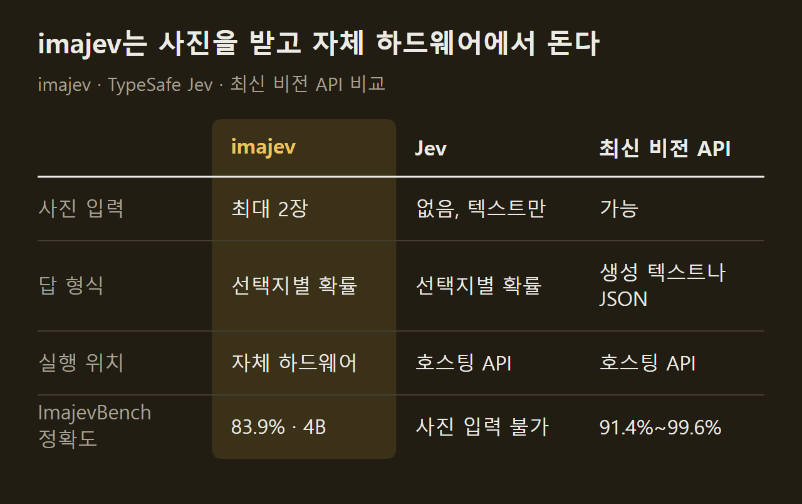
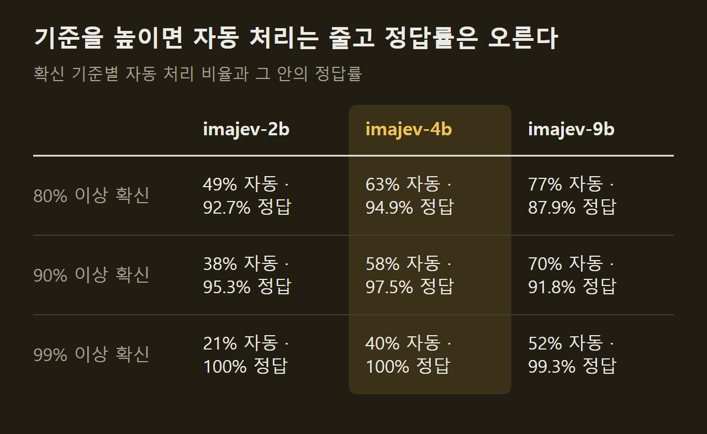
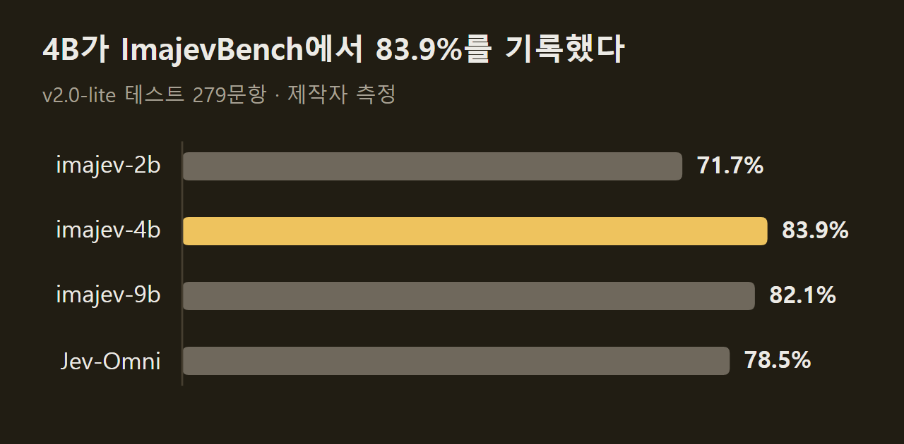

> 이 글은 아래 원문을 우리말로 간추려 정리한 글입니다. 정확한 내용은 원문을 확인하십시오.
>
> 원문: [github.com/mohit67890/imajev](https://github.com/mohit67890/imajev)  
> 원문을 소개한 뉴스레터: The Living Edge

쇼핑몰 상품 등록 정보에는 "빨간색 스웨이드 보트 슈즈"라고 적혀 있는데, 함께 올라온 사진 속 신발은 다른 색이다. 이런 불일치를 사람이 일일이 확인하기에는 건수가 너무 많고, 범용 비전 모델에 물으면 답이 문장으로 돌아와서 프로그램이 바로 받아 쓰기 어렵다. Mohit Garg가 공개한 [imajev](https://github.com/mohit67890/imajev)는 사진 최대 두 장과 업무 기록, 그리고 질문과 허용할 답 목록을 넣으면 답마다 확률을 붙여 돌려주는 모델이다. 근거가 부족하면 '알 수 없음'에 확률을 실어 답하므로, 시스템은 확신이 높은 건만 자동으로 처리하고 나머지는 사람에게 넘길 수 있다.

```요약
요약: imajev는 사진·기록·텍스트를 읽고 정해 둔 선택지마다 확률과 '알 수 없음' 확률을 돌려주는 2B·4B·9B 공개 모델이며, 4B는 제작자가 만든 ImajevBench 테스트 279문항에서 83.9%를 기록했지만 이 벤치마크의 이미지는 모두 AI가 생성했고 사람의 검수를 거치지 않았다.
```

```용어
기권: 모델이 선택지 가운데 하나를 고르지 않고 '알 수 없음'을 가장 유력한 답으로 내놓는 일이다. 응답의 `abstained` 값으로 표시된다.
캘리브레이션 온도: 모델이 내놓는 확률이 실제 정답률과 맞도록 확률을 눌러 주는 값이다. 어떤 답을 고르는지는 바꾸지 않고 확률만 바꾼다.
LoRA 어댑터: 기반 모델의 가중치는 그대로 두고, 작은 추가 가중치만 학습시켜 덧붙이는 파인튜닝 방식의 결과물이다.
ECE: 모델이 말한 확신과 실제 정답률의 차이를 평균한 값이다. 낮을수록 확률을 믿을 수 있다.
옵션 순서 평균: 선택지의 순서를 바꿔 가며 네 번 묻고 결과를 평균하는 방식이다. 배포 기본 설정이며 그만큼 시간이 더 든다.
```

## 1. 요청 하나와 답의 모양

요청에는 세 가지가 들어간다. 사진, 상품 등록 정보나 고객 기록 같은 상태 데이터, 그리고 질문이다. 질문마다 허용할 답을 미리 정해 두는데, 여러 선택지 가운데 하나를 고르는 유형, 예·아니오 유형, 단계별 점수 유형이 있다.

제작자가 4B 모델에 실제로 보낸 예시가 원문에 실려 있다. 색상이 빨강, 종류가 신발로 적힌 등록 정보와 사진 한 장을 보내고 "사진이 등록 정보의 어느 항목과 어긋나는가"를 물었더니 색상 항목에 0.95, 종류 항목에 0.006, '어긋나는 항목 없음'에 0.043이 돌아왔다. 같은 요청에 넣은 "사진 속 상품이 등록된 색상과 맞는가"는 0.082, "등록된 종류의 상품인가"는 0.989였다. 세 질문에 답하는 데 Mac Studio에서 1.15초가 걸렸고, 이는 옵션 순서 평균과 캘리브레이션을 적용한 값이다.

사진 없이 텍스트만 보내도 같은 방식으로 동작한다. 고객 지원 티켓 한 건을 보내면 요청 한 번으로 담당 부서를 고르고, 긴급 여부를 판단하고, 고객의 불만 정도를 점수로 매긴다.

==모든 답에는 선택지별 확률과 함께 '알 수 없음'의 확률이 따로 붙는다.== 근거가 빠졌거나 서로 모순되거나 질문의 범위를 벗어났을 때 이 확률이 올라가고, '알 수 없음'이 가장 유력하면 기권으로 표시된다. 요청 하나에는 사진 2장, 상태 데이터 32KB, 질문 8개, 선택지 254개까지 담을 수 있고 영어만 지원한다.

## 2. 기존 모델과의 차이

imajev가 요청·응답 형식을 따온 모델은 TypeSafe의 Jev다. Jev는 선택지별 확률을 돌려주지만 텍스트만 읽고 호스팅 API로 제공된다. 반대로 범용 비전 모델은 사진을 읽지만 답을 문장이나 JSON으로 생성하고, 호스팅 API를 거치며 결정 하나에 5~8초가 걸린다. imajev는 Jev의 답 형식을 사진으로 넓히고 자체 하드웨어에서 돌도록 만들었다. 가중치는 Apache-2.0으로 공개되어 있고, 텍스트만 쓰는 기존 Jev 요청은 고치지 않고 그대로 보낼 수 있다.



표에서 보듯 정확도만 놓고 보면 최신 비전 API가 더 높다. 다만 제작자는 이 모델들이 구조화된 생성이라는 다른 방식으로 답하므로 순위를 따로 매긴다고 밝혔다. Jev가 한 번에 받을 수 있는 기록의 크기도 imajev보다 크다.

두 장의 사진을 한 요청에 넣는 기능은 기준 사진과 대상 사진을 견주는 데 쓴다. 발송한 물건과 반품된 물건이 같은지, 정상 부품과 생산 라인 위의 부품이 같은지 판단하는 식이다. 속도는 질문 하나에 약 0.1초이고, 옵션 순서 평균을 켠 배포 설정에서는 약 0.3초다.

## 3. 확신 기준과 자동 처리 비율

모델이 얼마나 확신할 때 자동으로 처리할지는 쓰는 쪽이 정한다. 고른 답의 확률에 '알 수 없음이 아닐 확률'을 곱한 값이 기준을 넘으면 처리하고, 기준에 못 미치거나 모델이 기권하면 사람에게 넘기는 구조다. 기준을 높이면 자동으로 처리되는 건수는 줄지만 틀리는 건수도 함께 준다.



4B는 99% 기준에서 문항의 40%를 자동으로 처리했고 그 안에서는 틀린 답이 없었다. 이 수치는 사진·기록·텍스트가 섞인 ImajevBench 테스트 279문항에서 나왔으며, 그중 21문항은 정답이 '알 수 없음'이다. 제작자는 이 벤치마크가 일부러 어렵게 만들어졌으므로 수치를 출발점으로만 보고, 기준을 정하기 전에 자기 데이터 수백 건으로 직접 재 보라고 적었다.

==캘리브레이션 없이 쓰면 모델은 실제보다 과하게 확신한다.== 어려운 문항에서 ECE는 보정 전 0.16~0.19였고 배포 설정에서 0.09~0.12로 내려갔다. 크기마다 온도 하나가 함께 배포되는데, 사진만 보내는 요청에는 이 온도가 맞지 않는다. 4B는 사진 전용 검증 823문항에서 보정 전 확률이 이미 잘 맞았고(ECE 0.015), 공용 온도를 적용하면 오히려 0.029로 나빠졌다. 그래서 4B에는 사진만 있고 상태 데이터가 빈 요청에 쓰는 온도가 따로 추가됐고, 2B와 9B는 아직 온도 하나만 쓴다.

## 4. 세 가지 크기와 벤치마크 성적

모델은 Qwen3.5의 2B·4B·9B를 기반으로 한 세 가지 크기로 나온다. 제작자가 기본으로 권하는 것은 4B다. ImajevBench에서 4B가 9B보다 높게 나왔지만 이 차이는 통계적으로 유의하지 않고(p = 0.57), 2B는 4B보다 11점가량 낮다. 2B는 응답 시간이나 메모리가 빠듯할 때, 9B는 지식이 많이 필요한 텍스트 질문을 다루고 약 19GB의 메모리를 쓸 수 있을 때 고르라고 안내한다.



'알 수 없음'이 정답인 21문항에서는 4B가 18개, 9B가 15개에 기권했고 2B는 5개에 그쳤다. 같은 종류의 공개 모델인 Jev-Omni는 기권 출력이 없어서 이 21문항을 하나도 맞히지 못했는데, 답할 수 있는 문항만 보면 Jev-Omni가 근소하게 앞섰다. 4B는 9월 26일에 어댑터를 교체하면서 정확도가 82.4%에서 83.9%로 올랐고 올바른 기권도 14개에서 18개로 늘었다. 대신 답할 수 있는 258문항에서 잘못 기권한 건수가 3개에서 9개로 늘었고, DecisionBench에서 잰 ECE는 0.024에서 0.069로 나빠졌다.

ImajevBench 자체에도 단서가 붙는다. 이미지가 모두 AI로 생성됐고 사람의 검수를 아직 거치지 않은 미리보기 단계이며, 테스트 문항이 배포할 체크포인트를 고르는 데에도 쓰였으므로 완전히 분리된 평가가 아니다. 문항을 공개하지 않은 202문항에서는 2B 74.3%, 4B 85.6%, 9B 84.7%가 나왔다.

벤치마크 운영자가 직접 잰 순위도 있다. 원문이 날짜와 판 번호를 붙여 인용한 결과는 다음과 같다.

1. JevBench v1.4.2.2: 9월 27일 채점에서 4B가 91개 시스템 가운데 종합 점수 67.37로 1위였고, Plumb-4B가 65.84, Jev 1.13.0이 63.29였다.
2. Image JevBench v0.1.3: 9월 28일 공개된 판에서 4B가 49개 시스템 가운데 76.39로 1위였고, Jev-Omni가 73.10이었다.
3. DecisionBench: 4B가 56개 모델 가운데 79.65로 3위였고, 그 위의 두 모델은 벤치마크 팀이 직접 만든 Bosun 모델이다.

==종합 점수 1위이지 모든 항목에서 1위는 아니다.== JevBench의 종합 점수는 지능·캘리브레이션·속도·비용을 합친 값이고, 지능 항목만 보면 4B는 3위다. 공개된 어려운 문항 111개에서는 JevK5와 Eikos-4B가 73.9%로 4B의 72.1%를 앞섰다. imajev는 추론 과정 없이 한 번의 계산으로 답하므로, 생각 단계를 거치는 모델에는 어려운 문항에서 뒤진다고 제작자는 적었다. Image JevBench의 이전 판에서는 느린 서버 설정으로 65.72점, 11위였고, 새 판에 추가된 비공개 문항 333개는 운영자가 만든 합성 이미지다.

## 5. 답을 읽어 내는 방식과 학습 과정

imajev는 답을 글로 생성하지 않는다. 선택지 하나하나를 토큰 하나짜리 코드 255개 가운데 하나에 대응시키고, 프롬프트 끝의 결정 위치에서 각 코드가 받은 점수를 그대로 확률로 바꾼다. 요청 하나에 입력을 한 번 처리하고 질문마다 계산을 한 번 하면 끝나므로 토큰을 차례로 만들어 내는 과정이 없다. 속도가 빠르고 답이 항상 정해진 선택지 안에 머무는 이유가 여기에 있다.

학습은 기반 모델의 언어 쪽 층에만 LoRA 어댑터를 붙이고 이미지를 읽는 부분은 고정한 채 진행됐다. '알 수 없음'은 학습 때부터 정식 선택지로 들어갔고, 근거 부족, 잘못된 전제, 기준 사진과 맞지 않는 대상, 선택지 밖의 정답이 모두 이 답으로 학습됐다. 학습에 쓴 결정은 약 100만 건이고 다음 네 단계로 나뉜다.

1. 1단계: 라이선스를 확인한 출처 36곳에서 사람이 라벨을 붙인 결정 504,000건으로 학습했다.
2. 2단계: 1단계를 마친 9B가 새 사진·텍스트 출처에 라벨을 붙였고, 옵션 순서 두 가지에서 답이 일치하고 확률이 0.6 이상인 것만 남겼다. 사진과 기록을 견주거나 사진 두 장을 견주는 결정 71,630건도 더했다.
3. 3단계: 공개 가중치 모델들이 문서와 질문을 만들고 각자 답한 뒤 답이 일치한 것만 남긴 어려운 질문 17,898건으로 학습했다.
4. 4단계: 교사 모델이 정답 하나가 아니라 확률 분포 전체를 붙인 39,515행으로 학습했다.

3단계가 들어간 까닭은 1단계 방식이 추론 능력을 깎았기 때문이다. 9B는 JevBench의 어려운 문항에서 파인튜닝 전 64.9%였다가 1단계 뒤 42.3%로 떨어졌고, 어려운 질문으로 학습한 뒤 67.6%가 됐다. 4단계 체크포인트는 어려운 문항 점수를 더 올렸지만 사진과 기록을 함께 보는 문항에서 점수를 잃었다. ==그래서 배포본은 3단계와 4단계 어댑터를 절반씩 평균한 것이다.==

교사 모델은 모두 공개 가중치 모델이고, JevBench 문항이나 Jev의 출력, 유료 API의 출력은 학습에 쓰지 않았다고 제작자는 밝혔다. 프로젝트 전체에 든 GPU 임대 비용은 약 676달러다. 설치 명령과 서버 실행 옵션, 출처별 라이선스 표는 원문에 정리되어 있다.

## 6. 점검한 예시와 빗나간 사례

웹사이트와 데모에 실린 예시는 저장소 안의 작은 앱 다섯 개에서 나온다. 방문자가 앱에서 누를 수 있는 모든 조합을 모델에 보내 정답과 견주고, 답이 맞고 80% 기준에서 앱이 기대한 동작을 할 때만 통과로 친다. 통과한 것과 실패한 것 모두 저장소에 기록으로 남아 있다. 예시가 다루는 업무는 상품 등록 정보와 사진 대조, 반품 확인, 부품 불량 판정, 티켓 분류, 환불 정책 대조, 이메일과 고객 기록의 모순 찾기 같은 것으로, 건수가 많고 답의 범위가 분명한 결정들이다.

제작자가 알아 둘 만하다고 꼽은 실패는 두 가지다. 결제 메모가 비어 있을 때 4B는 '알 수 없음'이 아니라 "미결제"라고 답했다. ==빈 항목을 '아니오'로 읽을 수 있고, 기권이 보장되지는 않는다.== 글자를 따라 쓰는 앱에서는 따라 쓴 글자 20개를 모두 읽었지만, 아무렇게나 그은 낙서 10개 가운데 8개도 글자라고 판단했다.

사진 두 장을 견주는 작업은 시각 과제 가운데 가장 약하다. 3단계 학습 이전의 4B가 실제 사진 쌍에서 41.8%를 기록했고, 배포된 어댑터로는 다시 재지 않았다. 캘리브레이션 파일을 적용하면 고르는 답은 바뀌지 않지만 확신이 낮아지므로, 80% 기준에서 사람에게 넘어가는 건수가 늘어난다.

## 출처와 작성 방식

- 원문: [github.com/mohit67890/imajev](https://github.com/mohit67890/imajev)
- 원문을 소개한 뉴스레터: The Living Edge
- 그래프: 원문에 적힌 값으로 새로 그린 그림입니다. 원문에 실린 그림이 아닙니다.
- 작성 방식: 직접 만든 뉴스 정리 파이프라인(VISER)으로 생성하고 검수한 글입니다. 본문의 수치와 주장은 원문에서 가져온 것입니다.
- 정리 주차: 2026-W40
