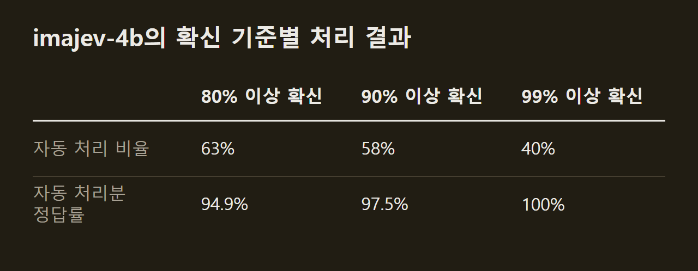
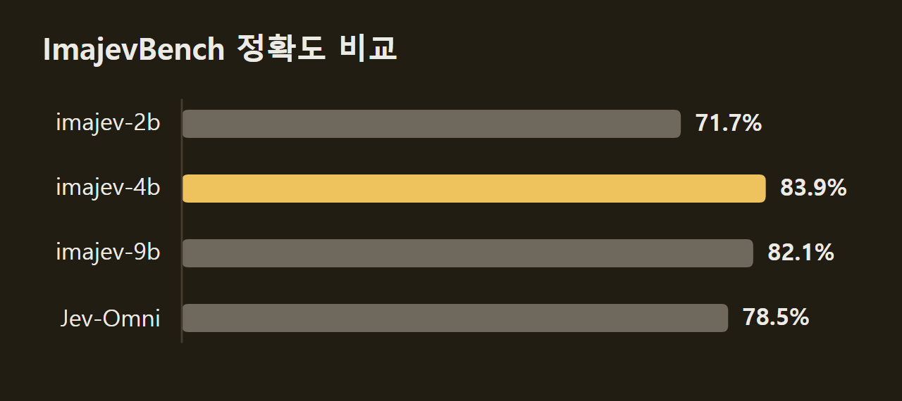

> 이 글은 아래 원문을 우리말로 간추려 정리한 글입니다. 정확한 내용은 원문을 확인하십시오.
>
> 원문: [github.com/mohit67890/imajev](https://github.com/mohit67890/imajev)  
> 원문을 소개한 뉴스레터: The Living Edge

온라인 판매 글에는 색상이 red로 적혀 있는데 사진 속 신발은 빨간색이 아닐 때가 있다. 고객이 메일에서 이사했다고 말했는데 고객 기록의 도시는 그대로일 때도 있다. 이런 어긋남은 매번 생기지만 사람이 모든 건을 확인할 수는 없다.

개발자 Mohit Garg는 이런 대조 작업을 맡는 모델 [imajev](https://github.com/mohit67890/imajev)를 공개했다. 사용자가 사진, 기록, 텍스트와 함께 질문과 허용할 답 목록을 보내면, 모델은 답마다 확률을 매긴다. 근거가 부족하면 '판단 불가'에 확률을 싣는다. 크기는 2B, 4B, 9B 세 가지다. 이 모델을 쓰는 시스템은 모델이 확신할 때만 자동으로 처리하고, 나머지는 사람에게 넘기도록 설계되어 있다.

```요약
요약: imajev는 사진·기록·텍스트를 읽고 사용자가 정한 선택지마다 확률과 판단 불가 확률을 돌려주는 2B·4B·9B 공개 모델이며, 4B는 ImajevBench 시험 문항 279개에서 83.9%를 맞혔다.
```

```용어
LoRA: 기본 모델의 가중치는 그대로 두고 작은 추가 가중치만 학습하는 파인튜닝 방식이다. imajev는 이 추가 가중치를 어댑터로 배포한다.
unknown: 근거가 없거나, 근거끼리 어긋나거나, 답이 목록 밖에 있을 때 고르도록 학습시킨 '판단 불가' 선택지다.
캘리브레이션(calibration): 모델이 말하는 확률이 실제 정답률과 맞도록 조정하는 일이다. imajev는 모델 크기마다 온도 값 하나로 확률을 고친다.
ECE(Expected Calibration Error): 모델이 내놓은 확률과 실제 정답률이 얼마나 벌어졌는지 잰 값이다.
옵션 순서 평균(rotations): 선택지 순서를 네 가지로 바꿔 물은 결과를 평균하는 설정이다.
```

## 1. 질문과 선택지를 함께 보내는 판정 요청

imajev에 보내는 요청은 근거와 질문으로 이루어진다. 근거로는 사진을 두 장까지 붙이고, '상태(state)'라고 부르는 기록을 함께 보낸다. 질문 형식은 세 가지다. choice는 선택지 중 하나를 고르고, noul은 예와 아니요를 묻고, score는 등급을 매긴다. 한 요청에는 질문을 1~8개, 질문마다 선택지를 2~254개 넣을 수 있고, 기록은 32KB까지 담을 수 있다.

응답은 문장이 아니라 선택지별 확률이어서 코드의 조건문에 바로 넣을 수 있다. 예를 들어 판매 글에는 상품명이 'Men's suede boat shoes', 색이 red로 적혀 있고 사진에는 빨간색이 아닌 신발이 찍혀 있다고 하자. 이 요청을 보내자 4B 모델은 사진과 어긋나는 칸으로 listing.color에 0.95의 확률을 매겼다. "색이 맞는가"라는 질문에는 0.082를 주었다. 이 요청은 Mac Studio에서 1.15초 걸렸고, 이때 옵션 순서 평균과 캘리브레이션 파일을 적용했다.

모든 답에는 판단 불가에 실린 확률(`unknown_probability`)이 붙는다. unknown이 가장 유력한 답이었는지를 알리는 표시(`abstained`)와 신뢰도도 함께 온다. 요청과 응답의 모양은 TypeSafe가 내놓은 텍스트 전용 판정 모델 Jev와 같다. imajev는 여기에 사진과 위의 두 항목만 더했으므로, 텍스트만 담은 Jev 요청은 고치지 않고도 그대로 처리된다.

사진 없이 텍스트만 보낼 수도 있다. 다음 그림의 고객은 같은 12석 요금 480달러가 9월 3일에 두 번 청구되었다며, 수요일 결산 전에 환불해 달라고 썼다. 모델은 요청 한 번으로 세 질문에 답했다. 담당 부서는 billing(0.963), 긴급 여부는 yes(0.836), 고객의 감정은 impatient(0.772)였고, 앱은 이 결과에 따라 티켓을 결제 부서로 보내고 당일 답장하도록 처리했다.

")

범용 비전 모델과 비교하면 결과 형식과 실행 위치가 다르다. 프런티어 비전 API는 호스팅된 서버에서 생성한 글이나 JSON으로 답하고, 판정 한 건에 5~8초가 걸린다. 반면 imajev는 Apache-2.0 라이선스로 가중치를 공개했고 Mac 한 대나 GPU 한 장에서 돌아간다. 그래서 사진과 고객 데이터가 사내 네트워크 밖으로 나가지 않는다.

## 2. 예제 앱으로 확인한 판정 사례

개발자는 보기 좋은 예제만 고르지 않고, 예제 앱에서 나올 수 있는 모든 경우를 검증했다. 작은 앱 다섯 개에서 방문자가 누를 수 있는 모든 조합을 모델에 보내 정답과 비교했다. 답이 맞고, 확신 기준 80%에서 앱이 예상한 동작을 하면 통과로 셌다. 이 검증에는 캘리브레이션 파일 없이 옵션 순서 평균만 적용한 4B를 썼다.

첫째 앱은 판매 글과 사진을 대조한다. 판매자가 올린 사진과 판매 글의 내용이 어긋나면 구매자가 반품하지만, 모든 판매 글을 사람이 확인할 수는 없다. 다음 그림에서는 판매 글의 색이 red인데 사진 속 신발은 빨간색이 아니다. 모델은 listing.color가 틀렸다고 판정했고, 앱은 판매자가 고칠 때까지 게시를 보류했다. 질문 세 개와 사진 한 장을 처리하는 데 500ms가 걸렸다.

")

둘째 앱은 같은 대조를 텍스트에 적용한다. 고객은 이사, 팀 증원, 요금제 변경 같은 일을 메일에서 지나가듯 말하고, 누군가 알아채기 전까지 CRM(고객 관계 관리) 기록은 틀린 채로 남는다. 다음 그림에서 Maja는 8월에 뮌헨으로 이사했다고 썼지만 기록의 도시는 Berlin이다. 모델은 account.city를 고치라고 판정했고, 사진 없이 질문 하나를 처리하는 데 196ms가 걸렸다.

")

개발자는 틀린 사례도 함께 공개했다. 결제 메모 칸이 비어 있을 때 4B는 unknown이 아니라 '미결제'라고 답했다(P = 0.06). 손으로 따라 그린 글자 20개는 모두 맞게 읽었지만, 아무렇게나 그은 낙서 10개 가운데 8개도 글자라고 판정했다. 이처럼 unknown은 근거가 없는 경우를 겨냥해 학습시킨 선택지일 뿐, 그런 경우에 반드시 unknown이 나온다는 보장은 없다.

캘리브레이션 파일을 적용해도 가장 유력한 답은 바뀌지 않는다. 다만 신뢰도가 낮아지므로, 80% 기준에서 사람에게 넘어가는 건이 늘어난다.

## 3. 확신 기준에 따라 달라지는 자동 처리 비율

모델이 얼마나 확신해야 시스템이 동작할지는 사용자가 정한다. 기준을 높이면 자동으로 처리하는 비율이 줄고 실수도 함께 줄어든다. 기준에 못 미친 답과 판단 불가로 나온 답은 모두 사람에게 넘어간다.

개발자는 ImajevBench 시험 문항 279개로 이 관계를 쟀다. 이 가운데 21개는 판단 불가가 정답인 문항이고, 옵션 순서 평균과 캘리브레이션 파일을 적용한 배포 설정으로 측정했다. 4B는 80% 기준에서 63%를 자동 처리해 94.9%를 맞혔고, 99% 기준에서는 40%만 처리하는 대신 모두 맞혔다. 같은 99% 기준에서 9B는 52%를 처리해 99.3%를 맞혔다.



개발자는 이 값을 출발점으로만 삼으라고 권한다. ImajevBench는 일부러 어렵게 만든 벤치마크이기 때문이다. 그 대신 판단 불가 사례를 포함해 자기 업무 데이터 수백 건으로 직접 잰 뒤 기준을 고르라는 것이 개발자의 권고다. 자기 데이터에 맞는 온도를 다시 맞추는 방법은 기술 보고서 5절에 정리되어 있다.

## 4. ImajevBench 정확도와 공식 순위

ImajevBench 시험 문항에서는 4B가 가장 높은 정확도를 기록했다. ImajevBench v2.0-lite는 개발자가 직접 만든 벤치마크다. 텍스트 문항, 사진 문항, 사진과 기록을 함께 보는 문항으로 구성되고, 판단 불가를 정답으로 둔 문항도 들어 있다. 4B는 83.9%, 9B는 82.1%, 2B는 71.7%를 맞혔다. 사진을 읽는 다른 공개 판정 모델 Jev-Omni(Gemma 4 12B 기반)는 자체 `predict()` API로 같은 문항을 풀어 78.5%를 맞혔다.



다만 Jev-Omni와의 차이는 통계적으로 유의하지 않았다. 이전 어댑터 기준으로 4B와 9B는 Jev-Omni보다 약 4점 앞섰지만 유의하지 않았다(p ≈ 0.25). 그래프에서 4B와 Jev-Omni가 보이는 5.4점 차는 지금 배포된 어댑터로 잰 값이어서, 이전 어댑터로 잰 약 4점과 다르다. 앞선 몫은 Jev-Omni에 없는 판단 불가 출력에서 나왔고, 답이 있는 문항만 보면 Jev-Omni가 219개를 맞혀 이전 어댑터의 215개(4B), 216개(9B)보다 조금 많았다.

크기 간 차이도 일부만 유의했다. 4B와 9B의 차이는 p = 0.57로 유의하지 않았다. 4B는 학습하지 않은 기본 모델보다 13.3점 높았지만(p = 0.0001), 9B가 기본 모델보다 앞선 폭은 0.05 수준에서 유의하지 않았다(p = 0.131). 판단 불가 문항 21개 가운데 unknown을 맞게 고른 수는 4B가 18개, 9B가 15개, 2B가 5개여서, 2B는 판단을 보류해야 할 때도 답을 내는 경우가 많았다.

ImajevBench 수치에는 조건이 붙는다. 이 벤치마크는 미리보기 판이다. 이미지는 모두 AI로 만들었고 아직 사람의 검수를 거치지 않았다. 또 배포할 체크포인트를 고를 때 시험 문항을 기준으로 썼기 때문에, 시험 점수는 학습에 쓰지 않은 데이터로만 잰 값이라고 보기 어렵다. 문항을 공개하지 않은 숨김 문항 202개에서는 4B가 85.6%를 기록했다.

벤치마크 운영자가 직접 잰 공식 순위표에서도 4B가 앞섰다. Benchmark Heaven의 JevBench v1.4.2.2(2026년 9월 27일 채점, 91개 시스템)에서 4B는 67.37점으로 1위였고, Plumb-4B는 65.84점, TypeSafe의 Jev 1.13.0은 63.29점이었다. 사진 문항을 담은 Image JevBench v0.1.3(2026년 9월 28일 공개, 49개 시스템)에서도 76.39점으로 1위였고, Jev-Omni는 73.10점이었다. 반면 JevBench의 공개 어려운 문항 111개에서는 JevK5와 Eikos-4B가 73.9%로 4B의 72.1%보다 높았다. imajev는 추론 과정을 거치지 않고 한 번에 답하는 모델이어서 어려운 텍스트 문항에서는 추론 모델에 뒤진다.

4B 어댑터는 2026년 9월 26일에 바뀌었다. 이전 판이 틀린 판정을 모아 학습시킨 결과, ImajevBench 정확도는 82.4%에서 83.9%로 올랐다. unknown을 맞게 고른 문항도 21개 중 14개에서 18개로 늘었다. 그 대신 답이 있는 문항 258개에서 판단을 보류한 경우가 3개에서 9개로 늘었고, DecisionBench에서 잰 ECE는 0.024에서 0.069로 나빠졌다.

개발자는 4B를 기본으로 쓰라고 권한다. 2B는 ImajevBench에서 4B보다 11점 낮으므로, 메모리나 지연 시간이 제약일 때만 고르라는 것이다. 9B는 지식이 많이 필요한 텍스트 질문에 맞지만, 메모리를 약 19GB 차지한다. JevBench 어려운 문항 한 건을 H100 한 장에서 처리하는 데 걸린 시간의 중앙값은 4B 배포 설정에서 350ms였다. 이 시간은 다른 작업이 함께 돌던 부하 상태에서 잰 값이고, 옵션 순서 평균과 캘리브레이션을 빼면 96ms였다.

## 5. 네 단계 학습과 확률 보정

imajev는 공개 모델 Qwen3.5의 2B, 4B, 9B를 기본 모델로 삼아 약 100만 건의 판정을 네 단계로 학습했다. 학습은 언어 모델 쪽에 LoRA 어댑터를 붙이는 방식이었고, 사진을 읽는 비전 부분은 고정했다. 프로젝트 전체에 든 GPU 대여비는 RunPod 기준 약 676달러다.

다음 그림의 막대는 앞 세 단계의 데이터 규모를 같은 비율로 그린 것이다. 검은 막대는 사람이 라벨을 붙인 공개 데이터셋에서 가져온 504k건이다. 이미지 출처 21곳에서 300k건, 텍스트 출처 15곳에서 200k건을 모았고, 사진과 판매 글이 어긋나는 사례 4k건을 더했다. 회색 막대는 488k건이다. 앞서 학습한 9B가 처음 보는 사진·텍스트 출처 여섯 곳에 라벨을 붙였는데, 선택지 순서를 바꿔 물어도 답이 같을 때만 남겼다. 사진과 기록, 사진 두 장을 대조하는 판정 72k건도 이 단계에 들어 있다. 빗금 막대는 어려운 질문 23k건이다.

")

세 번째 단계는 첫 단계에서 떨어진 추론 성능을 되살렸다. 첫 단계 학습을 거치자 9B의 JevBench 어려운 문항 점수가 기본 모델의 64.9%에서 42.3%로 떨어졌다. 이를 바로잡으려고 개발자는 Qwen3.6-27B로 문서와 질문을 만들고, Qwen3.6-27B와 gpt-oss-20b가 따로 답해 두 답이 일치한 문항만 남겼다. 이 질문을 학습하자 점수가 68.5%로 올랐다.

네 번째 단계에서는 정답 하나 대신 교사 모델이 낸 확률 분포를 학습 목표로 삼은 39,515행을 학습시켰다. 이 단계의 체크포인트만 쓰면 JevBench 어려운 문항 점수는 올랐지만, ImajevBench의 사진·기록 문항 점수는 떨어졌다. 그래서 배포한 어댑터는 세 번째 단계의 어댑터와 이 체크포인트를 가중치 단위로 반씩 평균한 것이다. 교사 모델은 모두 가중치가 공개된 모델이고, JevBench 문항과 Jev의 출력, 유료 API의 출력은 학습에 쓰지 않았다.

imajev는 답을 글로 생성하지 않고, 선택지에 대응하는 코드의 점수를 읽는다. 선택지마다 한 토큰짜리 코드 255개 중 하나를 붙인다. 그런 다음 판정 위치에서 각 코드와 unknown 코드가 받은 로짓을 읽어 답으로 삼는다. 이 때문에 질문 하나에 순전파 한 번이면 답이 나오고, 토큰을 하나씩 생성하는 디코딩 과정은 없다.

캘리브레이션을 적용하지 않으면 모델은 실제보다 높은 확률을 내놓는다. 어려운 문항에서 잰 ECE는 보정 전 0.16~0.19였고, 배포 설정에서는 0.09~0.12로 낮아졌다. 보정에 쓰는 온도는 2B가 1.646, 4B가 1.305, 9B가 1.748이다. 온도는 확률만 바꾸고 답 자체는 바꾸지 않는다. 다만 사진만 보내는 요청에서는 4B의 원래 확률이 이미 잘 맞았다(ECE 0.015). 공통 온도를 적용하자 오히려 확률이 지나치게 낮아져 ECE가 0.029가 되었으므로, 개발자는 사진 전용 온도 1.028을 따로 두어 ECE를 0.012로 낮췄다. 2B와 9B는 아직 온도 하나만 쓴다.

imajev는 사진, 기록, 텍스트를 사용자가 정한 선택지에 대한 확률로 바꾸고, 근거가 없으면 판단 불가를 고르도록 학습한 모델이다. 배포 설정의 4B는 ImajevBench에서 83.9%를 맞혔고, 99% 이상 확신한 40%만 자동으로 처리하면 모두 맞혔다. 개발자는 이 수치를 출발점으로 삼고, 자기 데이터로 잰 결과를 보고 확신 기준을 정하라고 권한다.

## 출처와 작성 방식

- 원문: [github.com/mohit67890/imajev](https://github.com/mohit67890/imajev)
- 원문을 소개한 뉴스레터: The Living Edge
- 그림: 아래에 출처가 적힌 그림은 원문에 실린 그림을 인용한 것이며 저작권은 원저작자에게 있습니다. 출처가 없는 그래프는 원문에 적힌 값으로 직접 그린 것입니다.
- 작성 방식: 직접 만든 뉴스 정리 파이프라인(VISER)으로 생성하고 검수한 글입니다. 본문의 수치와 주장은 원문에서 가져온 것입니다.
- 정리 주차: 2026-W40
