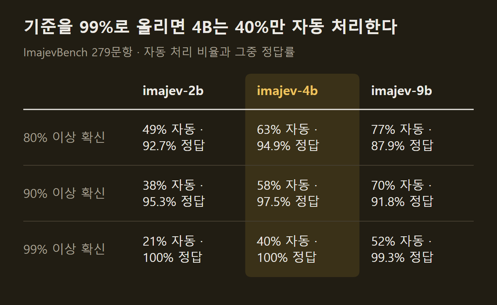
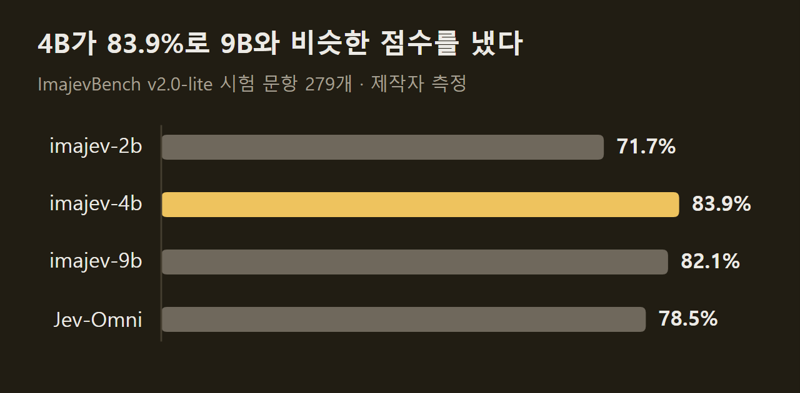

> 이 글은 아래 원문을 우리말로 간추려 정리한 글입니다. 정확한 내용은 원문을 확인하십시오.
>
> 원문: [github.com/mohit67890/imajev](https://github.com/mohit67890/imajev)  
> 원문을 소개한 뉴스레터: The Living Edge

중고 장터에 올라온 상품 글에는 색상이 '빨강'으로 적혀 있는데 사진 속 신발은 베이지색이다. 이런 불일치는 반품으로 이어지지만 모든 글을 사람이 확인할 수는 없다. Mohit Garg가 공개한 [ImaJev](https://github.com/mohit67890/imajev)는 사진, 회사가 가진 기록, 글을 넣고 질문과 선택지를 정해 주면 선택지마다 확률을 붙여 답하는 모델이다. 근거가 부족하면 '알 수 없음'으로 답하도록 학습했으므로, 시스템은 확률이 높은 답만 자동으로 처리하고 나머지는 사람에게 넘길 수 있다.

```요약
요약: ImaJev는 사진·기록·글을 읽고 정해 준 선택지에 확률을 매겨 답하는 2B·4B·9B 공개 모델이며, 4B는 제작자가 만든 ImajevBench 279문항에서 83.9%를 맞혔지만 이 벤치마크는 AI 생성 이미지로 만든 미리보기판이다.
```

```용어
판정 보류: 근거가 없거나 서로 어긋나거나 선택지 밖의 답일 때 모델이 '알 수 없음'을 고르는 일. 응답에는 `abstained`로 표시된다.
임계값: 모델의 답을 자동으로 실행할 최소 확률. 이보다 낮은 답은 사람에게 넘긴다.
캘리브레이션: 모델이 내놓는 확률이 실제 정답률과 맞도록 조정하는 일. ImaJev는 온도라는 값 하나로 확률을 누그러뜨린다.
ECE: 모델이 말한 확률과 실제 정답률이 벌어진 정도를 재는 지표. 작을수록 확률을 믿을 수 있다.
LoRA 어댑터: 기반 모델의 가중치는 그대로 두고 작은 추가 가중치만 학습해 덧붙이는 파인튜닝 방식.
```

## 1. 요청과 응답의 형태

요청에는 두 가지가 들어간다. 하나는 판단 근거가 되는 기록과 사진이고, 다른 하나는 묻고 싶은 질문들이다. 질문 유형은 다음 세 가지다.

1. `choice`: 정해 준 선택지 가운데 하나를 고른다.
2. `noul`: 예·아니요로 답하고 '예'일 확률을 돌려준다.
3. `score`: 정해 준 단계 가운데 어디에 해당하는지 매긴다.

모델은 문장을 지어내지 않고 질문마다 선택지별 확률을 돌려주므로, 응답을 그대로 조건문에 넣어 쓸 수 있다. ==모든 답에는 '알 수 없음'일 확률과 판정 보류 여부가 함께 붙는다.==

원문의 예시는 상품 글 검사다. 제목이 '남성 스웨이드 보트 슈즈', 색상이 '빨강', 종류가 '신발'인 기록과 베이지색 신발 사진을 함께 보내고 질문 세 개를 던졌다. 4B 모델은 사진과 어긋나는 필드로 `listing.color`를 0.95의 확률로 골랐고, 색상이 일치할 확률은 0.082, 상품 종류가 일치할 확률은 0.989로 답했다. 제작자가 Mac Studio에서 선택지 순서를 네 번 바꿔 평균하고 캘리브레이션 파일을 적용해 잰 처리 시간은 1.15초다.

")

사진 없이 글만 보내도 같은 방식으로 동작한다. 같은 요금이 두 번 청구됐다는 고객 문의 한 건을 넣으면 요청 한 번으로 담당 부서, 긴급 여부, 불만 정도가 함께 나온다. 원문 화면에서는 부서 '결제' 0.963, 긴급 '예' 0.836, 불만 정도 '조급함' 0.772가 나왔고, 앱은 이 값을 받아 '결제팀, 오늘 답변'으로 처리했다.

")

요청 하나에 넣을 수 있는 양에는 한도가 있다. 사진은 두 장까지, 기록은 32KB까지, 질문은 1~8개, 선택지는 2~254개이고 영어만 지원한다. 사진 두 장은 기준 사진과 대상 사진을 견주는 용도인데, 보낸 물건과 돌아온 반품, 정상 부품과 생산 라인의 부품을 비교하는 경우가 그렇다. 다만 두 사진 비교는 시각 과제 가운데 가장 약하다고 제작자가 밝혔고, 이전 버전 4B의 실제 사진 쌍 정확도는 41.8%였으며 공개된 어댑터로는 다시 재지 않았다.

## 2. 판정 보류와 임계값

ImaJev는 '알 수 없음'을 학습과 추론 양쪽에서 정식 선택지로 다룬다. 근거가 부족한 경우, 질문의 전제가 틀린 경우, 기준 사진이 맞지 않는 경우, 정답이 선택지에 없는 경우를 모두 '알 수 없음'으로 답하도록 학습했다. 빨간 배낭과 검은 배낭만 든 옷장 기록을 주고 흰색이나 베이지색 가방을 골라 달라고 하면 4B는 추측하는 대신 '알 수 없음'에 0.89를 준다.

사용하는 쪽은 모델이 얼마나 확신할 때 자동으로 처리할지를 임계값으로 정한다. 임계값을 높이면 자동 처리되는 비율이 줄어드는 대신 틀리는 일도 줄고, 임계값에 못 미친 답과 판정 보류된 답은 사람에게 간다. ==임계값을 99%로 잡으면 4B는 문항의 40%를 자동 처리하고 그 전부를 맞혔다.==



이 표는 ImajevBench 시험 문항 279개로 잰 값이고, 그중 21개는 정답이 '알 수 없음'이다. 제작자는 이 벤치마크를 일부러 어렵게 만들었으므로 수치를 출발점으로만 보고, 임계값을 정하기 전에 자기 데이터 수백 건으로 직접 재라고 적었다.

확률을 믿으려면 캘리브레이션이 필요하다. 모델은 크기마다 온도 값 하나를 함께 배포하는데, 온도는 답을 바꾸지 않고 확률만 낮춘다. 캘리브레이션 없이 쓰면 모델이 지나치게 확신해서, 어려운 문항의 ECE가 0.16~0.19이고 배포 설정에서는 0.09~0.12로 내려간다. 사진만 있고 기록이 빈 요청은 사정이 달라서, 4B의 확률은 원래 잘 맞는데 공용 온도를 적용하면 오히려 과하게 낮아진다. 그래서 4B에는 사진 전용 온도가 따로 들어 있고 2B와 9B에는 아직 없다.

판정 보류가 항상 작동하지는 않는다. 4B는 정답이 '알 수 없음'인 21문항 중 18개에서 판정을 보류했지만 답할 수 있는 258문항 중 9개에서도 보류했다. 2B는 21개 중 5개만 보류해서 제작자 스스로 너무 적다고 평가했다. 원문이 밝힌 실패 사례도 있는데, 결제 메모 칸이 비어 있을 때 4B는 '알 수 없음' 대신 '미결제'로 답했고, 손글씨 입력판에서는 낙서 10개 중 8개를 글자로 읽었다.

## 3. 모델 크기와 벤치마크 결과

모델은 Qwen3.5의 2B, 4B, 9B를 기반으로 한 세 가지다. 제작자는 4B를 기본으로 권하고, 지연 시간이나 메모리가 빠듯하면 2B를, 지식이 많이 필요한 글 질문에 약 19GB의 메모리를 쓸 수 있으면 9B를 쓰라고 안내한다.



4B가 9B보다 높게 나왔지만 이 차이는 유의하지 않다(p = 0.57). 파인튜닝의 효과는 크기마다 달랐다. 4B는 손대지 않은 기반 모델보다 13.3점, 2B는 11.5점 높았고 둘 다 유의했지만, 9B의 상승 폭 5.4점은 p = 0.131로 유의 기준을 넘지 못했다. 같은 계열의 공개 모델인 Jev-Omni와 견준 약 4점의 우위도 유의하지 않으며, 그 차이는 Jev-Omni에 판정 보류 출력이 없어서 생긴다. 답할 수 있는 문항만 보면 Jev-Omni가 조금 앞선다.

==ImajevBench 수치는 제작자가 만들고 직접 잰 값이라는 조건이 붙는다.== 이 벤치마크는 미리보기판으로, 이미지가 모두 AI로 생성됐고 사람의 검수를 거치지 않았다. 시험 문항이 배포할 체크포인트를 고르는 데도 쓰였으므로 순수한 미공개 평가값도 아니다. 문항을 공개하지 않은 202개에서는 2B 74.3%, 4B 85.6%, 9B 84.7%가 나왔다. 대형 상용 비전 모델은 같은 벤치마크에서 91.4~99.6%를 기록했는데, 이쪽은 글을 생성해 답하는 다른 방식이고 판정 하나에 5~8초가 걸린다. ImaJev는 H100 한 장에서 판정당 약 0.1초, 배포 설정으로는 약 0.35초다.

외부 운영자가 잰 순위도 원문에 실려 있다. 글 전용인 JevBench v1.4.2.2에서 4B는 91개 시스템 중 종합 1위(67.37점)였고, Image JevBench v0.1.3에서는 49개 중 1위(76.39점), DecisionBench에서는 56개 모델 중 3위(79.65점)였다. 다만 JevBench의 공개 고난도 문항 111개만 보면 JevK5와 Eikos-4B가 73.9%로 4B의 72.1%를 앞서고, 공식 순위표에서도 지능 항목만 따지면 3위다. 제작자는 추론 과정 없이 한 번에 답하는 구조라서 추론 모델에 뒤진다고 설명했다.

## 4. 생성 없이 읽어 내는 구조

속도가 빠른 이유는 답을 만드는 방식에 있다. 일반 언어 모델은 답을 토큰 단위로 생성하지만, ImaJev는 선택지마다 토큰 하나짜리 코드를 배정해 두고 프롬프트의 판정 위치에서 그 코드들의 점수만 읽는다. ==요청당 입력을 한 번 처리하고 질문당 한 번만 계산하며 글을 생성하지 않는다.== '알 수 없음'도 코드 하나를 차지한다.

학습에는 LoRA 어댑터를 썼다. 언어를 처리하는 층에만 어댑터를 붙이고 이미지를 읽는 부분은 고정했으며, 학습되는 파라미터는 2B 약 1,615만 개, 4B 약 3,113만 개, 9B 약 4,115만 개다. 2026년 9월 26일에는 4B만 어댑터를 바꿨다. 이전 버전이 틀린 판정으로 다시 학습한 결과 ImajevBench가 82.4%에서 83.9%로 올랐고 '알 수 없음' 문항의 보류도 14개에서 18개로 늘었지만, DecisionBench에서 잰 ECE는 0.024에서 0.069로 나빠졌다.

## 5. 학습 데이터와 비용

학습에는 약 100만 건의 판정이 네 단계로 들어갔다. 원문 그림은 그 규모를 세 덩어리로 보여 준다.

1. 사람이 라벨을 붙인 공개 데이터 50만 4천 건: 이미지 출처 21곳의 30만 건, 글 출처 15곳의 20만 건, 사진과 상품 글이 어긋나는 사례 4천 건이다.
2. 9B가 라벨을 붙인 새 데이터 48만 8천 건: 9B가 붙인 54만 7천 건 중 선택지 순서를 바꿔도 답이 같은 41만 6천 건을 남겼고, 사진과 기록 대조·두 사진 비교 판정 7만 2천 건을 더했다.
3. 어려운 질문 2만 3천 건: 공개 가중치 모델들이 질문을 쓰고 따로 답한 뒤 답이 일치한 것만 남겼고, 사람이 만든 추론 데이터를 더했다.

")

세 번째 단계는 규모가 작지만 역할이 컸다. 첫 단계 학습만 거친 9B는 JevBench 고난도 문항 점수가 기반 모델의 64.9%에서 42.3%로 떨어졌는데, 어려운 질문을 학습한 뒤 다시 올라갔다. 올라간 값을 원문 본문은 67.6%, 그림은 68.5%로 적었고, 배포된 9B의 점수는 69.4%다.

마지막 단계에서는 더 큰 공개 모델이 내놓은 확률 분포 전체를 정답으로 삼아 39,515건을 추가로 학습했다. 이렇게 얻은 체크포인트는 고난도 글 문항 점수는 올랐지만 사진과 기록을 함께 보는 문항에서 점수를 잃었다. 그래서 실제로 배포한 어댑터는 세 번째 단계의 어댑터와 이 체크포인트의 가중치를 절반씩 평균한 것이다.

제작자는 학습에 쓴 교사 모델이 모두 공개 가중치 모델이고, JevBench 문항이나 유료 API의 출력은 쓰지 않았다고 밝혔다. 프로젝트 전체에 든 GPU 임대 비용은 약 676달러다. 설치와 실행 명령, 자기 데이터로 온도를 다시 맞추는 방법, 출처별 라이선스는 원문 저장소에 정리되어 있다.

## 출처와 작성 방식

- 원문: [github.com/mohit67890/imajev](https://github.com/mohit67890/imajev)
- 원문을 소개한 뉴스레터: The Living Edge
- 원문 그림: 아래에 출처를 적은 그림은 원문에 실린 그림을 인용한 것이며, 저작권은 원저작자에게 있습니다.
- 그래프: 출처 표기가 없는 그림은 원문에 적힌 값으로 새로 그린 것입니다. 원문에 실린 그림이 아닙니다.
- 작성 방식: 직접 만든 뉴스 정리 파이프라인(VISER)으로 생성하고 검수한 글입니다. 본문의 수치와 주장은 원문에서 가져온 것입니다.
- 정리 주차: 2026-W40
