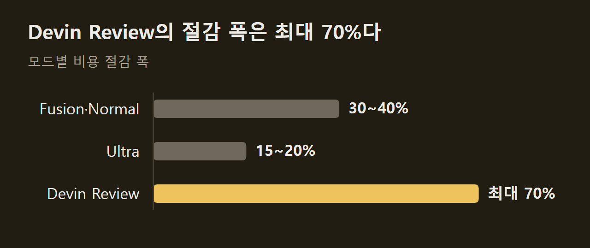
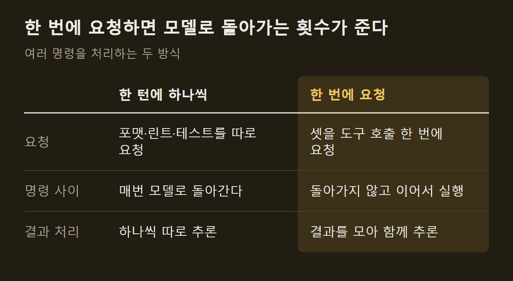
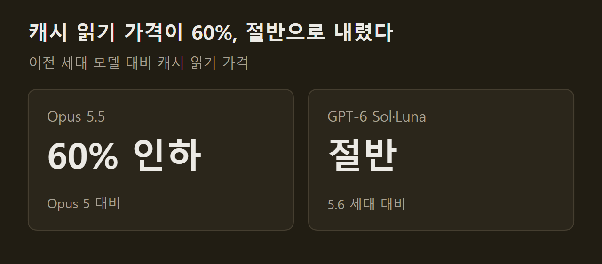

> 이 글은 아래 원문을 우리말로 간추려 정리한 글입니다. 정확한 내용은 원문을 확인하십시오.
>
> 원문: [devin.ai/blog/more-efficient-devin](https://devin.ai/blog/more-efficient-devin)  
> 원문을 소개한 뉴스레터: TLDR AI

코딩 에이전트는 한 작업을 끝내기까지 모델을 수십 번 호출하고, 호출할 때마다 지시문과 코드, 앞서 한 행동을 다시 보낸다. 작업이 길어질수록 비용이 불어나는 구조다. [Devin](https://devin.ai/blog/more-efficient-devin)은 개발 작업을 맡기면 계획, 테스트, 디버깅, 마이그레이션을 스스로 수행하는 코딩 에이전트인데, 최신 모델을 들이고 하니스를 고쳐 사용 비용을 낮췄다고 밝혔다.

```요약
요약: Devin은 작업마다 맞는 모델을 골라 쓰고 도구 호출과 캐시 활용을 개선해, 지능을 유지하거나 높이면서 Fusion·Normal 모드 비용을 30~40% 낮췄다고 밝혔다.
```

```용어
하니스: 모델을 둘러싼 실행 틀이다. 모델에 무엇을 보내고, 모델이 요청한 명령을 어떻게 실행할지 정한다.
도구 호출: 모델이 셸 명령 실행 같은 동작을 하니스에 요청하는 일이다.
턴: 모델이 요청을 한 번 받고 응답을 한 번 내는 단위다.
프롬프트 캐싱: 요청의 앞부분이 이전 요청과 같으면 그 부분의 계산 결과를 다시 쓰는 기능이다.
```

## 1. 모드별 비용 절감 폭

Devin에는 Fusion, Normal, Ultra 모드와 코드 리뷰를 맡는 Devin Review가 있고, 절감 폭은 모드마다 다르다. Fusion과 Normal은 30~40%, Ultra는 15~20%, Devin Review는 최대 70%다. 모두 Devin 측이 밝힌 값이고 측정 방법은 자료에 없다.



비용을 낮추면서 모든 모드의 지능은 유지하거나 높였다고 한다. Fusion은 FrontierCode 1.1의 Extended에서 68.8점으로 선두에 올랐고, 이때 작업 하나에 든 비용은 평균 0.60달러다.

## 2. 작업별 모델 선택

Devin은 특정 모델 하나에 묶이지 않고, 작업의 각 부분에 맞는 모델을 고른다. 기사가 든 모델별 쓰임새는 다음과 같다.

1. Opus 5.5와 GPT-6 Sol: 지능이 높으면서 가격 대비 성능이 좋다.
2. GPT-6 Astra: 컴퓨터 조작에 강하다.
3. GPT-6 Luna: 보조 작업의 비용을 크게 낮춘다.

여기에 자체 모델 SWE-2와 그 밖의 모델이 더해진다. ==Fusion은 성능 좋은 주 모델에 값싼 보조 모델을 짝지어 쓴다.== Devin Review는 변경분 분석, 버그 찾기, 변경 분류에 각각 맞는 모델을 고른다.

## 3. 도구 호출 줄이기

최신 모델은 작은 동작을 한 턴에 하나씩 처리하지 않고 여러 동작을 함께 계획할 수 있다. Devin은 이 능력에 맞춰 셸 명령 여러 개를 한 번의 호출로 보내고, 서로 독립적인 도구 호출은 병렬로 실행하도록 하니스를 고쳤다.



==턴 수가 줄면 작업을 조율하는 데 쓰는 토큰도 줄어든다.== 그만큼 세션 전체 비용이 낮아진다.

## 4. 프롬프트 캐싱 활용

모델은 이전 요청을 기억하지 못하므로, 에이전트는 매 턴 늘어난 이력을 통째로 다시 보내야 한다. 프롬프트 캐싱을 쓰면 앞부분이 이전 요청과 같을 때 그 부분의 계산을 재사용해 비용과 시간이 줄어든다.

다만 조건이 붙는다. 공통 앞부분이 바뀌면 안 되고, 캐시는 일정 시간이 지나면 사라지며, 모델과 제공사가 다르면 쓸 수 없다. Devin의 하니스는 이 조건 안에서 컨텍스트를 재사용하도록 짜였고, 캐시 읽기 가격이 내릴수록 이득이 커진다.



긴 이력을 여러 턴에 걸쳐 끌고 가는 작업일수록 이 인하분이 누적된다.

## 출처와 작성 방식

- 원문: [devin.ai/blog/more-efficient-devin](https://devin.ai/blog/more-efficient-devin)
- 원문을 소개한 뉴스레터: TLDR AI
- 그래프: 원문에 적힌 값으로 새로 그린 그림입니다. 원문에 실린 그림이 아닙니다.
- 작성 방식: 직접 만든 뉴스 정리 파이프라인(VISER)으로 생성하고 검수한 글입니다. 본문의 수치와 주장은 원문에서 가져온 것입니다.
- 정리 주차: 2026-W40
