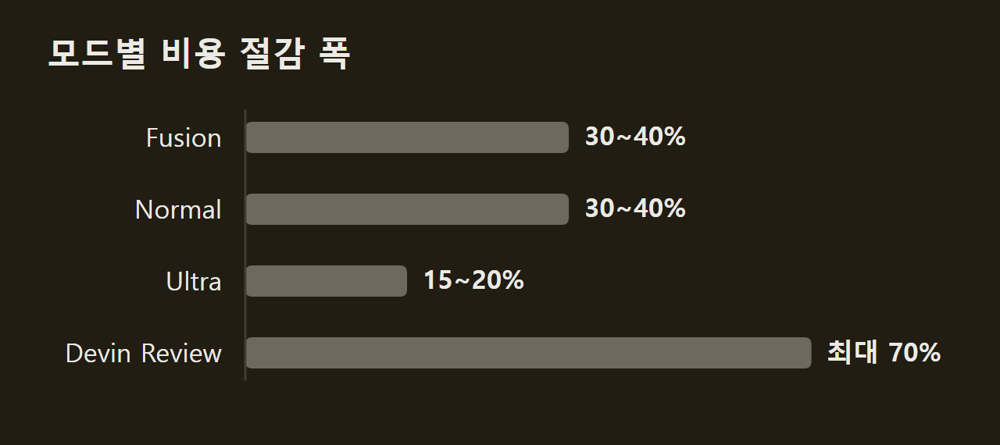
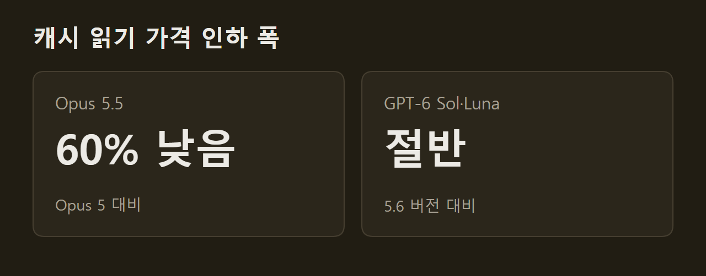

> 이 글은 아래 원문을 우리말로 간추려 정리한 글입니다. 정확한 내용은 원문을 확인하십시오.
>
> 원문: [devin.ai/blog/more-efficient-devin](https://devin.ai/blog/more-efficient-devin)  
> 원문을 소개한 뉴스레터: TLDR AI

코딩 에이전트는 작업 하나를 끝내는 동안 모델을 여러 차례 부르고, 부를 때마다 그때까지의 작업 기록을 함께 보내야 하므로 비용이 쌓인다. [Devin](https://devin.ai/blog/more-efficient-devin)은 계획, 테스트, 디버깅, 코드 이전(migration) 같은 개발 작업을 맡아 처리하는 코딩 에이전트다. 코드 변경분을 분석해 버그를 찾는 Devin Review 기능도 함께 제공한다. Devin 팀은 새 모델을 도입하고 하네스를 고쳐 모드에 따라 사용 비용을 최대 70% 낮췄다고 밝혔다.

```요약
요약: Devin은 최신 모델 조합과 하네스 개선으로 Fusion과 Normal 모드의 비용을 30~40% 낮추면서 모든 모드의 성능을 유지하거나 높였다.
```

```용어
하네스(harness): 모델에 보낼 컨텍스트를 구성하고, 모델이 요청한 도구 호출을 실행하는 Devin의 실행 환경이다.
도구 호출(tool call): 모델이 코드 포매팅, 린트, 테스트 실행 같은 작업을 요청하는 단위다.
프롬프트 캐싱: 요청의 앞부분이 이전 요청과 같을 때 그 부분에 대해 저장해 둔 계산 결과를 다시 쓰는 방식이다.
Fusion: 성능 좋은 주 모델과 비용이 낮은 보조 모델을 짝지어 쓰는 Devin의 모드다.
```

## 1. 모드별 비용 절감 폭

Devin 팀이 밝힌 비용 절감 폭은 모드마다 다르다. Fusion과 Normal 모드는 30~40%, Ultra 모드는 15~20% 싸졌고, Devin Review는 최대 70%까지 싸졌다. 그러면서도 성능은 모든 모드에서 유지되거나 나아졌다. 예를 들어 Fusion은 작업당 평균 0.60달러를 쓰면서 FrontierCode 1.1 Extended에서 68.8점을 받아 1위에 올랐다.



## 2. 작업마다 모델을 고르는 방식

Devin은 특정 모델에 묶이지 않아서 작업 부분마다 강점이 맞는 모델을 고를 수 있다. Opus 5.5와 GPT-6 Sol은 성능이 높으면서도 가격 대비 효율이 좋고, GPT-6 Astra는 컴퓨터 조작에 강하다. 반면 GPT-6 Luna는 보조 작업에 드는 비용을 크게 낮춘다. 여기에 자체 모델인 SWE-2를 비롯한 여러 모델이 더해진다.

모델을 고르는 방식은 모드마다 다르다. Fusion은 주 모델과 보조 모델을 짝짓고, Devin Review는 변경분 분석과 버그 찾기, 변경 분류에 각각 맞는 모델을 쓴다. Normal과 Ultra는 계획, 테스트, 디버깅처럼 단계마다 다른 모델을 쓴다.

## 3. 도구 호출을 묶어 실행하는 하네스

새 모델은 작은 작업을 한 턴에 하나씩 처리하지 않고 여러 작업을 함께 추론한다. 코드 포매팅, 린트, 테스트를 차례로 해야 하면 세 작업을 도구 호출 한 번으로 요청한 뒤 결과를 한꺼번에 검토하는 식이다. 이 때문에 작업 조율에 드는 턴과 토큰이 줄어 세션 전체 비용이 낮아진다.

하네스도 이 능력에 맞춰 바뀌었다. Devin은 셸 명령 여러 개를 한 호출로 묶고, 서로 독립인 도구 호출은 병렬로 실행한다. 미리 계획된 명령은 그 사이사이 모델을 다시 부르지 않고 연달아 실행된다.

## 4. 프롬프트 캐싱의 제약과 가격

LLM은 이전 요청을 기억하지 못하므로 Devin은 요청할 때마다 지시, 관련 코드, 이전 작업 기록을 모두 담아 보낸다. 늘어나는 기록을 매번 처음부터 처리하면 느리고 비싸다. 프롬프트 캐싱은 이 반복 처리를 줄여 같은 컨텍스트를 더 싸고 빠르게 다시 쓰게 한다.

다만 캐시를 쓰려면 지켜야 할 제약이 있다. 공통 앞부분(prefix)은 바뀌지 않아야 하고, 캐시는 정해진 시간이 지나면 사라지며, 저장한 계산은 모델과 제공사별로 따로 쓰인다. Devin의 하네스는 이 제약 안에서 컨텍스트를 다시 쓰도록 짜여 있어서 제공사들이 캐시 가격을 내릴수록 비용이 줄어든다.

실제로 캐시 읽기 가격은 이전 버전보다 낮아졌다. Opus 5.5는 Opus 5보다 60% 낮고, GPT-6 Sol과 Luna는 각각 이전 5.6 버전의 절반이다.



긴 기록을 안고 턴을 여러 번 도는 작업일수록 절감액이 커진다. 정리하면 Devin 팀은 이번 비용 절감이 두 가지에서 나왔다고 밝혔다. 하나는 최신 모델을 작업에 맞게 골라 쓰는 방식이고, 다른 하나는 한 단계에 더 많은 일을 처리하고 캐시된 컨텍스트를 다시 쓰도록 고친 하네스다.

## 출처와 작성 방식

- 원문: [devin.ai/blog/more-efficient-devin](https://devin.ai/blog/more-efficient-devin)
- 원문을 소개한 뉴스레터: TLDR AI
- 그래프: 원문에 적힌 값으로 직접 그린 그림입니다.
- 작성 방식: 직접 만든 뉴스 정리 파이프라인(VISER)으로 생성하고 검수한 글입니다. 본문의 수치와 주장은 원문에서 가져온 것입니다.
- 정리 주차: 2026-W40
