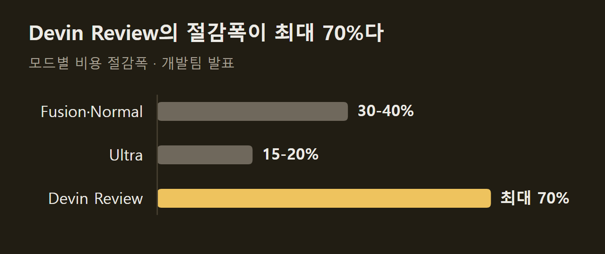
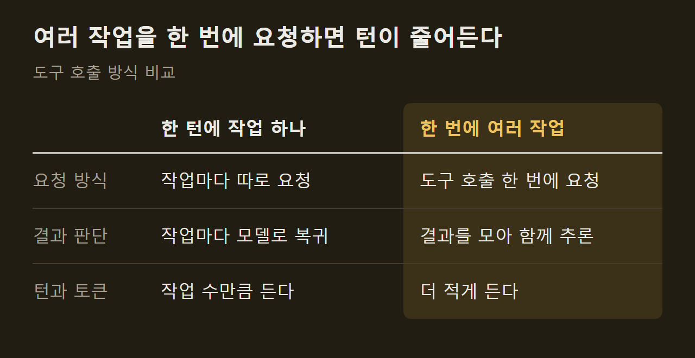
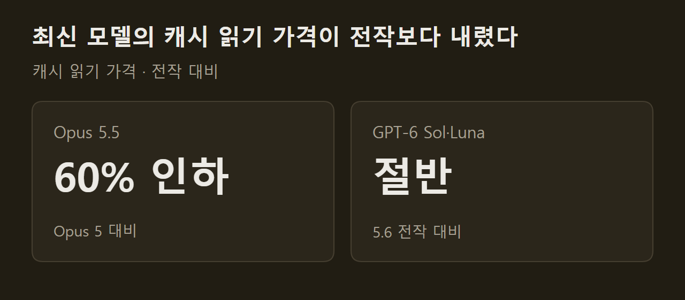

> 이 글은 아래 원문을 우리말로 간추려 정리한 글입니다. 정확한 내용은 원문을 확인하십시오.
>
> 원문: [devin.ai/blog/more-efficient-devin](https://devin.ai/blog/more-efficient-devin)  
> 원문을 소개한 뉴스레터: TLDR AI

코딩 에이전트는 작업 하나를 끝내는 동안 모델을 여러 번 호출하고, 호출할 때마다 지시문과 코드, 이전 행동 기록을 다시 보내므로 작업이 길어질수록 비용이 커진다. [Devin](https://devin.ai/blog/more-efficient-devin)은 개발 작업을 맡기면 계획, 테스트, 디버깅, 마이그레이션을 스스로 진행하는 코딩 에이전트다. 개발팀은 최신 모델을 도입하고 하네스를 고쳐 사용 비용을 낮췄다고 밝혔다.

```요약
요약: Devin은 작업별로 모델을 골라 쓰고 도구 호출과 캐시 사용을 고쳐, 지능을 유지하거나 높이면서 모드에 따라 비용을 15-20%에서 최대 70%까지 줄였다고 개발팀이 밝혔다.
```

```용어
하네스: 모델에 무엇을 보내고 모델이 요청한 작업을 어떻게 실행할지 정하는 에이전트의 바깥 프로그램이다.
도구 호출: 모델이 셸 명령 실행이나 파일 읽기 같은 작업을 하네스에 요청하는 일이다.
턴: 모델이 요청을 한 번 받고 응답을 한 번 내놓는 단위다.
프롬프트 캐싱: 요청의 앞부분이 이전 요청과 같으면 그 부분의 계산 결과를 다시 쓰는 기능이다.
Fusion: 성능이 높은 주도 모델과 비용이 낮은 보조 모델을 짝지어 쓰는 Devin의 모드다.
```

## 1. 모드별 비용 절감폭

절감폭은 모드마다 다르다. Fusion과 Normal이 30-40%, Ultra가 15-20%이고, 코드 변경을 검토하는 Devin Review는 최대 70%다. 어떤 작업으로 이 값을 쟀는지는 원문에 적혀 있지 않다.



개발팀은 비용을 줄이면서도 모든 모드에서 지능을 유지하거나 높였다고 설명한다. 근거로 든 것은 Devin Fusion이 FrontierCode 1.1 Extended에서 68.8점으로 선두에 올랐고, 이때 작업당 평균 비용이 $0.60였다는 점이다.

## 2. 작업별 모델 선택

Devin은 특정 모델 하나에 묶여 있지 않고, 일의 성격에 맞춰 모델을 골라 쓴다. 기사가 든 모델과 강점은 다음과 같다.

1. Opus 5.5와 GPT-6 Sol: 지능이 높으면서 가격 대비 성능이 좋다.
2. GPT-6 Astra: 컴퓨터 조작에 강하다.
3. GPT-6 Luna: 보조 작업의 비용을 크게 낮춘다.
4. SWE-2: 개발팀이 직접 만든 모델이다.

==Fusion은 주도 모델과 값싼 보조 모델을 짝지어 쓴다.== Devin Review는 변경 내용 분석, 버그 찾기, 변경 분류에 각각 맞는 모델을 고르고, Normal과 Ultra도 같은 방식으로 모델을 배정한다.

## 3. 도구 호출 줄이기

최신 모델은 작은 작업을 한 턴에 하나씩 처리하지 않고 여러 작업을 함께 계획할 수 있다. 코드 포맷 정리, 린트, 테스트 실행을 도구 호출 한 번으로 요청한 뒤 결과를 모아서 판단하면, 턴 수가 줄고 작업을 조율하는 데 쓰는 토큰도 줄어든다.



하네스도 이에 맞춰 바뀌었다. 여러 셸 명령을 호출 하나로 처리하고, 서로 독립적인 도구 호출은 병렬로 실행하며, 미리 계획한 순서는 명령 사이에 모델로 돌아가지 않고 이어서 실행한다.

## 4. 프롬프트 캐싱 활용

모델은 이전 요청을 기억하지 못하므로, 턴마다 늘어나는 기록을 처음부터 다시 처리하면 느리고 비싸다. 프롬프트 캐싱을 쓰면 요청 앞부분이 이전 요청과 같을 때 그 부분의 계산을 다시 쓸 수 있다.

조건은 까다롭다. 공통 앞부분이 바뀌면 안 되고, 캐시는 수명이 제한되며, 모델과 제공사가 다르면 쓸 수 없다. ==Devin의 하네스는 이 제약 안에서 컨텍스트를 재사용하도록 설계됐다.== 그래서 제공사가 캐시 읽기 가격을 내리면 그만큼 비용이 줄고, 긴 기록을 여러 턴에 걸쳐 끌고 가는 작업일수록 절감액이 쌓인다.



## 출처와 작성 방식

- 원문: [devin.ai/blog/more-efficient-devin](https://devin.ai/blog/more-efficient-devin)
- 원문을 소개한 뉴스레터: TLDR AI
- 그래프: 원문에 적힌 값으로 새로 그린 그림입니다. 원문에 실린 그림이 아닙니다.
- 작성 방식: 직접 만든 뉴스 정리 파이프라인(VISER)으로 생성하고 검수한 글입니다. 본문의 수치와 주장은 원문에서 가져온 것입니다.
- 정리 주차: 2026-W40
