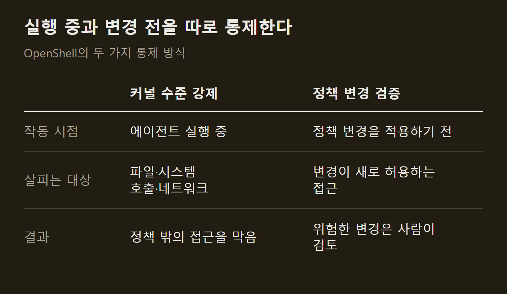
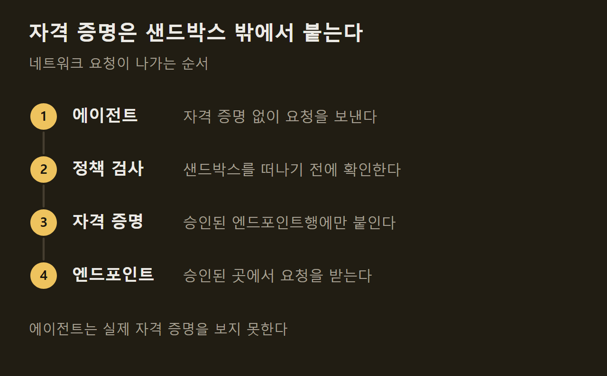
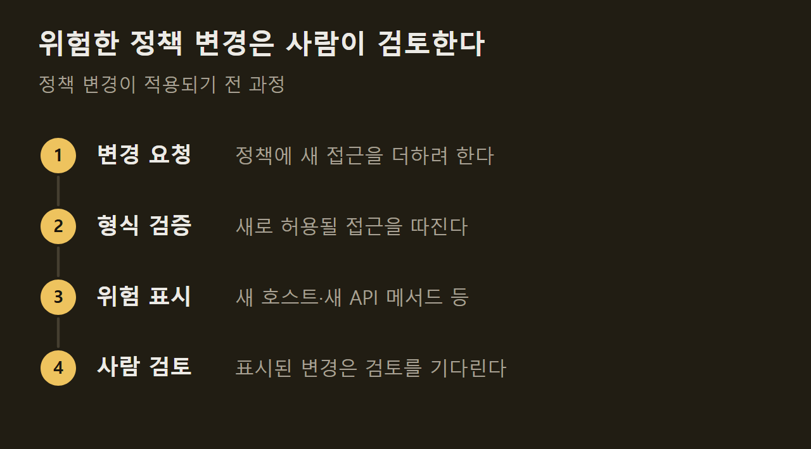

> 이 글은 아래 원문을 우리말로 간추려 정리한 글입니다. 정확한 내용은 원문을 확인하십시오.
>
> 원문: [github.com/NVIDIA/OpenShell](https://github.com/NVIDIA/OpenShell)  
> 원문을 소개한 뉴스레터: TLDR AI

AI 에이전트는 파일을 읽고 패키지를 설치하고 API를 호출하며 자격 증명까지 쓸 수 있을 때 쓸모가 크지만, 그 권한을 그대로 내주면 데이터와 비밀 값, 네트워크가 함께 열린다. NVIDIA가 공개한 [OpenShell](https://github.com/NVIDIA/OpenShell)은 이 문제를 다루는 런타임이다. 에이전트마다 무엇을 건드릴 수 있는지 정책으로 적어 두면, 에이전트를 격리된 샌드박스 안에서 실행하면서 그 정책을 벗어나는 파일 접근과 시스템 호출, 네트워크 연결을 막는다.

```요약
요약: OpenShell은 에이전트를 샌드박스에 가두고 커널 수준에서 정책을 강제하며, 정책을 바꿀 때는 형식 검증으로 위험한 새 권한을 가려내 사람의 검토를 거치게 하는 런타임이다.
```

```용어
샌드박스: 에이전트 하나가 실행되는 격리된 공간. 정책이 허용한 파일과 연결만 바깥으로 통한다.
정책: 에이전트가 접근할 수 있는 파일, 네트워크, 프로세스 규칙을 적은 선언.
자격 증명: API 키나 비밀번호처럼 외부 서비스가 요청자를 확인하는 데 쓰는 비밀 값.
형식 검증: 실제로 실행해 보지 않고, 어떤 규칙이 무엇을 허용하는지 논리적으로 따져 확인하는 방법.
게이트웨이: 샌드박스와 정책, 접근 권한을 관리하는 제어 지점.
```

## 1. 통제하는 두 가지 방식

OpenShell은 에이전트의 행동을 두 시점에서 통제한다. 하나는 실행 중이고, 다른 하나는 정책을 바꾸기 직전이다.

실행 중에는 커널에 계측을 넣어 파일 접근, 시스템 호출, 네트워크 연결마다 정책을 적용한다. 정책을 바꿀 때는 그 변경이 무엇을 새로 허용하는지 적용하기 전에 형식 검증으로 확인한다. ==실행 중의 강제와 변경 전의 검증이 서로 다른 시점을 맡는다.==



## 2. 샌드박스와 자격 증명 처리

에이전트는 저마다 격리된 샌드박스에서 실행된다. 커널 제어가 접근할 수 있는 파일과 쓸 수 있는 시스템 호출을 제한하고, 네트워크 연결은 샌드박스를 떠나기 전에 정책 검사를 통과해야 한다.

자격 증명은 에이전트에게 넘기지 않는다. ==에이전트는 실제 자격 증명을 보지 못한다.== OpenShell이 승인된 엔드포인트로 가는 요청에만 자격 증명을 덧붙이므로, 에이전트가 다른 곳으로 요청을 보내도 비밀 값은 따라가지 않는다.



## 3. 정책 변경의 사전 검증

에이전트가 일하다 보면 처음 정책에 없던 접근이 필요해지고, 그때마다 정책을 고쳐야 한다. OpenShell은 변경을 승인하기 전에 형식 검증을 돌려 그 변경이 새로 허용할 위험한 접근을 표시한다. 저장소가 든 예는 자격 증명을 들고 새 호스트에 닿게 되는 경우와 새 API 메서드를 호출하게 되는 경우다. ==표시된 변경은 사람의 검토를 기다린다.==



## 4. 구성 요소와 연결 수단

OpenShell은 게이트웨이, 슈퍼바이저, 샌드박스로 이루어지고, 셋이 맞물리는 방식은 별도의 아키텍처 문서에 있다. 설치 프로그램은 CLI와 로컬 게이트웨이를 함께 설치한다. 기본 샌드박스 이미지는 에이전트가 들어 있지 않은 최소 Ubuntu이므로, 실제 에이전트를 돌리려면 안내 문서를 따라 따로 올려야 한다.

애플리케이션을 게이트웨이에 연결하는 SDK는 Python, TypeScript, Go, Rust용으로 제공되고, 게이트웨이는 Helm으로 Kubernetes에 배포할 수 있다. 코딩 에이전트가 OpenShell CLI를 다루고 정책을 작성하도록 가르치는 스킬도 함께 공개했다. 설치 명령과 지원 환경은 원문에 정리되어 있다.

저장소는 두 가지 단서를 밝힌다. OpenShell은 운영 범주와 횟수로 한정한 익명 텔레메트리를 수집하는데, 샌드박스 이름이나 파일 경로, 프롬프트, 자격 증명은 수집하지 않으며 설정으로 끌 수 있다. 또 이 소프트웨어는 외부 자료를 자동으로 가져오거나 그것과 상호작용하고, 그 자료의 보안과 적합성을 확인할 책임은 사용자에게 있다.

## 출처와 작성 방식

- 원문: [github.com/NVIDIA/OpenShell](https://github.com/NVIDIA/OpenShell)
- 원문을 소개한 뉴스레터: TLDR AI
- 그래프: 원문에 적힌 값으로 새로 그린 그림입니다. 원문에 실린 그림이 아닙니다.
- 작성 방식: 직접 만든 뉴스 정리 파이프라인(VISER)으로 생성하고 검수한 글입니다. 본문의 수치와 주장은 원문에서 가져온 것입니다.
- 정리 주차: 2026-W40
