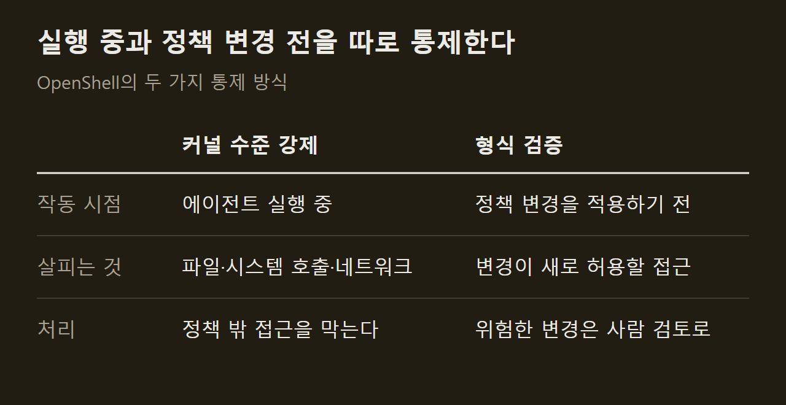
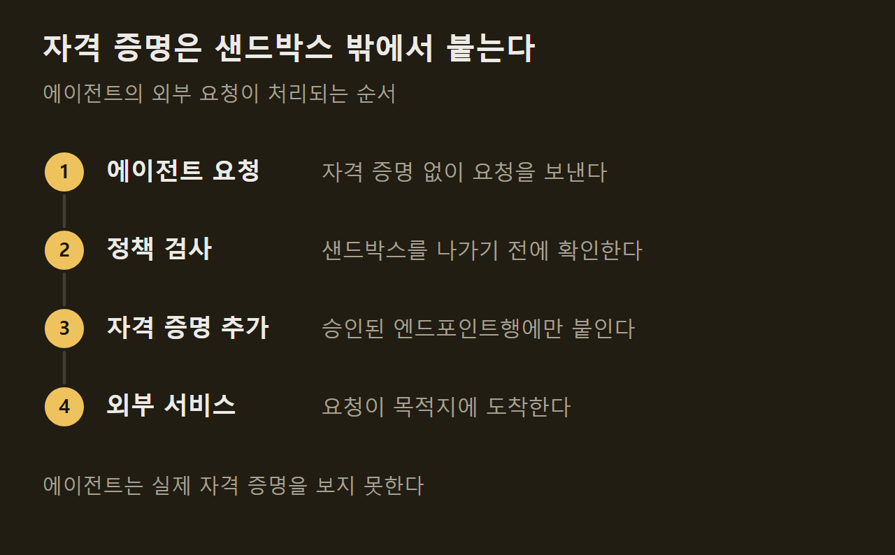

> 이 글은 아래 원문을 우리말로 간추려 정리한 글입니다. 정확한 내용은 원문을 확인하십시오.
>
> 원문: [github.com/NVIDIA/OpenShell](https://github.com/NVIDIA/OpenShell)  
> 원문을 소개한 뉴스레터: TLDR AI

AI 에이전트는 파일을 읽고 패키지를 설치하고 API를 호출하며 자격 증명까지 쓸 수 있을 때 쓸모가 커지지만, 그만큼 데이터와 비밀 값, 네트워크가 에이전트에게 통째로 열린다. NVIDIA가 공개한 [OpenShell](https://github.com/NVIDIA/OpenShell)은 이 권한을 제한한 채로 에이전트 여러 대를 돌리는 실행 환경이다. 에이전트마다 무엇을 건드릴 수 있는지를 정책으로 적어 두면, OpenShell이 에이전트를 격리된 공간에서 실행하면서 그 정책을 벗어나는 파일 접근과 네트워크 연결을 막는다.

```요약
요약: OpenShell은 에이전트를 샌드박스에 가두고 실행 중에는 커널 수준에서 정책을 강제하며, 정책을 바꿀 때는 형식 검증으로 위험한 새 접근을 가려내 사람 검토로 넘기는 런타임이다.
```

```용어
샌드박스: 에이전트 하나가 실행되는 격리된 공간. 바깥의 파일과 네트워크에는 정책이 허용한 만큼만 닿는다.
정책: 에이전트가 접근할 수 있는 파일, 네트워크, 프로세스 규칙을 적은 선언문.
형식 검증: 프로그램이나 규칙이 어떤 동작을 허용하는지를 실행해 보지 않고 논리적으로 따져 확인하는 방법.
자격 증명: API 키나 비밀번호처럼 외부 서비스에 접속할 때 내는 비밀 값.
게이트웨이: 샌드박스, 정책, 접근 권한을 관리하는 OpenShell의 제어부.
```

## 1. 에이전트 권한 문제

에이전트에게 일을 맡기려면 권한을 줘야 한다. 코드를 고치려면 파일을 읽어야 하고, 외부 서비스를 쓰려면 API 키가 필요하다. 문제는 이 권한을 한 번 열어 주면 에이전트가 맡은 일과 상관없는 데이터나 호스트에도 닿을 수 있다는 점이다.

OpenShell은 권한을 주되 범위를 정책으로 못 박는 방식을 택했다. ==사용자는 정책을 선언하고, 강제하는 일은 OpenShell이 맡는다.== 에이전트가 스스로 규칙을 지키기를 기대하지 않고, 에이전트 바깥에서 막는 구조다.

## 2. 두 가지 통제 방식

통제는 실행 중과 정책 변경 전, 두 시점에 이뤄진다. 실행 중에는 커널 제어가 샌드박스 안 에이전트의 파일 접근과 시스템 호출 범위를 제한하고, 네트워크 연결은 샌드박스를 나가기 전에 모두 정책 검사를 거친다.

정책을 바꿀 때는 형식 검증이 먼저 돈다. 변경이 적용되면 무엇이 새로 허용되는지를 따져서, 자격 증명을 들고 새 호스트에 접속하거나 새 API 메서드를 호출하게 되는 것처럼 위험한 접근을 표시한다. ==표시된 변경은 사람이 검토할 때까지 적용되지 않는다.==



## 3. 자격 증명 처리

에이전트는 실제 자격 증명을 보지 못한다. 에이전트가 외부로 요청을 보내면 OpenShell이 목적지를 확인하고, 승인된 엔드포인트로 가는 요청에만 자격 증명을 덧붙인다. 에이전트가 키를 손에 쥐지 않으므로 승인되지 않은 곳으로 키를 실어 보낼 수 없다.



## 4. 구성 요소와 연결 수단

문서가 소개하는 주요 구성 요소는 다음과 같다.

1. 샌드박스: 에이전트가 실행되는 격리 환경으로, 이미지와 런타임, GPU, 수명 주기를 다룬다.
2. 정책: 파일 시스템, 네트워크, 프로세스 규칙이며, 변경을 검토하는 도구가 함께 있다.
3. 프로바이더: 승인된 엔드포인트에서만 통하는 자격 증명으로, 추론 서비스도 여기에 든다.
4. 게이트웨이: 샌드박스와 정책, 접근 권한을 관리하는 제어부다.

설치 프로그램은 CLI와 로컬 게이트웨이를 깔고, 기본 샌드박스 이미지는 에이전트가 들어 있지 않은 최소 Ubuntu다. 애플리케이션을 게이트웨이에 연결하는 SDK는 Python, TypeScript, Go, Rust용으로 제공되며, Kubernetes에는 Helm으로 게이트웨이를 배포할 수 있다. 코딩 에이전트가 OpenShell CLI를 다루고 정책을 작성하도록 가르치는 스킬도 공개되어 있다. 설치 명령과 지원 환경은 원문에 정리되어 있다.

## 5. 텔레메트리와 사용자 책임

OpenShell은 익명 텔레메트리를 수집한다. NVIDIA는 수집 대상이 운영 범주와 횟수에 한정되고 샌드박스 이름, 호스트 이름, 파일 경로, 프롬프트, 자격 증명, 사용자 콘텐츠는 수집하지 않는다고 밝혔다. 설정으로 끌 수 있고 빌드 단계에서 아예 빼는 방법도 있다.

이 소프트웨어는 외부 자료를 자동으로 내려받거나 접근한다. 그 자료의 보안과 무결성, 용도 적합성을 확인할 책임은 사용자에게 있다고 문서는 명시한다.

## 출처와 작성 방식

- 원문: [github.com/NVIDIA/OpenShell](https://github.com/NVIDIA/OpenShell)
- 원문을 소개한 뉴스레터: TLDR AI
- 그래프: 원문에 적힌 값으로 새로 그린 그림입니다. 원문에 실린 그림이 아닙니다.
- 작성 방식: 직접 만든 뉴스 정리 파이프라인(VISER)으로 생성하고 검수한 글입니다. 본문의 수치와 주장은 원문에서 가져온 것입니다.
- 정리 주차: 2026-W40
