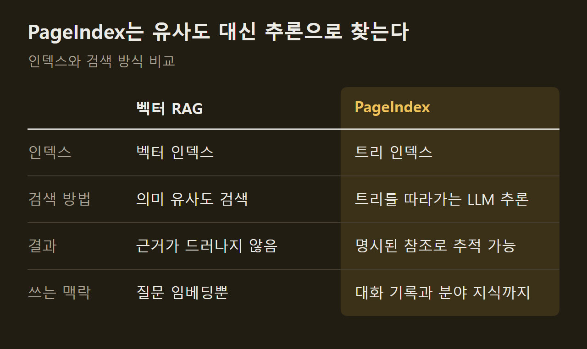
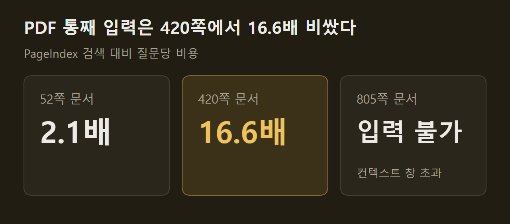
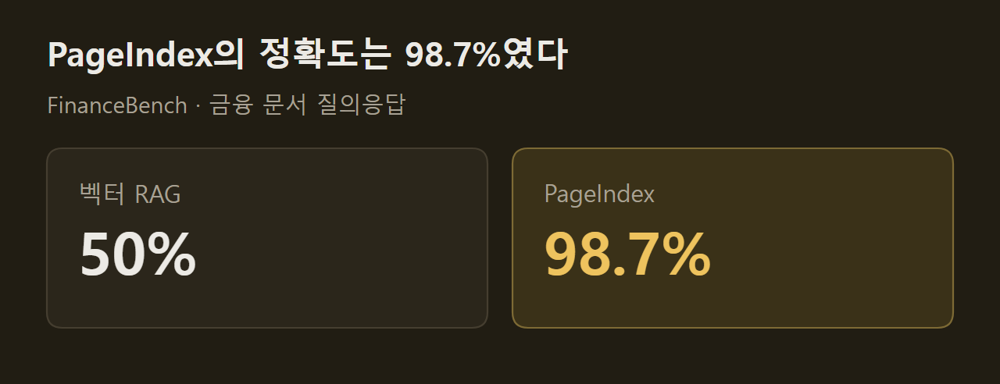
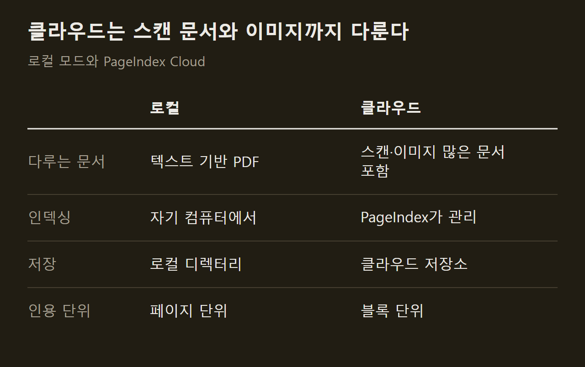

> 이 글은 아래 원문을 우리말로 간추려 정리한 글입니다. 정확한 내용은 원문을 확인하십시오.
>
> 원문: [github.com/VectifyAI/PageIndex](https://github.com/VectifyAI/PageIndex)  
> 원문을 소개한 뉴스레터: AlphaSignal

수백 쪽짜리 재무 보고서에서 질문의 답이 적힌 대목을 찾을 때, 벡터 검색은 질문과 뜻이 비슷한 조각을 가져온다. 그런데 뜻이 비슷한 대목과 답에 필요한 대목은 같지 않아서, 전문 문서일수록 엉뚱한 조각이 올라오거나 필요한 조각이 빠진다. [PageIndex](https://github.com/VectifyAI/PageIndex)는 이 문제를 겨냥해 공개된 오픈소스 도구다. PDF를 넣으면 문서의 목차 구조를 닮은 트리 인덱스를 만들고, 질문이 들어오면 LLM이 그 트리를 따라가며 필요한 부분만 읽고 답한다.

```요약
요약: PageIndex는 벡터 데이터베이스와 청킹 없이 문서별 트리 인덱스를 LLM이 추론으로 탐색하는 RAG 도구이고, 개발팀은 금융 문서 질의응답 벤치마크 FinanceBench에서 정확도 98.7%를 기록했다고 밝혔다.
```

```용어
RAG: 질문과 관련된 문서 내용을 먼저 찾아 온 뒤 그 내용을 LLM에 넘겨 답하게 하는 방식이다.
벡터 검색: 문장을 숫자 배열로 바꿔 두고 질문과 의미가 가까운 조각을 골라내는 검색이다.
청킹: 긴 문서를 검색 단위가 되는 작은 조각으로 자르는 작업이다.
트리 인덱스: 문서를 장, 절, 소절처럼 위아래로 이어진 구조로 정리한 색인이다.
노드: 트리 인덱스를 이루는 칸 하나로, 문서의 한 부분에 해당한다.
```

## 1. 벡터 검색과 다른 점

PageIndex 팀은 검색에 필요한 것이 유사도가 아니라 관련성이고, 관련성을 가리려면 추론이 필요하다고 본다. 맥락 이해와 분야 지식, 여러 단계의 추론이 필요한 전문 문서에서는 유사도 검색이 관련은 있지만 표현이 다른 대목을 놓치기 때문이다.

그래서 검색을 두 단계로 나눴다. 먼저 문서마다 트리 인덱스를 만들고, 질문이 오면 LLM 에이전트가 전문가가 긴 보고서에서 해당 절을 펴 읽듯이 트리를 탐색한다. ==벡터 인덱스를 트리로 바꾸고, 검색을 LLM의 추론에 맡긴다.== 어느 절을 거쳐 답에 이르렀는지가 남으므로 결과의 근거도 짚을 수 있다.



## 2. 인덱스 생성 비용과 시간

트리의 뼈대는 LLM 없이 문서 레이아웃에서 뽑아내고, 인덱스용 모델은 이를 요약하고 다듬는 일만 맡는다. 그래서 인덱스에는 기본급 모델로 충분하고, 개발팀 실험에서는 그렇게 해도 품질이 떨어지지 않았다고 한다. 반면 트리를 탐색하는 모델은 쓸 수 있는 가장 좋은 것을 권한다.

로컬에서 `gpt-5.6-luna`로 인덱스를 만들면 비용은 페이지당 약 0.001달러다. 1,000쪽 교과서라면 1달러 남짓과 몇 분이 한 번 들고, 이후 질문은 모두 그 인덱스를 다시 쓴다. 같은 설정에서 9쪽부터 1,098쪽까지의 벤치마크 문서는 약 13초에서 4.5분 사이에 인덱싱을 마쳤다.

## 3. 질문 한 건의 비용

검색을 쓰지 않는다면 질문할 때마다 PDF 전체를 모델에 넘겨야 하고, 그 비용은 문서 길이에 따라 커진다. PageIndex는 추론이 닿은 노드만 읽으므로 문서가 길어져도 질문당 비용이 따라 늘지 않는다. 두 방법이 같은 답을 낸 문서에서 견주면 PDF를 통째로 넣는 쪽이 52쪽에서 2.1배, 420쪽에서 16.6배 비쌌고, 805쪽 문서는 컨텍스트 창에 들어가지도 않았다. `gpt-5.6-sol` 기준이고 프롬프트 캐싱은 뺀 값이다.



정확도는 별도 벤치마크로 쟀다. 로컬 모드에 OCR 없이, MMLongBench-Doc-V2에서 고른 PDF 34개(1,945쪽)에 조회형 질문 62개를 던지는 구성이다. 모든 답이 본문에 적힌 사실이어서, 틀린 답은 추론이 아니라 검색이나 읽기의 실패로 볼 수 있다. 모델별 결과는 아래 그래프와 벤치마크 저장소에 있다.

## 4. FinanceBench 정확도

개발팀이 내세우는 대표 수치는 금융 문서 질의응답 벤치마크인 FinanceBench 결과다. ==PageIndex는 98.7%를 기록했고, 함께 제시된 벡터 RAG는 50%였다.== 두 값 모두 개발팀이 밝힌 것이고, 평가 조건과 세부 결과는 별도 저장소와 블로그 글에 실려 있다.



## 5. 로컬 모드와 클라우드

오픈소스 버전은 텍스트 위주의 PDF를 자기 컴퓨터에서 처리하는 용도에 맞는다. 스캔본이나 그림이 많은 문서는 PageIndex Cloud가 맡아서, 파싱과 OCR, 이미지 이해, 트리 생성, 저장을 클라우드에서 처리한다. 이때도 트리를 탐색하는 모델은 쓰던 것을 그대로 쓸 수 있고, 전환에는 API 키만 있으면 된다.

수백만 건 규모의 문서는 클라우드 전용인 PageIndex File System이 다룬다. 파일 단위로 트리 인덱스를 한 겹 더 쌓아, 문서 하나가 아니라 문서 전체를 놓고 추론하게 하는 계층이다. 설치 방법과 모델 설정은 원문에 예제 코드로 정리되어 있다.



## 출처와 작성 방식

- 원문: [github.com/VectifyAI/PageIndex](https://github.com/VectifyAI/PageIndex)
- 원문을 소개한 뉴스레터: AlphaSignal
- 그래프: 원문에 적힌 값으로 새로 그린 그림입니다. 원문에 실린 그림이 아닙니다.
- 작성 방식: 직접 만든 뉴스 정리 파이프라인(VISER)으로 생성하고 검수한 글입니다. 본문의 수치와 주장은 원문에서 가져온 것입니다.
- 정리 주차: 2026-W40
