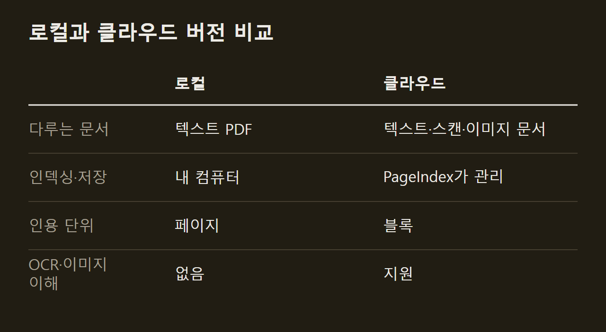

> 이 글은 아래 원문을 우리말로 간추려 정리한 글입니다. 정확한 내용은 원문을 확인하십시오.
>
> 원문: [github.com/VectifyAI/PageIndex](https://github.com/VectifyAI/PageIndex)  
> 원문을 소개한 뉴스레터: AlphaSignal

재무 보고서나 법률 문서처럼 수백 쪽짜리 문서에서 답을 찾을 때, 흔히 쓰는 벡터 RAG는 질문과 비슷한 문장은 가져오지만 정작 필요한 구간을 놓치곤 한다. PageIndex 팀은 벡터 데이터베이스와 청킹 없이 동작하는 검색 엔진 [PageIndex](https://github.com/VectifyAI/PageIndex)를 오픈소스로 공개했다. 문서를 넣으면 PageIndex가 레이아웃에서 계층 구조를 뽑아 트리 인덱스를 만들고, 질문이 들어오면 LLM이 그 트리를 따라 내려가 필요한 구간을 읽고 답한다.

```요약
요약: PageIndex는 문서마다 트리 인덱스를 만들고 LLM이 그 트리를 추론으로 탐색하는 RAG 엔진으로, 금융 문서 벤치마크 FinanceBench에서 정확도 98.7%를 기록했다.
```

```용어
RAG: 답을 만들기 전에 문서에서 관련 부분을 찾아 LLM에 함께 넣는 방식이다.
벡터 RAG: 문서 조각을 수치 벡터로 바꿔 두고 질문과 의미가 비슷한 조각을 찾아 쓰는 방식이다.
청킹: 검색에 쓰려고 문서를 일정 크기의 조각으로 자르는 작업이다.
트리 인덱스: 문서의 장·절 구조를 위아래 단계로 정리한 색인이다. 각 노드는 문서의 한 구간을 가리킨다.
컨텍스트 윈도: 모델이 한 번에 읽을 수 있는 입력의 최대 길이다.
```

## 1. 유사도 검색 대신 쓰는 트리 탐색

벡터 RAG는 의미 유사도로 구간을 찾지만, 비슷한 내용이 곧 질문과 관련 있는 내용은 아니다. 맥락과 전문 지식, 여러 단계의 추론이 필요한 전문 문서에서는 유사도 검색이 관련은 있어도 표현이 다른 구간을 놓치고, 표현만 비슷한 구간을 가져온다. 이 때문에 PageIndex 팀은 관련성을 추론으로 판단해야 한다고 본다.

PageIndex는 AlphaGo에서 착안해 벡터 인덱스 대신 트리 인덱스를 쓴다. 먼저 문서마다 트리를 만들고, 그다음 LLM 에이전트가 추론하며 그 트리를 탐색한다. 다음 그림의 왼쪽은 문서에서 만든 트리이고, 오른쪽의 파란 경로는 LLM이 질문에 맞는 노드를 골라 답에 이르는 과정이다.

")

벡터 RAG가 질문 임베딩만 보는 것과 달리, PageIndex는 대화 기록과 도메인 지식까지 맥락으로 쓴다. 또 답이 어느 구간에서 나왔는지 명시적인 참조로 추적할 수 있다.

## 2. 로컬 인덱싱의 비용과 시간

트리는 문서마다 한 번만 만들고, 이후의 질문은 모두 그 트리를 다시 쓴다. gpt-5.6-luna를 인덱스 모델로 써서 로컬에서 PDF 9개(9~1,098쪽)를 인덱싱했을 때 비용은 페이지당 평균 0.0011달러였다. 팀은 본문에서 이 값을 약 0.001달러로 어림해, 1,000쪽 교과서 한 권이면 1달러 남짓이 든다고 설명한다. 다음 그림은 두 축이 모두 로그 눈금이고, 점선은 페이지당 평균 비용을 나타낸다.

")

인덱스 모델은 기본 모델로 충분하다. 트리 구조는 LLM 없이 레이아웃에서 뽑고, 인덱스 모델은 그 구조를 요약하고 다듬는 일만 맡기 때문이다. 반면 트리를 탐색하는 채팅 모델에는 감당할 수 있는 가장 좋은 모델을 쓰라고 팀은 권한다.

인덱싱 시간도 문서 길이에 따라 예측할 수 있게 늘어났다. 같은 로컬 환경에서 9~1,098쪽 문서의 인덱싱은 약 13초에서 4.5분 사이에 끝났다.

")

## 3. 채팅 모델별 정확도와 질문당 비용

PageIndex-OSS-Benchmark는 MMLongBench-Doc-V2에서 뽑은 PDF 34개(1,945쪽)와 조회 질문 62개로 로컬 모드의 성능을 쟀다. 인덱싱에는 OCR 없이, 텍스트 PDF의 트리를 빠르게 만드는 PageIndex Flash를 썼다. 질문의 답은 모두 본문 문장에 적힌 사실이므로, 오답이 나왔다면 추론이 아니라 검색이나 읽기에서 실패했다는 뜻이다.

다음 그림에서 선 하나는 한 모델의 추론 강도(reasoning effort)를 none에서 high까지 바꾼 결과다. gpt-5.6-luna는 high에서 96.8%, gpt-5.6-terra는 high에서 100%를 기록했고, gpt-5.6-sol은 medium과 high에서 100%였다. 한 모델의 점들이 거의 세로로 늘어서 있어서, 질문당 비용은 추론 강도보다 어떤 모델을 쓰느냐에 따라 크게 달라진다.

")

## 4. PDF 전체 입력과 견준 질문당 비용

질문마다 PDF 전체를 모델에 넣으면 문서가 길수록 비용이 늘지만, PageIndex는 추론이 닿은 노드만 읽으므로 문서가 길어져도 비용이 늘지 않는다. 두 방식의 답이 같았던 문서에서 gpt-5.6-sol로 비교하자, 프롬프트 캐싱을 뺀 PDF 전체 입력 비용은 PageIndex 대비 52쪽에서 2.1배, 420쪽에서 16.6배였다. 805쪽 문서는 컨텍스트 윈도에 아예 들어가지 않았다.

다음 그림의 파란 막대는 PageIndex의 비용을 1로 둔 기준이다. 주황 막대는 페이지당 약 1,650토큰을 쓰는 PDF 전체 입력의 비용이다.

")

## 5. FinanceBench 결과와 클라우드 버전

PageIndex는 금융 문서 질의응답 벤치마크인 FinanceBench에서 정확도 98.7%를 기록했다. SEC 제출 서류와 실적 공시를 다루는 이 벤치마크에서 벡터 RAG의 정확도는 50%였다.

")

오픈소스 버전은 텍스트 위주의 PDF를 로컬에서 다루는 데 맞춰져 있다. 반면 PageIndex Cloud는 파싱, OCR, 이미지 이해, 인덱스 구성과 저장을 직접 맡아서 스캔 문서와 이미지가 많은 문서도 처리한다. 검색에는 사용자가 쓰던 모델을 그대로 쓸 수 있고, 로컬에서 옮길 때는 PageIndex API 키만 있으면 된다.



클라우드에서만 쓸 수 있는 PageIndex File System은 파일 단위의 트리 인덱싱 층으로, 문서 한 편이 아니라 코퍼스 전체를 대상으로 추론할 수 있게 한다.

PageIndex는 벡터 검색 대신 LLM이 문서 트리를 추론으로 탐색하게 하고, 이 방식으로 FinanceBench에서 98.7%를 기록했다. 인덱스는 문서마다 한 번, 적은 비용으로 만든다. 질문당 비용은 PDF 전체를 넣는 방식과 달리 문서가 길어져도 늘지 않는다.

## 출처와 작성 방식

- 원문: [github.com/VectifyAI/PageIndex](https://github.com/VectifyAI/PageIndex)
- 원문을 소개한 뉴스레터: AlphaSignal
- 그림: 아래에 출처가 적힌 그림은 원문에 실린 그림을 인용한 것이며 저작권은 원저작자에게 있습니다. 출처가 없는 그래프는 원문에 적힌 값으로 직접 그린 것입니다.
- 작성 방식: 직접 만든 뉴스 정리 파이프라인(VISER)으로 생성하고 검수한 글입니다. 본문의 수치와 주장은 원문에서 가져온 것입니다.
- 정리 주차: 2026-W40
