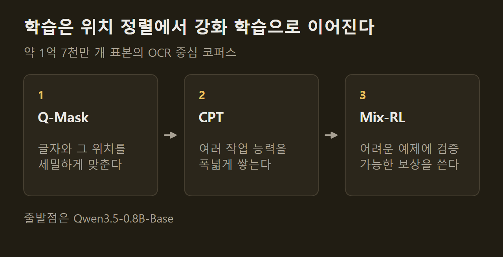
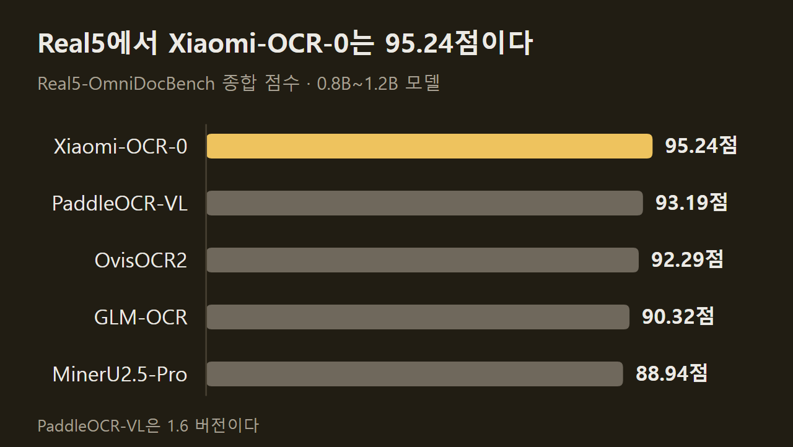
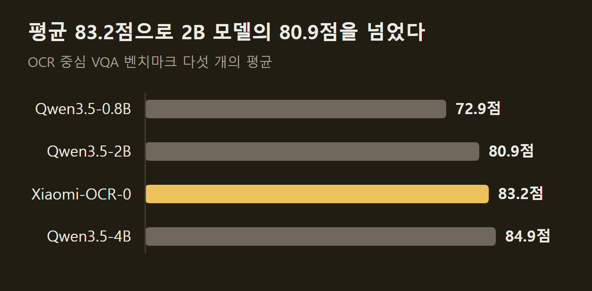
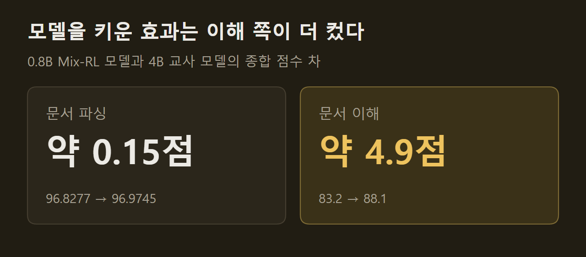

> 이 글은 아래 원문을 우리말로 간추려 정리한 글입니다. 정확한 내용은 원문을 확인하십시오.
>
> 원문: [huggingface.co/SeerRay-Lab/Xiaomi-OCR-0](https://huggingface.co/SeerRay-Lab/Xiaomi-OCR-0)  
> 원문을 소개한 뉴스레터: The Living Edge

논문 한 쪽을 찍은 사진에는 본문과 수식, 표가 섞여 있고, 영수증 사진에는 날짜와 금액이 제각각의 자리에 흩어져 있다. 이런 이미지를 컴퓨터가 다루려면 글자를 읽어 내는 일과 읽은 내용을 바탕으로 질문에 답하는 일이 모두 필요한데, 지금까지는 두 일을 서로 다른 모델에 맡기는 경우가 많았다. SeerRay-Lab이 허깅페이스에 공개한 [Xiaomi-OCR-0](https://huggingface.co/SeerRay-Lab/Xiaomi-OCR-0)는 문서 이미지 한 장과 지시문을 넣으면 그 문서를 마크다운으로 옮겨 주거나, 문서 내용을 묻는 질문에 답하거나, 지정한 항목만 뽑아 JSON으로 돌려주는 모델이다. 파라미터는 0.8B개이고, 기술 보고서와 모델 가중치는 2026년 9월 30일에 함께 나왔다.

```요약
요약: Xiaomi-OCR-0는 문서 파싱과 문서 이해를 한 모델로 처리하는 0.8B 시각-언어 모델로, 제작진이 밝힌 점수는 Real5-OmniDocBench 95.24점이지만 이해 작업에서는 4B 모델과의 차이가 파싱보다 크게 남았다.
```

```용어
문서 파싱: 문서 이미지를 읽는 순서대로 글, 표, 수식으로 옮겨 적는 작업이다. 이 모델은 본문을 마크다운으로, 표를 OTSL 형식으로, 수식을 LaTeX로 내놓는다.
시각 질의응답: 이미지를 보고 질문에 답하는 작업이다. 이 기사에서는 문서, 인포그래픽, 차트처럼 글자를 읽어야 답할 수 있는 이미지를 다루며 VQA로 줄여 쓴다.
핵심 정보 추출: 영수증 같은 이미지에서 날짜, 판매자, 합계처럼 미리 정한 항목의 값만 뽑아내는 작업이다.
지속 사전 학습: 이미 학습된 모델을 특정 분야 데이터로 더 학습시키는 단계다. 여기서는 OCR 중심 데이터로 여러 작업 능력을 넓히는 단계를 가리키며 CPT로 줄여 쓴다.
MOPD: 제작진이 Mix-RL과 견준 학습 방식으로, 파싱 교사 모델 하나와 이해 교사 모델 하나를 둔다고만 설명되어 있다.
```

## 1. 모델이 처리하는 작업

Xiaomi-OCR-0가 어떤 일을 할지는 지시문으로 정해진다. 원문에는 작업별 지시문이 표로 정리되어 있고, 그 내용은 다음 다섯 가지다.

1. 문서 전체: 머리말과 꼬리말을 뺀 본문을 읽는 순서대로 마크다운으로 옮긴다.
2. 글자 영역: 이미지 속 글자를 일반 텍스트로 뽑는다.
3. 표 영역: 표를 OTSL 형식으로 옮긴다.
4. 수식 영역: 수식을 LaTeX로 옮긴다.
5. 핵심 정보 추출: 사용자가 준 JSON 틀에 맞춰 값을 채워 돌려준다.

원문이 보여 주는 예시는 네 가지다. 수식이 빽빽한 논문 한 쪽과 손으로 쓴 프리드만 방정식 유도 과정은 번호가 붙은 수식까지 LaTeX로 옮겨졌고, 행서로 쓴 천자문은 한자 그대로 읽혔다. 영수증 사진에는 날짜, 판매자 주소, 판매자 이름, 합계, 세액 등 여섯 항목을 담은 틀을 함께 주었는데, 모델은 날짜 "2017-10-18", 합계 "5.90", 세액 "0.33"처럼 각 칸을 채운 JSON을 돌려주었다.

==글자를 옮겨 적는 일과 내용을 묻는 질문에 답하는 일을 한 모델이 맡는다.== 제작진은 표준 문서뿐 아니라 스캔본, 휘어진 문서, 사진으로 찍거나 기울어진 문서에서도 파싱이 안정적이라고 밝혔다.

## 2. 학습 과정

출발점은 Qwen3.5-0.8B-Base이고, 여기에 약 1억 7천만 개 표본으로 이루어진 OCR 중심 코퍼스를 학습시켰다. 학습은 단계를 밟아 가는 방식이며, 제작진은 각 단계의 목적을 다르게 두었다.



Q-Mask 텍스트 앵커링은 세밀한 글자와 그 글자가 놓인 위치를 맞추는 단계다. 이어지는 CPT에서는 여러 작업을 두루 익히고, 마지막 혼합 작업 강화 학습인 Mix-RL에서는 어려운 예제를 골라 정답 여부를 검증할 수 있는 보상으로 학습한다. 각 단계의 세부 설정은 모델 카드에 없고 기술 보고서로 안내되어 있다.

## 3. 학습 데이터를 만든 방법

1억 7천만 개 규모의 데이터에 사람이 일일이 정답을 달 수는 없으므로, 제작진은 기존 OCR 모델 여러 개를 전문가 삼아 정답을 만들고 걸러 내는 체계를 꾸렸다. 글, 표, 수식의 정답을 공급하는 구성 요소는 세 가지다.

1. 삼중 합의: 서로 다른 전문가 모델들이 후보 정답을 내면 전체 모델 간 일치도로 순위를 매기고, 세 모델이 합의한 것을 고르며, 불확실한 표본은 다음 단계로 넘긴다.
2. 렌더링 기반 수정과 판정: 전문가들의 답이 엇갈리면 후보 정답을 다시 이미지로 그려 원본 영역과 견준다. 표와 수식의 구조 오류를 학습 전에 잡아내려는 절차다.
3. 표본 선별과 합성: 전문가 일치도, 모델의 자기 일관성, 의미 군집, 확인된 실패 유형을 함께 따져 학습 표본을 고르고 부족한 부분은 합성 데이터로 채운다.

전문가 모델로는 PaddleOCR-VL-1.6, MinerU2.5-Pro, GLM-OCR, TeleOCR, OvisOCR2 등 여덟 개가 쓰였다. 합성 데이터는 두 방향으로 만들어진다. 하나는 구조, 서체, 글자 모양, 분야 가운데 데이터가 모자란 곳을 메우는 합성이고, 다른 하나는 학습 중 되풀이되는 오류를 겨냥한 합성이다.

## 4. 벤치마크 점수

문서 파싱에서 제작진이 앞세운 결과는 Real5-OmniDocBench 종합 점수 95.24점이며, 이 벤치마크에서 1위라고 밝혔다. 원문 비교표에는 크기가 비슷한 모델 다섯 개가 함께 실려 있는데, 그중 TeleOCR은 이 항목의 점수가 보고되지 않았다.



다른 두 벤치마크에서는 2위다. OmniDocBench v1.6에서 96.83점, Wild-OmniDocBench에서 87.94점을 받았고, 두 항목 모두 1.2B 크기의 TeleOCR이 96.87점과 88.53점으로 조금 높다. 비교표의 굵은 글씨는 Xiaomi-OCR-0를 표시할 뿐 그 열의 최고값을 뜻하지 않는다고 제작진이 따로 적어 두었다. 이 밖에 수식 인식 벤치마크 UniMER-Test에서 97.84점, 표 인식 벤치마크 PubTabNet에서 92.27점을 기록했으며, 옛 손글씨와 서예를 다루는 Chronicles-OCR의 예서·초서·행서·해서 부문에서는 73점으로 Seed 2.0 Pro의 72점과 비슷했다.

문서 이해 쪽은 DocVQA, InfoVQA, ChartQA, OCRBench, TextVQA 다섯 벤치마크의 산술 평균으로 견주었다.



==같은 0.8B인 Qwen3.5-0.8B의 72.9점보다 10.3점 높은 83.2점이다.== 크기가 2.5배인 Qwen3.5-2B의 80.9점도 넘었지만 Qwen3.5-4B의 84.9점에는 못 미친다. 8B 크기의 MiniCPM-V-4.5는 평균 82.6점으로 Xiaomi-OCR-0보다 낮았으나, ChartQA, OCRBench, TextVQA 세 항목에서는 더 높은 점수를 받았다.

## 5. 학습 중에 확인한 세 가지

제작진은 이해 데이터가 파싱 점수에 미치는 영향과 Mix-RL의 효과를 따로 실험해 세 가지 결과를 공개했다.

첫 번째는 이해 데이터를 섞는 시점이다. 전체 파싱 데이터의 9%만 쓴 초기 단계에서는 이해 데이터를 더하자 파싱 점수가 0.330 내려갔지만, 29%를 쓴 중간 단계에서는 0.639 올랐고 50%를 쓴 후기 단계에서도 0.0749 올랐다. 각 변화량은 해당 단계의 파싱 기준 점수와 견준 값이다. 파싱 능력이 충분히 올라온 뒤에야 이해 데이터가 파싱에 도움이 된다는 것이 제작진의 해석이다.

두 번째는 모델 크기의 효과다. 제작진은 4B 모델과 0.8B 모델에 같은 CPT 과정을 거치게 한 뒤, 4B 모델은 파싱 전용과 이해 전용 교사 모델로 각각 만들고 0.8B 모델은 두 작업을 함께 학습시켰다. 작업별로 교사와 학생이 쓴 데이터 양은 같다.



==0.8B와 4B의 차이는 파싱에서 약 0.15점, 이해에서 약 4.9점이다.== 제작진은 이를 근거로 이해 작업이 파싱보다 파라미터를 더 많이 필요로 하고 더 어렵다고 판단했다.

세 번째는 MOPD와 Mix-RL의 비교다. MOPD는 빨리 수렴하지만 더 오래 학습한 Mix-RL이 더 높은 점수에 이른다고 제작진은 설명한다. 표에 실린 0.8B 모델의 값으로 보면 OmniDocBench v1.6 종합 점수는 CPT만 거친 모델 96.4739, MOPD 96.7417, Mix-RL 96.8277 순이고, VQA 평균은 78.1, 82.7, 83.2 순이다. 수렴 과정의 자세한 분석은 기술 보고서에 있다.

## 6. 공개 범위와 커뮤니티 변환본

모델 카드에는 Transformers로 문서 한 장을 통째로 파싱하는 예제 코드와 검증된 패키지 버전 조합이 실려 있고, 일괄 처리, 레이아웃을 먼저 나눈 뒤 영역별로 인식하는 2단계 파싱, 평가 코드는 GitHub 저장소에 따로 있다.

공개 뒤에는 커뮤니티가 GGUF 양자화본과 NInfer용 패키지를 만들어 올렸고, 2026년 10월 8일 자 공지에 그 목록이 정리되어 있다. 다만 제작진은 이 변환본들을 직접 평가하지 않았으며, 원본 모델의 벤치마크 점수가 변환본의 정확도를 보장하지 않는다고 적었다. Ollama로 내려받아 쓰는 방법은 실험 단계로 분류되어 있는데, 모델만 내려받아서는 이미지 전처리와 프롬프트, 디코딩 설정이 맞춰지지 않으므로 저장소의 MCP 서비스나 브라우저 데모를 거쳐야 제작진이 확인한 설정이 적용된다.

## 출처와 작성 방식

- 원문: [huggingface.co/SeerRay-Lab/Xiaomi-OCR-0](https://huggingface.co/SeerRay-Lab/Xiaomi-OCR-0)
- 원문을 소개한 뉴스레터: The Living Edge
- 그래프: 원문에 적힌 값으로 새로 그린 그림입니다. 원문에 실린 그림이 아닙니다.
- 작성 방식: 직접 만든 뉴스 정리 파이프라인(VISER)으로 생성하고 검수한 글입니다. 본문의 수치와 주장은 원문에서 가져온 것입니다.
- 정리 주차: 2026-W40
