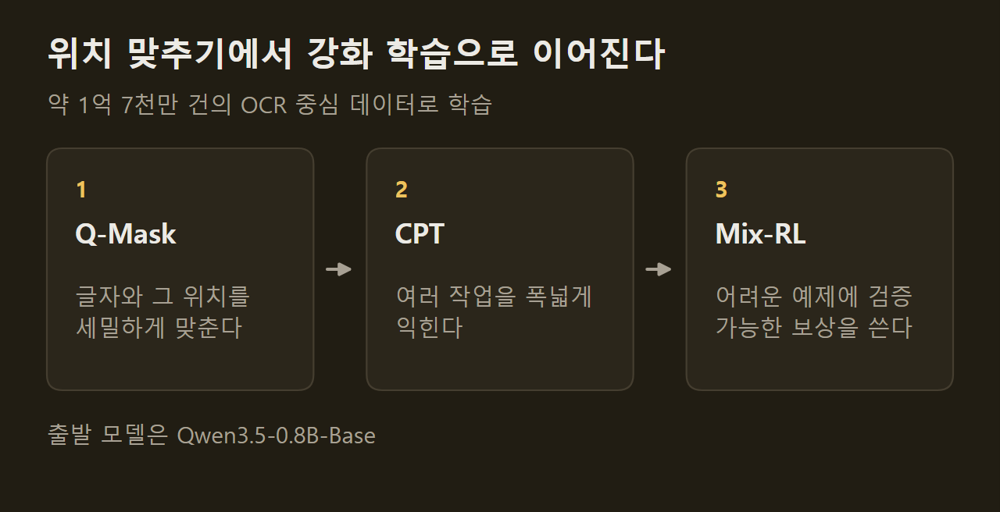
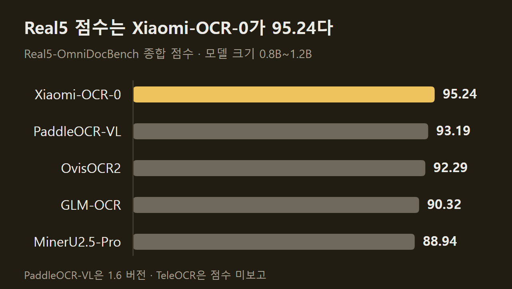
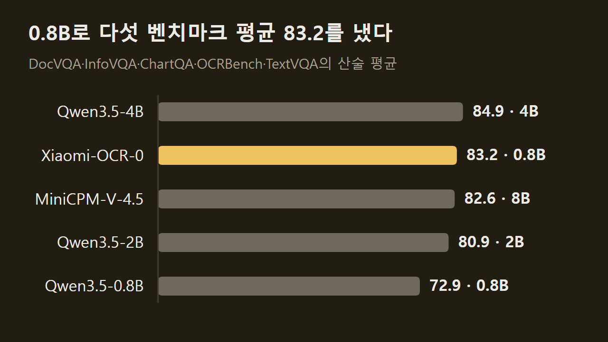
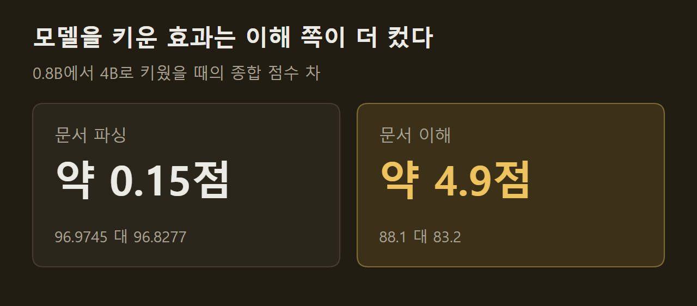

> 이 글은 아래 원문을 우리말로 간추려 정리한 글입니다. 정확한 내용은 원문을 확인하십시오.
>
> 원문: [huggingface.co/SeerRay-Lab/Xiaomi-OCR-0](https://huggingface.co/SeerRay-Lab/Xiaomi-OCR-0)  
> 원문을 소개한 뉴스레터: The Living Edge

스캔한 논문, 손으로 쓴 수식 풀이, 구겨진 영수증 사진은 사람 눈에는 읽히지만 프로그램이 다루려면 글자와 표, 수식을 구조가 있는 텍스트로 옮겨야 한다. 지금까지는 문서를 옮겨 적는 모델과 문서 내용을 묻고 답하는 모델을 따로 쓰는 경우가 많았다. SeerRay-Lab이 공개한 [Xiaomi-OCR-0](https://huggingface.co/SeerRay-Lab/Xiaomi-OCR-0)는 문서 이미지 한 장과 지시문을 넣으면 그 문서를 마크다운으로 옮겨 주고, 문서 내용에 관한 질문에 답하거나 지정한 항목만 JSON으로 뽑아 주는 모델이다. 파라미터는 0.8B이고, 2026년 9월 30일에 기술 보고서와 모델 가중치가 함께 나왔다.

```요약
요약: Qwen3.5-0.8B-Base에서 출발해 약 1억 7천만 건의 OCR 중심 데이터로 학습한 0.8B 모델로, 저자 측 평가에서 Real5-OmniDocBench 95.24점을 기록했지만 문서 이해 작업은 4B 모델과 약 4.9점 차이가 남았다.
```

```용어
문서 파싱: 문서 이미지의 글자, 표, 수식을 읽는 순서대로 구조가 있는 텍스트로 옮기는 작업이다.
문서 이해: 옮겨 적는 데서 그치지 않고 문서 내용에 관한 질문에 답하거나 필요한 항목만 뽑아내는 작업이다. 기사에서는 OCR 중심 이해라고 부른다.
핵심 정보 추출: 사용자가 준 JSON 틀에 맞춰 날짜, 금액 같은 항목을 문서에서 찾아 채우는 작업이다. 줄여서 KIE라고 쓴다.
CPT: OCR 중심 데이터로 사전 학습을 이어 가며 여러 작업을 폭넓게 익히게 하는 단계다.
MOPD: 파싱 교사 모델 하나와 이해 교사 모델 하나를 두고 작은 모델을 가르치는 방식으로, 기사에서 Mix-RL과 비교한 대상이다.
```

## 1. 모델이 하는 일

Xiaomi-OCR-0는 지시문에 따라 하는 일이 달라진다. 같은 이미지를 넣어도 어떤 프롬프트를 붙이느냐에 따라 출력 형식이 바뀌며, 원문은 다섯 가지 작업과 각각의 프롬프트를 표로 정리해 두었다.

1. 문서 전체: 머리말과 꼬리말을 뺀 본문을 읽는 순서대로 마크다운으로 옮긴다. 표는 OTSL 형식, 수식은 LaTeX로 적는다.
2. 글자 영역: 이미지 속 글자를 일반 텍스트로 뽑는다.
3. 표 영역: 표 하나를 OTSL 형식으로 옮긴다.
4. 수식 영역: 수식 하나를 LaTeX로 옮긴다.
5. 핵심 정보 추출: 프롬프트 뒤에 붙인 JSON 틀을 채워 JSON 객체로 돌려준다.

원문에는 실제 입출력 예가 네 가지 실려 있다. 수식이 빽빽한 논문 한 쪽과 손으로 쓴 프리드만 방정식 유도 과정을 LaTeX로 옮긴 결과가 있고, 행서로 쓴 천자문을 한자로 옮긴 결과도 있다. 영수증 사진에서는 날짜, 판매자 이름과 주소, 총액, 세액을 요청한 틀 그대로 채워 냈다.

==문서 파싱과 문서 이해를 0.8B 모델 하나가 함께 맡는다.== 저자들은 표준 문서뿐 아니라 스캔본, 휘어진 문서, 사진으로 찍은 문서, 기울어진 문서에서도 파싱이 안정적이라고 밝혔다.

## 2. 학습 순서와 데이터 엔진

출발점은 Qwen3.5-0.8B-Base다. 여기에 약 1억 7천만 건 규모의 OCR 중심 데이터를 쓰되, 한 번에 학습하지 않고 쉬운 정렬 작업부터 어려운 예제 보강까지 단계를 나눠 진행했다.



학습 데이터의 정답을 만드는 과정도 따로 설계했다. 문서 파싱용 정답은 사람이 일일이 달지 않고 기존 OCR 모델 여러 개를 전문가로 세워 만들었는데, 기술 보고서의 전문가 목록에는 PaddleOCR-VL-1.6, MinerU2.5-Pro, GLM-OCR, TeleOCR, OvisOCR2 등 여덟 개 모델이 올라 있다. 이 데이터 엔진은 세 부분으로 이루어진다.

1. 전문가 합의: 여러 모델이 낸 후보 정답을 전체 일치도로 순위 매기고, 세 전문가가 합의한 것을 고르며, 불확실한 샘플은 다음 단계로 넘긴다.
2. 렌더링 검증: 전문가끼리 답이 엇갈리면 후보 정답을 다시 이미지로 그려 원본 영역과 비교한다. 표와 수식의 구조 오류를 학습에 넣기 전에 잡아내려는 절차다.
3. 샘플 선별과 합성: 전문가 일치도, 모델의 자기 일관성, 의미 군집, 확인된 실패 유형을 함께 보고 샘플을 고른다. 부족한 구조·서체·분야를 채우는 합성과 학습 중 되풀이되는 오류를 겨냥한 합성을 병행한다.

## 3. 문서 파싱 성적

저자들이 내세운 대표 성적은 Real5-OmniDocBench 95.24점이다. 저자들은 이 벤치마크에서 1위에 올랐다고 밝혔고, 비교표에 실린 비슷한 크기의 모델 가운데 그다음으로 높은 PaddleOCR-VL-1.6이 93.19점이다.



나머지 두 벤치마크에서는 2위다. OmniDocBench v1.6에서 96.83점, Wild-OmniDocBench에서 87.94점을 받았고, 두 곳 모두 1.2B 크기의 TeleOCR이 각각 96.87점과 88.53점으로 앞섰다. TeleOCR의 Real5 점수는 비교표에 실려 있지 않다.

세부 작업 점수도 함께 공개됐다. 수식 인식을 재는 UniMER-Test에서 97.84점, 표 인식을 재는 PubTabNet에서 92.27점이다. 옛 필사본과 서예를 다루는 Chronicles-OCR의 예서·초서·행서·해서 부문에서는 73점으로, 저자들은 Seed 2.0 Pro의 72점과 비슷한 수준이라고 적었다.

## 4. 문서 이해 성적

문서 내용을 묻고 답하는 능력은 DocVQA, InfoVQA, ChartQA, OCRBench, TextVQA 다섯 벤치마크의 산술 평균으로 견주었다. Xiaomi-OCR-0의 평균은 83.2이고, 같은 크기의 Qwen3.5-0.8B는 72.9다. 파라미터가 두 배 반인 Qwen3.5-2B의 80.9와 8B인 MiniCPM-V-4.5의 82.6보다 높지만, 4B인 Qwen3.5-4B의 84.9에는 미치지 못했다.



항목별로 보면 고르지는 않다. DocVQA는 93.1, ChartQA는 84.6으로 높지만, OCRBench에서는 84.6으로 Qwen3.5-2B의 85.9보다 낮고 MiniCPM-V-4.5는 ChartQA, OCRBench, TextVQA 세 곳에서 더 높은 점수를 받았다.

## 5. 학습 과정에서 확인한 세 가지

저자들은 학습 도중 얻은 관찰 세 가지를 따로 적었다. 첫째는 이해용 데이터를 섞는 시점이다. 파싱 데이터의 9%만 쓴 초기 단계에서는 이해 데이터를 더하자 파싱 점수가 0.330 내려갔지만, 29%를 쓴 중간 단계에서는 0.639 올랐고 50%를 쓴 후기 단계에서도 0.0749 올랐다. 세 값은 각 단계의 파싱 기준 점수와 비교한 것이다. ==파싱 실력이 이미 충분할 때 이해 데이터가 파싱에도 도움이 된다.==

둘째는 모델 크기의 효과다. 4B 모델과 0.8B 모델에 같은 CPT 과정을 거치게 한 뒤 비교했더니, 크기를 키워 얻는 이득이 파싱에서는 약 0.15점에 그쳤고 이해에서는 약 4.9점이었다. 저자들은 이를 근거로 이해 작업이 파싱보다 어렵고 더 많은 파라미터를 요구한다고 해석했다. 다만 4B 교사는 한 분야만 전담하고 0.8B 모델은 두 분야를 모두 학습했다는 차이가 있으며, 작업별 데이터 양은 양쪽이 같다.



셋째는 MOPD와 Mix-RL의 차이다. MOPD는 빨리 수렴하고, Mix-RL은 더 오래 학습해야 하지만 더 높은 점수에 도달했다. 같은 0.8B 모델로 OmniDocBench v1.6 종합 점수가 MOPD 96.7417, Mix-RL 96.8277이었고, 다섯 질의응답 벤치마크 평균은 82.7과 83.2였다. CPT만 마친 모델은 각각 96.4739와 78.1이다.

## 6. 공개 이후의 변환본

가중치가 공개된 뒤 커뮤니티에서 GGUF 양자화본 두 종과 NInfer용 BF16 변환본이 나왔고, 저자들은 10월 8일 공지에서 이를 소개했다. 다만 저자들은 이 변환본들을 직접 평가하지 않았으며, 원본 모델의 벤치마크 점수가 변환본의 정확도를 보증하지는 않는다고 밝혔다.

Ollama로 쓰는 경로는 실험 단계로 표시되어 있고 패키지 크기는 약 1.8GB다. 모델만 내려받아서는 이미지 전처리와 프롬프트, 디코딩 설정이 적용되지 않으므로, 저자들은 이 설정을 자동으로 맞춰 주는 MCP 서비스나 브라우저 데모를 함께 쓰도록 안내한다. 설치 명령과 버전 조합, 일괄 처리와 2단계 파싱 코드는 원문과 GitHub 저장소에 정리되어 있다.

## 출처와 작성 방식

- 원문: [huggingface.co/SeerRay-Lab/Xiaomi-OCR-0](https://huggingface.co/SeerRay-Lab/Xiaomi-OCR-0)
- 원문을 소개한 뉴스레터: The Living Edge
- 그래프: 원문에 적힌 값으로 새로 그린 그림입니다. 원문에 실린 그림이 아닙니다.
- 작성 방식: 직접 만든 뉴스 정리 파이프라인(VISER)으로 생성하고 검수한 글입니다. 본문의 수치와 주장은 원문에서 가져온 것입니다.
- 정리 주차: 2026-W40
