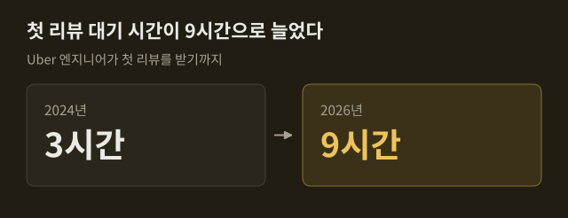
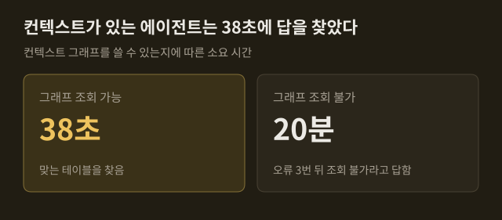
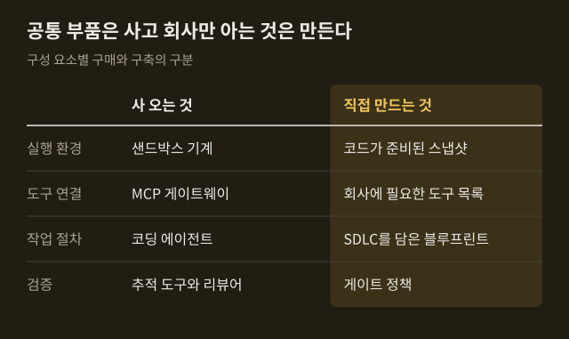
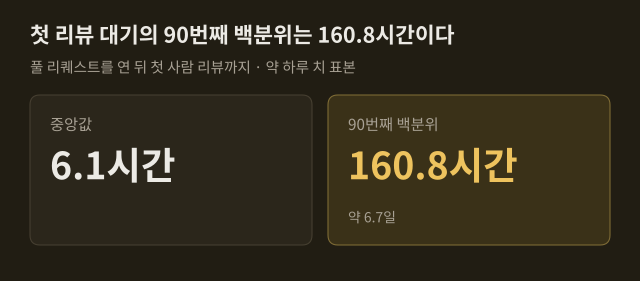

> 이 글은 아래 원문을 우리말로 간추려 정리한 글입니다. 정확한 내용은 원문을 확인하십시오.
>
> 원문: [theaithinker.com/p/how-to-build-an-ai-native-software](https://www.theaithinker.com/p/how-to-build-an-ai-native-software)  
> 원문을 소개한 뉴스레터: TLDR AI

팀원 모두가 Claude Code나 Cursor를 쓰고 몇 명은 에이전트 세 개를 동시에 돌리는 회사에서도, 경영진이 Uber의 발표를 보고 "우리 것은 어디 있느냐"고 물으면 답하기 어렵다. 도구는 이미 샀는데 무엇을 더 만들어야 하는지가 분명하지 않기 때문이다. The AI Thinker는 Uber가 올해 공개한 글과 발표를 중심으로 70개가 넘는 공개 자료를 모아, 에이전트 수백 개를 운영하는 체계인 [소프트웨어 팩토리](https://www.theaithinker.com/p/how-to-build-an-ai-native-software)가 무엇으로 이루어지고 어떤 순서로 들여놓는지를 정리했다.

```요약
요약: 소프트웨어 팩토리는 코딩 에이전트를 새로 만드는 일이 아니라 사 온 에이전트가 돌아갈 실행 환경·도구·규칙·측정 체계를 회사 차원에서 갖추는 일이며, Uber는 이를 여섯 가지 구성 요소로 만들었지만 공개 사례가 모두 플랫폼 팀을 둔 대형 기술 기업이라는 한계가 있다.
```

```용어
소프트웨어 팩토리: 아이디어에서 운영 배포까지, 에이전트를 둘러싸고 회사가 갖추는 실행 환경·규칙·측정 체계 전체를 가리킨다.
토일: 운영 중인 서비스에 딸린 수작업으로, 반복되고 자동화할 수 있으며 서비스가 커질수록 그만큼 늘어나는 일이다. 마이그레이션과 플래그 정리가 여기에 든다.
모델 게이트웨이: 어느 회사 모델이든 모든 모델 호출이 거쳐 가는 하나의 관문이다. 누가 어느 프로젝트에서 얼마를 썼는지가 여기서 기록된다.
샌드박스: 에이전트가 작업하는 격리된 기계다. Uber에서는 DevPod이라고 부른다.
MCP: 에이전트에 도구를 연결하는 공개 표준이다. 사내 API를 에이전트가 쓸 수 있는 도구로 바꿀 때 쓴다.
```

## 1. 코딩 도구가 풀지 못하는 네 가지 한계

코딩 도구는 개발자 한 사람이 자기 노트북의 세션 안에서 더 빨리 일하게 해 준다. 회사가 에이전트를 수십, 수백 개 돌리면 사정이 달라져서, 도구 하나로는 풀 수 없는 한계 네 가지가 나타나고 그중 어느 것도 모델 성능과는 관계가 없다.

1. 실행 위치: Uber에서는 코드 리뷰, CI 수정, 온콜 대응, 유지보수처럼 사람 없이 시작되는 세션이 늘고 있는데, 노트북은 주인이 자면 같이 꺼진다.
2. 제각각인 설정: 개발자 백 명에게 에이전트를 주면 설정도 백 가지가 되고, Uber에서도 여러 저장소에 스킬이 중복으로 쌓였으며 품질이 낮은 것이 많았다.
3. 보이지 않는 비용: 개발자마다 도구와 모델을 고르면 청구서가 오기 전에는 총액을 아무도 모른다.
4. 리뷰 적체: 앞의 세 가지가 풀려 산출물이 늘면 같은 수의 리뷰어에게 더 많은 코드가 몰린다.

노트북의 한계는 다른 회사에서도 확인된다. DoorDash는 노트북에 SSH 키와 VPN 세션, 인증된 도구가 들어 있어서 자율 에이전트에 그 권한을 넘기면 피해 범위가 커진다고 보았고, Ramp는 노트북에서 세션을 두어 개밖에 돌리지 못했다. Uber는 노트북에서 관리형 에이전트로 옮겨 간 것을 핵심 전략 전환이라고 부른다.

비용 문제는 수치로 드러났다. Uber의 AI 비용은 3월 기준으로 2024년보다 6배 늘었고, 6월에는 1년 치 AI 예산을 넉 달 만에 다 썼다. Sonnet으로 충분한 단순 작업을 Opus로 돌리는 세션 같은 낭비는 노트북 한 대에서는 보이지 않지만 게이트웨이에서는 전부 보인다. 글쓴이가 강조하는 목표는 청구액을 줄이는 것보다 먼저 비용을 보이게 하는 것이다. 좌석당 라이선스 가격만 알아서는 병합된 변경 하나에 얼마가 들었는지 알 수 없기 때문이다.

네 번째 한계는 Uber 리뷰 팀이 8월 AI Engineer 발표에서 직접 밝혔다. ==산출물이 늘어도 모든 변경이 사람을 기다리면 속도는 오르지 않는다.== Spotify는 AI를 도입한 뒤 리뷰할 풀 리퀘스트가 76% 늘었고, Faros AI는 개발자 22,000명을 조사해 리뷰에 쓰는 시간의 중앙값이 441.5% 늘었다고 집계했다. Uber는 리뷰 다음으로 막힐 곳으로 CI 용량, 실험 슬롯, 무엇을 만들지 정하는 일을 꼽는다.



## 2. Uber가 그린 에이전트의 네 층

Uber는 코딩 에이전트를 직접 만들지 않았다. 개발자들은 Claude Code, Codex, OpenCode를 쓰고, 회사가 만든 것은 그 주변이다. Uber는 모든 에이전트 세션을 가장 전문화된 것부터 가장 일반적인 것까지 네 층으로 나누는데, 위층일수록 비용과 품질, 모델 선택을 회사가 더 많이 통제한다고 설명한다.

1. 전문 에이전트: 좁은 일 하나씩을 맡아 Uber 클라우드에서 돌아간다. Minion은 의도를 풀 리퀘스트로 만들고, uReview는 리뷰하며, Agentic XP는 실험 결과를 정리하고, Conan AI는 알림의 원인을 찾고, Fawkes는 예약된 유지보수를 한다.
2. 범용 에이전트 하나: Cortana가 모든 요청을 받는 단일 창구이고, 사내 마켓플레이스의 스킬을 무엇이든 쓸 수 있다.
3. 스킬을 얹은 세션: 개발자 노트북의 세션에 공유 스킬을 불러와 쓰는 형태이며, Uber가 센 스킬은 3,600개가 넘는다.
4. 맨 세션: 아무것도 더하지 않은 코딩 도구로, 프롬프트와 컨텍스트를 개발자가 직접 넣는다.

전문 에이전트 다섯 개가 회사 전체의 코드 생성, 검증, 배포, 관측, 유지보수를 맡고 팀마다 에이전트를 따로 두지 않는다. 층마다 단가도 다르게 잰다. 전문 에이전트는 병합된 풀 리퀘스트당, 리뷰당, 알림당, 정리 작업당 비용을 재고 Cortana는 질의당 비용을 잰다. 코딩 도구는 맨 아래층에 그대로 남아 아직 어느 에이전트에도 맞지 않는 일을 받는다.

이 지도는 아래에서 위로 읽으면 일이 올라가는 경로가 된다. ==맨 세션에서 시작한 일이 공유 스킬이 되고, 자주 돌면 전문 에이전트가 된다.== 맨 위층에 올릴 때 Uber가 쓰는 규칙은 가장 좁은 작업을 골라 실제 벤치마크를 만들고, 비용과 품질의 균형이 가장 좋은 모델을 돌리는 것이다.

다른 회사는 다른 층에서 출발했다. Shopify는 사내 Slack의 공개 채널에서만 일하는 에이전트 River를 먼저 두었는데, 지금은 병합된 풀 리퀘스트 여덟 건 중 한 건에 River가 공동 작성자로 올라 있다. DoorDash는 스킬에 해당하는 플레이북이 필요한 도구를 선언하면 그 권한만 받게 했다. Spotify는 유지보수 전용 에이전트 Honk부터 만들어 데이터셋 변경 한 건에 하위 파이프라인 약 1,800개를 옮겼고, 결과를 예측할 수 있게 하려고 당시에는 공유 스킬을 쓰지 못하게 했다.

## 3. 변경 하나가 지나는 경로와 첫 에이전트

Uber의 Adam Huda는 AI Engineer 발표에서 기능 하나가 팩토리를 지나는 과정을 보였다. 월드컵 경기장을 나서는 승객에게 인파에서 떨어진 승차 지점을 안내하는 기능이다. 팀이 Slack 스레드에서 Cortana를 부르면 Cortana가 과거 대형 행사와 해당 경기장을 컨텍스트 그래프에서 찾아보고 A/B 테스트용 Figma 시안 두 개를 그린다. 이어 Minion이 DevPod에서 여러 저장소에 걸쳐 백엔드와 프런트엔드 변경을 작성하고 풀 리퀘스트 초안에서 멈춘다.

검증은 CI보다 앞에서 이루어진다. 스킬 하나가 시뮬레이터에서 앱을 띄워 화면을 찍고 Figma 시안과 비교하며, 다른 스킬은 스테이징에 서비스를 올려 새 화면과 새 백엔드를 맞물려 본다. 리뷰는 중간 크기의 빠른 모델이 CI 전에 한 번 하고 추론이 더 강한 모델이 CI 안에서 다시 한다. 빌드가 실패하면 CI가 오류 상당수를 스스로 고친다. ==풀 리퀘스트는 통과한 검사 표와 스크린샷을 달고 사람에게 간다.== 실험이 끝나 쓸모없어진 기능 플래그는 CI에 여유가 있는 주말에 정리되고, 한 달에 한 번 장애 리뷰에서 찾은 패턴은 모든 서비스에 적용되는 유지보수 스킬이 된다.

어느 단계에 에이전트를 먼저 넣느냐는 물음에 Uber가 택한 답은 토일이었다. 틀린 답의 비용이 낮고 옳은 답이 분명하며 '완료'를 쉽게 확인할 수 있는 일이기 때문이다. Uber는 자동 마이그레이션을 250건 넘게 돌려 코드 900만 줄을 바꾸었다. Minion은 기능 개발도 하지만 토일을 벗어난 작업은 초안에서 멈추게 해서, 검증되지 않은 변경이 CI에 부하를 주지 않도록 한다.

토일이라고 해서 늘 에이전트가 맞는 도구는 아니었다. Uber는 JUnit 5 마이그레이션에서 생성형 AI로 테스트 클래스 여러 개를 한꺼번에 옮기려다 실패했고, 규칙 기반 도구인 Shepherd로 바꿔 diff 5,000여 개를 만들었다. AI는 테스트와 빌드 실패를 디버깅하는 데만 썼고, 넉 달 동안 테스트 클래스 75,000개 이상이 옮겨졌다. 규칙으로 쓸 수 있는 일은 규칙으로 처리하고 에이전트는 규칙이 닿지 않는 곳에 쓴다는 것이 글쓴이의 정리다.

첫 대상은 회사마다 달랐다. DoorDash는 자주 일어나고 측정하기 쉽다는 이유로 코드 리뷰에서 시작했고, Spotify는 마이그레이션에서 시작해 처음 병합한 풀 리퀘스트 1,500건을 사람이 할 때보다 60~90% 적은 시간에 처리했다. Stripe의 Minions는 사람이 쓴 코드 없이 주당 1,300건 넘게 병합하지만 리뷰는 전부 사람이 한다.

## 4. 에이전트 아래의 여섯 가지 구성 요소

Uber의 Uday Kiran Medisetty와 Adam Huda가 8월 발표에서 소개한 구성 요소는 여섯 가지이고, 그중 코딩 에이전트는 없다. Uber는 6년에 걸친 플랫폼 작업 위에 이것을 지었다고 밝혔으며, 글쓴이는 대부분의 회사가 게이트웨이에서 시작한다고 적는다. 여섯 요소는 Uber의 발표와 글쓴이의 정리를 합쳐 아래처럼 나뉜다.

1. 모델 게이트웨이: 모든 모델 호출이 지나는 관문으로, Uber에서는 800개 넘는 사내 프로젝트가 하루 1억 건 이상의 요청을 보낸다.
2. 샌드박스: Uber의 DevPod은 저장소 복사와 검색 색인을 미리 끝낸 기계를 대기시켜 두어 에이전트가 몇 초 안에 일을 시작한다.
3. 도구 카탈로그: MCP 게이트웨이가 설정 변경 한 번으로 사내 API를 도구로 바꾼다.
4. 컨텍스트: 30개 넘는 사내 시스템에서 노드 2,400만 개를 연결한 그래프다.
5. 하니스: 에이전트를 돌리는 루프와 그것을 시작시키는 트리거이며, 트리거는 Slack, CI, 일정, 알림에서 온다.
6. 게이트: 에이전트의 신원과 운영 배포 앞의 승인 절차다.

게이트웨이는 살 수 있는 요소지만 보안상 가장 민감한 자리다. 2026년 3월 오픈소스 게이트웨이 LiteLLM의 오염된 배포판 두 개가 PyPI에 약 40분 동안 올라가 있었고, Datadog 분석에 따르면 클라우드 키와 SSH 키, CI 비밀 값이 탈취 대상이었다. 의존성을 고정한 공식 Docker 이미지를 쓴 팀은 피해를 입지 않았다.

도구는 많을수록 토큰을 먹는다. Uber에서는 도구 100여 개가 프롬프트마다 50,000~70,000토큰을 더했고, 그래서 1,000개 넘는 도구를 명령으로 바꿔 에이전트가 필요할 때만 찾아보게 했다. 컨텍스트의 효과는 Uber가 같은 데이터 질문을 두 에이전트에 던진 실험에서 드러난다. ==Uber는 근거 없는 에이전트가 싸게 실패하지 않고 느리게 실패한다고 요약했다.== 규모가 작아도 시작할 수 있어서, Meta는 에이전트 50여 개가 큰 코드베이스를 읽고 짧은 컨텍스트 파일 59개를 쓰게 한 뒤 초기 테스트에서 작업당 도구 호출이 40% 줄었다고 밝혔다.



게이트는 신원에서 시작한다. Uber에서는 풀 리퀘스트 작성자가 'Monitoring Agent'로만 남아 요청한 엔지니어가 기록에서 사라진 일이 있었고, 그 뒤로 단계마다 수명이 짧고 범위가 좁은 토큰을 발급해 사람까지 이어지는 연결을 남긴다. 에이전트가 쓴 것은 모두 풀 리퀘스트로 도착하며 코드를 쓴 에이전트는 그것을 승인하지 못한다. 게이트가 없을 때 벌어진 일로 글쓴이는 코드 동결 중 운영 데이터베이스를 지운 Replit 에이전트, 악의적인 공개 이슈가 에이전트를 가로채 비공개 데이터를 유출시킨 GitHub MCP 사례 등을 든다. 방어책으로는 Meta의 '둘의 규칙'을 소개하는데, 한 세션에서 에이전트는 아래 세 가지 권한 중 둘까지만 갖고 셋이 다 필요하면 사람이 그 세션을 감독한다.

1. 신뢰할 수 없는 입력 읽기: 공개 이슈나 고객 티켓이 여기에 든다.
2. 민감한 시스템이나 비공개 데이터 접근
3. 상태를 바꾸거나 외부와 통신하기

무엇을 사고 무엇을 만들지에 대해 글쓴이는 공개 자료에서 뽑은 방향일 뿐 정답이 아니라고 먼저 밝힌다. 출발점은 샌드박스와 트리거, 풀 리퀘스트 흐름이 한데 들어 있는 호스팅형 백그라운드 에이전트를 통째로 사는 것이고, 그 대가로 스냅샷과 도구, 한도를 통제하지 못한다. Copilot 클라우드 에이전트는 59분에서 멈추고 한 번에 저장소 하나에서만 일한다. 그 범위를 넘어서면 아래처럼 나눈다. 규모가 꼭 커야 하는 것도 아니어서, Ramp의 Inspect 팀은 엔지니어 넷과 디렉터, 파트타임 PM을 합쳐 5.5명이었고 v2 출시 두 달 뒤 Ramp 풀 리퀘스트의 약 60%, 5월에는 75%를 Inspect가 썼다.



## 5. 도입 순서와 측정 기준

글쓴이는 도입 순서를 말하기 전에 빈틈부터 밝힌다. 공개된 사례는 모두 플랫폼 팀을 둔 대형 기술 기업이고, 엔지니어 300명 규모의 회사가 노트북에서 출발한 사례는 없다. 그래서 제시하는 순서는 무언가 입증되기 전까지 가장 적게 요구하도록 짜였고, 단계마다 성공을 가리키는 수치 하나가 움직여야 다음으로 넘어간다. 대기열 측정에서 시작해 토일에 에이전트 하나를 붙이고, 그 에이전트가 필요하다고 입증한 플랫폼만 만든 뒤 게이트와 측정을 붙이는 순서다.

첫 단계는 비용이 거의 들지 않는다. 글쓴이는 Claude Code에 프롬프트 하나를 주어 PostHog 공개 저장소에서 최근 병합된 풀 리퀘스트 200건의 첫 사람 리뷰 대기 시간을 재게 했고, 약 6분과 25센트가 들었다. 200건 중 40.0%는 사람 리뷰 없이 병합됐고 28.5%는 400줄 넘게 바꾼 변경이었다. 리뷰 봇까지 세면 중앙값이 0.07시간으로 떨어지므로 사람의 대기열을 보려면 봇을 빼야 한다. 다만 이 표본은 PostHog의 약 하루 치 병합분이어서 글쓴이도 프롬프트의 시연으로만 읽으라고 적었다.



측정은 Uber의 점수표가 기준이 된다. 관리형 에이전트는 모두 아래 세 종류의 수치를 보고한다.

1. 결과당 비용: 병합된 풀 리퀘스트당, 리뷰당, 알림당, 정리 작업당 비용이다.
2. 품질: 되돌림 비율, 리뷰어의 F1, 장애 복구 시간이다.
3. 물량: 반영된 diff, 올린 리뷰, 분류한 알림의 수다.

==처리량 수치 옆에 품질 수치가 없으면 사람들은 수치를 부풀리게 된다.== 'AI가 쓴 코드 비율'이 약한 지표인 까닭도 Uber 안에서 확인된다. 8월에는 풀 리퀘스트의 70% 이상에 에이전트가 관여했다고 했지만 5월 백그라운드 에이전트 팀이 말한 값은 병합된 풀 리퀘스트의 11%였고, 무엇을 세느냐에 따라 같은 회사에서 수치가 여섯 배 달라졌다. Meta와 Amazon의 토큰 사용량 순위표는 피해야 할 예로 꼽히는데, Amazon에서는 직원들이 순위를 올리려고 사소한 작업을 돌렸다.

비용에서는 한도보다 가시성이 효과가 컸다. Uber는 예산 초과 뒤 코딩 도구별로 직원 1인당 월 1,500달러 한도를 두었다가, 이후 지출을 실시간으로 보여 주고 계획의 50%, 80%, 100%에서 알림을 주는 방식으로 바꾸었으며 6월 이후 세션당 비용은 정점보다 52% 내려갔다. 그래도 사용량이 쓸모 있는 기능으로 이어졌는지는 여전히 답하지 못한 문제여서, Uber의 Andrew Macdonald는 그 사이에 선을 긋기가 매우 어렵다고 말했다. Intercom은 R&D 직원 1인당 병합 풀 리퀘스트를 16개월 만에 세 배로 늘렸고, AI가 쓴 백엔드 코드의 되돌림 비율은 0.53%, 사람이 쓴 코드는 5.39%였다고 밝혔다.

개발자가 받아들이게 하는 방법으로 글쓴이는 도입에 성공한 회사에서 되풀이된 네 가지를 든다.

1. 토일부터 덜기: Uber는 업그레이드, 마이그레이션, 버그 수정을 AI로 옮긴 뒤 엔지니어 만족도가 크게 올랐다고 밝혔다.
2. 공개된 곳에서 일하기: Cortana는 팀 Slack 채널에서 답하고, DoorDash는 에이전트 실행마다 비공개 채널을 주었을 때 팀의 습관이 생기지 않았다고 했다.
3. 선택에 맡기기: Ramp는 Inspect 사용을 강제하지 않았는데도 풀 리퀘스트 대부분을 Inspect가 쓰게 됐고, Duolingo는 인사 평가에서 AI 사용 항목을 뺐다.
4. 게이트를 개발자에게 주기: Anthropic의 플레이북은 테크 리드가 리뷰 정책을 `REVIEW.md` 파일에 쓰게 하고, 에이전트가 자기 작업을 승인하지 못하므로 병합의 책임은 사람에게 남는다.

Uber 팀은 발표를 다른 질문으로 끝냈다. 거의 무엇이든 만들 수 있게 되면 물음은 "만들 수 있는가"에서 "만들어야 하는가"로 바뀌고, 그것은 에이전트를 몇 개 더 붙이든 그 앞에 놓이는 제품의 문제라는 것이다.

## 출처와 작성 방식

- 원문: [theaithinker.com/p/how-to-build-an-ai-native-software](https://www.theaithinker.com/p/how-to-build-an-ai-native-software)
- 원문을 소개한 뉴스레터: TLDR AI
- 그래프: 원문에 적힌 값으로 새로 그린 그림입니다. 원문에 실린 그림이 아닙니다.
- 작성 방식: 직접 만든 뉴스 정리 파이프라인(VISER)으로 생성하고 검수한 글입니다. 본문의 수치와 주장은 원문에서 가져온 것입니다.
- 정리 주차: 2026-W41
