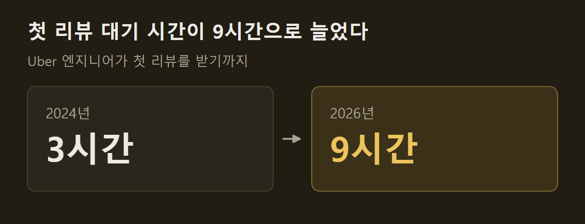

> 이 글은 아래 원문을 우리말로 간추려 정리한 글입니다. 정확한 내용은 원문을 확인하십시오.
>
> 원문: [theaithinker.com/p/how-to-build-an-ai-native-software](https://www.theaithinker.com/p/how-to-build-an-ai-native-software)  
> 원문을 소개한 뉴스레터: TLDR AI

팀원 모두가 Claude Code나 Cursor를 쓰고 몇몇은 에이전트 셋을 동시에 돌리는 회사에, 경영진이 Uber의 발표 영상을 전달하며 "우리 것은 어디 있나"라고 묻는다. 도구는 이미 샀는데 무엇을 더 만들어야 하는지가 이 글의 출발점이다. 글쓴이는 70개가 넘는 공개 자료를 바탕으로 Uber의 [소프트웨어 팩토리](https://www.theaithinker.com/p/how-to-build-an-ai-native-software)를 단계별로 따라간다. 소프트웨어 팩토리는 에이전트를 둘러싼 회사 차원의 시스템이다. 사람이 키보드 앞에 없어도 티켓이나 경보에서 작업이 시작되고, 에이전트는 모든 팀이 공유하는 규칙 아래 클라우드에서 돌며, 회사는 결과물 하나에 든 비용을 읽을 수 있다.

```요약
요약: Uber는 코딩 에이전트를 직접 만들지 않고 사서 쓰면서 그 아래에 게이트웨이·샌드박스·도구 카탈로그·컨텍스트·하네스·게이트를 쌓았는데, 공개된 사례는 모두 플랫폼 팀을 둔 대형 기술 기업의 것이다.
```

```용어
소프트웨어 팩토리: 아이디어에서 프로덕션까지, 에이전트가 일하는 데 필요한 실행 환경·규칙·비용 집계를 회사가 한곳에 갖춘 시스템이다.
토일: 서비스 운영에 따라붙는 수작업으로, 반복적이고 자동화할 수 있으며 서비스가 커지는 만큼 늘어나는 일이다. 마이그레이션, 낡은 기능 플래그 정리가 여기에 든다.
모델 게이트웨이: 어느 회사 모델이든 모든 모델 호출이 지나가는 하나의 문이다. 누가 어떤 모델에 얼마를 썼는지가 여기서 보인다.
샌드박스: 에이전트가 작업하는 격리된 컴퓨터다. 개발자의 노트북과 달리 그 사람의 인증 정보에 닿지 않는다.
섀도 모드: 에이전트가 의견만 남기고 아무도 그 의견을 따를 의무가 없는 시험 운영 방식이다.
```

## 1. 코딩 도구가 풀지 못하는 한계

코딩 도구는 개발자 한 사람을 그 사람의 세션과 노트북 안에서 빠르게 만든다. 에이전트 수십 개를 돌리는 회사는 도구 하나로는 풀리지 않는 한계 넷을 만나는데, 글쓴이는 그 가운데 모델 때문에 생기는 것은 하나도 없다고 짚는다. 여기서는 셋을 먼저 보고, 넷째인 리뷰는 다음 절에서 다룬다.

첫째는 실행 장소다. Uber에서는 코드 리뷰, CI 수정, 당직 분류, 유지보수처럼 사람 없이 시작되는 에이전트 세션의 비중이 커지고 있는데, 노트북은 주인이 자면 같이 잠들기 때문에 이런 일을 맡을 수 없다. Uber는 노트북에서 관리형 에이전트로 옮긴 일을 핵심 전략 전환이라고 부른다. DoorDash는 접근 권한을 걱정했다. 노트북에는 SSH 키, VPN 세션, 인증된 도구가 들어 있어서 자율 에이전트에게 이를 넘기면 피해 범위가 커질 수 있다고 봤다. Ramp는 노트북 한 대로 세션을 두어 개밖에 돌리지 못했다.

둘째는 팀마다 방식이 달라지는 문제다. 개발자 백 명에게 에이전트를 주면 설정도 백 가지가 된다. Uber에서는 엔지니어들이 여러 저장소에 스킬을 잔뜩 만들었는데 중복이 많았고 품질이 낮은 것도 많았다. 보안 규칙이 한 팀의 프롬프트에는 있고 옆 팀에는 없는 일도 생긴다. 2026년 3월 기준 Uber 개발자의 92%가 매달 에이전트를 썼지만 도입 속도는 기대보다 느렸다. Google의 DORA 연구는 이런 상태를 "국지적인 생산성 주머니"라고 부르며, 개인이 빨라져도 그 효과가 뒤 단계에서 사라진다고 설명한다.

셋째는 비용이 보이지 않는 문제다. 개발자마다 도구와 모델을 고르면 청구서가 오기 전에는 아무도 총액을 모른다. Uber의 AI 비용은 2024년 이후 3월까지 6배로 늘었고, 6월에는 1년 치 AI 예산을 넉 달 만에 다 썼다. Uber의 세션 분석은 Sonnet으로 충분한 단순 작업을 Opus로 돌린 세션을 찾아내는데, 이런 패턴은 개발자 한 사람의 노트북에서는 보이지 않고 게이트웨이에서만 보인다. ==팩토리의 목표는 청구액을 줄이는 것보다 비용을 보이게 하는 데 있다.== Shopify의 Farhan Thawar는 엔지니어가 LLM 때문에 한 달에 1,000달러를 더 쓰고 생산성이 10% 오른다면 그것은 너무 싸다고 말했다. 그런 판단은 병합된 변경 하나에 얼마가 들었는지 알아야 내릴 수 있다.

")

## 2. 리뷰로 옮겨 간 대기 줄

넷째 한계는 앞의 셋을 풀어 산출물이 늘어난 뒤에 나타난다. 에이전트가 오기 전에는 개발자가 코드를 쓰는 속도와 리뷰어가 읽는 속도가 얼추 맞았지만, 에이전트가 풀 리퀘스트를 쏟아 내면 리뷰어 수는 그대로여서 대기 줄이 리뷰 앞에 쌓인다.

")

Uber 리뷰 팀은 이 변화를 수치로 밝혔다. 엔지니어가 첫 리뷰를 받기까지 2024년에는 3시간이 걸렸는데 2026년에는 9시간이 걸린다.



다른 회사에서도 같은 일이 벌어졌다. Spotify는 AI 도입 뒤 리뷰할 풀 리퀘스트가 76% 늘었고, 엔지니어링 분석 업체 Faros AI는 개발자 22,000명을 조사해 리뷰에 머무는 시간의 중앙값이 441.5% 늘었다고 측정했다. 글쓴이는 모든 일이 기다리는 한 단계를 찾아 다음 에이전트를 거기에 투입한다는 규칙을 꺼내고, 팩토리는 이 일을 아이디어에서 프로덕션까지 전체에 걸쳐 되풀이하는 장치라고 설명한다. Uber는 리뷰 다음으로 느려질 곳으로 CI 용량, 실험 슬롯, 무엇을 만들지 정하는 일을 꼽았다.

## 3. Uber가 나눈 에이전트 네 층

Uber는 모든 에이전트 세션을 가장 특화된 것부터 가장 일반적인 것까지 네 층으로 나눈다. Uber의 설명으로는 층이 높을수록 비용, 품질, 모델 선택을 더 많이 통제할 수 있다. 위에서부터 차례로 이렇다.

1. 특화 에이전트: 좁은 일 하나씩을 맡은 소수의 에이전트로, Uber 클라우드에서 사람의 확인을 받으며 돈다. Minion은 의도를 풀 리퀘스트로 바꾸고 uReview는 그것을 리뷰하며, Agentic XP는 실험 결과를 정리하고 Conan AI는 경보의 근본 원인을 찾고 Fawkes는 예약된 유지보수를 돌린다.
2. 범용 에이전트 하나: Cortana가 유일한 창구다. 설정 없이 쓸 수 있고 회사 마켓플레이스의 어떤 스킬이든 쓴다.
3. 스킬을 얹은 세션: 개발자가 자기 노트북에서 여는 세션에 공유 스킬을 올린 것으로, Uber는 이런 스킬을 3,600개 넘게 센다.
4. 맨 세션: 아무것도 더하지 않은 Claude Code, Codex, OpenCode다. 프롬프트와 컨텍스트, 방향 잡기를 모두 개발자가 맡는다.

특화 에이전트는 저마다 단가를 매긴다. 병합된 풀 리퀘스트당, 리뷰당, 경보당, 정리 작업당 비용이고, Cortana는 질의당 비용이다. 글쓴이는 이 지도에서 세 가지 선택을 읽어 낸다. 특화 에이전트 다섯 개가 회사 전체의 코드 생성·검증·배포·관측·유지보수를 맡아서 팀마다 에이전트를 두지 않는다. 요청 창구가 하나여서 맞는 봇을 찾아다닐 필요가 없다. 그리고 코딩 도구는 맨 아래층에 그대로 남아, 아직 정해진 자리가 없는 모든 일을 받는다.

")

이 지도는 아래에서 위로 읽으면 경로가 된다. 작업은 맨 세션에서 시작하고, 여러 사람이 같은 방식으로 하게 되면 공유 스킬이 되며, 벤치마크를 만들 만큼 자주 돌면 특화 에이전트가 된다. Uber는 맨 위층에서 가장 좁은 작업을 골라 실제 벤치마크를 만든 다음, 비용과 품질의 균형이 가장 좋은 모델을 돌린다. ==Uber는 모든 비용을 작업 단위 하나에 대응시킨다.==

다른 회사는 다른 층에서 시작했다. Shopify는 창구부터 만들었다. 사내 Slack의 공개 채널에서만 일하는 에이전트 River는 지금 병합된 풀 리퀘스트 여덟 건 가운데 한 건을 함께 작성하고, 팀들이 리뷰·조사·마이그레이션 에이전트를 따로 요구하자 Shopify는 그 아래 플랫폼을 만들었다. DoorDash는 스킬 층에 권한을 붙여서, 작업 단위마다 필요한 도구를 선언하게 하고 그 권한만 준다. Spotify는 특화 에이전트 하나로 곧장 갔다. 백그라운드 에이전트 Honk는 데이터셋 변경 한 건에서 하위 파이프라인 약 1,800개를 마이그레이션했다.

## 4. 변경 하나의 경로와 첫 에이전트

Uber의 Adam Huda는 발표에서 기능 하나가 팩토리를 지나는 과정을 보였다. 월드컵 경기장을 빠져나오는 승객에게 인파에서 떨어진 승차 지점을 안내하는 기능이다. 진행 순서는 이렇다.

1. 아이디어: 팀이 Slack 스레드에서 Cortana를 부르면, Cortana가 컨텍스트 그래프에서 과거 대형 행사와 해당 경기장을 찾아보고 A/B 테스트용 Figma 시안 두 개를 그리며 재사용할 화면과 백엔드 서비스를 나열한다.
2. 구현: Minion이 여러 저장소에 걸쳐 백엔드와 프런트엔드 변경을 쓰고 초안 풀 리퀘스트에서 멈춘다. 토일은 그대로 통과시키지만 새 기능은 CI에 부담을 주기 전에 먼저 검사한다.
3. 검증: 스킬이 시뮬레이터에서 앱을 띄워 화면을 찍고 Figma 시안과 견주며, 다른 스킬은 스테이징에 서비스를 올려 새 프런트엔드와 백엔드를 함께 시험한다.
4. 리뷰: 빠른 중간 크기 모델이 CI 전에 변경을 보고, 더 강한 추론 모델이 CI 안에서 깊게 본다.
5. CI: 빌드가 실패하면 CI가 오류 상당수를 스스로 고친다.
6. 인계: 풀 리퀘스트는 통과한 검사를 모두 적은 표와 시뮬레이터 화면을 달고 사람에게 간다.
7. 유지보수: 실험이 끝나면 쓰지 않는 기능 플래그가 정리 루프에 올라간다. 루프는 CI에 여유가 있는 주말에 돌고, 월요일에 엔지니어에게 떨어지는 변경 수를 제한한다.
8. 장애: Uber는 한 달에 한 번 장애 리뷰에서 패턴을 찾고, 잡아낼 수 있는 패턴은 모든 서비스에 적용하는 유지보수 스킬로 만든다.

Anthropic은 같은 고리를 플레이북으로 적어 두었다. 단계마다 파일 하나를 버전 관리에 쓰고 다음 단계가 그 파일을 읽으며 시작하므로, 아이디어는 `intent.md`, `spec.md`, 계획 파일을 거쳐 코드와 테스트, 풀 리퀘스트, 장애 기록이 된다. 사람은 의도 수락, 계획 승인, 병합 승인 세 곳에 선다. 글쓴이는 Anthropic이 에이전트를 파는 회사이므로 이 문서는 형태를 보는 용도로 읽으라고 단서를 단다.

")

어느 단계에 먼저 에이전트를 둘지에 Uber는 토일이라고 답했다. Uber는 자동 마이그레이션을 250건 넘게 돌려 코드 900만 줄을 건드렸다. 글쓴이가 드는 기준은 틀린 답의 대가가 작고 맞는 답이 분명하며 '끝났다'를 확인하기 쉬운 작업이다. DoorDash는 자주 일어나고 측정할 수 있고 엔지니어가 평가하기 쉽다는 이유로 코드 리뷰에서 시작했고, Spotify는 마이그레이션에서 시작해 에이전트의 첫 병합 풀 리퀘스트 1,500건을 수작업보다 60~90% 짧은 시간에 얻었다.

토일이라고 해서 언제나 에이전트가 맞는 도구인 것은 아니다. Uber는 JUnit 5 마이그레이션에서 생성형 AI로 여러 테스트 클래스 파일을 한꺼번에 옮기려다 실패했다. 그래서 대규모 코드 변경용 내부 도구 Shepherd로 5,000개가 넘는 변경을 규칙에 따라 생성했고, AI는 테스트와 빌드 실패를 디버깅하는 데만 썼다. 그 결과 넉 달 동안 테스트 클래스 75,000개 이상이 옮겨졌다. ==규칙으로 쓸 수 있는 일은 규칙으로 하고, 에이전트는 규칙이 닿지 않는 곳에 쓴다.==

## 5. 에이전트 아래의 여섯 구성 요소

Uber가 발표에서 든 구성 요소 가운데 코딩 에이전트는 없다. Uber 개발자는 Claude Code, Codex, OpenCode를 쓰고, 회사가 만든 것은 그 아래다. Uber는 이것을 6년간의 플랫폼 작업 위에 지었다고 밝혔고, 글쓴이는 대부분의 회사가 게이트웨이에서 시작한다고 전한다. 글이 정리한 여섯 가지는 이렇다.

1. 모델 게이트웨이: 모든 모델 호출이 지나는 문이다. Uber의 게이트웨이는 개인 정보를 기본으로 내부에 두고, 모든 요청을 사용자·프로젝트·팀에 연결한다. 800개가 넘는 내부 프로젝트가 하루 1억 건 이상의 요청을 보낸다.
2. 샌드박스: Uber의 DevPod는 모든 저장소를 복사하고 검색 색인까지 만들어 둔 컴퓨터를 미리 대기시켜서 에이전트가 몇 초 안에 일을 시작한다. Stripe는 10초, DoorDash는 5초 미만이 목표이고 Ramp는 30분마다 이미지를 다시 만든다.
3. 도구 카탈로그: 에이전트는 MCP라는 공개 표준으로 사내 시스템에 닿는다. Uber는 설정 한 줄로 내부 API를 도구로 바꾸는 MCP 게이트웨이를 만들었다.
4. 컨텍스트: 에이전트가 추측하지 않게 하는 사내 지식이다. Uber의 컨텍스트 그래프는 30개가 넘는 내부 시스템에서 노드 2,400만 개를 잇는다.
5. 하네스: 에이전트를 돌리는 루프와 그것을 시작시키는 트리거다. Uber의 하네스는 어떤 모델이든 한 인터페이스 뒤에서 돌리고, 트리거는 Slack, CI, 일정, 경보에서 온다.
6. 게이트: 에이전트가 넘지 못하는 규칙으로, 신원 확인에서 시작해 프로덕션 앞에서 끝난다.

")

요소마다 붙은 관찰이 있다. 도구에는 에이전트가 읽어야 하는 설명이 따라오므로 토큰이 든다. Uber에서는 도구 100여 개가 프롬프트마다 50,000~70,000토큰을 더했고, Uber는 1,000개가 넘는 도구를 명령으로 바꿔 에이전트가 필요할 때만 찾아보게 했다. Stripe의 카탈로그에도 도구가 500개 가까이 있지만 에이전트는 의도적으로 작게 잡은 일부만 들고 시작한다. 컨텍스트의 효과는 실험으로 보였다. 같은 데이터 질문을 받은 두 에이전트 가운데 컨텍스트 그래프를 조회할 수 있었던 쪽은 38초 만에 맞는 테이블을 찾았고, 그렇지 못한 쪽은 20분을 쓰며 오류를 세 번 낸 끝에 조회할 수 없는 데이터라고 답했다. Meta는 더 작은 규모로, 에이전트 50여 개가 큰 코드베이스 하나를 읽고 짧은 컨텍스트 파일 59개를 쓰게 했더니 초기 시험에서 작업당 도구 호출이 40% 줄었다.

게이트웨이는 모든 모델 제공사의 키를 쥐고 있어서 구성도에서 가장 민감한 요소가 된다. 2026년 3월 오픈소스 게이트웨이 LiteLLM의 오염된 릴리스 두 개가 PyPI에 약 40분 동안 올라 있었는데, Datadog의 분석으로는 이 릴리스가 클라우드 키, SSH 키, Kubernetes 데이터, CI 비밀 값을 가져갔다. 의존성 버전을 고정한 공식 Docker 이미지를 쓴 팀은 피해를 입지 않았다.

게이트는 신원에서 시작한다. Uber에서는 풀 리퀘스트 작성자가 "Monitoring Agent"로 기록되어 그것을 요청한 엔지니어가 기록에서 사라진 일이 있었고, Uber는 호출 단계마다 수명이 짧고 범위가 제한된 토큰을 발급해 사람까지 이어지는 연결을 남기게 고쳤다. 프로덕션 앞의 게이트는 Anthropic 플레이북의 한 줄로 요약된다. 에이전트는 프로덕션 게이트까지만 행동하고 그것을 통과하지 못한다. ==코드를 쓴 에이전트는 그 코드를 스스로 승인할 수 없다.== 게이트가 없을 때 벌어진 일로 글은 세 사건을 든다. Replit에서는 에이전트가 코드 동결 기간에 프로덕션 데이터베이스를 지웠고, AWS에서는 코딩 도구가 고객이 쓰는 시스템을 삭제하고 다시 만드는 쪽을 택했으며, GitHub MCP에서는 악의적인 공개 이슈가 에이전트를 가로채 비공개 데이터를 유출했다. Meta는 방어 규칙으로 한 세션의 에이전트가 신뢰할 수 없는 입력 읽기, 민감한 시스템 접근, 외부 변경이라는 세 권한 가운데 둘까지만 갖게 하고, 셋이 다 필요하면 사람이 그 세션을 감독하게 한다.

무엇을 사고 무엇을 만들지에 글쓴이는 방향을 제시하면서도, 이것이 공개 자료에서 뽑은 방향일 뿐 그대로 따를 처방은 아니라고 먼저 밝힌다. 출발점은 호스팅된 백그라운드 에이전트로 전부 사는 것이다. 샌드박스와 트리거, 풀 리퀘스트 흐름이 한데 들어 있지만 스냅샷과 도구, 한도의 통제권은 내놓아야 한다. 그 단계를 넘어서면 에이전트, 게이트웨이, 샌드박스, 추적, 리뷰어는 사고, 회사만 아는 것은 만든다. 코드가 설치되고 빌드된 상태의 스냅샷, 도구 목록, 컨텍스트, 회사의 개발 절차를 코드로 적은 실행 순서, 게이트 정책이 그렇다. 만드는 규모가 Uber만큼 클 필요는 없다는 사례로 Ramp가 나온다. 엔지니어 넷, 디렉터 하나, 시간제 PM 하나로 5.5명이던 Ramp의 Inspect 팀은 v2 출시 두 달 뒤 회사 풀 리퀘스트의 약 60%를, 5월에는 75%를 Inspect가 쓰게 만들었다.

## 6. 도입 순서와 측정 지표

글쓴이는 도입 순서를 내놓기 전에 빈틈을 먼저 인정한다. 공개된 사례는 모두 플랫폼 팀을 둔 대형 기술 기업의 것이고, 노트북에서 출발하는 엔지니어 300명 규모 회사의 사례는 없다. 그래서 제시하는 순서는 무언가를 입증하기 전에는 가장 적게 요구하도록 짜였고, 단계마다 성공을 말해 주는 수치가 하나씩 붙는다. 그림에 적힌 단계와 수치는 이렇다.

1. 대기 줄 측정: 첫 리뷰까지 걸리는 시간
2. 에이전트 하나를 섀도 모드로 운영: 에이전트 의견 가운데 실제로 반영된 것
3. 가장 얇은 기반 구축: 세션당 비용
4. 게이트와 루프 추가: 병합 건수와 그 옆에 놓은 되돌림 건수
5. 에이전트 추가: 변경 실패율

")

첫 단계는 비용이 거의 들지 않는다. 글쓴이는 오픈소스 분석 회사 PostHog의 공개 저장소에서 최근 병합된 풀 리퀘스트 200건을 Claude Code로 조사했다. 사람의 첫 리뷰까지 기다린 시간은 중앙값이 6.1시간, 90번째 백분위가 160.8시간이었고, 40.0%는 사람의 리뷰 없이 병합됐으며 28.5%는 400줄 넘게 바꿨다. 실행에는 약 6분과 25센트가 들었다. 다만 이 표본은 PostHog의 하루 치 병합에 해당하므로 글쓴이는 이를 프롬프트의 시연으로 읽으라고 한다. PostHog는 리뷰 봇을 여럿 돌리는데, 봇을 포함하면 중앙값이 0.07시간으로 떨어지므로 사람의 대기 줄은 봇을 뺀 수치로 봐야 한다.

지표는 Uber의 성적표가 출발점으로 제시된다. 관리형 에이전트는 모두 세 종류의 수치를 보고한다.

1. 결과당 비용: 병합된 풀 리퀘스트당, 리뷰당, 경보당, 정리 작업당 비용
2. 품질: 되돌림 비율, 리뷰어의 F1 점수, 장애 복구 시간
3. 양: 반영된 변경, 게시된 리뷰, 분류된 경보

==처리량 수치 옆에 품질 수치가 없으면 사람들은 그 수치를 부풀린다.== 'AI가 쓴 코드 비율'이 약한 지표인 이유도 Uber가 보여 준다. 8월에는 풀 리퀘스트의 70% 이상에 에이전트가 관여했다고 했지만 5월에 백그라운드 에이전트 팀이 말한 수치는 병합된 풀 리퀘스트의 11%여서, 무엇을 세느냐에 따라 한 회사 안에서 여섯 배가 달라졌다. 비용 쪽에서 Uber는 예산 초과 뒤 코딩 도구 하나에 직원 1인당 월 1,500달러 상한을 두었다가, 나중에는 지출을 실시간으로 보여 주고 계획의 50%, 80%, 100%에서 알림을 주는 방식으로 바꿨다. 6월 이후 세션당 비용은 정점에서 52% 내려갔다. Intercom에서는 AI가 쓴 백엔드 코드의 되돌림 비율이 0.53%로, 사람이 쓴 코드의 5.39%보다 낮았다. 사용량이 쓸모 있는 기능으로 이어지는지는 아직 답이 없는 문제로 남아 있고, Uber의 Andrew Macdonald도 그 선을 긋기가 매우 어렵다고 말했다. Meta와 Amazon의 토큰 순위표는 피해야 할 예로 나오는데, Amazon에서는 직원들이 순위를 올리려고 사소한 작업을 돌렸다.

개발자의 반발은 도구 문제보다 깊은 곳에서 나오기도 한다. Anthropic의 한 엔지니어는 25년간 프로그래밍을 해 왔고 그 기술에 능숙하다는 느낌이 직업적 만족의 핵심이었다고 말했다. Honeycomb의 공동 창업자 Charity Majors는 읽지 않은 코드를 배포하면서 온전히 마음이 놓이려면 무엇이 필요한지를 묻는다. 글쓴이는 도입에 성공한 회사들에서 되풀이되는 방법 넷을 정리한다.

1. 토일부터 가져가기: Uber는 업그레이드, 마이그레이션, 버그 수정을 AI로 옮긴 뒤 엔지니어 만족도가 크게 올랐다고 밝혔다.
2. 공개된 곳에서 일하기: Cortana는 팀 Slack 채널에서 일해 답이 팀 전체에 보인다. DoorDash는 에이전트 실행마다 비공개 채널을 주었을 때 팀의 습관이 생기지 않았고, 공개 스레드로 바꾼 뒤 달라졌다.
3. 선택에 맡기기: Ramp는 Inspect를 강제하지 않았는데도 Inspect가 풀 리퀘스트 대부분을 쓰게 됐다. Duolingo의 Luis von Ahn은 인사 평가에서 AI 사용 항목을 뺐다.
4. 게이트를 개발자에게 주기: Uber의 에이전트 풀 리퀘스트에는 통과한 검사의 표와 화면이 붙어 있어 리뷰어가 코드보다 증거를 먼저 본다. Anthropic의 플레이북에서는 기술 리드가 리뷰 정책을 `REVIEW.md` 파일로 쓴다.

Uber 팀은 발표를 그다음 질문으로 마쳤다. 거의 무엇이든 만들 수 있게 되면 질문이 "그것을 만들어야 하는가"로 바뀐다는 것이다. 글쓴이는 이것이 제품의 문제이며 팩토리에서 처음부터 사람의 몫이었던 부분이라고 적는다.

## 출처와 작성 방식

- 원문: [theaithinker.com/p/how-to-build-an-ai-native-software](https://www.theaithinker.com/p/how-to-build-an-ai-native-software)
- 원문을 소개한 뉴스레터: TLDR AI
- 원문 그림: 아래에 출처를 적은 그림은 원문에 실린 그림을 인용한 것이며, 저작권은 원저작자에게 있습니다.
- 그래프: 출처 표기가 없는 그림은 원문에 적힌 값으로 새로 그린 것입니다. 원문에 실린 그림이 아닙니다.
- 작성 방식: 직접 만든 뉴스 정리 파이프라인(VISER)으로 생성하고 검수한 글입니다. 본문의 수치와 주장은 원문에서 가져온 것입니다.
- 정리 주차: 2026-W41
