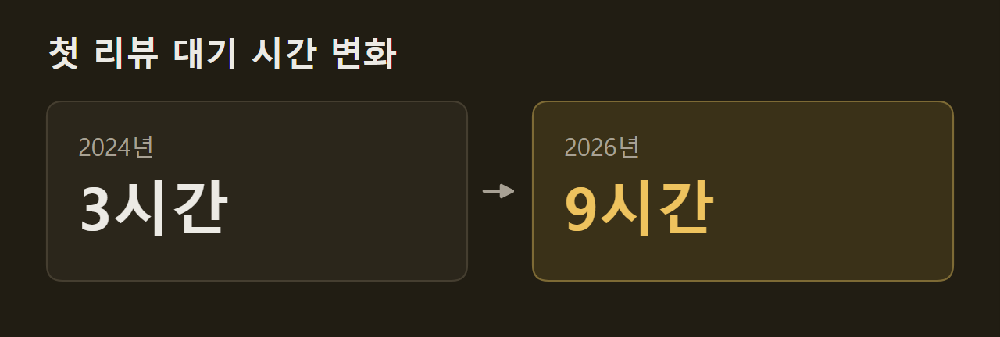
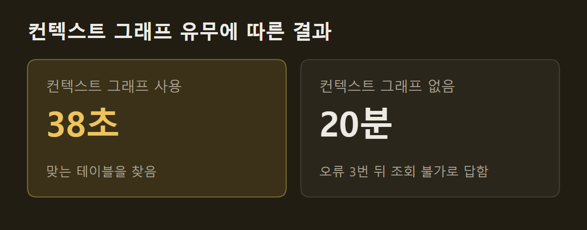
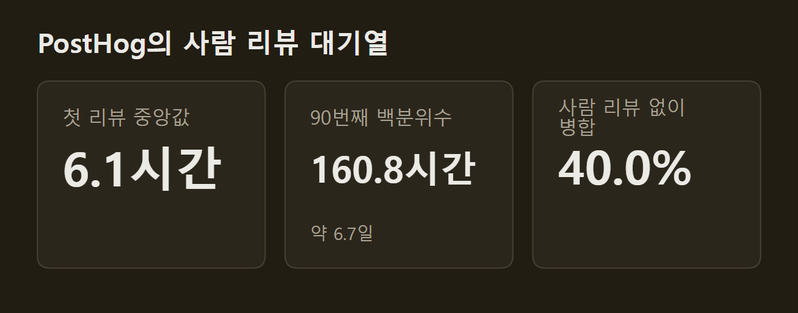

> 이 글은 아래 원문을 우리말로 간추려 정리한 글입니다. 정확한 내용은 원문을 확인하십시오.
>
> 원문: [theaithinker.com/p/how-to-build-an-ai-native-software](https://www.theaithinker.com/p/how-to-build-an-ai-native-software)  
> 원문을 소개한 뉴스레터: TLDR AI

개발자 모두가 Claude Code나 Cursor를 쓰는 회사라도, 에이전트 수백 개를 회사 단위로 운영하려면 개인용 코딩 도구 바깥에 별도의 체계가 있어야 한다. 소프트웨어 팩토리(software factory)는 그런 체계다. 사람이 지켜보지 않아도 티켓이나 알림에서 작업을 시작하고, 모든 팀이 같은 규칙을 따르는 클라우드 환경에서 에이전트를 실행하며, 작업마다 든 비용을 집계한다. The AI Thinker는 [AI 네이티브 소프트웨어 팩토리를 만드는 방법](https://www.theaithinker.com/p/how-to-build-an-ai-native-software)에서 이 체계를 가장 자세히 공개한 Uber를 따라가며 구성 요소와 도입 순서를 정리했다.

```요약
요약: 소프트웨어 팩토리는 코딩 에이전트는 사서 쓰고 실행 환경, 도구, 컨텍스트, 승인 규칙은 회사가 직접 갖춰 에이전트 수백 개의 비용과 품질을 관리하는 체계이며, Uber는 반복 운영 업무를 맡는 에이전트부터 들였다.
```

```용어
반복 운영 업무: 서비스 운영에 딸려 손으로 되풀이하지만 자동화할 수 있고, 남는 가치가 없으며, 서비스가 커질수록 그만큼 늘어나는 일이다. Google SRE 책의 정의다.
스킬: 에이전트가 불러 쓰는 재사용 지침이다. 에이전트가 대체로 따르지만 강제력은 없다.
모델 게이트웨이: 공급사와 관계없이 모든 모델 호출이 거쳐 가는 공용 경로다. 요청마다 사용자, 프로젝트, 팀을 기록한다.
샌드박스: 에이전트가 작업하는 격리된 머신이다. Uber는 이를 DevPod라고 부른다.
하네스: 에이전트를 실행하는 반복 루프와 그 루프를 시작하는 트리거다.
```

## 1. 코딩 도구만으로 풀리지 않는 네 가지 한계

코딩 도구는 개발자 한 사람의 작업 속도를 높인다. 그러나 에이전트 수십 개를 돌리는 회사는 어떤 도구로도 혼자서는 풀 수 없는 한계 네 가지에 부딪힌다. 실행 위치, 팀마다 다른 작업 방식, 보이지 않는 비용, 리뷰 대기가 그것이며, 넷 모두 모델 성능과는 관계가 없다.

")

첫째 한계는 에이전트가 돌아가는 위치다. Uber에서는 사람 없이 시작되는 에이전트 세션의 비중이 커지고 있다. 코드 리뷰, CI(Continuous Integration) 오류 수정, 당직 장애 분류, 유지보수 작업이 이런 세션을 띄우는데, 개발자가 쓰지 않는 동안 노트북은 꺼져 있으므로 이런 작업을 맡길 수 없다. 이 때문에 Uber는 에이전트를 노트북에서 회사가 관리하는 클라우드 환경으로 옮긴 일을 핵심 전략 전환으로 꼽았다.

다른 회사들은 다른 이유로 같은 한계에 부딪혔다. DoorDash 플랫폼 팀은 노트북에 SSH 키, VPN 세션, 인증된 도구가 모여 있어서 자율 에이전트에게 이 권한을 넘기면 사고 한 번의 피해 범위가 커질 수 있다고 지적했다. 반면 Ramp는 동시 실행 수가 걸림돌이었다. 엔지니어들이 Claude Code를 좋아했지만 노트북 한 대로는 세션을 두어 개밖에 돌리지 못했다.

둘째 한계는 팀마다 작업 방식이 제각각이라는 점이다. Uber 엔지니어들이 여러 저장소에 스킬(에이전트가 불러 쓰는 재사용 지침)을 대량으로 만들면서 중복이 많아졌고, 품질이 낮은 스킬도 많았다. 예를 들어 보안 규칙이 한 팀의 프롬프트에는 들어 있고 옆 팀의 프롬프트에서는 빠지는 식이다. Anthropic의 플레이북은 규칙마다 스킬을 한 번만 써서 공유하는 방법을 제시하며, 소프트웨어 팩토리는 이렇게 정리한 회사의 작업 방식을 모든 에이전트에 똑같이 적용한다.

도입 속도가 고르지 않은 것도 같은 문제다. 3월 기준 Uber 개발자의 92%가 매달 에이전트를 썼지만, 도입 속도는 예상보다 느렸다. Google의 DORA 연구는 이런 결과를 "국지적인 생산성"이라고 부른다. 일부 개인과 팀에서 오른 생산성이 다음 단계에서 사라져 회사 전체의 속도로 이어지지 않는다는 뜻이다.

셋째 한계는 비용이다. 개발자마다 도구와 모델을 따로 고르면 청구서가 오기 전까지 아무도 전체 비용을 모른다. Uber의 AI 비용은 3월 기준 2024년의 6배가 되었고, 6월에는 연간 AI 예산을 넉 달 만에 모두 써 버린 상태였다. Uber의 세션 분석에서는 Sonnet으로 충분한 단순 작업을 Opus로 돌린 세션이 드러났는데, 이런 낭비는 노트북 한 대에서는 보이지 않지만 모든 호출이 지나가는 게이트웨이에서는 전부 보인다.

이 체계가 먼저 노리는 것은 지출 절감보다 지출을 보이게 하는 일이다. Shopify의 Farhan Thawar는 "엔지니어가 LLM 때문에 매달 1,000달러를 더 쓰면서 10% 더 생산적이라면 그건 너무 싸다"고 말했다. 이런 판단을 내리려면 병합된 변경 하나에 든 비용을 알아야 하는데, 개인 라이선스로는 좌석 가격만 알 수 있고 소프트웨어 팩토리가 있어야 성과 하나당 비용을 알 수 있다.

넷째 한계인 리뷰 대기는 앞의 세 가지를 풀어 에이전트의 산출물이 늘어난 뒤에 나타난다. 다음 그림의 왼쪽은 에이전트 도입 전 개발자 한 명이 보낸 풀 리퀘스트(PR)를 리뷰어가 곧바로 처리하는 모습이다. 오른쪽은 여러 에이전트가 보낸 PR이 같은 리뷰어 앞에 쌓인 모습이다.

")

Uber 리뷰 팀이 밝힌 수치도 같은 변화를 보여 준다. 리뷰 팀은 2026년 8월 AI Engineer 행사에서, 엔지니어가 첫 리뷰를 받기까지 걸린 시간이 2024년 3시간에서 2026년 9시간으로 늘었다고 밝혔다. 리뷰어 수는 그대로인데 리뷰할 코드만 늘어났기 때문이다.



다른 회사들의 수치도 같은 방향이다. Spotify에서는 AI를 도입한 뒤 리뷰할 PR이 76% 늘었다. 엔지니어링 분석 회사 Faros AI가 개발자 22,000명을 조사한 결과에서도 PR이 리뷰 단계에 머무는 시간의 중앙값이 441.5% 늘었다.

지금 많은 팀에서는 리뷰가 가장 느린 단계다. Uber는 그다음에 막힐 단계로 CI 용량, 실험 슬롯, 무엇을 만들지 정하는 일을 꼽았다. 글쓴이는 모든 작업이 기다리는 단계 하나를 찾아 다음 에이전트를 그곳에 두라고 권한다. 소프트웨어 팩토리는 아이디어부터 운영까지 전 과정에서 이 단계를 찾아 해소하고, 병목이 다른 단계로 옮겨 가면 다시 찾는 체계다.

## 2. Uber 에이전트의 네 층 구성

Uber는 모든 에이전트 세션을 가장 전문화된 것부터 가장 범용적인 것까지 네 층으로 나눈다. Uber는 효율에 관한 글에서 이 구분을 그림으로 공개하며 "층이 높을수록 비용, 품질, 모델 선택을 더 많이 통제할 수 있다"고 설명했다.

맨 위 층에는 좁은 일 하나씩을 맡은 전문 에이전트가 있다. 이 에이전트들은 Uber 클라우드에서 돌아가며 중간에 사람의 확인을 거친다. Minion은 만들려는 변경의 설명을 받아 PR을 쓰고, uReview는 그 PR을 리뷰하며, Agentic XP는 실험 결과를 정리하고, Conan AI는 알림의 근본 원인을 찾고, Fawkes는 정기 유지보수를 맡는다. 단가도 에이전트마다 따로 매기는데, 병합된 PR당, 리뷰당, 알림당, 정리 작업당 비용이 그 예다.

둘째 층은 범용 에이전트 Cortana 하나다. Cortana는 모든 요청을 받는 단일 창구로, 설치 없이 Uber 클라우드에서 돌아가고 회사 스킬 마켓플레이스의 어떤 스킬이든 쓸 수 있으며 단가는 질문당 비용으로 매긴다. 아래 두 층은 개발자의 노트북 세션이다. 셋째 층은 3,600개가 넘는 공용 스킬을 불러온 세션이고, 맨 아래 층은 Claude Code, Codex, OpenCode에 아무것도 더하지 않은 세션이다.

")

이 구성에는 세 가지 선택이 들어 있다. 회사 전체의 코드 생성, 검증, 배포, 관찰, 유지보수를 전문 에이전트 다섯 개가 맡고 팀별 에이전트는 두지 않는다. 또 요청 창구가 하나여서 맞는 봇을 찾아다닐 필요가 없다. 마지막으로 코딩 도구는 맨 아래 층에 남아 아직 전문 에이전트에 맡기지 않은 모든 일을 처리하므로, 팩토리가 자기 도구를 빼앗을까 걱정하는 개발자도 쓰던 도구를 계속 쓸 수 있다.

아래에서 위로 읽으면 이 구성은 작업이 올라가는 경로이기도 하다. 작업은 아무것도 더하지 않은 세션에서 시작한다. 여러 사람이 같은 방식으로 하게 되면 공용 스킬이 되고, 벤치마크를 만들 수 있을 만큼 자주 돌면 전문 에이전트가 된다. 맨 위 층에서는 가장 좁은 작업을 골라 실제 벤치마크를 만들고, 비용과 품질의 균형이 가장 좋은 모델을 쓴다. Uber는 이 원칙을 "모든 비용이 작업 단위 하나에 대응한다"고 요약했다.

Claude Code나 Cursor를 쓰는 팀은 이 구성의 아래 두 층에 있다. 글쓴이는 공용 스킬 폴더를 가장 적은 비용으로 올라갈 수 있는 다음 단계로 꼽고, 맨 아래 층을 계속 열어 두라고 권한다. 다음 전문 에이전트가 될 작업은 그 층에서 발견되기 때문이다.

다른 회사들은 층을 다른 순서로 쌓았다. Shopify는 단일 창구부터 만들었다. Slack 공개 채널에서만 일하는 에이전트 River는 지금 병합 PR 8건 중 1건을 함께 쓴다. 그 뒤 팀들이 리뷰, 조사, 마이그레이션용 에이전트를 따로 요구하자 Shopify는 "River 백 개가 될 수 있는 것을 만들지 않았다"며 그 아래 플랫폼을 새로 지었다.

DoorDash는 권한이 딸린 스킬 층을 만들었다. Flux 플랫폼의 플레이북은 자신이 쓸 도구를 미리 밝히고, 그 도구에 필요한 권한만 받는다. 반면 Spotify는 곧바로 전문 에이전트 하나를 두었다. 백그라운드 에이전트 Honk는 회사 전체의 유지보수를 맡아 데이터셋 변경 한 건으로 하위 파이프라인 약 1,800개를 옮겼고, Spotify는 결과를 예측할 수 있도록 당시 Honk가 공용 스킬을 쓰지 못하게 했다.

## 3. 아이디어에서 장애 대응까지: 변경 하나의 경로

Uber의 Adam Huda는 AI Engineer 발표에서 기능 하나가 팩토리를 거치는 과정을 보여 주었다. 예로 든 기능은 붐비는 월드컵 경기장을 나서는 승객에게 인파를 피할 수 있는 승차 지점을 알려 주는 것이다.

1. 아이디어: 팀이 Slack 스레드에서 Cortana를 부르면, Cortana가 컨텍스트 그래프에서 과거 대형 행사와 해당 경기장을 찾아 범위를 북미 출시로 좁힌다. 이어 버튼 문구가 다른 Figma 시안 두 개를 A/B 테스트용으로 만들고, 재사용할 화면과 백엔드 서비스를 정리한다.
2. 구현: Minion이 격리된 클라우드 개발 환경인 DevPod에서 여러 저장소에 걸친 백엔드와 프런트엔드 변경을 쓴다. 새 기능은 CI에 부담을 주기 전에 먼저 확인받아야 하므로 초안 PR에서 멈춘다.
3. 검증: CI보다 먼저 스킬 하나가 시뮬레이터에서 앱을 띄워 화면을 캡처하고 Figma 시안과 비교한다. 다른 스킬은 스테이징 환경에서 새 프런트엔드와 백엔드를 함께 시험한다.
4. 리뷰: CI 전에는 빠른 중간 크기 모델이 리뷰하고, CI 안에서는 더 강한 추론 모델이 한 번 더 깊이 리뷰한다.
5. CI: 빌드가 실패하면 자가 복구 CI가 오류 상당수를 스스로 고친다.
6. 인계: 통과한 모든 검사와 시뮬레이터 스크린샷을 정리한 표가 PR과 함께 사람 리뷰어에게 넘어간다.
7. 유지보수: 실험이 끝나 필요 없어진 B안의 기능 플래그는 CI에 여유가 있는 주말에 정리 루프가 지운다. 엔지니어에게 넘어가는 diff(변경분) 수에는 상한을 둔다.
8. 장애: Uber는 매달 장애 리뷰에서 패턴을 찾는다. 잡아낼 수 있는 패턴은 새 유지보수 스킬로 만들어 모든 서비스에 적용한다.

Anthropic의 Louis Claxton이 쓴 플레이북은 같은 루프를 단계마다 파일을 넘기는 방식으로 정리했다. 각 단계는 버전 관리에 파일 하나를 남기고 다음 단계는 그 파일을 읽으며 시작하므로, 아이디어는 `intent.md`에서 시작해 명세 문서와 `plan.md`를 거쳐 코드와 테스트, PR, 장애 기록이 된다. 다음 그림에서 손 모양으로 표시한 곳이 사람이 개입하는 세 지점으로, 의도 수락, 계획 승인, 병합 승인이다.

")

다른 회사들도 같은 단계를 돌린다. Stripe의 Minions는 사람이 쓴 코드 없이 매주 PR 1,300건 이상을 병합하지만, 그 PR은 모두 사람이 리뷰한다. Spotify의 백그라운드 에이전트는 모든 변경에 검증기를 돌린다. 판정을 맡은 모델이 세션의 약 4분의 1을 거부하고, 그중 절반에서 에이전트가 방향을 고친다. DoorDash는 리뷰를 둘로 나눠, 먼저 탐색 담당이 의심스러운 부분을 표시하면 더 깊이 보는 리뷰어들이 하나씩 확인한다.

## 4. 첫 에이전트에 반복 운영 업무를 맡기는 이유

Uber가 가장 먼저 에이전트에 맡긴 일은 반복 운영 업무(toil)였다. Google SRE(Site Reliability Engineering) 책은 이를 운영에 딸려 있고, 손으로 하며, 되풀이되고, 자동화할 수 있으며, 남는 가치가 없고, 서비스가 커질수록 그만큼 늘어나는 일로 정의한다. Uber는 자동 마이그레이션을 250건 넘게 돌려 코드 900만 줄을 고쳤다. 반면 Minion은 그보다 복잡한 기능을 만들 때는 초안 PR에서 멈춘다.

첫 작업을 고르는 기준도 여기서 나온다. 글쓴이는 틀려도 피해가 작고 맞았는지가 분명히 드러나는 일을 고르라고 권한다. SRE의 정의를 점검표로 쓰고, '완료'를 확인하기 쉬운지를 하나 더 따지라는 것이다.

다만 반복 운영 업무라고 모두 에이전트가 맞는 도구는 아니다. Uber는 JUnit 5 마이그레이션에서 생성형 AI로 여러 테스트 클래스 파일을 한꺼번에 옮기려 했지만 실패했고, 정해진 규칙대로 코드를 바꾸는 내부 도구 Shepherd로 방식을 바꿨다. Shepherd가 diff 5,000개 이상을 만들고 AI는 테스트·빌드 실패를 디버깅하는 데만 쓰여, 넉 달 만에 테스트 클래스 75,000개 이상이 옮겨졌다. 규칙으로 쓸 수 있는 일은 규칙으로 처리하고, 규칙이 닿지 않는 부분에만 에이전트를 쓴다는 것이 이 사례에서 나온 원칙이다.

첫 작업은 회사마다 달랐다. DoorDash는 리뷰가 "자주 일어나고, 측정할 수 있고, 엔지니어가 평가하기 쉬워서" 코드 리뷰부터 시작했다. 반면 Spotify는 마이그레이션부터 시작했다. 에이전트가 처음 병합한 PR 1,500건이 마이그레이션에서 나왔고, 손으로 할 때보다 시간이 60~90% 덜 들었다.

첫 에이전트는 사서 쓸 수 있다. Claude Code on the web, Copilot cloud agent, Cursor의 클라우드 에이전트는 모두 격리된 머신에서 작업을 돌린 뒤 결과를 PR로 돌려준다. 처음에는 섀도 모드(shadow mode), 곧 에이전트가 의견만 남기고 누구도 그에 따라 행동할 필요가 없는 방식으로 돌리라는 것이 기사의 권고다.

첫 작업이 CI에 있다면 가장 작은 시작은 읽기만 하는 작업이다. `claude -p`는 대화창 없이 스크립트 안에서 Claude Code를 실행하므로 파이프라인에서 실패한 빌드를 분류하거나, 불안정한 테스트를 요약하거나, 변경 내역 초안을 쓰는 데 쓸 수 있다. 에이전트는 읽고 보고만 하며, 사람이 승인하기 전에는 아무것도 배포되지 않는다.

Uber가 이미 돌리는 다음 단계 에이전트들은 사람의 부담을 덜어 주는 일을 맡는다. Code Inbox는 PR마다 가장 알맞은 리뷰어를 골라 보내서 리뷰 대기열을 빨리 비운다. 기능 플래그 정리 루프는 CI에 여유가 있을 때 오래된 플래그를 지우고, uSpec은 Cursor의 에이전트를 Figma에 연결해 세 플랫폼용 화면 낭독기 명세를 2분 안에 쓴다. 다른 회사 사례로 Warp의 사기 탐지 봇은 8시간마다 돌며, 한 번의 실행에서 6만 달러 가까운 부정 사용을 잡아내고 수정안을 썼다.

## 5. 에이전트 아래의 여섯 구성 요소

Uber의 Uday Kiran Medisetty와 Adam Huda는 2026년 8월 AI Engineer 발표에서 플랫폼을 이루는 여섯 구성 요소를 소개했는데, 그중에 코딩 에이전트 자체는 없다. 여섯은 모델 게이트웨이, MCP 게이트웨이, DevPod, 스킬 마켓플레이스, 컨텍스트 그래프, 단일 창구 Cortana이며, Uber는 6년 동안 쌓은 플랫폼 작업 위에 이를 지었다. 처음부터 여섯이 다 필요하지는 않고, 대부분의 회사는 게이트웨이부터 시작한다.

기사는 이 요소들을 역할에 따라 다시 나눈다. 다음 그림은 맨 위에 작업을 시작하는 트리거(Slack, 이슈, CI, 일정)를 놓고, 가운데에 사서 쓰는 에이전트를 넣은 하네스를 둔다. 맨 아래에는 모델 게이트웨이, 샌드박스, 도구 카탈로그, 컨텍스트가 놓이고, 오른쪽 기둥에는 게이트, 신원, 로그가 선다.

")

첫째 요소인 모델 게이트웨이는 공급사와 관계없이 모든 모델 호출이 지나가는 공용 경로다. Uber의 게이트웨이는 개인정보를 기본적으로 회사 안에 두고, 가드레일 검사가 더하는 지연에 엄격한 상한을 두며, 모든 요청을 사용자, 프로젝트, 팀과 연결한다. 내부 프로젝트 800개 이상이 이 게이트웨이로 하루 1억 건 넘는 요청을 보낸다. 이 요소는 살 수 있다. 오픈소스 LiteLLM이 키 관리, 사용자별 예산, 100개가 넘는 모델의 지출 집계를 지원하고, Portkey, Kong, Cloudflare, AWS Bedrock도 같은 기능을 제공한다.

게이트웨이에서는 배포 방식이 위험을 가른다. 2026년 3월 LiteLLM의 오염된 릴리스 두 개가 PyPI에 약 40분 동안 올라와 있었고, Datadog의 분석에 따르면 이 릴리스는 클라우드 키, SSH 키, 쿠버네티스 데이터, CI 비밀값을 빼 갔다. 반면 공식 Docker 이미지를 쓴 팀은 의존성 버전이 고정되어 있어 피해를 입지 않았다. 게이트웨이는 회사가 가진 모든 공급사 키를 쥐고 있으므로, 이 사례에서 나온 권고는 게이트웨이를 가장 민감한 구성 요소로 다뤄 버전을 고정하고, 패치하고, 담당자를 정해 두라는 것이다.

둘째 요소인 샌드박스는 에이전트가 작업하는 격리된 머신이다. Uber는 모든 저장소를 미리 복사하고 검색 인덱스까지 만들어 둔 DevPod를 대기시켜 두므로, 에이전트가 몇 초 안에 일을 시작한다. Stripe의 개발 머신은 코드와 서비스를 올린 채 10초 만에 뜨고, Ramp는 세션마다 최신 코드로 시작하도록 이미지를 30분마다 다시 만든다. 머신 자체는 AWS AgentCore Runtime, Modal, E2B 같은 업체에서 살 수 있다. 다만 회사 저장소를 설치하고 빌드해 바로 쓸 수 있게 준비한 스냅샷은 어떤 업체도 팔지 않으므로 직접 만들어야 한다.

셋째 요소인 도구 카탈로그는 에이전트가 회사 시스템에 접근하는 경로다. 에이전트는 도구를 연결하는 공개 표준인 MCP(Model Context Protocol)로 시스템에 접근한다. Uber에는 내부 API가 수천 개 있었지만 에이전트가 바로 쓸 수 있는 것은 없었으므로, Uber는 크롤러가 딸린 MCP 게이트웨이를 만들어 설정 하나만 바꾸면 내부 API가 도구가 되게 했다.

도구가 많아지면 토큰을 많이 쓴다. 도구마다 에이전트가 읽어야 하는 설명이 있어서, Uber에서는 100개가 넘는 도구가 프롬프트마다 50,000~70,000 토큰을 더했다. 이 때문에 Uber는 1,000개가 넘는 도구를 명령으로 바꿔 에이전트가 필요할 때만 찾아보게 했다. Stripe도 도구 500개 가까이를 담은 카탈로그 Toolshed를 두지만, 에이전트에게는 "의도적으로 작은 부분 집합"만 기본으로 준다.

넷째 요소인 컨텍스트는 에이전트가 추측하지 않고 답을 찾게 한다. Uber가 같은 데이터 질문을 두 에이전트에 주었을 때, 컨텍스트 그래프를 조회할 수 있는 에이전트는 38초 만에 맞는 테이블을 찾았다. 반면 그래프를 쓰지 못한 에이전트는 20분 동안 오류를 세 번 낸 뒤 그 데이터는 조회할 수 없다고 답했다. Uber는 이 결과를 "근거가 없는 에이전트는 싸게 실패하지 않고 느리게 실패한다"고 요약했다.



컨텍스트는 훨씬 작은 규모로 시작해도 된다. Uber의 그래프는 30개가 넘는 내부 시스템에서 모은 노드 2,400만 개를 잇는다. 이에 비해 Meta는 에이전트 50여 개가 큰 코드베이스 하나를 읽고 짧은 컨텍스트 파일 59개를 쓰게 했고, 초기 시험에서 에이전트의 작업당 도구 호출이 40% 줄었다. 가장 작은 규모에서는 Claude Code가 가장 먼저 읽는 `CLAUDE.md` 파일 하나가 컨텍스트 역할을 한다.

다섯째 요소인 하네스(harness)는 에이전트를 실행하는 루프와 그 루프를 시작하는 트리거다. Uber의 하네스는 최상위 성능 모델이든 공개 가중치 모델이든 같은 인터페이스로 돌린다. Uber는 에이전트마다 실제 업무로 벤치마크해 그 일에 가장 나은 모델로 바꾼다. Stripe는 회사가 믿는 작업 순서를 블루프린트(blueprint), 곧 "Minion 실행을 지휘하는 코드로 정의한 워크플로"로 적어 둔다. 마지막에 린터를 돌리는 단계처럼 일부는 일반 코드로 처리하는데, 이렇게 하면 토큰을 아끼고 에이전트가 틀릴 기회도 줄어든다.

여섯째 요소는 게이트이며, 첫 게이트는 신원이다. Uber에서는 PR 작성자가 "Monitoring Agent"로 기록되어 작업을 요청한 엔지니어가 기록에서 사라진 일이 있었다. 이에 Uber는 단계마다 짧게 유효하고 권한 범위가 좁은 토큰을 발급해, 요청한 사람까지 거슬러 올라가는 기록이 남게 했다. 지금은 내부 에이전트 수천 개가 이 방식을 쓴다.

마지막 게이트는 운영 환경 앞에 있다. Anthropic의 플레이북은 에이전트가 "운영 게이트까지는 행동할 수 있지만 넘을 수는 없다"고 적었고, 에이전트가 만든 결과는 모두 PR로 올라오며 코드를 쓴 에이전트는 그 PR을 승인할 수 없다. Ramp는 세션을 시작한 사람 명의로 PR을 열어 누구도 자기 변경을 스스로 승인하지 못하게 한다. 게이트가 없을 때 일어난 사고도 있다. Replit에서는 코드 동결 기간에 에이전트가 운영 데이터베이스를 지웠고, GitHub MCP에서는 악의적인 공개 이슈가 에이전트를 가로채 비공개 데이터를 유출했다.

에이전트는 티켓을 읽으므로 마지막 사고는 소프트웨어 팩토리에 그대로 해당한다. 이에 대한 방어책으로 기사는 Meta의 '둘의 규칙(Rule of Two)'을 든다. 한 세션의 에이전트는 다음 세 권한 가운데 둘까지만 가질 수 있다.

- 공개 이슈나 고객 티켓처럼 신뢰할 수 없는 입력을 읽는다.
- 민감한 시스템이나 비공개 데이터에 접근한다.
- 무언가를 바꾸거나 외부와 통신한다.

세 권한이 모두 필요한 세션은 사람이 감독한다.

무엇을 사고 무엇을 만들지에 대해 글쓴이는 이 회사들의 공개 자료에서 끌어낸 방향일 뿐 정해진 방법은 아니라는 단서를 달았다. 출발점은 호스팅 백그라운드 에이전트를 통째로 사는 것이다. Claude Code on the web, Copilot, Cursor, Devin은 샌드박스, 트리거, PR 흐름을 함께 제공하는 대신 스냅샷, 도구, 실행 한도를 회사가 통제할 수 없다. 예를 들어 Copilot의 클라우드 에이전트는 59분이 지나면 멈추고, 한 번 실행할 때 저장소 하나만 다룬다.

이 단계를 넘어서면 에이전트, 게이트웨이, 샌드박스, 추적 도구, 리뷰 도구는 사서 쓰고, 회사만 아는 것은 직접 만든다. 미리 준비한 코드 스냅샷, 도구 카탈로그, 컨텍스트, 개발 절차를 코드로 적은 블루프린트, 게이트 정책이 직접 만들 대상이다. 이것도 한 번에 다 만들지 않는다. Team Topologies는 다른 팀의 속도를 높이는 최소한의 공용 도구를 제품처럼 운영하는 것을 '가장 얇은 실행 가능한 플랫폼(thinnest viable platform)'이라고 부른다. 이 글에서는 첫 에이전트에 필요한 요소만 만들고, 팀이 요청할 때 다음 요소를 더하는 방식을 가리킨다.

필요한 인력도 생각보다 적을 수 있다. Ramp의 Inspect 팀은 엔지니어 4명, 디렉터 1명, 시간제 PM 1명을 더해 5.5명이었다. Inspect는 v2 출시 두 달 뒤 Ramp PR의 약 60%를 썼고, 5월에는 그 비율이 75%가 되었다. LinkedIn의 Prince Valluri는 InfoQ에서 "GitHub Copilot이나 Cursor나 Replit을 회사 안에서 다시 만들려고 하지 말라"고 경고했다.

## 6. 작게 시작하는 도입 순서와 성과 지표

공개된 사례는 모두 플랫폼 팀을 둔 대형 기술 기업의 것이고, 노트북에서 출발하는 엔지니어 300명 규모 회사의 사례는 없다. 이 때문에 기사가 제시하는 도입 순서는 효과가 증명되기 전까지 투자를 가장 적게 요구하도록 짜였다. 단계마다 성공을 판단할 숫자가 하나씩 있고, 그 숫자가 움직일 때만 다음 단계로 넘어간다. 다음 그림은 대기열 측정, 섀도 모드로 돌리는 에이전트 하나, 최소 기반 구축, 게이트와 루프, 에이전트 추가의 다섯 단계와 단계마다 보는 지표를 계기판으로 나타냈다.

")

첫 단계인 대기열 측정은 비용이 거의 들지 않고 외부 업체도 필요 없다. 작업은 리뷰, CI, 배포 등 여러 곳에서 기다리지만, git 기록에서 가장 쉽게 읽어 낼 수 있는 것은 리뷰 대기다. 글쓴이는 Claude Code에 GitHub CLI로 공개 저장소 PostHog/posthog의 최근 병합 PR 200건을 살펴보게 했다. PR이 열린 뒤 작성자가 아닌 사람의 첫 리뷰까지 걸린 시간, 리뷰 없이 병합된 비율, 400줄 넘게 바꾼 비율을 구하는 작업이었다.

리뷰 봇을 빼고 사람의 리뷰만 센 결과, 첫 리뷰까지 걸린 시간의 중앙값은 6.1시간이었다. 90번째 백분위수는 160.8시간(약 6.7일)이었고, 40.0%는 사람의 리뷰 없이 병합되었다. 실행에는 약 6분과 25센트가 들었다.



봇을 빼고 잰 데는 이유가 있다. PostHog는 리뷰 봇을 여럿 돌리는데, 봇까지 세면 중앙값은 0.07시간(약 4분)으로 줄고 리뷰 없이 병합된 PR도 없어진다. 따라서 사람의 대기열을 보려면 봇을 빼고 재야 한다. 이 200건은 PostHog가 약 하루 동안 병합한 분량이어서 프롬프트 시연으로 보아야 하며, 이렇게 잰 숫자가 이후 모든 단계를 판단하는 기준이 된다.

에이전트가 돌기 시작하면 Uber가 쓰는 세 종류의 숫자를 본다. 성과 하나당 비용(병합 PR당, 리뷰당, 알림당 비용), 품질(되돌린 비율, 리뷰 에이전트의 F1 점수, 장애 복구 시간), 양(반영된 diff, 남긴 리뷰, 분류한 알림)이 그것이다. 처리량 숫자 옆에 품질 숫자를 함께 두지 않으면 사람들이 처리량만 부풀리기 쉽다.

반면 'AI가 쓴 코드 비율'은 무엇을 세느냐에 따라 크게 달라진다. Uber는 8월에 PR의 70% 이상에 에이전트가 관여했다고 밝혔지만, 5월에 Uber 백그라운드 에이전트 팀이 말한 수치는 병합 PR의 11%였다. 한 회사 안에서 셈 기준만 바꿔도 6배 차이가 난 것이다.

비용은 빠르게 움직이므로 따로 본다. 예산을 초과한 뒤 Uber는 직원 한 명이 코딩 도구 하나에 쓰는 비용을 월 1,500달러로 묶었다가, 나중에는 엔지니어가 지출을 실시간으로 보고 계획 대비 50%, 80%, 100%에 이를 때 알림을 받는 방식으로 바꿨다. 6월 이후 Uber의 세션당 비용은 최고치보다 52% 줄었고, 지출 상한보다 지출을 보이게 한 조치가 더 큰 효과를 냈다.

다른 회사의 지표도 같은 방향이다. Ramp는 병합 PR로 끝난 세션을 "가장 중요한 지표"로 추적한다. Intercom은 R&D 직원 1인당 병합 PR을 두 배로 늘리려던 목표를 넘어 16개월 만에 세 배로 늘렸다. 또 AI가 쓴 백엔드 코드가 되돌려진 비율은 0.53%로, 사람이 쓴 코드의 5.39%보다 낮았다. 반대로 Meta와 Amazon의 토큰 사용 순위표는 실패 사례다. Meta의 순위표는 언론 보도 뒤 내려졌고, Amazon에서는 직원들이 순위를 올리려고 의미 없는 작업을 돌렸다.

개발자의 반발은 도구보다 깊은 곳에서 나오기도 한다. Anthropic의 한 엔지니어는 "25년 동안 프로그래밍을 해 왔고, 그 기술에서 느끼는 유능함이 직업 만족의 핵심"이라며 한 시대가 끝났다고 말했다. Honeycomb 공동 창업자 Charity Majors는 "읽지 않은 코드를 완전히 편한 마음으로 배포하려면 무엇이 필요한가"라고 물었다. 이런 질문을 하는 사람이 가장 좋은 리뷰어라는 것이 기사의 입장이며, 도입에 성공한 회사들에서는 다음 네 가지 방법이 되풀이해 나타난다.

- **반복 운영 업무부터 넘긴다.** Uber는 "업그레이드, 마이그레이션, 버그 수정"을 AI에 맡긴 뒤 엔지니어 만족도가 "훨씬 높아졌다".
- **공개된 곳에서 일한다.** Cortana는 팀 Slack 채널에서 일해 답이 팀 전체에 보인다. DoorDash는 실행마다 비공개 채널을 열던 첫 방식이 "팀의 습관을 만들지 못하자" 공개 스레드로 바꿨다.
- **쓸지 말지는 개발자가 정한다.** Ramp는 기존 도구 대신 Inspect를 쓰라고 누구에게도 강요하지 않았고, Duolingo의 Luis von Ahn은 AI 사용량을 성과 평가에서 뺐다.
- **승인 권한은 사람이 쥔다.** Anthropic 플레이북에서는 기술 리더가 `REVIEW.md`에 리뷰 정책을 쓰고, 에이전트는 자기 작업을 승인하지 못한다.

개발자들은 이미 에이전트를 쓰고 있으므로, 회사가 갖출 것은 에이전트가 돌아갈 환경, 접근할 수 있는 시스템, 넘을 수 없는 규칙, 그리고 효과를 보여 줄 숫자다. 출발점은 아무도 손으로 하고 싶어 하지 않는 작업 하나이고, 그 뒤로는 모두가 기다리는 단계를 찾아 해소하는 일을 되풀이한다. Uber의 Adam Huda는 무엇이든 만들 수 있게 된 뒤에 남는 질문을 "만들어야 하느냐의 문제"라고 정리했다.

## 출처와 작성 방식

- 원문: [theaithinker.com/p/how-to-build-an-ai-native-software](https://www.theaithinker.com/p/how-to-build-an-ai-native-software)
- 원문을 소개한 뉴스레터: TLDR AI
- 그림: 아래에 출처가 적힌 그림은 원문에 실린 그림을 인용한 것이며 저작권은 원저작자에게 있습니다. 출처가 없는 그래프는 원문에 적힌 값으로 직접 그린 것입니다.
- 작성 방식: 직접 만든 뉴스 정리 파이프라인(VISER)으로 생성하고 검수한 글입니다. 본문의 수치와 주장은 원문에서 가져온 것입니다.
- 정리 주차: 2026-W41
