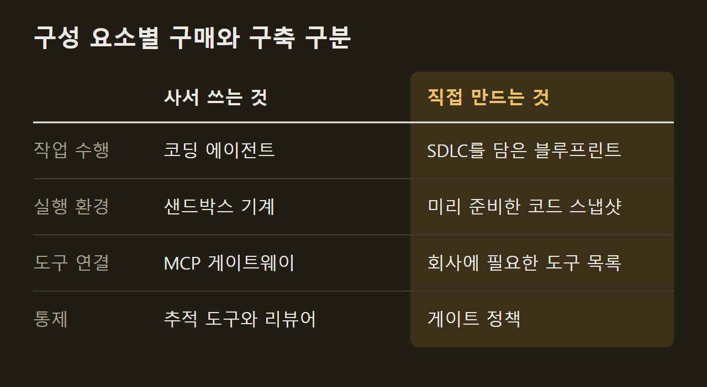
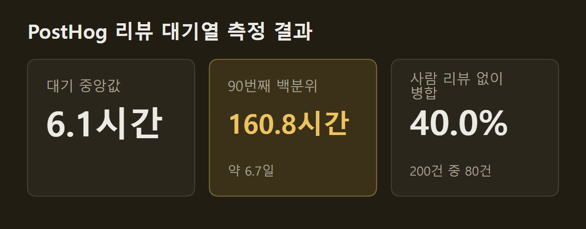

> 이 글은 아래 원문을 우리말로 간추려 정리한 글입니다. 정확한 내용은 원문을 확인하십시오.
>
> 원문: [theaithinker.com/p/how-to-build-an-ai-native-software](https://www.theaithinker.com/p/how-to-build-an-ai-native-software)  
> 원문을 소개한 뉴스레터: TLDR AI

팀원 모두가 Claude Code나 Cursor를 쓰고 그중 몇 명은 에이전트 세 개를 한꺼번에 돌리는 회사라도, 경영진이 Uber의 발표를 전달하며 "우리 팩토리는 어디 있느냐"고 물으면 답하기 어렵다. 도구를 이미 샀는데 무엇을 더 갖춰야 하는지가 분명하지 않아서다. [소프트웨어 팩토리](https://www.theaithinker.com/p/how-to-build-an-ai-native-software)는 에이전트를 둘러싸고 아이디어부터 운영 환경까지 이어지는 회사 차원의 체계를 가리킨다. 이 체계에서는 사람이 키보드 앞에 없어도 티켓이나 알림이 작업을 시작시키고, 에이전트는 모든 팀이 공유하는 규칙에 따라 클라우드에서 돌며, 그 비용을 회사가 파악할 수 있다. The AI Thinker의 글쓴이는 70개가 넘는 공개 자료를 바탕으로 Uber가 이 체계를 세운 과정을 따라가면서, 무엇을 사고 무엇을 직접 만들지와 어떤 순서로 도입할지를 정리했다.

```요약
요약: 소프트웨어 팩토리는 코딩 에이전트는 사서 쓰고 그 아래의 실행 환경, 도구, 컨텍스트, 게이트를 회사가 갖추는 체계로, Uber는 반복 운영 업무부터 에이전트에 맡기며 이를 운영한다.
```

```용어
소프트웨어 팩토리: 아이디어부터 운영까지 에이전트가 일하는 데 필요한 실행 환경, 공유 규칙, 비용 관리를 회사 차원에서 갖춘 체계다.
반복 운영 업무: 수작업이고 반복적이며 자동화할 수 있고, 서비스가 커질수록 그에 비례해 늘어나는 운영 작업이다.
모델 게이트웨이: 공급사와 관계없이 회사의 모든 모델 호출이 거쳐 가는 단일 지점이다. 요청마다 사용자, 프로젝트, 팀을 기록한다.
하네스: 에이전트를 실행하는 루프와 그 루프를 시작시키는 트리거를 합친 실행 틀이다.
섀도 모드: 에이전트가 코멘트만 남기고 아무도 그에 따라 행동할 필요가 없는 시험 운영 방식이다.
```

## 1. 코딩 도구만으로는 풀리지 않는 네 가지 한계

코딩 도구는 개발자 한 명의 작업 속도를 높이지만, 에이전트 수십 개를 돌리는 회사는 도구 하나로는 풀 수 없는 네 가지 한계에 부딪힌다. 에이전트가 실행되는 위치, 팀마다 달라지는 작업 방식, 보이지 않는 비용, 늘어난 코드를 따라가지 못하는 리뷰가 그것이다. 글쓴이는 넷 모두 모델과는 관계없는 문제이고, 하나하나가 팩토리를 세워야 하는 이유라고 본다.

")

첫째 한계는 에이전트가 실행되는 위치다. Uber에서는 사람 없이 시작되는 에이전트 세션의 비중이 늘고 있으며, 코드 리뷰, CI(Continuous Integration) 실패 수정, 당직 장애 분류, 유지보수 작업이 이런 세션을 띄운다. 노트북은 주인이 잠들면 함께 꺼지므로 이 일을 맡을 수 없다. 이 때문에 Uber는 노트북에서 관리형 에이전트로 옮기는 것을 핵심 전략 전환으로 삼았고, 관리형 환경에서는 모델 라우팅, 하네스(harness), 지출을 "완전히 통제"할 수 있다고 설명한다.

다른 회사들도 다른 이유로 같은 한계에 부딪혔다. DoorDash 플랫폼 팀은 노트북에 SSH 키, VPN 세션, 인증된 도구가 모여 있어 자율 에이전트에 이 권한을 넘기면 피해 범위가 커질 수 있다고 지적했다. 반면 Ramp의 엔지니어들은 처음부터 Claude Code를 반겼지만, 노트북에서는 세션을 두어 개밖에 돌리지 못했다.

둘째 한계는 팀마다 작업 방식이 제각각이라는 점이다. 개발자 100명에게 코딩 에이전트를 주면 설정도 100가지가 생기는데, Uber에서도 엔지니어들이 여러 저장소에 스킬을 잔뜩 만들었고 그 가운데 중복이 많았으며 품질이 낮은 것도 많았다. 예를 들어 보안 규칙이 한 팀의 프롬프트에는 있지만 옆 팀의 프롬프트에는 빠져 있는 식이다. Anthropic의 플레이북은 규칙마다 스킬을 하나씩만 써서 공유하라고 권하고, 팩토리는 회사의 작업 방식을 한곳에 두고 모든 에이전트가 같이 쓰게 하는 자리가 된다.

도입 속도도 같은 이유로 고르지 않다. 3월 기준으로 Uber 개발자의 92%가 매달 에이전트를 썼지만, 도입은 예상보다 더뎠다. Google의 DORA 연구는 이런 결과를 '국지적으로 흩어진 생산성(localized pockets of productivity)'이라 부르며, 이렇게 흩어진 성과는 이후 단계에서 사라진다고 지적한다.

셋째 한계는 비용 전체를 아무도 보지 못한다는 것이다. 개발자마다 도구와 모델을 따로 고르면 청구서가 오기 전까지 전체 금액을 아는 사람이 없다. Uber의 AI 비용은 3월에 이미 2024년의 6배가 됐고, 6월에는 1년 치 AI 예산을 넉 달 만에 다 썼다. Uber의 세션 분석은 Sonnet으로 충분한 단순 세션을 Opus로 돌린 사례를 찾아냈는데, 이런 낭비는 개발자 한 명의 노트북에서는 보이지 않지만 모델 게이트웨이에서는 모두 보인다.

글쓴이는 비용을 줄이는 것보다 비용을 보이게 하는 것이 먼저라고 본다. Shopify의 Farhan Thawar도 "엔지니어가 LLM 때문에 매달 1,000달러를 더 쓰고 생산성이 10% 오른다면 그건 너무 싼 것"이라고 말했다. 다만 이런 판단을 하려면 병합된 변경 하나에 든 비용을 알아야 한다. 개별 라이선스로는 1인당 가격만 알 수 있지만, 팩토리를 갖추면 성과당 비용을 알 수 있다.

넷째 한계는 리뷰다. 이 한계는 앞의 세 한계를 풀어 코드 산출량이 늘어난 뒤에 드러난다. Uber 리뷰 팀은 8월 AI Engineer 발표에서 엔지니어가 첫 리뷰를 받기까지 걸리는 시간이 2024년 3시간에서 2026년 9시간으로 늘었다고 밝혔다. 리뷰어 수는 그대로인데 리뷰할 코드가 늘어났기 때문이다.


다른 회사의 수치도 같은 흐름을 보인다. Spotify는 AI를 도입한 뒤 리뷰할 풀 리퀘스트(PR)가 76% 늘었고, 엔지니어링 분석 회사 Faros AI가 개발자 22,000명을 측정해 보니 리뷰에 머문 시간의 중앙값이 441.5% 늘었다. 변경마다 여전히 사람을 기다려야 한다면 코드를 더 많이 써도 회사 전체의 속도는 오르지 않는다. 다음 그림의 왼쪽은 에이전트 도입 전, 오른쪽은 도입 후의 리뷰 대기열이다.

")

글쓴이는 앞선 글에서 세운 규칙을 여기에 적용한다. 모든 작업이 기다리는 단계 하나를 찾아 다음 에이전트를 그 단계에 두라는 규칙이며, 소프트웨어 팩토리는 이 일을 아이디어부터 운영까지 전체 과정에서 되풀이하는 체계다. 지금 많은 팀에서 가장 느린 단계는 리뷰다. Uber는 그다음 병목으로 CI 처리 용량, 실험 슬롯, 무엇을 만들지 정하는 일을 꼽았다.

## 2. Uber 에이전트 작업의 네 층 구성

Uber는 회사의 모든 에이전트 세션을 가장 전문화된 것부터 가장 범용적인 것까지 네 층으로 나눈다. Uber는 효율성을 다룬 글의 그림 3으로 이 구성을 공개하면서 "층이 높을수록 비용, 품질, 모델 선택을 더 많이 통제할 수 있다"고 설명했다. 위층부터 차례로 보면 다음과 같다.

- 전문 에이전트: 좁은 일을 하나씩 맡은 소수의 에이전트로, Uber 클라우드에서 사람의 확인을 거치며 돈다. Minion은 의도를 PR로 바꾸고 uReview는 그 PR을 리뷰하며, Agentic XP는 실험 결과를 정리하고 Conan AI는 알림의 근본 원인을 찾고 Fawkes는 정기 유지보수를 맡는다. 비용은 병합된 PR당, 리뷰당, 알림당, 정리 작업당으로 따로 잰다.
- 범용 에이전트: Cortana 하나가 모든 요청을 받는 단일 진입점이다. 설정 없이 회사 마켓플레이스의 어떤 스킬이든 쓸 수 있고, 비용은 질의당으로 잰다.
- 스킬을 얹은 세션: 개발자가 노트북에서 여는 자기 세션에 공유 스킬을 불러 쓴다. Uber에는 이런 스킬이 3,600개가 넘는다.
- 기본 세션: 아무것도 더하지 않은 Claude Code, Codex, OpenCode다. 프롬프트, 맥락, 방향 지시를 모두 개발자가 맡는다.

")

이 구성에서는 세 가지 선택이 드러난다. 전문 에이전트 다섯 개가 회사 전체의 코드 생성, 검증, 배포, 관찰, 유지보수를 맡으므로 팀마다 따로 둔 에이전트는 없다. 또 요청은 단일 진입점 하나로 들어오고, 기존 코딩 도구는 맨 아래층에 남아 아직 전담 에이전트가 없는 일을 맡는다. 글쓴이는 이것이 팩토리가 자기 도구를 빼앗을까 걱정하는 개발자에게 줄 수 있는 답이라고 본다.

네 층을 아래에서 위로 읽으면 작업이 옮겨 가는 경로가 된다. 일은 기본 세션에서 시작하고, 여러 사람이 같은 방식으로 하게 되면 공유 스킬이 되며, 벤치마크를 만들 수 있을 만큼 자주 돌면 전문 에이전트를 둘 대상이 된다. 맨 위층에 대해 Uber는 가장 좁은 작업을 골라 실제 벤치마크를 만든 뒤 비용과 품질의 균형이 가장 좋은 모델을 쓴다는 규칙을 제시한다. 그래야 Uber의 표현대로 "1달러마다 작업 단위 하나가 대응"한다.

다른 회사들은 층을 다른 순서로 갖췄다. Shopify는 단일 진입점부터 만들었는데, 회사 Slack의 공개 채널에서만 일하는 에이전트 River가 지금은 병합된 PR 8건 중 1건을 함께 작성한다. 반면 Spotify는 처음부터 전문 에이전트 하나를 두었다. 백그라운드 에이전트 Honk는 데이터셋 하나가 바뀌었을 때 하위 파이프라인 약 1,800개를 옮겼는데, Spotify는 결과를 예측할 수 있도록 Honk가 공유 스킬에 접근하지 못하게 했다.

## 3. 변경 하나의 흐름: 아이디어부터 장애 대응까지

Uber의 Adam Huda는 AI Engineer 발표에서 기능 하나가 팩토리를 거치는 과정을 처음부터 끝까지 보여 주었다. 예로 든 기능은 붐비는 월드컵 경기장을 나서는 승객에게 군중을 피한 탑승 위치를 안내하는 기능이고, 다음 순서로 진행된다.

1. 아이디어: 팀이 Slack 스레드에서 논의하며 Cortana를 부르면, Cortana는 컨텍스트 그래프에서 과거 대형 행사장 사례를 찾아 북미 출시를 제안한다. 이어 A/B 테스트용 Figma 시안 두 개와 재사용할 화면·백엔드 서비스 목록을 만든다. Huda는 예전에는 이렇게 의견을 맞추는 데 몇 주가 걸렸다고 말했다.
2. 구현: Cortana가 클라우드 코딩 에이전트 Minion에 일을 넘기고, Minion은 클라우드 개발 환경 DevPod에서 여러 저장소에 걸친 백엔드·프런트엔드 변경을 작성한다. 새 기능이므로 CI에 부담을 주지 않도록 초안 PR에서 멈춘다.
3. 검증: 검사를 CI보다 앞당긴다. 한 스킬은 시뮬레이터에서 앱을 띄워 탑승 화면을 캡처한 뒤 Figma 시안과 비교하고, 다른 스킬은 스테이징 환경에서 새 프런트엔드와 새 백엔드를 함께 시험한다.
4. 리뷰: 빠른 중간 크기 모델이 CI 전에 먼저 보고, 더 강한 추론 모델이 CI 안에서 깊이 본다.
5. CI: 빌드가 실패하면 자동 복구 CI가 상당수 오류를 고친다.
6. 인계: PR은 통과한 모든 검사와 시뮬레이터 화면을 담은 표와 함께 사람에게 가고, 리뷰어는 이 표를 근거로 변경 내용을 믿을 수 있다.
7. 유지보수: 실험이 끝나 B안이 필요 없어지면 그 기능 플래그는 관리형 정리 작업으로 넘어간다. 이 작업은 CI가 한가한 주말에 돌면서 엔지니어에게 가는 변경 수에 상한을 두고, 변경이 받아들여졌는지가 정리 스킬을 고치는 데이터가 된다.
8. 장애: Uber는 한 달에 한 번 장애 리뷰를 읽어 패턴을 찾고, 미리 잡을 수 있는 패턴마다 모든 서비스에 적용할 유지보수 스킬을 새로 만든다.

Anthropic도 같은 순환을 Louis Claxton이 쓴 플레이북으로 정리했다. 이 플레이북에서는 단계마다 파일 하나를 버전 관리에 남기고, 다음 단계가 그 파일을 읽으며 시작한다. 이에 따라 아이디어는 `intent.md`, `spec.md`, 계획 파일, 코드와 테스트, PR, 장애 기록으로 차례로 바뀌고, 사람은 의도 수락, 계획 승인, 병합 승인의 세 지점에서 개입한다. 다음 그림에서 손이 그려진 세 자리가 이 승인 지점이다.

")

플레이북은 단계마다 먼저 손으로 프롬프트를 넣어 보고 순환 전체의 자동화는 맨 마지막에 하라고 권한다. 다만 Anthropic은 이 순환을 돌리는 에이전트를 파는 회사이므로, 글쓴이는 이 플레이북을 구조를 보는 자료로만 읽으라고 덧붙였다. 다른 회사들도 같은 단계를 운영한다. Stripe의 Minions는 사람이 작성한 코드 없이 매주 1,300건이 넘는 PR을 병합하지만 사람이 한 건씩 리뷰하고, Spotify에서는 판정을 맡은 모델이 세션의 약 4분의 1을 거부하며 에이전트는 그중 절반에서 방향을 고친다.

## 4. 첫 에이전트를 반복 운영 업무에 두는 이유

Uber는 첫 에이전트를 반복 운영 업무(toil)에 두었다. Google의 SRE(Site Reliability Engineering) 책은 이를 "운영 서비스를 돌리는 데 딸린 일 가운데 수작업이고 반복적이며 자동화할 수 있고, 전술적이고 오래 남는 가치가 없으며, 서비스가 커질수록 선형으로 늘어나는 일"로 정의한다. Uber는 자동 마이그레이션을 250회 넘게 실행해 코드 900만 줄을 바꿨다. 반면 Minion은 반복 운영 업무를 넘어서는 기능 개발에서는 CI에 부담을 주기 전에 검증하려고 초안 PR에서 멈춘다.

글쓴이는 틀린 답의 피해가 작고 맞는 답이 분명히 드러나는 일을 첫 대상으로 고르라고 권한다. SRE의 정의를 점검표로 쓰고, '완료'를 쉽게 확인할 수 있는지를 시험 하나로 더하라는 것이다. 다른 회사도 이런 기준으로 골랐다. DoorDash는 코드 리뷰가 "자주 일어나고 측정할 수 있으며 엔지니어가 평가하기 쉽다"는 이유로 첫 대상으로 삼았고, Spotify는 마이그레이션부터 시작해 처음 병합한 PR 1,500건을 손으로 할 때보다 60~90% 적은 시간에 처리했다.

반복 운영 업무라도 알맞은 도구를 골라야 한다. Uber는 JUnit 5 마이그레이션에서 생성형 AI로 여러 테스트 클래스 파일을 한꺼번에 옮기려 했지만 실패했다. 그래서 결정론적 방식으로 바꿨다. 대규모 코드 변경용 내부 도구 Shepherd가 변경 5,000건 이상을 만들었고, AI는 테스트와 빌드 실패를 디버깅하는 데만 썼다. 그 결과 테스트 클래스 75,000개 이상이 넉 달 만에 옮겨졌다.

첫 에이전트는 사서 쓸 수 있다. Claude Code on the web, Copilot 클라우드 에이전트, Cursor 클라우드 에이전트는 모두 격리된 기계에서 작업한 뒤 PR을 돌려준다. 글쓴이는 처음에는 이 에이전트를 섀도 모드(shadow mode)로 돌리라고 권한다. 첫 작업이 CI 안에 있다면 가장 작은 시작은 읽기 전용 작업이다. 예를 들어 Claude Code를 대화창 없이 스크립트 안에서 실행하는 `claude -p`로 실패한 빌드를 분류하거나 불안정한 테스트를 요약하게 할 수 있다.

에이전트를 더할 때는 그 에이전트가 리뷰와 CI에 얼마나 일을 더 얹는지부터 따지고, 사람의 부담을 덜어 주는 에이전트를 먼저 둔다. Uber는 PR마다 가장 알맞은 리뷰어를 찾아 보내는 Code Inbox, Figma와 연결해 디자인 시스템 명세를 쓰는 uSpec 등을 이미 운영한다. uSpec은 세 플랫폼에 쓸 화면 낭독기 명세 전체를 2분 안에 쓴다. 다른 회사 사례로는 PR 스레드에서 에이전트를 호출하면 원격 기계에서 코드를 고쳐 PR에 반영하는 DoorDash의 수정 에이전트가 있다. Warp의 사기 탐지 봇은 8시간마다 도는데, 한 번의 실행에서 6만 달러 가까운 부정 사용을 잡아내고 수정안까지 썼다.

## 5. 에이전트 아래의 여섯 구성 요소

Uber의 Uday Kiran Medisetty와 Adam Huda는 8월 AI Engineer 발표에서 플랫폼을 이루는 여섯 구성 요소를 소개했고, 그 가운데 코딩 에이전트는 없었다. 여섯 구성 요소는 모델 게이트웨이, MCP 게이트웨이, DevPod, 스킬 마켓플레이스, 컨텍스트 그래프, Cortana다. 글쓴이는 에이전트 아래에 깔리는 기반을 '바닥(floor)'이라 부르고, 이를 모델 게이트웨이, 샌드박스, 도구 목록, 컨텍스트, 하네스, 게이트의 여섯 요소로 다시 정리했다. Uber는 이 기반을 6년 동안의 플랫폼 작업 위에 세웠는데, 대부분의 회사는 게이트웨이부터 시작한다.

다음 그림의 맨 위 칸은 작업을 시작시키는 트리거(메시지, 이슈, CI, 일정)이고, 가운데 칸은 사서 쓰는 에이전트가 들어가는 하네스다. 맨 아래 칸에는 모델 게이트웨이, 샌드박스, 도구 목록, 컨텍스트가 놓이고, 오른쪽 기둥은 게이트, 신원, 로그를 가리킨다.

")

첫째 요소인 모델 게이트웨이는 공급사와 관계없이 모든 모델 호출이 거쳐 가는 단일 지점이다. Uber의 게이트웨이는 개인 정보를 기본적으로 회사 안에 두고, 안전장치가 더하는 지연에 엄격한 상한을 두며, 모든 요청을 사용자, 프로젝트, 팀과 연결한다. 그 결과 내부 프로젝트 800개 이상이 이 게이트웨이로 하루 1억 건이 넘는 요청을 보낸다.

게이트웨이는 사서 쓸 수 있지만 배포는 조심해야 한다. 오픈소스 LiteLLM은 키, 사용자별 예산, 100개 넘는 모델의 지출을 관리하고, Portkey, Kong, Cloudflare, AWS Bedrock도 같은 기능을 판다. 그런데 2026년 3월 오염된 LiteLLM 릴리스 두 개가 PyPI에 약 40분 동안 올라 있었고, Datadog의 분석에 따르면 이 릴리스는 클라우드 키, SSH 키, 쿠버네티스 데이터, CI 비밀값을 빼냈다. 의존성을 고정한 공식 Docker 이미지를 쓴 팀은 피해를 입지 않았다. 이를 근거로 글쓴이는 모든 공급사 키를 쥔 게이트웨이를 가장 민감한 시스템으로 다루고, 버전을 고정해 패치하며, 담당자를 정하라고 권한다.

둘째 요소는 에이전트가 일하는 격리된 기계인 샌드박스다. Uber는 모든 저장소를 복사하고 검색 색인까지 만들어 둔 DevPod 기계를 미리 대기시키므로, 에이전트가 몇 초 안에 작업을 시작한다. Stripe의 개발 기계는 코드와 서비스를 실은 채 10초 만에 뜨고, Ramp는 세션마다 최신 코드로 시작하도록 이미지를 30분마다 다시 만든다. 기계 자체는 AWS AgentCore Runtime, Modal, E2B 등에서 살 수 있지만, 회사 저장소를 설치하고 빌드까지 마쳐 둔 스냅샷은 회사가 직접 만들어야 한다.

셋째 요소는 도구 목록이다. 에이전트는 도구를 에이전트에 연결하는 공개 표준인 MCP(Model Context Protocol)를 거쳐 회사 시스템에 접근한다. Uber는 수천 개의 내부 API가 에이전트에 맞게 준비되어 있지 않았으므로, 크롤러를 단 MCP 게이트웨이를 만들어 설정 하나만 바꾸면 내부 API를 도구로 쓸 수 있게 했다. 다만 에이전트는 도구마다 설명을 읽어야 해서, 도구 100개 이상이 프롬프트마다 토큰 50,000~70,000개를 더했다. 이 때문에 Uber는 1,000개 넘는 도구를 명령으로 바꿔 필요할 때만 찾아 쓰게 했고, 약 500개 도구를 갖춘 Stripe도 에이전트마다 "의도적으로 작은 일부"만 기본으로 준다.

넷째 요소인 컨텍스트에 따라 에이전트가 근거를 갖고 일하는지, 추측으로 일하는지가 갈린다. Uber는 같은 데이터 질문을 컨텍스트 그래프를 조회할 수 있는 에이전트와 그렇지 못한 에이전트에 주었다. 앞의 에이전트는 38초 만에 맞는 테이블을 찾았지만, 뒤의 에이전트는 20분 동안 오류를 세 번 낸 끝에 그 데이터는 조회할 수 없다고 답했다. Uber의 그래프는 내부 시스템 30개 이상에서 가져온 노드 2,400만 개를 잇지만, 훨씬 작게 시작할 수도 있다. 예를 들어 Meta는 에이전트 50여 개에게 큰 코드베이스를 읽고 짧은 컨텍스트 파일 59개를 쓰게 했고, 초기 시험에서 에이전트의 작업당 도구 호출이 40% 줄었다.

다섯째 요소인 하네스는 에이전트를 돌리는 루프와 그 루프를 시작시키는 트리거를 합친 것이다. Uber의 하네스는 최신 상용 모델이든 공개 가중치 모델이든 같은 인터페이스로 돌리고, 에이전트마다 실제 작업으로 벤치마크해 그 일에 가장 알맞은 모델로 바꾼다. 회사가 직접 정할 부분은 믿고 맡길 수 있는 작업 순서이며, Stripe는 이를 블루프린트(blueprint)라 부른다. 블루프린트에서 린터 실행 같은 단계는 일반 코드가 처리하고 판단이 필요한 단계만 에이전트가 맡으므로, 토큰을 아끼고 에이전트가 틀릴 여지도 줄어든다.

여섯째 요소인 게이트는 신원 관리에서 시작한다. Uber에서는 한때 PR 작성자가 'Monitoring Agent'로 기록되고, 작업을 요청한 엔지니어는 기록에서 빠졌다. 이를 막으려고 Uber는 호출 단계마다 수명이 짧고 권한 범위가 좁은 토큰을 발급해, 에이전트의 작업이 요청한 사람까지 거슬러 올라가 추적되게 했다. 지금은 내부 에이전트 수천 개가 이 방식을 쓴다.

마지막 게이트는 운영 환경 앞에 있다. Anthropic 플레이북의 표현으로는 에이전트가 "운영 게이트까지는 움직일 수 있지만 그 게이트를 넘을 수 없다". 에이전트가 쓴 모든 결과물은 PR로 들어오고, 코드를 쓴 에이전트는 그 코드를 승인할 수 없다. Ramp는 세션을 시작한 사람 명의로 PR을 열어 누구도 자기 변경을 스스로 승인하지 못하게 하고, 글쓴이는 모든 도구 호출을 추적용 공개 표준 OpenTelemetry로 기록하라고 권한다.

게이트가 없을 때 실제로 사고가 났다. Replit에서는 코드 동결 기간에 에이전트가 운영 데이터베이스를 지웠고, GitHub MCP 사례에서는 악성 공개 이슈가 에이전트를 장악해 비공개 데이터를 유출했다. 팩토리의 에이전트도 티켓을 읽으므로 같은 위험에 놓인다. 이에 대한 방어책으로 글쓴이는 Meta의 '둘의 규칙(Rule of Two)'을 꼽는다. 이 규칙은 한 세션의 에이전트에게 신뢰할 수 없는 입력 읽기, 민감한 시스템 접근, 변경과 외부 통신의 세 권한 가운데 둘까지만 주고, 셋이 모두 필요하면 사람이 감독하게 한다.

무엇을 사고 무엇을 만들지에 대해 글쓴이는 공개 사례에서 끌어낸 방향일 뿐 정해진 방법은 아니라고 전제한다. 출발점은 호스팅형 백그라운드 에이전트를 통째로 사는 '선택지 0'이다. Claude Code on the web, Copilot, Cursor, Devin은 샌드박스, 트리거, PR 흐름을 함께 제공하지만, 그 대신 회사가 스냅샷, 도구, 한도를 통제할 수 없다. 예를 들어 Copilot 클라우드 에이전트는 59분이 지나면 멈추고, 한 번 실행할 때 저장소 하나에서만 일한다.

이 단계를 넘어서면 어느 회사나 쓰는 범용 요소는 사고 회사만 아는 것은 직접 만든다. 사서 쓰는 것은 에이전트, 모델 게이트웨이, 샌드박스, 추적 도구, 리뷰어다. 직접 만드는 것은 미리 준비한 코드 스냅샷, 도구 목록, 컨텍스트, SDLC(Software Development Life Cycle)를 담은 블루프린트, 게이트 정책이다.



이 모두를 처음부터 갖출 필요는 없다. 조직 설계서 『Team Topologies』는 다른 팀의 작업 속도를 높이는 가장 작은 공유 도구 모음을 '가장 얇은 실행 가능 플랫폼(thinnest viable platform)'이라 부르는데, 이 원칙에 따라 첫 에이전트에 필요한 요소만 만들고 팀이 요청할 때 다음 요소를 더한다. 규모도 작을 수 있다. Ramp의 Inspect 팀은 엔지니어 넷, 디렉터 한 명, 파트타임 PM 한 명으로 5.5명이었고, Inspect는 v2 출시 두 달 뒤 Ramp PR의 약 60%를, 5월에는 75%를 썼다. LinkedIn의 Prince Valluri도 InfoQ에서 "GitHub Copilot이나 Cursor나 Replit을 회사 안에서 다시 만들려 하지 말라"고 경고했다.

## 6. 도입 순서와 단계별 측정 지표

글쓴이는 도입 순서를 제시하기 전에 공개 사례의 한계부터 밝힌다. 공개 사례는 모두 플랫폼 팀을 둔 대형 기술 기업이고, 노트북에서 출발하는 엔지니어 300명 규모의 회사를 다룬 사례는 없다. 그래서 이 순서는 효과를 증명하기 전까지 요구하는 것을 최소로 줄였고, 단계마다 성공을 판단할 수치를 하나씩 둔 뒤 그 수치가 움직여야 다음 단계로 넘어가게 짰다. 다음 그림은 왼쪽부터 대기열 측정(첫 리뷰까지 시간), 섀도 모드의 에이전트 하나(실제로 반영된 코멘트), 최소 기반(세션당 비용), 게이트와 루프(병합 건수와 되돌림), 에이전트 추가(변경 실패율)의 순서다.

")

첫 단계에는 비용이 거의 들지 않는다. 작업이 기다리는 곳은 리뷰, CI, 배포 등 여러 군데지만 git 기록에서 가장 쉽게 읽히는 것이 리뷰이므로, 자기 저장소의 기록으로 리뷰 대기열부터 잰다. 시연으로 글쓴이는 오픈소스 분석 회사 PostHog의 공개 저장소에서 Claude Code에게 최근 병합된 PR 200건을 대상으로 첫 사람 리뷰까지 걸린 시간을 재게 했고, 실행에는 약 6분과 25센트가 들었다. 리뷰 봇을 빼고 계산하자 대기 시간 중앙값은 6.1시간, 90번째 백분위는 160.8시간(약 6.7일)이었으며, 40.0%는 사람 리뷰 없이 병합됐다.



봇을 빼고 잰 이유는 PostHog가 리뷰 봇을 여럿 돌리기 때문이다. 봇까지 세면 대기 중앙값은 0.07시간(약 4분)으로 줄고, 리뷰 없이 병합된 PR도 없다. 다만 이 표본은 PostHog의 하루치 병합에 해당하므로 프롬프트 시연으로만 읽어야 하며, 프롬프트와 답변 전문은 원문에 실려 있다. 400줄 넘게 바꾼 PR의 비율(28.5%)도 함께 볼 수치다. DORA의 AI 역량 모델은 일곱 가지 역량 가운데 하나로 작은 단위로 나눠 작업하기를 꼽는다.

**성과는 작성한 코드가 아니라 병합된 작업으로 잰다.** Uber의 관리형 에이전트는 모두 세 종류의 수치를 보고한다. 병합된 PR당·리뷰당 비용 같은 성과당 비용, 되돌림 비율과 장애 복구 시간 같은 품질, 반영된 변경과 게시된 리뷰의 수 같은 처리량이다. 처리량만 보고 품질 수치를 옆에 두지 않으면 사람들이 처리량 수치를 부풀리기 쉽다.

반면 'AI가 쓴 코드 비율'은 무엇을 세느냐에 따라 크게 달라진다. Uber는 8월에 PR의 70% 이상에 에이전트가 관여했다고 밝혔지만, 5월에 Uber의 백그라운드 에이전트 팀이 말한 수치는 병합된 PR의 11%였다. 같은 회사 안에서도 세는 기준에 따라 수치가 여섯 배 차이 났다.

비용은 빠르게 바뀌므로 따로 관리한다. Uber는 예산을 초과한 뒤 코딩 도구마다 직원 1인당 월 1,500달러로 지출 상한을 두었다가, 이후 엔지니어가 지출을 실시간으로 보고 계획의 50%, 80%, 100%에 이를 때 알림을 받는 방식으로 바꿨다. 6월 이후 Uber의 세션당 비용은 정점보다 52% 낮아졌다. 글쓴이는 상한보다 지출을 보이게 한 조치가 더 효과가 컸다고 본다.

다른 회사의 지표도 병합된 결과를 중심에 둔다. Ramp는 병합된 PR로 끝난 세션을 "가장 중요한 지표"로 꼽는다. Intercom은 R&D 직원 1인당 병합 PR을 두 배로 늘리려다 16개월 만에 세 배로 늘렸고, AI가 쓴 백엔드 코드의 되돌림 비율은 0.53%로 사람이 쓴 코드의 5.39%보다 낮았다. 반대로 Meta와 Amazon의 토큰 사용량 순위표는 피해야 할 사례다. Amazon에서는 직원들이 순위를 올리려고 사소한 작업을 돌렸다.

개발자의 거부감은 도구 문제보다 깊을 수 있다. 25년 동안 프로그래밍한 한 Anthropic 엔지니어는 그 기술에서 느끼는 유능함이 직업 만족의 핵심이었다며 지금을 "한 시대의 끝"이라고 말했다. Honeycomb 공동 창업자 Charity Majors는 "읽지 않은 코드를 배포하면서도 완전히 편안하려면 무엇이 필요한가"라고 묻는다. 글쓴이는 이렇게 묻는 사람들이 가장 좋은 리뷰어라고 보고, 도입에 성공한 회사들에서 되풀이되는 방법 네 가지를 정리했다.

- **반복 운영 업무부터 넘긴다.** Uber는 업그레이드, 마이그레이션, 버그 수정을 AI에 넘긴 뒤 엔지니어 만족도가 크게 높아졌다.
- **공개된 자리에서 일한다.** Uber의 Cortana는 팀 Slack 채널에서 답해 팀 전체가 볼 수 있다. DoorDash는 에이전트 실행마다 비공개 채널을 열었을 때는 팀의 사용 습관이 생기지 않았고, 공개 스레드로 바꾼 뒤에야 습관이 생겼다.
- **쓸지 말지를 개발자가 고르게 한다.** Ramp는 누구에게도 Inspect를 강요하지 않았지만 Inspect가 PR 대부분을 쓰게 됐고, Duolingo의 Luis von Ahn은 AI 사용 여부를 성과 평가에서 뺐다.
- **게이트는 개발자에게 맡긴다.** Uber의 에이전트 PR에는 통과한 검사 목록과 화면이 붙는다. Anthropic 플레이북에서는 테크 리드가 `REVIEW.md`에 리뷰 정책을 쓰고, 에이전트는 자기 작업을 승인하지 않으므로 병합마다 사람이 책임진다.

Warp의 Zach Lloyd는 모든 회사가 CI/CD를 두듯 "핵심에 소프트웨어 팩토리"를 두게 될 것이라고 예측했다. 다만 Warp는 그런 플랫폼을 파는 회사이므로, 글쓴이는 Spotify의 사례를 더 나은 근거로 든다. Spotify는 자동 유지보수 PR을 250만 건 넘게 병합했고, 그 대부분에는 사람이 개입하지 않았다. 지금까지 살펴본 경로를 정리하면 다음 그림과 같다.

")

개발자들은 이미 에이전트를 쓰고 있으므로, 회사에 남은 일은 에이전트가 돌아갈 곳과 접근할 수 있는 범위, 어길 수 없는 규칙을 정한 기반을 갖추고 그 기반이 제대로 작동하는지 보여 주는 수치를 마련하는 것이다. 글쓴이는 아무도 손으로 하고 싶어 하지 않는 일 하나에서 시작해, 모든 작업이 기다리는 단계를 찾아 계속 풀어 나가라고 정리한다. Uber의 Adam Huda의 말처럼 거의 무엇이든 만들 수 있게 되면 질문은 "그것을 만들어야 하는가"로 바뀐다.

## 출처와 작성 방식

- 원문: [theaithinker.com/p/how-to-build-an-ai-native-software](https://www.theaithinker.com/p/how-to-build-an-ai-native-software)
- 원문을 소개한 뉴스레터: TLDR AI
- 그림: 아래에 출처가 적힌 그림은 원문에 실린 그림을 인용한 것이며 저작권은 원저작자에게 있습니다. 출처가 없는 그래프는 원문에 적힌 값으로 직접 그린 것입니다.
- 작성 방식: 직접 만든 뉴스 정리 파이프라인(VISER)으로 생성하고 검수한 글입니다. 본문의 수치와 주장은 원문에서 가져온 것입니다.
- 정리 주차: 2026-W41
