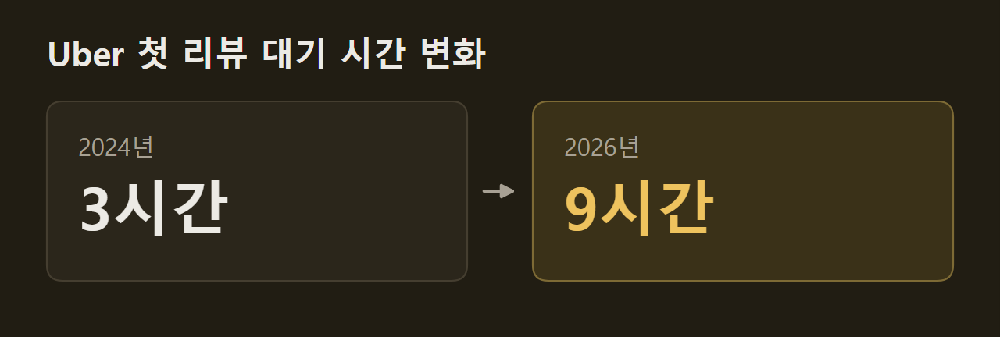
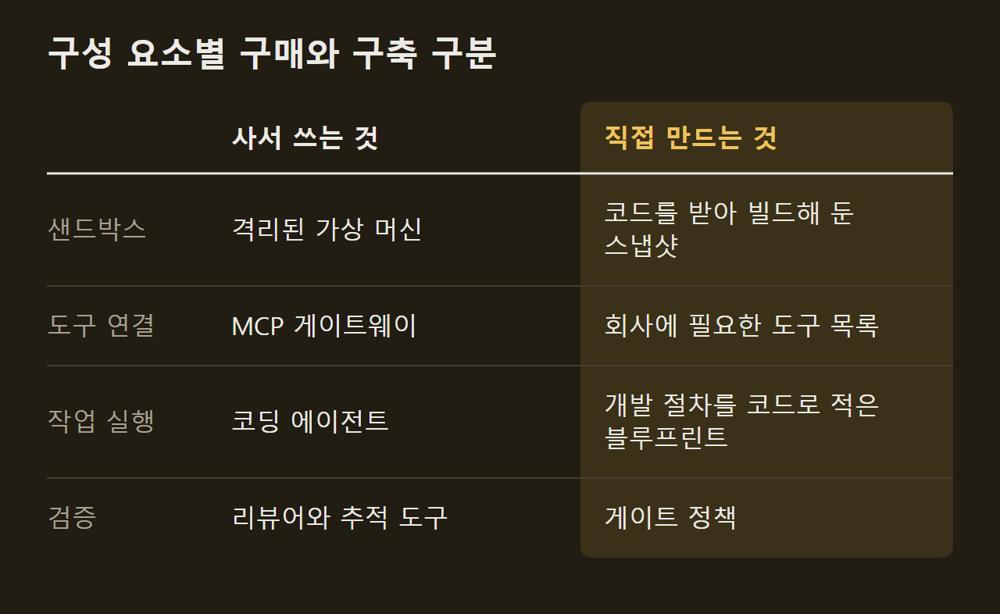
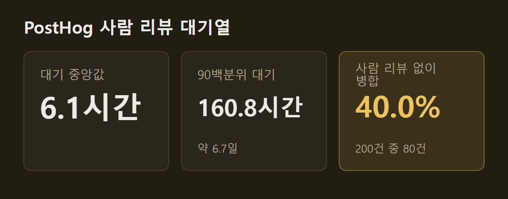

> 이 글은 아래 원문을 우리말로 간추려 정리한 글입니다. 정확한 내용은 원문을 확인하십시오.
>
> 원문: [theaithinker.com/p/how-to-build-an-ai-native-software](https://www.theaithinker.com/p/how-to-build-an-ai-native-software)  
> 원문을 소개한 뉴스레터: TLDR AI

팀원 모두가 이미 Claude Code나 Cursor를 쓰고, 몇몇은 에이전트 셋을 동시에 돌린다. 그런데 경영진이 Uber의 소프트웨어 팩토리 발표를 전달하면서 "우리 것은 어디 있느냐"고 묻는다. 도구는 이미 샀는데 무엇을 더 만들어야 하느냐는 물음에 The AI Thinker의 글은 회사 차원의 체계라고 답한다. 글이 말하는 [소프트웨어 팩토리](https://www.theaithinker.com/p/how-to-build-an-ai-native-software)는 티켓이나 알림이 들어오면 키보드 앞에 사람이 없어도 에이전트가 일을 시작하고, 모든 팀이 공유하는 규칙에 따라 클라우드에서 돌며, 그 비용을 누구나 읽을 수 있게 만드는 시스템이다. 아이디어에서 프로덕션까지를 모두 덮지만, 그 안에 들어가는 코딩 에이전트는 Uber도 직접 만들지 않고 사서 쓴다.

```요약
요약: 소프트웨어 팩토리는 코딩 에이전트는 사서 쓰고 실행 환경·도구·규칙·비용 측정은 회사가 직접 만드는 체계이고, Uber는 이 체계에서 이전 작업과 코드 리뷰 같은 반복 잡무부터 에이전트에 맡겼다.
```

```용어
소프트웨어 팩토리: 에이전트가 아이디어부터 프로덕션까지의 일을 맡도록 회사가 갖추는 실행 환경, 규칙, 비용 측정 체계다. 코딩 에이전트 자체는 여기에 들어가지 않는다.
라인: 에이전트 하나가 일 하나를 맡는 단위다. 풀 리퀘스트 리뷰나 오래된 기능 플래그 정리가 그런 일이다.
반복 잡무: 손으로 해야 하고 되풀이되며 자동화할 수 있지만 남는 가치가 없고, 서비스가 커지는 만큼 늘어나는 운영 작업이다. Google SRE 책의 정의다.
모델 게이트웨이: 공급사와 관계없이 회사의 모든 모델 호출이 지나가는 관문 하나다. 요청마다 사용자와 팀을 기록하므로 비용을 볼 수 있다.
섀도 모드: 에이전트가 의견만 남기고, 그 의견을 따라야 할 사람은 없는 시험 운영 방식이다.
```

## 1. 코딩 도구가 풀지 못하는 네 가지 한계

코딩 도구는 개발자 한 명을 빠르게 만든다. 에이전트 수십 개를 돌리는 회사는 도구 하나로는 풀리지 않는 한계에 부딪히고, 글은 그것을 네 가지로 정리한다.

1. 노트북: 사람 없이 시작되는 에이전트 세션이 늘어나는데, 노트북은 주인이 잘 때 같이 꺼진다.
2. 팀마다 다른 방식: 개발자 100명에게 에이전트를 주면 설정도 100가지가 된다.
3. 보이지 않는 비용: 개발자마다 도구와 모델을 따로 고르면 청구서가 오기 전까지 합계를 아무도 모른다.
4. 리뷰 병목: 앞의 셋을 풀어 산출물이 늘면 사람의 리뷰가 그 양을 따라가지 못한다.

")

Uber에서는 코드 리뷰, CI 수정, 장애 대응 분류, 유지보수가 사람 없이 에이전트 세션을 시작하는 경우가 점점 늘고 있다. Uber는 노트북에서 관리형 에이전트로 옮겨 가는 것을 핵심 전략 전환으로 꼽았고, 관리형 환경이어야 모델 라우팅과 하네스, 지출을 "완전히 통제"할 수 있다고 설명한다. DoorDash는 권한을 걱정했다. 노트북에는 SSH 키와 VPN 세션, 인증이 끝난 도구가 다 들어 있어서 자율 에이전트에게 그 접근권을 넘기면 사고가 났을 때 피해 범위가 클 수 있다는 것이다. Ramp는 개수에서 막혔다. 엔지니어들이 Claude Code를 좋아했지만 노트북 한 대로는 세션을 두어 개밖에 돌릴 수 없었다.

팀마다 방식이 갈리는 문제는 잘 드러나지 않는다. Uber 엔지니어들이 여러 저장소에 스킬을 대량으로 만들고 나니 중복이 많았고 품질이 낮은 것도 많았다. 보안 규칙도 어느 팀 프롬프트에는 있는데 다른 팀 프롬프트에는 빠지기 쉽다. Anthropic의 플레이북은 규칙마다 스킬을 한 번만 만들어 공유하라고 하고, 글쓴이는 회사의 일하는 방식을 한 곳에 한 번만 두는 자리가 팩토리라고 본다. 도입 속도도 팀마다 달라진다. 올해 3월 Uber 개발자의 92%가 매달 에이전트를 썼는데도 확산은 예상보다 느렸다. Google의 DORA 연구는 이런 상태를 "국지적인 생산성 섬"이라고 부르는데, 한 팀이 빨라져도 그 효과가 뒷단계에서 사라진다는 뜻이다.

비용은 더 급했다. 3월까지 Uber의 AI 비용은 2024년보다 6배 늘었고, 6월에는 한 해 AI 예산을 넉 달 만에 다 썼다. Uber가 세션을 분석해 보니 Sonnet으로 충분한 단순한 세션을 Opus로 돌린 경우가 많았다. 노트북 한 대에서는 이런 패턴이 보이지 않지만 게이트웨이에서는 전부 보인다. Shopify의 Farhan Thawar는 "LLM 때문에 엔지니어 한 명에게 월 1,000달러가 더 들어도 생산성이 10% 오르면 너무 싸다"고 말했다. ==네 한계 가운데 어느 것도 모델 성능의 문제가 아니다.== 다만 이런 판단을 하려면 병합된 변경 하나에 얼마가 들었는지 알아야 하는데, 개인 라이선스로는 좌석 가격만 알 수 있다.

## 2. 리뷰로 옮겨 간 대기열

앞의 세 한계를 풀면 산출물이 늘고, 그때 네 번째 한계가 나타난다. 왼쪽 그림은 개발자 한 명이 쓴 풀 리퀘스트를 리뷰어가 여유 있게 처리하는 모습이다. 오른쪽에서는 에이전트들이 풀 리퀘스트를 쏟아 내고, 같은 리뷰어 앞에 쌓인 더미가 새로운 병목으로 표시되어 있다.

")

Uber 리뷰 팀은 8월 AI Engineer 발표에서 이 변화를 숫자로 밝혔다. 2024년에는 엔지니어가 첫 리뷰를 받기까지 3시간이 걸렸는데, 2026년에는 9시간으로 늘었다. ==코드는 늘었는데 리뷰어 수는 그대로였다.== Spotify도 AI를 도입한 뒤 리뷰할 풀 리퀘스트가 76% 늘었다. 엔지니어링 분석 회사 Faros AI는 개발자 22,000명을 조사해 리뷰에 머무는 시간의 중앙값이 441.5% 늘었다고 밝혔다.



글쓴이는 앞서 쓴 글에서 모든 일이 기다리는 단계를 하나 찾아 다음 에이전트를 그 단계에 두라는 규칙을 내놓았고, 팩토리는 이 규칙을 아이디어에서 프로덕션까지 전체 라인에 적용한다고 설명한다. 지금 많은 팀에서 가장 느린 단계는 리뷰다. Uber는 리뷰 다음 병목으로 CI 처리 용량과 실험 슬롯, 무엇을 만들지 정하는 일을 꼽는다.

## 3. Uber의 네 층 에이전트 지도

Uber는 비용 효율을 다룬 글에서 모든 에이전트 세션을 가장 전문화된 것부터 가장 일반적인 것까지 네 층으로 나눴다. Uber의 표현으로는 "층이 높을수록 비용, 품질, 모델 선택을 더 많이 통제할 수 있다."

1. 전문 에이전트: 좁은 일 하나씩을 맡는 에이전트 몇 개로, Uber 클라우드에서 사람의 확인을 거치며 돈다. Minion은 의도를 풀 리퀘스트로 만들고 uReview는 그것을 리뷰하며, Agentic XP는 실험 결과를 정리하고 Conan AI는 알림의 근본 원인을 찾고 Fawkes는 정기 유지보수를 맡는다. 병합된 풀 리퀘스트, 리뷰, 알림, 정리 작업마다 단가를 매긴다.
2. 일반 에이전트: 회사의 단일 창구인 Cortana다. 설정 없이 클라우드에서 돌고, 사내 마켓플레이스의 스킬을 무엇이든 쓰며, 질의 한 건당 비용으로 잰다.
3. 스킬을 얹은 세션: 개발자가 노트북에서 여는 세션에 공유 스킬을 얹어 쓰는 층이다. Uber의 공유 스킬은 3,600개가 넘는다.
4. 맨 세션: 아무것도 더하지 않은 Claude Code, Codex, OpenCode다. 프롬프트와 맥락, 방향 잡기를 개발자가 직접 한다.

그림 왼쪽의 위쪽 화살표는 반복되는 일일수록 위층으로 올라간다는 뜻이다.

")

이 구조에는 세 가지 선택이 들어 있다. 팀마다 에이전트를 두지 않고 전문 에이전트 다섯 개로 회사 전체의 코드 생성, 검증, 배포, 관찰, 유지보수를 맡긴다. 요청이 들어오는 창구는 하나라서 어느 봇에 물어야 할지 찾아다닐 필요가 없다. 코딩 도구는 맨 아래층에 그대로 남아 아직 전담 라인이 없는 일을 처리하므로, 팩토리가 자기 도구를 빼앗을까 걱정하는 개발자에게도 답이 된다.

지도를 아래에서 위로 읽으면 일이 올라가는 경로가 된다. 어떤 일은 맨 세션에서 시작했다가 여러 사람이 같은 방식으로 하게 되면 공유 스킬이 되고, 벤치마크를 만들 수 있을 만큼 자주 돌면 전문 에이전트가 된다. ==반복되는 일일수록 위층으로 올라가 전담 에이전트가 된다.== 맨 위층의 규칙은 가장 좁은 일을 골라 실제 벤치마크를 만들고, 비용과 품질의 균형이 가장 좋은 모델을 쓰는 것이다. Uber는 이를 "모든 비용이 작업 단위 하나에 대응한다"고 요약했다. 지금 Claude Code나 Cursor를 쓰는 팀은 아래 두 층에 있고, 글쓴이는 공유 스킬 폴더를 두는 것이 가장 싸게 한 층 올라가는 방법이라고 본다.

다른 회사들은 다른 층부터 시작했다. Shopify는 사내 Slack의 공개 채널에서만 일하는 에이전트 River로 창구부터 만들었고, River는 이제 병합되는 풀 리퀘스트 여덟 건 중 한 건을 함께 쓴다. 이후 팀마다 리뷰, 조사, 이전 작업용 에이전트를 요청하자 Shopify는 그 밑에 플랫폼을 깔았다. DoorDash는 Flux 플랫폼에서 플레이북마다 필요한 도구를 선언하게 하고 그 도구의 권한만 주는 방식으로 스킬 층을 만들었다. Spotify는 바로 전문 라인으로 갔다. 백그라운드 에이전트 Honk는 데이터셋 변경 한 건으로 하위 파이프라인 약 1,800개를 옮겼는데, 결과를 예측할 수 있게 하려고 일부러 공유 스킬에는 접근하지 못하게 했다.

## 4. 한 변경의 흐름과 첫 라인

AI Engineer에서 Adam Huda는 기능 하나가 Uber 팩토리를 지나는 과정을 보여 줬다. 사람이 몰린 월드컵 경기장을 나서는 승객에게 혼잡을 피한 승차 위치를 제안하는 기능이다.

1. 아이디어: Slack 스레드에서 Cortana를 부르면, 과거 대형 행사장 사례를 찾아 북미 출시를 제안하고 A/B 테스트용 Figma 시안 두 개와 재사용할 화면·서비스 목록을 만든다. Huda는 예전에는 이 합의에만 몇 주가 걸렸다고 했다.
2. 구현: Cortana가 넘긴 일을 클라우드 개발 환경에서 도는 Minion이 맡아, 여러 저장소에 걸친 백엔드와 프런트엔드 변경을 쓰고 초안 풀 리퀘스트에서 멈춘다.
3. 검증: CI 전에 스킬이 시뮬레이터 화면을 찍어 Figma 시안과 견주고, 스테이징에서 새 프런트엔드와 백엔드를 함께 띄워 본다.
4. 리뷰와 CI: 중간 크기 모델이 CI 전에 먼저 보고, 추론이 강한 모델이 CI에서 한 번 더 깊게 본다. 빌드가 실패하면 자가 복구 CI가 상당수 오류를 스스로 고친다.
5. 인계: 사람에게 가는 풀 리퀘스트에는 통과한 검사 목록과 시뮬레이터 화면이 붙는다.
6. 유지보수와 장애: 실험이 끝나면 B안의 기능 플래그는 CI가 한가한 주말에 정리 루프가 지운다. 매달 장애 리뷰에서 찾은 패턴은 새 유지보수 스킬이 되어 모든 서비스에 적용된다.

Anthropic의 Louis Claxton은 같은 루프를 플레이북으로 정리했다. Anthropic은 이 루프가 쓰는 에이전트를 파는 회사이므로 글쓴이는 형태만 참고하라고 덧붙인다. 그림에서 단계마다 파일 하나를 버전 관리에 남기면 다음 단계는 그 파일을 읽고 시작하고, intent.md, spec.md, plan.md, 코드와 테스트, 풀 리퀘스트, 장애 기록이 차례로 생긴다. 손 모양으로 표시된 의도 수락, 계획 승인, 병합 승인 세 곳에 사람이 선다.

")

플레이북은 단계마다 먼저 사람이 직접 프롬프트를 넣어 보고, 루프 자동화는 맨 나중에 하라고 권한다. Stripe의 Minions는 사람이 쓴 코드 없이 풀 리퀘스트를 주당 1,300건 넘게 병합하지만 리뷰는 한 건도 빠짐없이 사람이 한다. Spotify에서는 판정 역할을 맡은 모델이 세션의 약 4분의 1을 거부하고, 거부당한 에이전트는 절반쯤 스스로 방향을 고친다. DoorDash는 리뷰를 둘로 나눠 정찰 역할의 에이전트가 의심 구간을 표시하면 더 깊이 보는 리뷰어들이 하나씩 확인한다.

Uber가 처음 에이전트를 둔 곳은 반복 잡무였다. Uber는 자동화된 이전 작업을 250건 넘게 돌려 코드 900만 줄을 고쳤고, Minion은 반복 잡무를 넘어서는 기능 작업이면 초안 풀 리퀘스트에서 멈춘다. 생성형 AI가 늘 맞는 것도 아니었다. JUnit 5 이전에서 테스트 클래스 파일 여러 개를 한 번에 생성형 AI로 옮기려다 실패하자, Uber는 대규모 코드 변경용 사내 도구 Shepherd로 규칙에 따라 5,000건 넘는 변경을 만들고 AI는 테스트와 빌드 실패를 디버깅하는 데만 썼다. 그렇게 테스트 클래스 75,000개 이상을 넉 달 만에 옮겼다. ==규칙으로 쓸 수 있는 일은 규칙으로 처리하고, 에이전트는 그다음이다.==

글쓴이는 첫 라인을 고를 때 틀린 답의 비용은 싸고 맞는 답은 분명한 일을 고르고, SRE의 정의에 "완료"를 쉽게 확인할 수 있는지를 더해 점검하라고 한다. DoorDash는 자주 일어나고 측정하기 쉬우며 엔지니어가 평가하기 쉽다는 이유로 코드 리뷰부터 시작했다. Spotify는 이전 작업부터 시작했고, 첫 병합 1,500건이 모두 여기서 나왔으며 손으로 할 때보다 시간이 60~90% 덜 들었다. 첫 라인에는 Claude Code on the web, Copilot 클라우드 에이전트, Cursor 클라우드 에이전트처럼 격리된 머신에서 일하고 풀 리퀘스트를 돌려주는 상용 에이전트를 쓸 수 있다. 처음에는 섀도 모드로 돌리고, CI라면 `claude -p`로 실패한 빌드를 분류하거나 불안정한 테스트를 요약하는 읽기 전용 작업부터 맡긴다. Uber의 리뷰어 배정 도구 Code Inbox와 기능 플래그 정리 루프, DoorDash에서 리뷰 댓글에 에이전트를 태그하면 수정을 올려 주는 기능도 다음 후보로 소개된다.

## 5. 에이전트 아래의 여섯 구성 요소

Uber의 Uday Kiran Medisetty와 Adam Huda는 8월 발표에서 플랫폼을 여섯 구성 요소로 설명했는데, 그 안에 코딩 에이전트는 없다. Uber는 이 플랫폼이 6년간 쌓아 온 플랫폼 작업 위에 서 있다고 밝혔고, 글쓴이는 대부분의 회사가 게이트웨이부터 시작한다고 본다. 그림 맨 위 칸에는 에이전트를 깨우는 Slack 메시지, 이슈, CI 이벤트, 일정이 있다. 가운데 칸에는 사서 쓰는 에이전트를 돌리는 하네스가, 맨 아래 칸에는 모델 게이트웨이, 샌드박스, 도구 카탈로그, 맥락이 있다. 오른쪽 기둥은 모든 칸을 지나는 게이트와 신원, 기록이다.

")

1. 모델 게이트웨이: 모든 모델 호출이 지나는 관문이다. Uber의 게이트웨이는 개인정보를 기본적으로 밖으로 내보내지 않고, 상한이 엄격한 범위에서 가드레일 지연을 허용하며, 요청마다 사용자·프로젝트·팀을 기록한다. 사내 프로젝트 800개 이상이 하루 1억 건 넘게 요청을 보낸다.
2. 샌드박스: 에이전트가 일하는 격리된 머신이다. Uber의 DevPod는 모든 저장소를 복사하고 검색 색인까지 만들어 둔 머신을 미리 띄워 두므로 몇 초 안에 일을 시작한다.
3. 도구 카탈로그: 에이전트에 도구를 연결하는 공개 표준인 MCP로 사내 시스템을 여는 층이다. Uber는 크롤러가 달린 MCP 게이트웨이를 만들어 설정 하나만 바꾸면 사내 API가 도구가 되게 했다.
4. 맥락: 에이전트가 짐작에 기대지 않게 하는 정보다. Uber의 맥락 그래프는 사내 시스템 30여 개의 노드 2,400만 개를 잇는다.
5. 하네스: 에이전트를 돌리는 루프와 그것을 시작하는 트리거다. Uber는 상용 모델이든 공개 가중치 모델이든 한 인터페이스 뒤에 두고, 에이전트마다 실제 업무로 벤치마크해 가장 맞는 모델로 바꾼다.
6. 게이트: 신원, 승인, 기록이다. 에이전트마다 신원을 따로 주고 일에 필요한 권한만 준다.

구성 요소마다 실제로 있었던 일이 붙어 있다. 오픈소스 게이트웨이 LiteLLM에서는 2026년 3월 악성 코드가 든 릴리스 두 개가 PyPI에 약 40분간 올라와 있었다. 의존성을 고정한 공식 Docker 이미지를 쓴 팀은 피해를 입지 않았지만, Datadog의 분석에 따르면 이 릴리스는 클라우드 키, SSH 키, 쿠버네티스 데이터, CI 비밀값을 빼 갔다. 게이트웨이에는 회사의 공급사 키가 모두 모이므로 글쓴이는 이것을 가장 민감한 장비로 다루라고 한다. 샌드박스는 속도가 중요하다. Stripe의 개발 박스는 10초 만에 뜨고, DoorDash는 5초 이내를 목표로 하며, Ramp는 30분마다 이미지를 다시 만들어 세션이 늘 최신 코드에서 시작하게 한다.

도구는 토큰을 먹는다. 도구마다 에이전트가 읽어야 하는 설명이 붙기 때문에, Uber에서는 도구 100여 개가 프롬프트마다 토큰을 5만~7만 개씩 더했다. Uber는 도구 1,000여 개를 명령으로 바꿔 필요할 때만 찾아 쓰게 했다. Stripe의 Toolshed에는 도구가 500개 가까이 있지만 에이전트는 일부러 줄인 작은 세트만 가지고 시작한다. 맥락의 효과는 Uber의 실험에서 드러났다. 같은 데이터 질문에 맥락 그래프를 쓴 에이전트는 38초 만에 맞는 테이블을 찾았고, 그래프 없이 한 에이전트는 20분 동안 오류를 세 번 낸 끝에 조회할 수 없는 데이터라고 답했다. Meta는 에이전트 50여 개가 큰 코드베이스를 읽고 짧은 맥락 파일 59개를 쓰게 했고, 초기 시험에서 작업당 도구 호출이 40% 줄었다. 가장 작은 규모의 맥락은 Claude Code가 먼저 읽는 `CLAUDE.md` 파일 하나다.

하네스에서 회사 몫으로 남는 것은 믿을 수 있는 단계의 순서다. Stripe는 이를 블루프린트라 부르고, 린터 실행 같은 단계는 일반 코드로 두고 판단이 필요한 단계에만 에이전트를 쓴다. 게이트가 생긴 계기는 신원 문제였다. Uber에서 한 풀 리퀘스트의 작성자가 "Monitoring Agent"로 찍히면서 요청한 엔지니어가 기록에서 사라졌고, Uber는 거치는 곳마다 수명이 짧고 범위가 좁은 토큰을 발급해 사람까지 이어지는 연결을 남겼다. 에이전트가 쓴 코드를 그 에이전트가 승인하지 못하게 하고, Ramp는 세션을 시작한 사람 이름으로 풀 리퀘스트를 연다. 게이트가 없어서 생긴 사고로는 코드 동결 기간에 Replit 에이전트가 프로덕션 데이터베이스를 지운 일, AWS의 코딩 도구가 고객용 시스템을 "지우고 다시 만들기"로 한 일, 악성 공개 이슈가 GitHub MCP 에이전트를 장악해 비공개 데이터를 빼낸 일이 소개된다. 이에 대한 방어로 Meta의 2의 규칙이 나온다. 한 세션의 에이전트는 다음 세 능력 가운데 둘까지만 가진다.

1. 신뢰할 수 없는 입력 읽기: 공개 이슈나 고객 티켓 같은 것이다.
2. 민감한 시스템 접근: 비공개 데이터나 내부 시스템에 닿는 권한이다.
3. 변경과 외부 통신: 무언가를 바꾸거나 바깥과 주고받는 권한이다.

셋이 다 필요한 세션은 사람이 감독한다. 무엇을 사고 무엇을 만들지는 공개 사례에서 끌어낸 방향일 뿐 정해진 방법은 아니라고 글쓴이는 단서를 단다. 출발점은 샌드박스와 트리거, 풀 리퀘스트 흐름을 함께 제공하는 호스팅 백그라운드 에이전트를 통째로 사는 것이다. 다만 스냅샷과 도구, 제한은 마음대로 정할 수 없어서, 예를 들어 Copilot 클라우드 에이전트는 59분에서 멈추고 한 번에 저장소 하나만 다룬다. 그 한계를 넘어서면 글쓴이는 아래처럼 나누자고 제안한다.



모델 게이트웨이도 LiteLLM, Portkey, Kong, Cloudflare, Bedrock 같은 상품을 살 수 있고, 회사 맥락은 직접 만들어야 하는 쪽에 들어간다. 처음부터 다 갖출 필요는 없다. 글쓴이는 다른 팀을 빠르게 만드는 최소한의 공유 도구를 뜻하는 Team Topologies의 "가장 얇은 플랫폼" 개념을 빌려, 첫 에이전트에 필요한 구성 요소만 만들고 팀이 요청할 때 하나씩 더하라고 한다. 규모도 작을 수 있다. Ramp의 Inspect 팀은 엔지니어 넷, 디렉터 하나, 시간제 PM 하나로 5.5명이었는데, v2 출시 두 달 뒤 Inspect가 Ramp 풀 리퀘스트의 약 60%를 썼고 5월에는 75%가 됐다. LinkedIn의 Prince Valluri는 사내에서 GitHub Copilot이나 Cursor, Replit을 다시 만들려 하지 말라고 경고했다. ==에이전트는 사고, 에이전트가 딛는 바닥은 직접 만든다.==

## 6. 도입 순서와 측정, 개발자 설득

글쓴이는 공개된 사례가 모두 플랫폼 팀을 둔 대형 기술 기업이고, 노트북에서 출발하는 엔지니어 300명 규모 회사의 사례는 없다고 먼저 밝힌다. 그래서 무언가를 증명하기 전까지 요구하는 것이 가장 적은 순서를 제안한다. 그림의 계단은 다섯 단계이고 단계마다 계기판이 하나씩 붙어 있다. 대기열 측정은 첫 리뷰까지 걸린 시간으로, 섀도 모드로 돌리는 라인 하나는 실제로 반영된 의견 수로 잰다. 가장 얇은 바닥은 세션당 비용으로, 게이트와 루프는 되돌린 변경 수와 나란히 놓은 병합 수로, 라인 추가는 변경 실패율로 잰다.

")

==단계마다 숫자 하나가 움직일 때만 다음 단계로 간다.== 첫 단계에는 공급사도 비용도 거의 필요 없다. 글쓴이는 오픈소스 분석 회사 PostHog의 공개 저장소에서 최근 병합된 풀 리퀘스트 200건을 Claude Code에 맡겨 GitHub CLI로 첫 리뷰까지 걸린 시간을 재게 했고, 실행에는 약 6분과 25센트가 들었다. PostHog는 리뷰 봇을 여럿 돌려 거의 모든 풀 리퀘스트를 몇 분 안에 보는데, 봇을 넣어 세면 대기 시간 중앙값이 약 4분까지 내려가므로 봇을 빼고 사람의 대기열만 쟀다.



PostHog는 하루에 풀 리퀘스트를 약 200건 병합하므로 이 표본은 하루치 정도이고, 글쓴이도 프롬프트 시연으로만 읽으라고 한다. 400줄 넘게 바꾼 풀 리퀘스트가 28.5%였다는 결과도 나왔다. 글쓴이가 큰 변경의 비율도 함께 보라고 하는 근거는 DORA의 AI 역량 모델이다. 이 모델은 작은 단위로 일하기를 AI가 크고 불안정한 변경을 만드는 위험에 맞서는 방법으로 꼽는다.

측정의 틀은 Uber의 점수표를 따른다. 관리형 에이전트마다 병합된 풀 리퀘스트나 리뷰, 알림당 비용을 보고, 되돌림 비율과 리뷰어의 F1 점수, 장애 복구 시간으로 품질을 보며, 반영된 변경과 게시된 리뷰 수로 양을 본다. 처리량 숫자 옆에 품질 숫자가 없으면 숫자를 부풀리려는 사람이 생긴다. "AI가 쓴 코드 비율"이 좋은 지표가 아니라는 것은 Uber 자신의 숫자가 보여 준다. 8월에는 풀 리퀘스트의 70% 이상에 에이전트가 관여했다고 했는데, 5월에 백그라운드 에이전트 팀은 병합된 풀 리퀘스트의 11%를 이야기했다. 무엇을 세느냐에 따라 같은 회사 안에서 여섯 배 넘게 차이가 났다. 비용도 따로 본다. 예산을 넘긴 뒤 Uber는 도구 하나당 직원 한 명의 월 지출을 1,500달러로 묶었다가, 지출을 실시간으로 보여 주고 계획의 50%, 80%, 100%에서 알림을 보내는 방식으로 바꿨다. 6월 이후 세션당 비용은 최고치보다 52% 내려갔다. 다른 회사들의 숫자도 있다. Intercom은 R&D 직원 한 명당 병합 풀 리퀘스트를 16개월 만에 세 배로 늘렸고, AI가 쓴 백엔드 코드의 되돌림 비율은 0.53%로 사람이 쓴 코드의 5.39%보다 낮았다. 반대로 Meta와 Amazon의 토큰 사용량 순위표는 의미 없는 작업으로 순위를 올리는 사람이 나오면서 실패 사례로 소개된다.

마지막 과제는 개발자다. 25년 동안 프로그래밍을 해 온 한 Anthropic 엔지니어는 그 기술에서 느끼는 유능함이 일의 만족에서 중심이었는데 한 시대가 끝났다고 말했다. Honeycomb 공동 창업자 Charity Majors는 읽지 않은 코드를 마음 편히 배포하려면 무엇이 필요하냐고 묻는다. 글쓴이는 이렇게 묻는 사람들이 가장 좋은 리뷰어라고 보고, 도입에 성공한 회사들에서 되풀이되는 방법 네 가지를 든다.

1. 잡무부터 덜어 주기: Uber는 업그레이드, 이전 작업, 버그 수정을 AI에 넘긴 뒤 엔지니어 만족도가 크게 올랐다고 밝혔다.
2. 공개된 곳에서 일하기: Cortana는 팀 Slack 채널에서 답한다. DoorDash는 실행마다 비공개 채널을 열었을 때는 팀의 습관이 생기지 않다가 공개 스레드로 바꾸자 달라졌다.
3. 선택에 맡기기: Ramp는 Inspect 사용을 강요하지 않았는데도 Inspect가 풀 리퀘스트 대부분을 쓰게 됐다. Duolingo의 Luis von Ahn은 AI 사용 여부를 인사 평가에서 뺐다.
4. 게이트를 개발자에게 맡기기: Uber의 에이전트 풀 리퀘스트에는 통과한 검사 목록과 화면이 붙는다. Anthropic 플레이북에서는 기술 리드가 `REVIEW.md`에 리뷰 정책을 쓰고, 에이전트는 자기 작업을 승인하지 못한다.

Spotify가 병합한 자동 유지보수 풀 리퀘스트는 250만 건이 넘고, 대부분 사람을 거치지 않았다. Uber 발표는 거의 무엇이든 만들 수 있게 되면 질문이 바뀐다는 말로 끝났다. Huda는 이제 "만들어야 하느냐"가 질문이라고 했다.

## 출처와 작성 방식

- 원문: [theaithinker.com/p/how-to-build-an-ai-native-software](https://www.theaithinker.com/p/how-to-build-an-ai-native-software)
- 원문을 소개한 뉴스레터: TLDR AI
- 그림: 아래에 출처가 적힌 그림은 원문에 실린 그림을 인용한 것이며 저작권은 원저작자에게 있습니다. 출처가 없는 그래프는 원문에 적힌 값으로 직접 그린 것입니다.
- 작성 방식: 직접 만든 뉴스 정리 파이프라인(VISER)으로 생성하고 검수한 글입니다. 본문의 수치와 주장은 원문에서 가져온 것입니다.
- 정리 주차: 2026-W41
