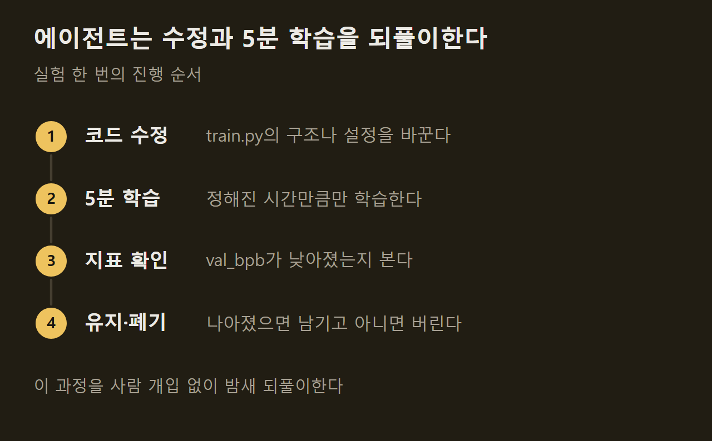

> 이 글은 아래 원문을 우리말로 간추려 정리한 글입니다. 정확한 내용은 원문을 확인하십시오.
>
> 원문: [github.com/karpathy/autoresearch](https://github.com/karpathy/autoresearch)  
> 원문을 소개한 뉴스레터: Nathan Benaich

언어 모델 연구자는 보통 학습 코드를 직접 고치고, 돌려 보고, 결과가 나아졌는지 확인하는 일을 되풀이한다. Andrej Karpathy가 공개한 [autoresearch](https://github.com/karpathy/autoresearch)는 이 반복을 AI 에이전트에게 맡기는 저장소다. 작지만 실제로 동작하는 LLM 학습 코드를 에이전트에게 주면, 에이전트가 코드를 고치고 5분 동안 학습한 뒤 결과가 나아졌을 때만 변경을 남긴다. 사람은 아침에 실험 기록과 성능이 나아진 모델을 받는다.

```요약
요약: 에이전트가 학습 코드 파일 하나를 고치며 5분짜리 실험을 밤새 반복하는 저장소로, 학습 시간이 고정되어 실험끼리는 바로 비교되지만 다른 장비에서 얻은 결과와는 비교할 수 없다.
```

```용어
에이전트: 지시문을 읽고 코드를 고치고 실행하는 일을 스스로 이어 가는 AI 프로그램. 원문은 Claude나 Codex를 예로 든다.
val_bpb: 검증 데이터에서 잰 바이트당 비트 수. 낮을수록 모델이 글을 잘 예측한다는 뜻이다.
하이퍼파라미터: 학습률이나 배치 크기처럼 학습 전에 사람이 정해 두는 설정값.
옵티마이저: 학습 중에 모델의 가중치를 어떻게 고칠지 정하는 알고리즘.
```

## 1. 실험이 반복되는 방식

에이전트가 하는 일은 단순한 반복이다. 학습 코드를 한 군데 고치고, 5분 동안 학습하고, 지표가 좋아졌는지 확인한다. 좋아졌으면 변경을 남기고 아니면 버린 뒤 다음 수정으로 넘어간다.



지표는 `val_bpb` 하나다. 이 값은 어휘 크기에 영향을 받지 않으므로, 에이전트가 모델 구조를 바꿔도 앞선 실험과 공정하게 비교된다. 학습 코드는 Karpathy의 nanochat을 GPU 한 대용으로 단순화한 것이다.

## 2. 파일 세 개와 사람의 역할

저장소는 일부러 작게 유지되고, 중요한 파일은 셋뿐이다.

1. `prepare.py`: 고정 상수, 한 번만 하는 데이터 준비, 데이터 로더와 평가 도구를 담으며 아무도 고치지 않는다.
2. `train.py`: 모델, 옵티마이저, 학습 루프가 모두 들어 있고 에이전트가 고치는 유일한 파일이다.
3. `program.md`: 에이전트에게 주는 지시문으로, 사람이 고친다.

==사람은 파이썬 코드가 아니라 에이전트에게 줄 지시문을 고친다.== 연구자가 평소처럼 학습 코드를 만지는 대신, 에이전트에게 맥락을 주는 마크다운 파일을 다듬어 연구 조직을 짜는 셈이다. 저장소의 기본 지시문은 의도적으로 최소한만 담았고, Karpathy는 이 지시문을 계속 고쳐 연구 진행이 가장 빠른 구성을 찾거나 에이전트를 더 붙일 수 있다고 적었다.

에이전트가 고칠 수 있는 파일을 하나로 묶어 둔 것은 작업 범위를 관리하기 쉽고 변경 내역을 사람이 검토하기 쉽기 때문이다. 모델 구조, 하이퍼파라미터, 옵티마이저, 배치 크기는 모두 수정 대상이다.

## 3. 5분 고정 학습과 실험 기록

학습 시간은 장비 사양과 관계없이 시작·컴파일 시간을 뺀 경과 시간 기준으로 정확히 5분이다. 그래서 한 시간에 약 12번, 자는 동안 약 100번의 실험이 돌아간다. 에이전트가 모델 크기나 배치 크기를 바꿔도 같은 시간 안에서 겨루므로 실험끼리 바로 비교되고, 그 장비에서 5분 안에 가장 좋은 모델을 찾게 된다. ==대신 다른 장비에서 돌린 사람의 결과와는 비교할 수 없다.==

저장소에 실린 진행 그래프는 실험 83번 가운데 기준 실험을 포함해 15번이 남았음을 보여 준다. 세로축 눈금으로 읽으면 `val_bpb`는 약 0.998에서 0.977 부근까지 내려갔다. 남은 변경에는 전체 배치 크기를 524K에서 262K로 절반으로 줄여 학습 스텝을 늘린 것, 워밍업 5%를 추가한 것, 깊이를 9로 바꾼 것, 위치 인코딩의 기준 주파수를 10000에서 200000까지 세 차례 올린 것이 있다. 40번대 초반부터 60번대 중반까지는 남은 변경이 하나도 없어서, 대부분의 시도가 버려진다는 점도 함께 드러난다.

")

## 4. 실행 환경

지금 코드는 NVIDIA GPU 한 대가 있어야 하고 H100에서 시험했다. 의존성은 PyTorch와 작은 패키지 몇 개뿐이며, 분산 학습이나 복잡한 설정 파일은 없다. CPU나 다른 플랫폼 지원은 원리상 가능하지만 코드가 불어난다는 이유로 넣지 않았다.

맥북처럼 훨씬 작은 장비에서 돌리려는 사람에게는 플랫폼별 포크를 쓰라고 권한다. 작은 모델에 맞춰 데이터셋과 설정값을 어떻게 줄일지도 원문에 정리되어 있다.

## 출처와 작성 방식

- 원문: [github.com/karpathy/autoresearch](https://github.com/karpathy/autoresearch)
- 원문을 소개한 뉴스레터: Nathan Benaich
- 원문 그림: 아래에 출처를 적은 그림은 원문에 실린 그림을 인용한 것이며, 저작권은 원저작자에게 있습니다.
- 그래프: 출처 표기가 없는 그림은 원문에 적힌 값으로 새로 그린 것입니다. 원문에 실린 그림이 아닙니다.
- 작성 방식: 직접 만든 뉴스 정리 파이프라인(VISER)으로 생성하고 검수한 글입니다. 본문의 수치와 주장은 원문에서 가져온 것입니다.
- 정리 주차: 2026-W41
