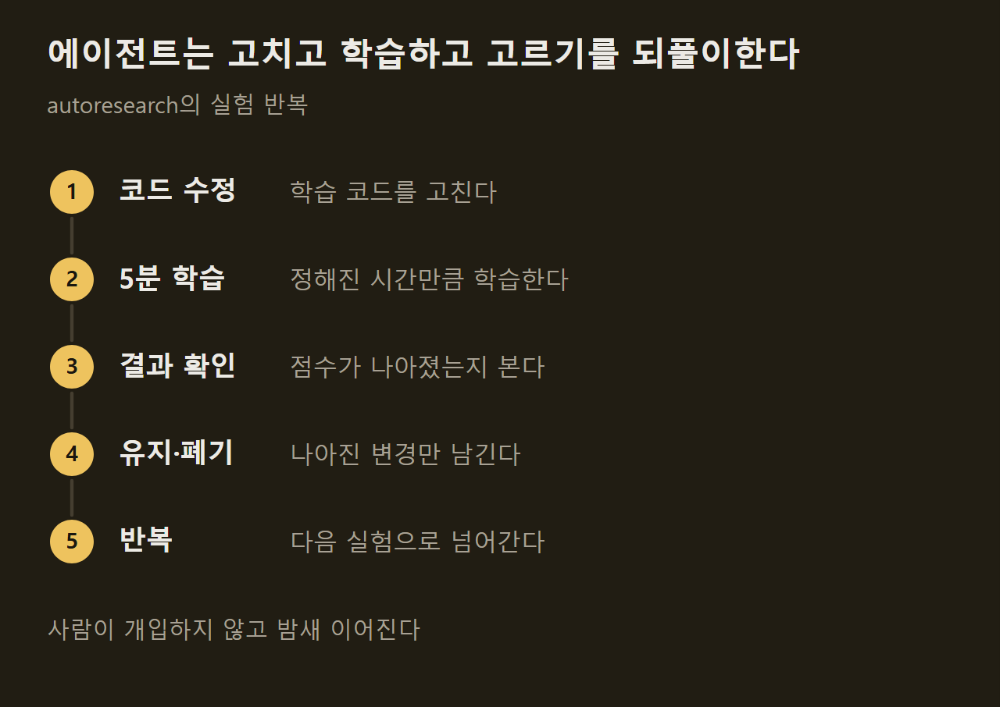
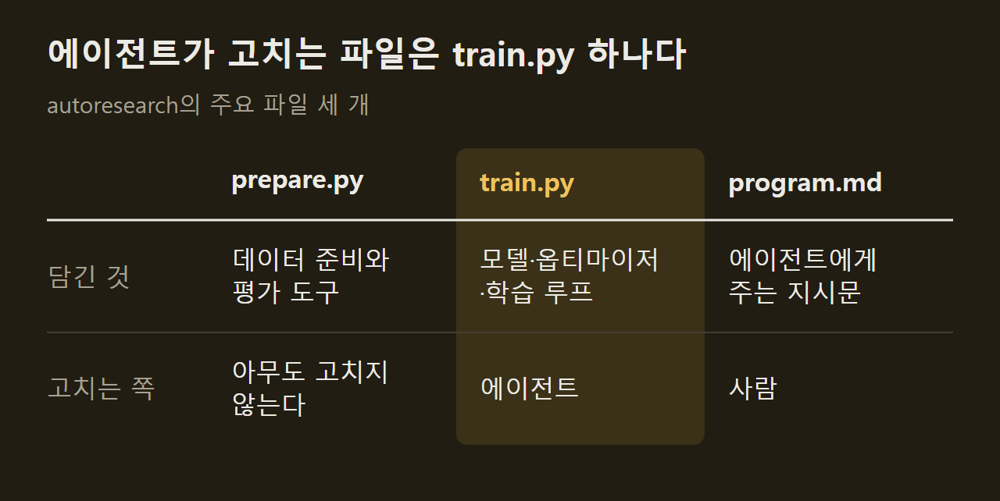
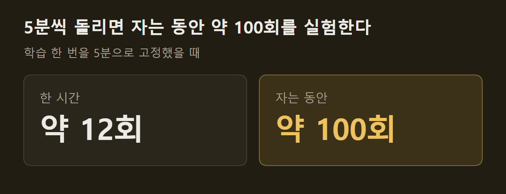

> 이 글은 아래 원문을 우리말로 간추려 정리한 글입니다. 정확한 내용은 원문을 확인하십시오.
>
> 원문: [github.com/karpathy/autoresearch](https://github.com/karpathy/autoresearch)  
> 원문을 소개한 뉴스레터: Nathan Benaich

연구자가 잠든 사이에도 GPU는 돌아가지만, 다음에 무엇을 실험할지는 사람이 깨어 있어야 정할 수 있었다. Andrej Karpathy는 이 결정까지 AI 에이전트에게 맡기는 작은 저장소를 만들어 2026년 3월 [autoresearch](https://github.com/karpathy/autoresearch)라는 이름으로 공개했다.

```요약
요약: 에이전트가 소형 LLM 학습 코드를 스스로 고치고 5분씩 학습해 나아진 변경만 남기는 저장소이며, 학습 시간을 고정했기 때문에 다른 컴퓨터에서 얻은 결과와는 비교할 수 없다.
```

```용어
에이전트: 지시문을 읽고 코드를 고치고 실행하는 일을 스스로 이어 가는 AI 프로그램. 원문은 Claude나 Codex를 예로 든다.
하이퍼파라미터: 학습을 시작하기 전에 정해 두는 설정값. 모델 깊이나 배치 크기가 여기에 든다.
옵티마이저: 학습 중에 모델의 가중치를 어떻게 고쳐 나갈지 정하는 알고리즘.
val_bpb: 검증 데이터에서 잰 바이트당 비트 수. 낮을수록 좋은 모델이다.
```

## 1. 실험 반복 구조

에이전트에게 작지만 실제로 동작하는 LLM 학습 환경을 주고 밤새 혼자 실험하게 한다. 학습 코드는 Karpathy의 nanochat을 GPU 한 장에서 돌도록 줄인 것이다.

에이전트는 코드를 고치고 5분 동안 학습한 뒤 결과가 나아졌는지 확인한다. 나아졌으면 변경을 남기고, 그렇지 않으면 버린 다음 같은 과정을 되풀이한다. ==아침에 남는 것은 실험 기록과 조금 더 나아졌을 모델이다.== 다만 원문도 더 나은 모델에는 "바라건대"라는 단서를 붙였다.



## 2. 파일 세 개의 역할

저장소는 일부러 작게 유지했고, 의미 있는 파일은 세 개뿐이다. 이 가운데 에이전트가 손대는 파일은 `train.py` 하나여서 변경 범위가 좁고, 사람이 바뀐 내용을 검토하기 쉽다. 이 파일 안에서는 모델 구조, 하이퍼파라미터, 옵티마이저, 배치 크기까지 무엇이든 바꿀 수 있다.

사람이 하는 일도 달라진다. 연구자는 파이썬 파일을 직접 고치지 않고, 에이전트에게 맥락과 지시를 주는 마크다운 파일 `program.md`를 쓴다. ==사람은 코드가 아니라 에이전트에게 줄 지시문을 고친다.== 기본으로 들어 있는 지시문은 일부러 최소한으로만 적은 기준선이며, 이를 다듬거나 에이전트를 여럿으로 늘리는 일은 사용자의 몫으로 남겼다.



## 3. 5분 고정 시간과 평가 지표

학습은 컴퓨터 성능과 관계없이 항상 5분 동안만 돈다. 시작과 컴파일에 드는 시간은 빼고 잰 경과 시간이다. 원문은 이렇게 하면 한 시간에 약 12회, 자는 동안 약 100회를 실험할 수 있다고 적었다.



시간을 고정한 데에는 이유가 두 가지 있다. 에이전트가 모델 크기나 구조를 어떻게 바꾸든 같은 시간 안에서 낸 결과이므로 실험끼리 바로 비교할 수 있고, 그 시간 안에서 해당 컴퓨터에 가장 잘 맞는 모델을 찾게 된다. 대신 대가가 따른다. ==다른 컴퓨터에서 돌린 사람의 결과와는 비교할 수 없다.==

성적은 val_bpb 하나로 잰다. 이 값은 어휘 크기에 영향을 받지 않으므로, 에이전트가 모델 구조를 바꿔도 공정하게 견줄 수 있다.

## 4. 실행 환경

현재 코드는 NVIDIA GPU 한 장이 있어야 돌아가며, 시험은 H100에서 했다. 외부 의존성은 PyTorch와 작은 패키지 몇 개뿐이고 분산 학습이나 복잡한 설정 파일은 없다.

CPU나 맥 같은 다른 환경도 원리상 지원할 수 있지만, Karpathy는 코드가 불어난다는 이유로 지금 직접 맡을지 확신하지 못한다고 밝혔다. 그 대신 다른 환경용 포크를 저장소에 소개하고 있으며, 작은 컴퓨터에서 돌릴 때 줄일 설정값도 원문에 정리되어 있다.

## 출처와 작성 방식

- 원문: [github.com/karpathy/autoresearch](https://github.com/karpathy/autoresearch)
- 원문을 소개한 뉴스레터: Nathan Benaich
- 그래프: 원문에 적힌 값으로 새로 그린 그림입니다. 원문에 실린 그림이 아닙니다.
- 작성 방식: 직접 만든 뉴스 정리 파이프라인(VISER)으로 생성하고 검수한 글입니다. 본문의 수치와 주장은 원문에서 가져온 것입니다.
- 정리 주차: 2026-W41
