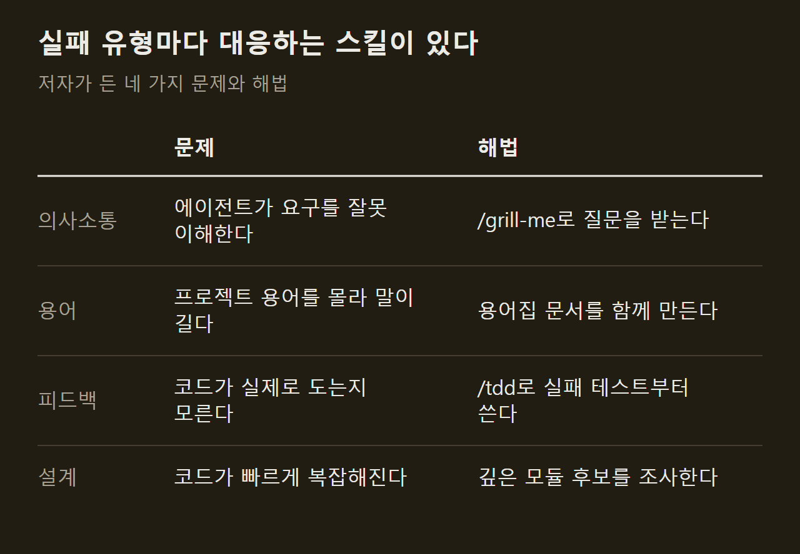
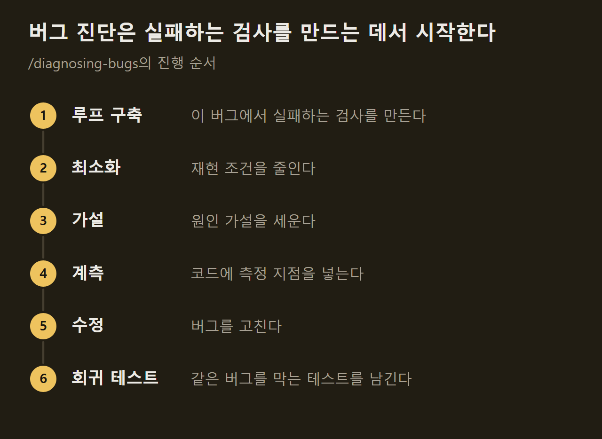
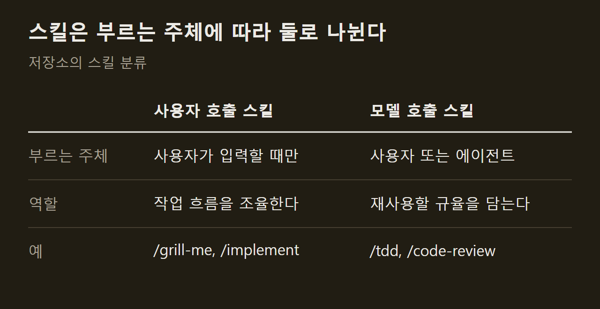

> 이 글은 아래 원문을 우리말로 간추려 정리한 글입니다. 정확한 내용은 원문을 확인하십시오.
>
> 원문: [github.com/mattpocock/skills](https://github.com/mattpocock/skills)  
> 원문을 소개한 뉴스레터: Deep Learning Weekly

코딩 에이전트에게 일을 맡기면 요청한 것과 다른 결과물이 나오거나, 돌아가기는 하지만 고치기 어려운 코드가 쌓이는 일이 잦다. Matt Pocock은 이런 실패를 줄이려고 자신이 매일 쓰는 스킬을 [mattpocock/skills](https://github.com/mattpocock/skills) 저장소로 공개했다. 스킬은 에이전트에 설치해 두고 `/grill-me` 같은 명령으로 부르는 작업 지침이다. 부르면 에이전트가 정해진 절차대로 질문하고, 테스트를 먼저 쓰고, 코드 구조를 점검한다.

```요약
요약: Claude Code, Codex 같은 코딩 에이전트가 자주 보이는 네 가지 실패에 대응하도록 만든 작은 스킬들이며, 설계 개선 스킬은 후보를 찾아 줄 뿐 얽힌 코드를 대신 풀어 주지는 않는다.
```

```용어
스킬: 에이전트가 특정 작업을 할 때 따르는 지침 파일. 사용자가 명령으로 부르거나 에이전트가 필요할 때 스스로 꺼내 쓴다.
그릴링 세션: 작업을 시작하기 전에 에이전트가 사용자에게 만들려는 것을 세세하게 캐묻는 과정.
공유 언어: 프로젝트에서 쓰는 전문 용어를 정리해 사람과 에이전트가 같은 말을 쓰게 하는 문서. 저장소에서는 GLOSSARY.md에 적는다.
레드-그린-리팩터: 실패하는 테스트를 먼저 쓰고, 통과시키고, 그다음 코드를 다듬는 순서.
깊은 모듈: 단순한 인터페이스 뒤에 많은 기능을 담은 모듈.
```

## 1. 만든 배경과 설계 방향

실제 애플리케이션 개발을 돕는 도구로는 GSD, BMAD, Spec-Kit 같은 방식이 이미 있다. 저자는 이들이 개발 과정 전체를 가져가는 방식이라서 사용자의 통제권이 줄고, 과정 안에서 생긴 문제를 바로잡기 어렵다고 본다.

이 저장소의 스킬은 반대 방향으로 설계됐다. 하나하나가 작고, 고쳐 쓰기 쉽고, 서로 조합할 수 있으며 특정 모델에 묶이지 않는다. ==스킬 하나는 에이전트의 실패 유형 하나에 대응한다.== 저자가 꼽은 실패 유형은 네 가지이고, 각각 소프트웨어 공학의 고전에서 가져온 원칙을 해법으로 삼았다.



설치는 에이전트별 플러그인을 쓰거나 skills.sh로 파일을 프로젝트에 복사하는 방법 중 하나를 고른다. 플러그인은 스스로 갱신되고 복사한 파일은 직접 고칠 수 있지만 손으로 갱신해야 하며, 둘을 함께 설치하면 스킬이 두 번씩 잡힌다. 에이전트별 명령은 원문에 정리되어 있다.

## 2. 그릴링 세션과 공유 언어

저자가 가장 흔한 실패로 꼽는 것은 서로 다르게 이해한 채 작업이 진행되는 상황이다. 개발자가 내 뜻을 안다고 생각했는데 결과물을 보고서야 전혀 전달되지 않았음을 알게 되는 일이 에이전트와도 똑같이 벌어진다. 해법은 그릴링 세션이다. `/grill-me`를 부르면 에이전트가 계획의 모든 분기가 정리될 때까지 질문을 이어 가고, 사용자는 답하면서 자신이 만들려는 변경을 더 깊이 생각하게 된다. 저자는 이 스킬들이 가장 많이 쓰인다고 밝혔다.

두 번째 문제는 용어다. 에이전트는 프로젝트에 갑자기 투입되어 전문 용어를 작업하면서 짐작해야 하므로, 한 단어면 될 말을 스무 단어로 풀어 쓴다. 저자는 자신의 저장소에서 가져온 예를 든다. 용어집이 없을 때는 "코스의 섹션 안에 있는 레슨이 '실제'가 될 때, 곧 파일 시스템에 자리를 받을 때 문제가 있다"라고 써야 했던 문장이, 용어집이 생긴 뒤에는 "materialization cascade에 문제가 있다"로 줄었다.

`/grill-with-docs`는 그릴링 세션을 하면서 이 용어집을 함께 만들고, 설명하기 어려운 결정은 ADR이라는 결정 기록 문서로 남긴다. ==공유 언어가 생기면 변수·함수·파일 이름이 일관되게 붙는다.== 그 결과 에이전트가 코드베이스를 찾아다니기 쉬워지고, 간결한 말로 생각하므로 추론에 쓰는 토큰도 줄어든다는 것이 저자의 설명이다. 수치로 잰 결과는 자료에 없다.

## 3. 피드백 루프와 /tdd

무엇을 만들지 합의했는데도 결과물이 나쁘다면 저자는 피드백 루프를 살펴보라고 한다. 자신이 쓴 코드가 실제로 어떻게 동작하는지 알 수 없으면 에이전트는 확인 없이 코드를 계속 쌓게 된다. 필요한 피드백 수단으로는 정적 타입, 브라우저 접근, 자동화 테스트가 꼽힌다.

자동화 테스트에서는 레드-그린-리팩터 순서가 핵심이다. `/tdd`는 에이전트가 실패하는 테스트를 먼저 쓴 뒤 그것을 통과시키도록 유도하고, 좋은 테스트와 나쁜 테스트를 가르는 기준도 함께 준다. 기능 추가든 버그 수정이든 작게 나눈 단위 하나씩 진행한다.

디버깅에는 `/diagnosing-bugs`가 있다. 까다로운 버그와 성능 저하를 다루는 절차이며, 앞 단계를 통과해야 다음 단계로 넘어간다.



## 4. 설계 관리와 /improve-codebase-architecture

에이전트로 만든 앱은 대체로 복잡하고 고치기 어렵다. 에이전트가 코딩 속도를 크게 높이는 만큼 코드가 무질서해지는 속도도 함께 빨라지기 때문이다. 저자가 내놓은 해법은 코드 설계에 계속 신경 쓰는 것이고, 기준은 깊은 모듈이다.

이 원칙은 여러 스킬에 들어 있다. `/to-spec`은 명세를 만들기 전에 어떤 모듈을 건드리는지 사용자에게 묻는다. `/improve-codebase-architecture`는 코드베이스를 훑어 모듈을 더 깊게 만들 수 있는 후보를 찾아 HTML 보고서로 보여 주고, 사용자가 고른 후보를 놓고 그릴링 세션을 진행한다. 저자는 며칠에 한 번 실행하기를 권한다.

저자는 이 스킬의 한계도 함께 적었다. ==이 스킬은 조사 도구이지 구조 작업 도구가 아니다.== 오래된 코드베이스에서도 실제 후보를 찾아내지만, 얽힌 코드를 대신 풀어 주지는 않는다.

## 5. 스킬의 두 종류

저장소의 스킬은 누가 부를 수 있느냐에 따라 둘로 나뉜다. 사용자 호출 스킬은 사용자가 명령을 입력해야만 실행되고 작업 흐름을 조율한다. 모델 호출 스킬은 사용자가 부를 수도 있고 에이전트가 작업에 맞다고 판단하면 스스로 꺼내 쓰기도 하며, 여러 곳에서 재사용할 규율을 담는다.



사용자 호출 스킬은 모델 호출 스킬을 부를 수 있지만 다른 사용자 호출 스킬은 부르지 못한다. 예를 들어 `/implement`는 명세나 티켓에 적힌 작업을 구현하면서 `/tdd`를 돌리고, 커밋 전에 코드 리뷰 스킬로 마무리한다. 질문을 이어 가는 `/grilling`도 모델 호출 스킬이어서 여러 사용자 호출 스킬이 공통으로 쓴다.

저장소를 처음 쓸 때는 설정 스킬을 저장소마다 한 번 실행한다. 이 스킬은 다음 세 가지를 묻는다.

1. 이슈 트래커: GitHub, GitLab, 로컬 파일 등 어디에 이슈를 둘지
2. 분류 라벨: 이슈를 분류할 때 붙이는 라벨이 무엇인지
3. 문서 위치: 스킬이 만드는 문서를 어디에 저장할지

이 밖에 대화를 인계 문서로 압축하는 스킬, 큰 작업을 결정 티켓으로 나눠 계획하는 스킬, 세션이 끝난 뒤 에이전트 환경의 개선점을 제안하는 스킬 등이 목록에 있다.

## 출처와 작성 방식

- 원문: [github.com/mattpocock/skills](https://github.com/mattpocock/skills)
- 원문을 소개한 뉴스레터: Deep Learning Weekly
- 그래프: 원문에 적힌 값으로 새로 그린 그림입니다. 원문에 실린 그림이 아닙니다.
- 작성 방식: 직접 만든 뉴스 정리 파이프라인(VISER)으로 생성하고 검수한 글입니다. 본문의 수치와 주장은 원문에서 가져온 것입니다.
- 정리 주차: 2026-W41
