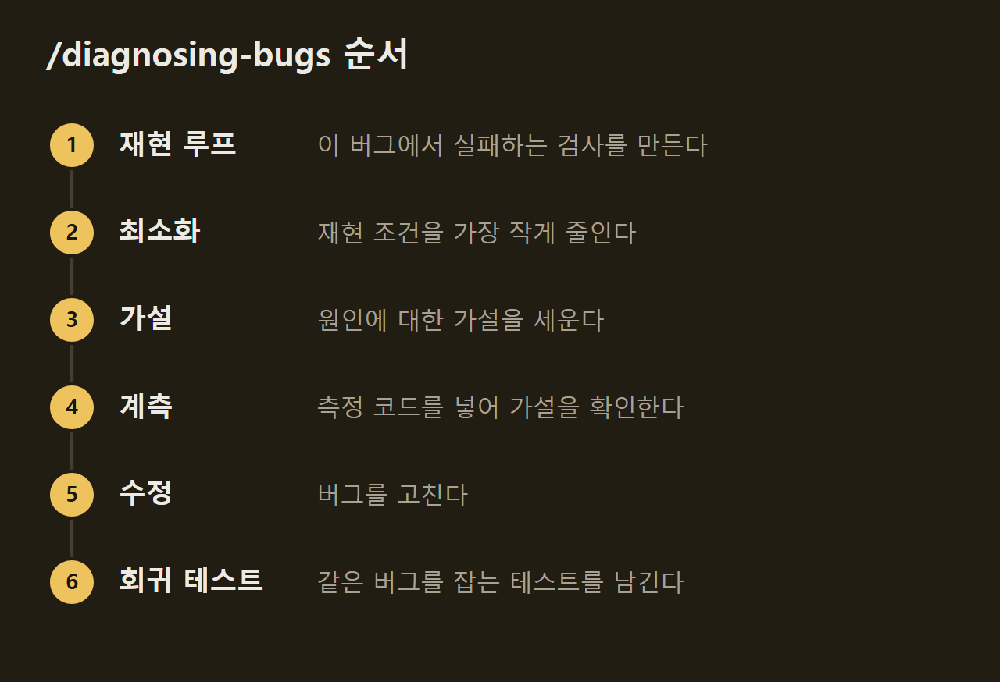
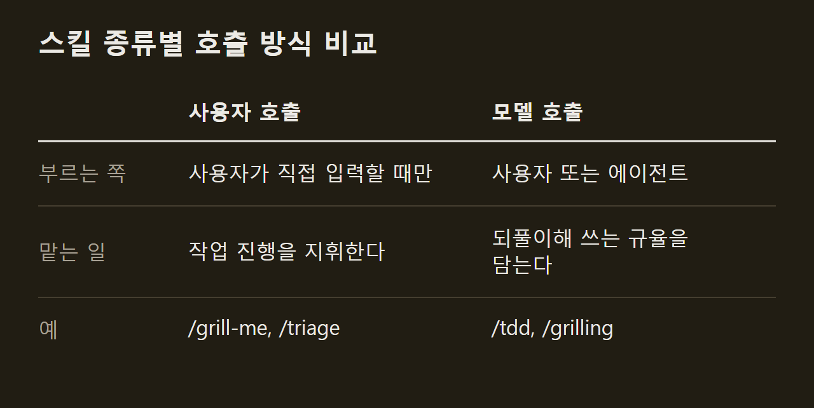

> 이 글은 아래 원문을 우리말로 간추려 정리한 글입니다. 정확한 내용은 원문을 확인하십시오.
>
> 원문: [github.com/mattpocock/skills](https://github.com/mattpocock/skills)  
> 원문을 소개한 뉴스레터: Deep Learning Weekly

코딩 에이전트에게 일을 맡기면 요청과 다른 결과물이 나오기도 하고, 코드가 빠르게 불어나 고치기 어려워지기도 한다. 개발자 Matt Pocock은 이런 실패를 줄이려고 자신이 매일 쓰는 에이전트용 스킬을 [mattpocock/skills](https://github.com/mattpocock/skills) 저장소로 공개했다. 스킬은 에이전트가 읽고 따르는 작업 지침 문서다. Claude Code, Codex, GitHub Copilot 같은 에이전트에 설치한 뒤 사용자가 /grill-me처럼 이름을 입력하거나 에이전트가 작업에 맞는 스킬을 스스로 고르면, 에이전트는 그 지침에 따라 사용자에게 질문하고 테스트를 먼저 쓰고 설계를 점검한다.

```요약
요약: mattpocock/skills는 소프트웨어 엔지니어링 원칙을 작은 스킬로 옮긴 모음으로, 여러 코딩 에이전트에서 쓸 수 있지만 오래된 코드를 대신 정리해 주지는 않는다.
```

```용어
스킬: 에이전트가 읽고 따르는 작업 지침 문서다. 사용자가 이름을 입력하거나 에이전트가 골라 실행한다.
그릴링(grilling): 에이전트가 계획에서 정해지지 않은 부분을 사용자에게 계속 묻는 질문 세션이다.
용어집: 프로젝트에서 쓰는 전문 용어와 그 뜻을 적은 문서다. 이 저장소에서는 `GLOSSARY.md`라는 파일이다.
레드-그린-리팩터(red-green-refactor): 실패하는 테스트를 먼저 쓰고, 통과시킨 뒤, 코드를 다듬는 반복이다.
깊은 모듈(deep module): 단순한 인터페이스 뒤에 많은 기능을 담은 모듈이다.
```

## 1. 작업 순서를 정하지 않는 작은 스킬

Pocock의 스킬은 개발 과정 전체를 맡지 않고, 필요한 일 하나씩을 맡도록 작게 설계됐다. GSD, BMAD, Spec-Kit 같은 기존 방식은 개발 과정을 통째로 이끌어 주지만, Pocock은 그 대가로 사용자가 과정을 통제하기 어렵고 과정 안에서 생긴 버그도 풀기 어렵다고 지적한다. 반면 그의 스킬은 고쳐 쓰기 쉽고 서로 조합할 수 있으며 어떤 모델에서도 동작한다.

설치 방식은 플러그인과 skills.sh 두 가지이고, 에이전트마다 하나만 고른다. 플러그인은 스스로 업데이트되지만, skills.sh는 수정할 수 있는 파일을 프로젝트에 복사해 두므로 사용자가 직접 업데이트해야 한다. 두 방식을 함께 쓰면 모든 스킬이 두 번씩 설치된다. 에이전트별 설치 명령은 원문에 정리되어 있다.

설치를 마치면 저장소마다 한 번 /setup-matt-pocock-skills를 실행한다. 이 스킬은 어떤 이슈 트래커(GitHub, GitLab, 로컬 파일 등)를 쓸지, 이슈를 분류할 때 어떤 라벨을 붙이는지, 만든 문서를 어디에 저장할지 사용자에게 묻는다. 여기서 정한 라벨은 이슈 분류 스킬인 /triage가 쓴다.

## 2. 작업 전 요구를 맞추는 질문 세션

Pocock이 꼽은 가장 흔한 실패는 만드는 사람과 맡기는 사람의 요구가 어긋나는 것이다. 상대가 원하는 바를 안다고 믿었다가 결과물을 보고서야 전혀 이해하지 못했다는 사실을 깨닫는 일은 사람끼리 일할 때도, 에이전트와 일할 때도 똑같이 생긴다. 이 때문에 그는 에이전트가 만들 대상에 대해 사용자에게 자세히 묻는 질문 세션, 곧 그릴링을 해법으로 내놓았다.

/grill-me는 설계에서 정해지지 않은 부분이 모두 정해질 때까지 사용자를 인터뷰하며, 코드와 관계없는 일에도 쓸 수 있다. /grill-with-docs는 같은 질문 세션을 진행하면서 문서도 함께 정리한다. 두 스킬은 저장소에서 가장 많이 쓰이며, Pocock은 변경을 할 때마다 쓰라고 권한다.

## 3. 용어집으로 맞추는 공유 언어

에이전트는 프로젝트에서 쓰는 용어를 모르면 한 단어로 될 말을 스무 단어로 풀어 쓴다. Eric Evans가 『Domain-Driven Design』에서 지적했듯이 프로젝트 초기에는 개발자와 도메인 전문가가 서로 다른 말을 쓰고, Pocock은 에이전트와 일할 때도 같은 어긋남을 겪었다. 에이전트는 대개 아무 설명 없이 프로젝트에 투입되어 그 안의 용어를 일하면서 알아내야 하기 때문이다.

그래서 Pocock은 프로젝트 용어를 풀이한 용어집을 두었다. 그의 course-video-manager 저장소에서 같은 문제를 용어집 없이 적으면 "강의의 한 섹션 안에 있는 레슨이 '실체화'될 때(파일 시스템에 자리를 얻을 때) 문제가 생긴다"가 된다. 용어집의 용어로 적으면 "materialization cascade에 문제가 있다"로 끝난다.

이 기능은 /grill-with-docs에 들어 있다. 질문 세션을 진행하면서 `GLOSSARY.md`를 고쳐 나가고, 설명하기 어려운 결정은 ADR(Architecture Decision Record) 문서에 남긴다. 공유 언어가 생기면 변수, 함수, 파일 이름이 같은 용어로 일관되게 붙으므로 에이전트가 코드베이스에서 필요한 곳을 찾기 쉬워진다. 또 더 짧은 말로 생각할 수 있어 추론에 쓰는 토큰도 줄어든다.

## 4. 피드백 루프: /tdd와 /diagnosing-bugs

요구를 맞춘 뒤에도 에이전트가 나쁜 코드를 낸다면 피드백 루프를 살펴야 한다. 자신이 만든 코드가 실제로 어떻게 돌아가는지 알려 주는 신호가 없으면 에이전트는 결과를 확인하지 못한 채 작업한다. Pocock이 꼽은 신호는 정적 타입, 브라우저 접근, 자동화 테스트다.

자동화 테스트에서는 레드-그린-리팩터 반복이 가장 중요하다. 에이전트가 실패하는 테스트를 먼저 쓰고 그 테스트가 통과하도록 코드를 고치면, 늘 같은 수준의 피드백을 받으므로 훨씬 나은 코드가 나온다. /tdd는 이 반복을 따르게 하면서 좋은 테스트와 나쁜 테스트를 가르는 지침을 주고, 기능을 세로로 자른 작은 단위(vertical slice)로 하나씩 만든다.

버그를 진단할 때는 /diagnosing-bugs를 쓴다. 이 스킬은 디버깅 모범 관행을 앞 단계를 마쳐야 다음 단계로 넘어가는 절차로 묶었고, 어려운 버그와 성능 저하에 쓴다.



## 5. 설계를 점검하는 /improve-codebase-architecture

에이전트로 만든 앱은 대부분 복잡하고 바꾸기 어렵다. 에이전트가 코딩 속도를 크게 높이는 만큼 코드가 무질서해지는 속도도 빨라지기 때문이다. Pocock은 그 해법으로 코드 설계를 챙길 것을 내세우며, "가장 좋은 모듈은 깊다"는 John Ousterhout의 말을 근거로 든다.

설계 원칙은 여러 스킬에 들어 있다. 예를 들어 /to-spec은 명세를 만들기 전에 사용자가 어떤 모듈을 건드리는지 묻고, /codebase-design은 깊은 모듈을 설계하는 공통 규율과 용어를 담고 있다.

/improve-codebase-architecture는 코드베이스에서 모듈을 더 깊게 만들 수 있는 곳을 찾아 HTML 보고서로 보여 주고, 사용자가 고른 후보를 질문 세션으로 함께 다듬는다. Pocock은 며칠에 한 번 이 스킬을 돌리라고 권한다. 다만 이 스킬은 점검 도구일 뿐 복구 도구가 아니어서, 오래된 코드베이스에서 실제 후보는 찾아도 엉킨 코드를 대신 풀어 주지는 않는다.

## 6. 스킬의 두 종류와 호출 규칙

스킬은 누가 부를 수 있느냐에 따라 사용자 호출 스킬(user-invoked)과 모델 호출 스킬(model-invoked)로 나뉜다. 사용자 호출 스킬은 사용자가 직접 입력할 때만 실행되고 작업의 진행을 지휘한다. 모델 호출 스킬은 사용자가 부를 수도 있고 작업에 맞을 때 에이전트가 스스로 골라 쓸 수도 있으며, 여러 작업에서 되풀이해 쓰는 규율을 담는다.



두 종류 사이에는 호출 규칙이 하나 있다. 사용자 호출 스킬은 모델 호출 스킬을 부를 수 있지만 다른 사용자 호출 스킬은 부르지 않는다. 예를 들어 모델 호출 스킬인 /grilling은 /grill-me, /grill-with-docs, /triage 같은 사용자 호출 스킬이 공통으로 쓰는 인터뷰 기능이다. 스킬은 코드 작업용과 일반 작업용으로도 나뉜다. 일반 작업용에는 대화를 문서로 압축해 다른 에이전트에 넘기는 /handoff, 이해되지 않은 메시지를 쉬운 말로 다시 설명하게 하는 /wait-what 등이 있다.

Pocock은 소프트웨어 엔지니어링의 기본기가 그 어느 때보다 중요하다고 보고, 이 스킬들을 그 기본기를 반복해 쓸 수 있는 작업 방식으로 압축한 결과물로 내놓았다. 스킬마다 요구 맞추기, 공유 언어 만들기, 피드백 받기, 설계 관리 가운데 한 가지 일을 맡으며, 사용자는 필요한 스킬만 골라 조합해 쓴다.

## 출처와 작성 방식

- 원문: [github.com/mattpocock/skills](https://github.com/mattpocock/skills)
- 원문을 소개한 뉴스레터: Deep Learning Weekly
- 그래프: 원문에 적힌 값으로 직접 그린 그림입니다.
- 작성 방식: 직접 만든 뉴스 정리 파이프라인(VISER)으로 생성하고 검수한 글입니다. 본문의 수치와 주장은 원문에서 가져온 것입니다.
- 정리 주차: 2026-W41
