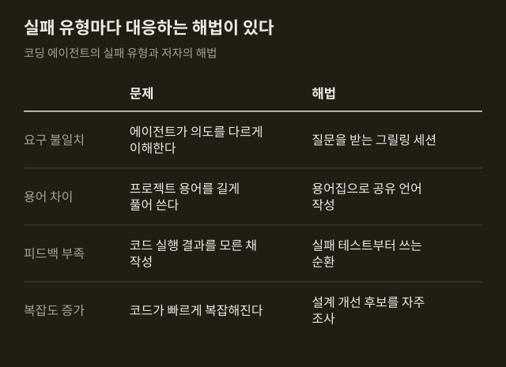
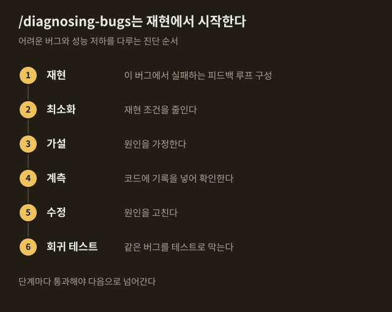
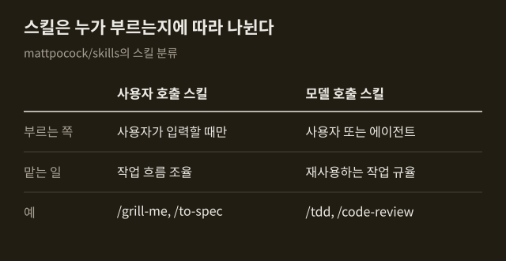

> 이 글은 아래 원문을 우리말로 간추려 정리한 글입니다. 정확한 내용은 원문을 확인하십시오.
>
> 원문: [github.com/mattpocock/skills](https://github.com/mattpocock/skills)  
> 원문을 소개한 뉴스레터: Deep Learning Weekly

코딩 에이전트에게 일을 맡기면 원한 것과 다른 결과물이 나오거나, 돌아가기는 하지만 고치기 어려운 코드가 쌓이는 일이 잦다. 개발 과정 전체를 대신 관리해 주는 GSD, BMAD, Spec-Kit 같은 방식도 있지만, Matt Pocock은 이런 방식이 개발자의 통제권을 가져가고 과정 안에서 생긴 버그를 풀기 어렵게 만든다고 본다. Pocock은 자신이 매일 쓰는 스킬을 [mattpocock/skills](https://github.com/mattpocock/skills) 저장소로 공개했다.

```요약
요약: 코딩 에이전트의 흔한 실패 유형을 질문 세션, 용어집, 테스트 주도 개발, 설계 점검 스킬로 줄이려는 저장소이며, 설계 점검 스킬은 후보를 찾아 줄 뿐 엉킨 코드를 대신 풀어 주지는 않는다.
```

```용어
스킬: 에이전트가 특정 작업을 할 때 따르도록 적어 둔 지침 파일. `/tdd`처럼 이름으로 부른다.
그릴링 세션: 작업을 시작하기 전에 에이전트가 사용자에게 계획과 설계를 세세하게 캐묻는 과정.
공유 언어: 프로젝트에서 쓰는 용어를 사람과 에이전트가 같은 뜻으로 쓰도록 정리한 것. 용어집 문서로 남긴다.
레드-그린-리팩터: 실패하는 테스트를 먼저 쓰고, 통과시키고, 코드를 다듬는 순서를 되풀이하는 개발 방식.
ADR: 설명하기 어려운 설계 결정과 그 이유를 적어 두는 문서.
```

## 1. 만든 배경과 설계 원칙

저자는 Claude Code, Codex 같은 코딩 에이전트에서 되풀이해 본 실패 유형을 고치려고 이 스킬들을 만들었다고 밝혔다. 스킬 하나하나는 작고, 고쳐 쓰기 쉽고, 서로 조합할 수 있게 설계했으며 어떤 모델에서도 동작한다고 한다. 과정을 통째로 맡기는 대신 필요한 스킬만 골라 쓰고 직접 손보라는 것이 저자의 입장이다.

설치 방식은 둘이다. 플러그인으로 설치하면 스스로 업데이트되고, `skills.sh`로 설치하면 수정할 수 있는 파일이 프로젝트에 복사되어 손으로 업데이트해야 한다. 둘을 함께 설치하면 스킬이 전부 두 번씩 들어가므로 에이전트마다 하나만 고른다. 에이전트별 설치 명령은 원문에 정리되어 있다.

설치한 뒤에는 저장소마다 한 번 설정 스킬을 실행하는데, 이때 에이전트가 묻는 것은 다음과 같다.

1. 이슈 트래커: GitHub, GitLab, 로컬 파일 등 무엇을 쓸지
2. 라벨: 티켓을 분류할 때 어떤 라벨을 붙이는지
3. 문서 위치: 만들어지는 문서를 어디에 저장할지

저자가 꼽은 실패 유형과 그에 맞춘 해법은 아래 표와 같다.



## 2. 요구 불일치와 그릴링 세션

저자는 소프트웨어 개발에서 가장 흔한 실패가 요구 불일치라고 본다. 개발자가 내 뜻을 안다고 생각했는데 결과물을 보고서야 전혀 이해하지 못했음을 알게 되는 일이고, 사람과 에이전트 사이에도 같은 의사소통 격차가 있다.

해법은 그릴링 세션이다. 작업을 시작하기 전에 에이전트가 만들려는 것을 세세하게 질문하도록 해서 양쪽의 이해를 맞춘다. ==저자는 변경을 시작할 때마다 그릴링 세션을 거치라고 권한다.== 코드가 아닌 일에는 `/grill-me`를 쓰고, 코드 작업에는 같은 질문 과정에 문서 작성을 더한 `/grill-with-docs`를 쓴다. 저자에 따르면 이 둘이 저장소에서 가장 인기 있는 스킬이다.

## 3. 공유 언어와 용어집

프로젝트 초기에는 개발자와 그 소프트웨어를 쓸 현업 전문가가 서로 다른 말을 쓴다. 에이전트도 사정이 같아서, 프로젝트에 투입된 뒤 용어를 스스로 짐작해야 하므로 한 단어면 될 말을 스무 단어로 풀어 쓴다고 저자는 설명한다.

해법은 프로젝트 용어를 정리한 용어집 문서다. 저자는 자신의 강의 영상 관리 저장소를 예로 들었다. 용어집이 없을 때는 "강의의 섹션 안에 있는 레슨이 '실제'가 될 때, 곧 파일 시스템에 자리를 받을 때 문제가 있다"라고 써야 했던 문장이, 용어집이 있으면 "materialization cascade에 문제가 있다"로 줄어든다.

`/grill-with-docs`는 그릴링 세션을 진행하면서 이 용어집을 함께 만들고, 설명하기 어려운 결정은 ADR로 기록한다. 저자가 든 효과는 문장이 짧아지는 것 말고도 더 있다. 변수, 함수, 파일 이름이 공유 언어에 맞춰 일관되게 붙으므로 에이전트가 코드베이스를 찾아다니기 쉬워지고, 간결한 말로 생각하게 되어 추론에 쓰는 토큰도 줄어든다고 한다. 다만 이 효과를 잰 수치는 자료에 없다.

## 4. 피드백 루프와 `/tdd`

무엇을 만들지 합의했는데도 품질이 나쁜 코드가 나온다면 저자는 피드백 루프를 점검하라고 한다. 자신이 쓴 코드가 실제로 어떻게 동작하는지 알 수 없으면 에이전트는 결과를 확인하지 못한 채 작업하게 된다. 필요한 피드백 수단으로는 정적 타입, 브라우저 접근, 자동화 테스트를 들었다.

자동화 테스트에서는 레드-그린-리팩터 순환이 핵심이다. 에이전트가 실패하는 테스트를 먼저 쓰고 그 테스트를 통과시키면 일정한 수준의 피드백을 계속 받게 되고, 저자는 그 결과 코드 품질이 훨씬 나아진다고 주장한다. `/tdd` 스킬은 이 순환을 유도하고 좋은 테스트와 나쁜 테스트의 기준을 에이전트에게 알려 준다.

디버깅에는 `/diagnosing-bugs`가 있다. 어려운 버그와 성능 저하를 다루는 진단 절차로, 한 단계를 마쳐야 다음 단계로 넘어가게 되어 있다.



## 5. 설계 관리와 `/improve-codebase-architecture`

저자는 에이전트로 만든 앱 대부분이 복잡하고 고치기 어렵다고 진단한다. 에이전트가 코딩 속도를 크게 높이는 만큼 코드베이스가 복잡해지는 속도도 함께 빨라지기 때문이다. 해법으로 내세운 것은 코드 설계에 신경 쓰는 일이며, 기준은 단순한 인터페이스 뒤에 많은 기능을 담는 '깊은 모듈'이다.

이 원칙은 여러 스킬에 들어 있다. `/to-spec`은 명세를 쓰기 전에 어떤 모듈을 건드리는지 사용자에게 묻는다. `/improve-codebase-architecture`는 코드베이스를 훑어 모듈을 더 깊게 만들 수 있는 후보를 찾아 HTML 보고서로 보여 주고, 사용자가 고른 후보를 놓고 그릴링 세션을 이어 간다. 저자는 며칠에 한 번씩 실행하라고 권한다.

한계도 저자가 직접 적었다. ==이 스킬은 조사 도구이며 엉킨 코드를 대신 풀어 주지 않는다.== 오래된 코드베이스에서도 실제 개선 후보는 찾아내지만, 고치는 일은 사용자에게 남는다.

## 6. 스킬의 두 종류

저장소의 스킬은 누가 부를 수 있는지에 따라 둘로 나뉜다. 사용자 호출 스킬은 사용자가 이름을 입력할 때만 실행되고 작업 흐름을 조율한다. 모델 호출 스킬은 사용자가 부를 수도 있고 작업 성격이 맞으면 에이전트가 스스로 꺼내 쓰기도 하며, 여러 곳에서 재사용하는 작업 규율을 담는다.



호출 방향에는 규칙이 있다. ==사용자 호출 스킬은 모델 호출 스킬만 부를 수 있다.== 다른 사용자 호출 스킬은 부르지 못한다. 예를 들어 질문을 끈질기게 이어 가는 `/grilling`은 모델 호출 스킬이고, `/grill-me`를 비롯한 여러 사용자 호출 스킬이 이것을 공통으로 쓴다.

스킬은 코드 작업용과 일반 업무용으로도 나뉜다. 코드 작업용에는 명세를 티켓으로 쪼개는 스킬, 명세대로 구현하고 코드 리뷰로 마무리하는 스킬, 세션이 끝난 뒤 에이전트 작업 환경의 개선점을 제안하는 스킬 등이 있다. 일반 업무용에는 대화를 인계 문서로 압축하는 스킬과 여러 세션에 걸쳐 개념을 가르치는 스킬 등이 들어 있다. 전체 목록과 스킬별 설명은 원문에 있다.

## 출처와 작성 방식

- 원문: [github.com/mattpocock/skills](https://github.com/mattpocock/skills)
- 원문을 소개한 뉴스레터: Deep Learning Weekly
- 그래프: 원문에 적힌 값으로 새로 그린 그림입니다. 원문에 실린 그림이 아닙니다.
- 작성 방식: 직접 만든 뉴스 정리 파이프라인(VISER)으로 생성하고 검수한 글입니다. 본문의 수치와 주장은 원문에서 가져온 것입니다.
- 정리 주차: 2026-W41
