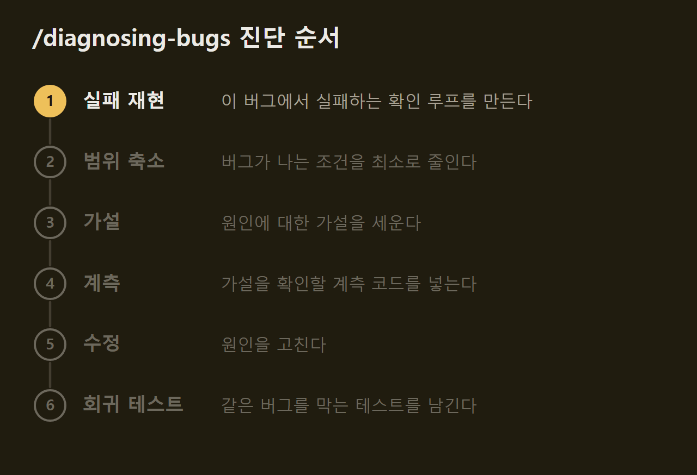
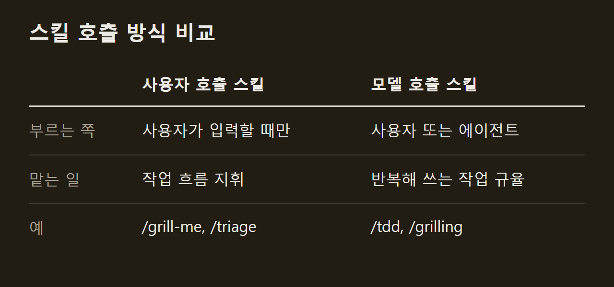

> 이 글은 아래 원문을 우리말로 간추려 정리한 글입니다. 정확한 내용은 원문을 확인하십시오.
>
> 원문: [github.com/mattpocock/skills](https://github.com/mattpocock/skills)  
> 원문을 소개한 뉴스레터: Deep Learning Weekly

Claude Code, Codex, GitHub Copilot 같은 코딩 에이전트에 말로 요청하면 코드를 대신 써 준다. 그러나 요청을 잘못 알아듣거나, 돌려 보지 않은 코드를 내놓거나, 코드베이스를 점점 복잡하게 만드는 일이 흔하다. Matt Pocock은 이런 실패를 줄이려고 자신이 매일 쓰는 스킬을 [mattpocock/skills](https://github.com/mattpocock/skills) 저장소로 공개했다. 스킬은 에이전트가 읽고 따르는 작업 지침 문서다. 사용자가 `/grill-me`처럼 이름을 입력하거나 에이전트가 상황에 맞다고 판단하면, 에이전트는 그 지침에 따라 사용자에게 질문을 던지거나 테스트를 먼저 쓰거나 코드 구조를 점검한다.

```요약
요약: 에이전트와의 이해 차이, 용어 혼란, 피드백 부족, 설계 붕괴를 각각 겨냥한 작은 스킬 모음으로, 어떤 모델에서도 쓸 수 있지만 설계 점검 스킬은 엉킨 코드를 직접 풀어 주지 않는다.
```

```용어
스킬: 에이전트가 특정 작업을 할 때 따르는 지침 문서다. 사용자가 이름으로 부르거나 에이전트가 스스로 꺼내 쓴다.
그릴링 세션: 에이전트가 사용자에게 만들려는 것을 자세히 캐물어 설계에서 정해지지 않은 부분을 모두 메우는 대화다.
용어집: 프로젝트에서 쓰는 전문 용어와 그 뜻을 적은 문서다. 이 저장소에서는 `GLOSSARY.md` 파일로 둔다.
ADR: 말로 설명하기 어려운 설계 결정을 기록해 두는 문서다.
깊은 모듈: 간단한 인터페이스 뒤에 많은 기능을 담아, 적은 진입점으로 많은 일을 할 수 있게 한 모듈이다.
```

## 1. 설계 방향과 설치 방식

GSD, BMAD, Spec-Kit 같은 기존 방법은 개발 과정 전체를 도구가 맡아 끌고 간다. Pocock은 이런 방식이 사용자에게서 통제권을 가져가고, 과정 안에서 생긴 버그를 풀기 어렵게 만든다고 본다. 그래서 스킬은 작게 만들었고, 사용자가 고쳐 쓰거나 서로 조합하기 쉽게 했으며, 어떤 모델에서도 돌아가게 했다. ==스킬은 과정을 대신 쥐지 않고 조합해 쓰는 작은 도구다.==

설치 방법은 두 가지다. 플러그인으로 설치하면 스킬이 스스로 업데이트된다. `skills.sh`로 설치하면 고칠 수 있는 파일이 프로젝트에 복사되지만, 업데이트는 손으로 해야 한다. 한 에이전트에 두 방법을 모두 쓰면 모든 스킬이 두 번씩 잡히므로 하나만 고른다. 에이전트별 설치 명령은 원문에 정리되어 있다.

설치를 마치면 저장소마다 한 번 `/setup-matt-pocock-skills`를 실행한다. 이 스킬은 다음 세 가지를 묻는다.

1. 이슈 트래커: GitHub, GitLab, 로컬 파일 가운데 무엇을 쓸지, 또는 그 밖의 무엇을 쓸지
2. 분류 라벨: 이슈를 분류할 때 어떤 라벨을 붙이는지(`/triage`가 이 라벨을 쓴다)
3. 문서 위치: 스킬이 만드는 문서를 어디에 저장할지

## 2. 이해 차이를 줄이는 그릴링

Pocock은 소프트웨어 개발에서 가장 흔한 실패로 서로 원하는 것이 어긋나는 상황을 꼽는다. 개발자가 내 뜻을 안다고 믿었는데, 결과물을 보고 나서야 상대가 전혀 이해하지 못했다는 것을 알게 되는 경우다. 상대가 AI 에이전트여도 사정은 같다. 그래서 그는 그릴링 세션을 해법으로 내놓는다. 에이전트가 사용자에게 만들려는 것을 자세히 묻게 하는 방식이다.

`/grill-me`는 코드와 관계없는 일에도 쓰는 기본형이다. `/grill-with-docs`는 여기에 다음 절에서 다룰 용어 정리 기능을 더했다. 두 스킬은 저장소에서 가장 인기가 많고, Pocock은 무언가를 바꾸기 전마다 이 스킬로 에이전트와 생각을 맞추라고 권한다.

## 3. 용어집으로 맞추는 공용어

이 스킬은 Eric Evans의 도메인 주도 설계에서 나온 생각을 따른다. 프로젝트 초기에는 개발자와, 그 소프트웨어를 쓸 현업 전문가가 서로 다른 말을 쓴다. 에이전트도 프로젝트에 갑자기 투입되어 전문 용어를 일하면서 짐작으로 익히기 때문에, 한 단어면 될 말을 스무 단어로 늘어놓는다. 해법은 프로젝트 용어를 풀어 둔 용어집이다.

원문은 Pocock의 강의 영상 관리 저장소에서 예를 가져온다. 용어집이 없을 때는 "강좌의 한 섹션 안에 있는 레슨이 '실제'가 될 때, 즉 파일 시스템에 자리를 얻을 때 문제가 생긴다"라고 길게 써야 한다. 용어집이 있으면 같은 내용을 "materialization cascade에 문제가 있다"로 줄여 쓸 수 있다. ==공용어가 있으면 같은 말을 훨씬 짧게 주고받는다.==

`/grill-with-docs`는 그릴링을 하는 동안 용어집과 ADR을 함께 써 나간다. Pocock은 이것을 저장소에서 가장 강력한 기법일지도 모른다고 적었다. 그가 꼽은 공용어의 이점은 다음 세 가지다.

1. 일관된 이름: 변수, 함수, 파일 이름이 공용어에 맞춰 붙는다
2. 쉬운 탐색: 이름이 일관되니 에이전트가 코드베이스에서 필요한 곳을 찾기 쉬워진다
3. 토큰 절약: 말이 간결해지므로 에이전트가 생각하는 데 쓰는 토큰이 줄어든다

## 4. 피드백 루프와 테스트 주도 개발

만들 것을 맞춘 뒤에도 에이전트가 형편없는 코드를 내놓을 수 있다. Pocock은 그 원인을 피드백 루프에서 찾는다. 자기가 쓴 코드가 실제로 어떻게 돌아가는지 확인할 수단이 없으면 에이전트는 결과를 모르는 채로 코드를 쓴다. 그래서 정적 타입, 브라우저 접근, 자동 테스트를 갖춰야 한다고 말한다.

자동 테스트에서는 레드-그린-리팩터 루프가 핵심이다. 에이전트가 실패하는 테스트를 먼저 쓰고, 그다음 그 테스트가 통과하도록 코드를 고치는 방식이다. Pocock은 이렇게 하면 에이전트가 고른 수준의 피드백을 계속 받으므로 코드가 훨씬 좋아진다고 설명한다. `/tdd`는 에이전트가 이 루프를 따르게 하고, 좋은 테스트와 나쁜 테스트를 구별하는 기준도 함께 알려 준다.

디버깅에는 `/diagnosing-bugs`를 쓴다. 검증된 디버깅 습관을 정해진 순서로 정리한 스킬이고, 각 단계를 통과해야 다음 단계로 넘어간다. 까다로운 버그와 성능 저하에 쓴다.



## 5. 설계를 지키는 스킬

Pocock에 따르면 에이전트로 만든 앱은 대개 복잡하고 고치기 어렵다. 에이전트가 코딩 속도를 크게 높이는 만큼 소프트웨어가 무질서해지는 속도도 빨라지므로, 코드베이스가 전에 없던 속도로 복잡해진다는 것이다. 그가 내놓은 해법은 코드 설계에 신경 쓰는 것이다. Kent Beck의 "매일 시스템 설계에 투자하라"는 말과, 좋은 모듈은 깊은 모듈이라는 John Ousterhout의 말을 근거로 든다.

이 원칙은 여러 스킬에 들어 있다. `/to-spec`은 명세를 만들기 전에 사용자가 어떤 모듈을 건드리는지 묻는다. `/improve-codebase-architecture`는 코드베이스를 훑어 모듈을 더 깊게 만들 수 있는 후보를 찾아 HTML 보고서로 보여 주고, 사용자가 고른 후보를 두고 그릴링을 이어 간다. Pocock은 이 스킬을 며칠에 한 번씩 돌리라고 권한다.

다만 그는 이 스킬이 하는 일을 '구조'가 아니라 '조사'라고 선을 그었다. 정말 오래된 코드베이스에서도 실제로 손볼 후보는 찾아내지만, ==엉킨 코드를 대신 풀어 주지는 않는다.==

## 6. 호출 주체에 따른 두 종류

스킬은 누가 부를 수 있느냐에 따라 두 종류로 나뉜다. 사용자 호출 스킬은 사용자가 이름을 입력할 때만 실행되고 작업 흐름 전체를 지휘한다. 모델 호출 스킬은 사용자가 직접 부를 수도 있고, 작업에 맞으면 에이전트가 스스로 꺼내 쓰기도 한다. 여러 번 다시 쓰는 작업 규율이 여기에 들어간다.



사용자 호출 스킬은 모델 호출 스킬을 부를 수 있지만, 다른 사용자 호출 스킬은 부르지 않는다. 예를 들어 질문을 던지는 인터뷰 기능은 모델 호출 스킬인 `/grilling` 하나에 들어 있고, 앞에서 본 그릴링 스킬들과 `/triage` 등이 이 스킬을 가져다 쓴다. 저장소에는 대화를 다른 에이전트에게 넘길 인수인계 문서를 만드는 스킬처럼 코드와 관계없는 일반 작업용 스킬도 있으며, 전체 목록과 설명은 원문에 있다.

## 출처와 작성 방식

- 원문: [github.com/mattpocock/skills](https://github.com/mattpocock/skills)
- 원문을 소개한 뉴스레터: Deep Learning Weekly
- 그래프: 원문에 적힌 값으로 직접 그린 그림입니다.
- 작성 방식: 직접 만든 뉴스 정리 파이프라인(VISER)으로 생성하고 검수한 글입니다. 본문의 수치와 주장은 원문에서 가져온 것입니다.
- 정리 주차: 2026-W41
