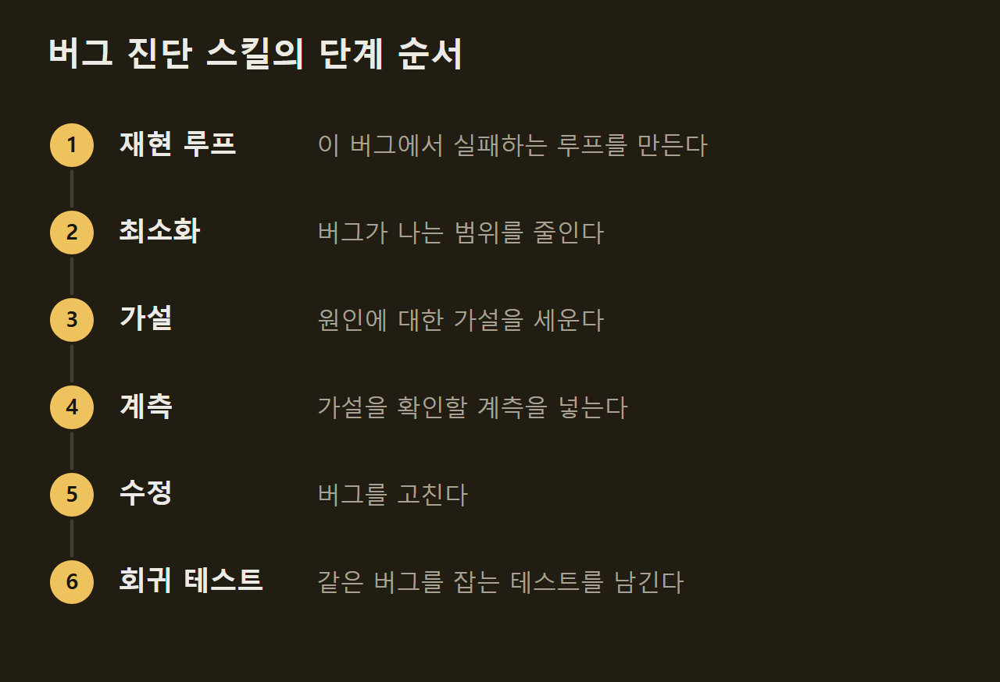
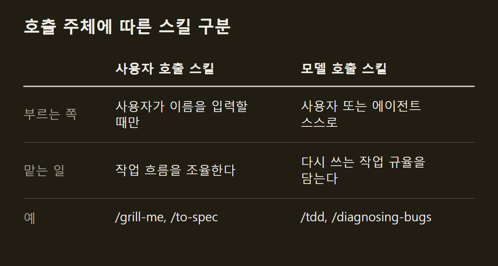

> 이 글은 아래 원문을 우리말로 간추려 정리한 글입니다. 정확한 내용은 원문을 확인하십시오.
>
> 원문: [github.com/mattpocock/skills](https://github.com/mattpocock/skills)  
> 원문을 소개한 뉴스레터: Deep Learning Weekly

Claude Code나 Codex 같은 코딩 에이전트에게 개발을 맡기면 사람이 원한 것과 다른 코드가 나오거나 코드베이스가 빠르게 복잡해지는 일이 흔하다. Matt Pocock은 이런 실패를 줄이려고 자신이 매일 쓰는 스킬을 [mattpocock/skills](https://github.com/mattpocock/skills) 저장소로 공개했다. 스킬은 에이전트가 특정 작업에서 따를 절차를 적은 파일이다. 사용자가 `/grill-me`처럼 이름을 입력해 부르거나, 작업에 맞으면 에이전트가 스스로 불러 쓴다.

```요약
요약: mattpocock/skills는 `/grill-me` 같은 질문 세션, 테스트 주도 개발, 설계 점검을 작은 스킬로 나눠 코딩 에이전트의 흔한 실패를 줄이는 모음이고, 설계 점검 스킬 `/improve-codebase-architecture`는 개선 후보를 찾아 줄 뿐 오래된 코드를 대신 정리하지는 않는다.
```

```용어
스킬: 에이전트가 특정 작업에서 따를 절차를 적은 파일이다. 사용자가 이름을 입력해 부르거나 에이전트가 스스로 불러 쓴다.
그릴링 세션: 에이전트가 사용자에게 무엇을 만들려는지 자세히 캐묻는 대화다.
공유 언어: 사람과 에이전트가 프로젝트의 개념을 같은 낱말로 부르도록 정리한 말이다. 용어집 문서에 적어 둔다.
레드-그린-리팩터: 실패하는 테스트를 먼저 쓰고 그 테스트가 통과하도록 코드를 고치는 개발 순환이다.
깊은 모듈: 단순한 인터페이스 뒤에 많은 기능을 담은 모듈이다.
```

## 1. 작업 순서를 정하지 않는 작은 스킬

이 스킬들은 개발 과정 전체를 떠맡지 않는다. 그 대신 작고 고쳐 쓰기 쉬우며, 서로 조합해 쓸 수 있게 만들어졌다. GSD, BMAD, Spec-Kit 같은 방식은 과정 전체를 맡아 개발을 돕지만, 그 때문에 사용자가 통제권을 잃고 과정 안에서 생긴 버그를 풀기 어려워진다. 반면 이 스킬들은 수십 년의 엔지니어링 경험을 바탕으로 하며 어떤 모델에서도 동작한다.

설치 방식은 플러그인과 skills.sh 가운데 하나를 고른다. 플러그인은 스스로 업데이트되고, skills.sh는 편집할 수 있는 파일을 프로젝트에 복사하므로 업데이트를 사람이 직접 해야 한다. 두 방식을 함께 쓰면 모든 스킬이 두 번씩 설치되므로 에이전트마다 한 방식만 쓴다. Claude Code, Codex, GitHub Copilot, Gemini CLI 같은 에이전트별 설치 명령은 원문에 정리되어 있다.

설치한 뒤에는 저장소마다 한 번 `/setup-matt-pocock-skills`를 실행한다. 이 스킬은 어떤 이슈 트래커(GitHub, GitLab, 로컬 파일 등)를 쓸지, 이슈를 분류할 때 어떤 라벨을 붙이는지, 만든 문서를 어디에 저장할지를 묻는다. 이때 정한 라벨은 이슈를 분류하는 `/triage`가 쓴다.

## 2. 요구를 맞추는 그릴링 세션

Matt Pocock은 소프트웨어 개발에서 가장 흔한 실패가 무엇을 만들지에 대한 이해가 어긋나는 데서 생긴다고 본다. 개발자가 내 뜻을 안다고 생각했는데 결과물을 보고서야 전혀 이해하지 못했다는 사실을 알게 되는 경우가 그렇다. AI 에이전트와 일할 때도 사람과 에이전트 사이에 같은 의사소통 격차가 생긴다.

이 격차를 메우는 방법은 그릴링 세션(grilling session)이다. 에이전트가 무엇을 만들려는지 사용자에게 자세히 캐묻게 하면, 작업을 시작하기 전에 서로의 이해가 맞춰지고 사용자도 바꾸려는 내용을 깊이 따져 보게 된다. 코드가 아닌 일에는 `/grill-me`를 쓰고, `/grill-with-docs`는 같은 질문 세션에 용어집과 설계 결정 기록을 갱신하는 기능을 더한다. 두 스킬은 저장소에서 가장 많이 쓰이며, Matt Pocock은 변경을 시작할 때마다 이 스킬을 쓰라고 권한다.

## 3. 공유 언어를 담은 용어집

에이전트는 프로젝트의 전문 용어를 모르는 채로 일을 시작한다. 대개 프로젝트에 투입되자마자 그 안의 용어를 일하면서 알아내야 하고, 이 때문에 1단어면 될 말을 20단어로 풀어 쓴다. 사람끼리도 같은 문제가 있어서, 프로젝트 초기에는 개발자와 도메인 전문가가 서로 다른 말을 쓰곤 한다. 에릭 에반스는 『도메인 주도 설계』에서 대화와 코드가 같은 도메인 모델에서 나오는 보편 언어(ubiquitous language)를 그 해법으로 내놓았다.

이 저장소의 해법은 공유 언어(shared language)다. 공유 언어는 프로젝트의 용어를 에이전트가 해독할 수 있게 정리한 문서다. 예를 들어 course-video-manager 저장소에서 "강좌의 한 섹션 안에 있는 레슨이 '실제'가 될 때, 즉 파일 시스템에 자리를 얻을 때 문제가 생긴다"라고 길게 쓰던 문장은, 용어집을 둔 뒤 "materialization cascade에 문제가 있다"로 짧아졌다. 이렇게 줄인 표현은 세션을 거듭할 때마다 이득이 된다.

`/grill-with-docs`는 질문 세션을 진행하면서 AI와 함께 공유 언어를 만든다. 설명하기 어려운 결정은 설계 결정 기록(ADR)에 남긴다. Matt Pocock은 이것이 저장소에서 가장 쓸모 있는 기법일 수 있다고 평가한다.

공유 언어로 얻는 이점은 말이 짧아지는 것만이 아니다. 변수, 함수, 파일 이름이 공유 언어에 맞춰 일관되게 붙으므로 에이전트가 코드베이스를 탐색하기 쉬워진다. 또 더 간결한 언어로 생각할 수 있어서 에이전트가 생각하는 데 쓰는 토큰도 줄어든다.

## 4. 피드백 루프와 테스트 주도 개발

무엇을 만들지 합의한 뒤에도 에이전트가 질 낮은 코드를 내놓는다면, Matt Pocock은 피드백 루프를 원인으로 본다. 자기가 만든 코드가 실제로 어떻게 동작하는지 피드백을 받지 못하면 에이전트는 결과를 확인하지 않은 채 작업하게 된다. 따라서 정적 타입, 브라우저 접근, 자동화 테스트처럼 흔히 쓰는 피드백 수단을 갖춰야 한다.

자동화 테스트에서는 레드-그린-리팩터(red-green-refactor) 루프가 핵심이다. 에이전트가 실패하는 테스트를 먼저 쓰고 그 테스트가 통과하도록 코드를 고치면, 일정한 수준의 피드백을 계속 받으므로 훨씬 나은 코드가 나온다. `/tdd`는 에이전트가 이 루프를 따르게 하고, 좋은 테스트와 나쁜 테스트를 가르는 기준을 자세히 알려 준다. 기능 추가와 버그 수정은 한 번에 수직 단면(vertical slice) 하나씩 진행한다.

디버깅에는 `/diagnosing-bugs`를 쓴다. 이 스킬은 좋은 디버깅 관행을 단계마다 통과 조건을 둔 루프로 정리한 것이고, 어려운 버그와 성능 저하를 진단할 때 쓴다.



## 5. 코드 설계를 돌보는 스킬과 그 한계

에이전트로 만든 앱은 대부분 복잡하고 바꾸기 어렵다. 에이전트가 코딩 속도를 크게 높이는 만큼, 코드가 점점 무질서해지는 소프트웨어 엔트로피도 빠르게 쌓이기 때문이다. 이에 맞서 이 스킬들은 코드의 설계를 신경 쓰는 원칙을 모든 층에 반영했다. 켄트 벡은 이 원칙을 "날마다 시스템 설계에 투자하라"는 말로 표현했다.

설계의 기준은 존 오스터하우트가 말한 깊은 모듈(deep module)이다. 깊은 모듈은 단순한 인터페이스로 많은 기능을 쓸 수 있게 한다. `/codebase-design`은 이런 모듈을 깔끔한 경계에 두고 그 인터페이스로 테스트하게 하는 설계 규율과 어휘를 담았다. `/to-spec`은 명세를 만들기 전에 사용자가 어떤 모듈을 건드리는지 묻는다.

설계 점검에서 가장 중요한 스킬은 `/improve-codebase-architecture`다. 이 스킬은 코드베이스에서 모듈을 더 깊게 만들 기회를 찾아 HTML 보고서로 보여 주고, 사용자가 고른 후보 하나를 두고 질문 세션을 이어 간다. Matt Pocock은 며칠에 한 번 이 스킬을 실행하기를 권한다. 다만 이 스킬은 후보를 조사할 뿐 코드를 고치지는 않으므로, 오래된 코드베이스에서도 실제 후보는 찾아내지만 정리되지 않은 코드를 대신 풀어 주지는 않는다.

## 6. 호출 주체에 따른 두 종류의 스킬

저장소의 스킬은 누가 부를 수 있느냐에 따라 나뉜다. 사용자 호출 스킬은 사용자가 `/grill-me`처럼 직접 입력할 때만 실행되고, 여러 작업의 흐름을 조율한다. 반면 모델 호출 스킬은 사용자가 부를 수도 있고 작업에 맞으면 에이전트가 스스로 불러 쓰며, 여러 작업에서 다시 쓰는 규율을 담는다. 사용자 호출 스킬은 모델 호출 스킬을 부를 수 있지만 다른 사용자 호출 스킬은 부르지 않는다.



코드 작업에 쓰는 사용자 호출 스킬은 계획에서 구현까지의 일을 맡는다.

- `/to-spec`: 지금까지 나눈 대화를 명세로 정리해 이슈 트래커에 올린다.
- `/to-tickets`: 계획이나 명세를 작은 티켓 여러 개로 나누고, 티켓마다 어떤 티켓이 끝나야 시작할 수 있는지 밝힌다.
- `/implement`: 명세나 티켓에 적힌 작업을 구현하고, 커밋하기 전에 `/code-review`로 검토를 마친다.
- `/wayfinder`: 에이전트 세션 하나로 감당할 수 없는 큰 작업을 결정할 일의 티켓으로 나눠 이슈 트래커에 올리고, 하나씩 해결한다.

모델 호출 스킬인 `/code-review`는 저장소의 코딩 표준을 지켰는지와 원래 명세를 충실히 구현했는지를 병렬 서브에이전트로 따로 검토해서, 한쪽 판단이 다른 쪽에 섞이지 않게 한다. 코드와 상관없는 일반 작업용 스킬도 있다. 예를 들어 `/handoff`는 지금까지의 대화를 인계 문서로 압축해 다른 에이전트가 작업을 이어받게 한다.

Matt Pocock은 소프트웨어 엔지니어링의 기본기가 어느 때보다 중요하다고 보고, 그 기본기를 반복할 수 있는 작업 방식으로 압축해 이 스킬들을 만들었다. 질문 세션으로 요구를 맞추고, 공유 언어로 용어를 통일하고, 테스트로 피드백을 받고, 설계 개선 후보를 주기적으로 찾는 일이 그 작업 방식이다.

## 출처와 작성 방식

- 원문: [github.com/mattpocock/skills](https://github.com/mattpocock/skills)
- 원문을 소개한 뉴스레터: Deep Learning Weekly
- 그래프: 원문에 적힌 값으로 직접 그린 그림입니다.
- 작성 방식: 직접 만든 뉴스 정리 파이프라인(VISER)으로 생성하고 검수한 글입니다. 본문의 수치와 주장은 원문에서 가져온 것입니다.
- 정리 주차: 2026-W41
